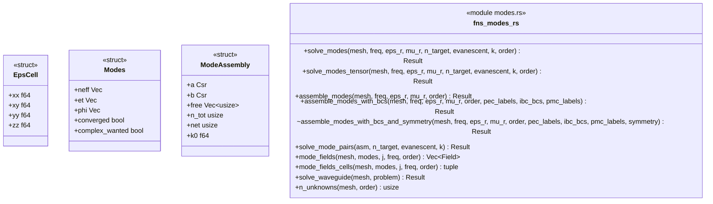

# Mode kernel: code

C4 level 4 (code) of the component **Mode kernel** (`ems.modes`) in the container **nyx-ems** (crate `nyx_ems`). [Component view of the container](../../3-components/ems.md) · [All code pages](../README.md)

> Full-vector mode analysis of a 2D waveguide cross-section (inhomogeneous media allowed).

**Decisions:** [ADR 45](../../../adr/0045-ems-moves-into-nyx-ems.md), [ADR 9](../../../adr/0009-kernels-are-three-stages.md)  
**Size:** 1 file, 526 lines.

## Files

| File | Lines | What it says about itself |
|---|---:|---|
| `crates/nyx-ems/src/modes.rs` | 526 |  |

## What it uses

| Target | Modules | Items |
|---|---|---|
| [container `femcore` (femcore)](../../3-components/femcore.md) | edge, fem, fields, linalg::arnoldi_real, linalg::csr, linalg::csr::assembly, linalg::driver, optical +3 | C0, CCoo, CellFields, Coo, EigOpts, RCsr, TensorKind, c, cell_data, edge_basis +7 |
| [container `physics` (nyx-physics)](../../3-components/physics.md) | crate root, result | Discretisation, Field, Scalar, Solution, SolveResult, cell_fields_of |
| [Thin-film IBC and Josephson ROM](./ibc.md) | ibc | add_ibc_2d_waveguide, pec_edges_and_nodes_2d |
| [Complex-mode kernel](./modescx.md) | modes_complex | compute_waveguide_2d_metrics, solve_waveguide_complex |
| [Optical mode sets](./optical.md) | optical | mode_frame |
| [Typed problem](./problem.md) | problem | Problem, Study, SurfaceImpedanceBc, Symmetry, pec_edges_and_nodes_2d_with_symmetry |

## Used by

| Component | Modules | Items |
|---|---|---|
| [Physics adapter](./adapter.md) | crate root, modes | C0, EpsCell, ModeAssembly, Modes, assemble_modes, assemble_modes_with_bcs, mode_fields, mode_fields_cells +5 |
| [Axisymmetric kernel](./axisym.md) | crate root | C0 |
| [3D cavity kernel](./cavity.md) | crate root | C0 |
| [Driven frequency-domain and PROM](./driven.md) | crate root, modes | C0, EpsCell, assemble_modes_with_bcs, solve_mode_pairs |
| [Thin-film IBC and Josephson ROM](./ibc.md) | crate root | C0 |
| [Complex-mode kernel](./modescx.md) | crate root | C0 |
| [Optical mode sets](./optical.md) | modes | EpsCell, Modes, solve_modes_tensor |
| [Typed problem](./problem.md) | crate root | C0 |

## Class diagram

Public types with their public fields (or variants) and methods, free functions per file as a `module` box; arrows are field types and `impl Trait`. Capped at 36 types and a few members each; the table below is complete.

## Public items

| Kind | Item | File:line | Signature or summary |
|---|---|---|---|
| struct | `EpsCell` | `modes.rs:44` | fields: `xx`, `xy`, `yy`, `zz` —  Relative permittivity of one cell in the local axes (lateral x, normal y, propagation z): the transverse 2x2 block (xx, xy, yy) and zz. The |
| struct | `Modes` | `modes.rs:51` | fields: `neff`, `et`, `phi`, `converged`, `complex_wanted` |
| fn | `solve_modes` | `modes.rs:67` | `pub fn solve_modes( mesh: &Discretisation, freq: f64, eps_r: &[f64], mu_r: &[f64], n_target: f64, evanescent: bool, k: usize, order: usize, ) -> Result<Modes, String>` —  Modes nearest the effective index `n_target` (real, or imaginary if `evanescent`) at |
| fn | `solve_modes_tensor` | `modes.rs:83` | `pub fn solve_modes_tensor( mesh: &Discretisation, freq: f64, eps_r: &[EpsCell], mu_r: &[f64], n_target: f64, evanescent: bool, k: usize, order: usize, ) -> Result<Modes, String>` —  As `solve_modes` with a permittivity tensor per cell. |
| struct | `ModeAssembly` | `modes.rs:99` | fields: `a`, `b`, `free`, `n_tot`, `net`, `k0` —  Stage 1 of the real mode solver: the generalized eigenproblem `A x = lambda B x` (`lambda = -beta^2`) of the |
| fn | `assemble_modes` | `modes.rs:111` | `pub fn assemble_modes( mesh: &Discretisation, freq: f64, eps_r: &[EpsCell], mu_r: &[f64], order: usize, ) -> Result<ModeAssembly, String>` |
| fn | `assemble_modes_with_bcs` | `modes.rs:121` | `pub fn assemble_modes_with_bcs( mesh: &Discretisation, freq: f64, eps_r: &[EpsCell], mu_r: &[f64], order: usize, pec_labels: &[i32], ibc_bcs: &[SurfaceImpedanceBc], pmc_labels: &[i32], ) -> Result<ModeAssembly, String>` |
| fn | `assemble_modes_with_bcs_and_symmetry` | `modes.rs:144` | `pub(crate) fn assemble_modes_with_bcs_and_symmetry( mesh: &Discretisation, freq: f64, eps_r: &[EpsCell], mu_r: &[f64], order: usize, pec_labels: &[i32], ibc_bcs: &[SurfaceImpedanceBc], pmc_labels: &[i32], symmetry: Symmetry, ) -> Result<ModeAssembly, String>` |
| fn | `solve_mode_pairs` | `modes.rs:298` | `pub fn solve_mode_pairs(asm: &ModeAssembly, n_target: f64, evanescent: bool, k: usize) -> Result<Modes, String>` —  Stage 2: the `k` eigenpairs nearest the effective index `n_target` (real, or imaginary if `evanescent`), sorted by |
| fn | `mode_fields` | `modes.rs:332` | `pub fn mode_fields(mesh: &Discretisation, modes: &Modes, j: usize, freq: f64, order: usize) -> Vec<Field>` —  Nodal fields of one mode: transverse and longitudinal field at every dof (node average of |
| fn | `mode_fields_cells` | `modes.rs:338` | `pub fn mode_fields_cells( mesh: &Discretisation, modes: &Modes, j: usize, freq: f64, order: usize, ) -> (Vec<Field>, CellFields)` —  Stage 3: `mode_fields` and, next to them, the components `Ex`, `Ez` (in the plane) and `Ey` (along the guide) at the |
| fn | `solve_waveguide` | `modes.rs:423` | `pub fn solve_waveguide(mesh: &Discretisation, problem: &Problem) -> Result<SolveResult, String>` —  The guided modes of a 2D cross-section for a `Modes` study: stages 1 to 3 of the real solver, or the complex solver (`modes_complex`) |
| fn | `n_unknowns` | `modes.rs:523` | `pub fn n_unknowns(mesh: &Discretisation, order: usize) -> usize` —  Number of edge-element dofs plus phi dofs (for reporting). |
