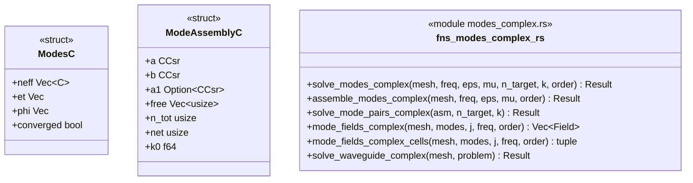

# Complex-mode kernel: code

C4 level 4 (code) of the component **Complex-mode kernel** (`ems.modescx`) in the container **nyx-ems** (crate `nyx_ems`). [Component view of the container](../../3-components/ems.md) · [All code pages](../README.md)

> Complex-valued mode analysis: lossy media and perfectly matched layers.

**Decisions:** [ADR 45](../../../adr/0045-ems-moves-into-nyx-ems.md)  
**Size:** 1 file, 466 lines.

## Files

| File | Lines | What it says about itself |
|---|---:|---|
| `crates/nyx-ems/src/modes_complex.rs` | 466 |  |

## What it uses

| Target | Modules | Items |
|---|---|---|
| [container `femcore` (femcore)](../../3-components/femcore.md) | edge, fem, fields, linalg::csr, linalg::csr::assembly, linalg::driver, optical, progress +1 | C, CCoo, CCsr, CellFields, EpsC, MuC, c, cell_data, cell_materials, check +7 |
| [container `physics` (nyx-physics)](../../3-components/physics.md) | crate root, result | Discretisation, Field, Scalar, Solution, SolveResult, cell_fields_of |
| [Mode kernel](./modes.md) | crate root | C0 |
| [Optical mode sets](./optical.md) | optical | mode_frame |
| [Typed problem](./problem.md) | problem | Problem, Study |

## Used by

| Component | Modules | Items |
|---|---|---|
| [Physics adapter](./adapter.md) | modes_complex | ModeAssemblyC, ModesC, assemble_modes_complex, mode_fields_complex, mode_fields_complex_cells, solve_mode_pairs_complex, solve_modes_complex, solve_waveguide_complex |
| [Mode kernel](./modes.md) | modes_complex | solve_waveguide_complex |
| [Optical mode sets](./optical.md) | modes_complex | ModesC, solve_modes_complex |

## Class diagram

Public types with their public fields (or variants) and methods, free functions per file as a `module` box; arrows are field types and `impl Trait`. Capped at 36 types and a few members each; the table below is complete.

## Public items

| Kind | Item | File:line | Signature or summary |
|---|---|---|---|
| struct | `ModesC` | `modes_complex.rs:49` | fields: `neff`, `et`, `phi`, `converged` |
| fn | `solve_modes_complex` | `modes_complex.rs:57` | `pub fn solve_modes_complex( mesh: &Discretisation, freq: f64, eps: &[EpsC], mu: &[MuC], n_target: C, k: usize, order: usize, ) -> Result<ModesC, String>` —  Modes with complex effective index nearest `n_target` (complex). |
| struct | `ModeAssemblyC` | `modes_complex.rs:72` | fields: `a`, `b`, `a1`, `free`, `n_tot`, `net`, `k0` —  Stage 1 of the complex mode solver: `A x = lambda B x` (`lambda = -beta^2`) on the free dofs, plus the part of `A` |
| fn | `assemble_modes_complex` | `modes_complex.rs:83` | `pub fn assemble_modes_complex( mesh: &Discretisation, freq: f64, eps: &[EpsC], mu: &[MuC], order: usize, ) -> Result<ModeAssemblyC, String>` |
| fn | `solve_mode_pairs_complex` | `modes_complex.rs:236` | `pub fn solve_mode_pairs_complex(asm: &ModeAssemblyC, n_target: C, k: usize) -> Result<ModesC, String>` —  Stage 2: the `k` eigenpairs nearest the complex effective index `n_target`, as effective indices, edge coefficients |
| fn | `mode_fields_complex` | `modes_complex.rs:332` | `pub fn mode_fields_complex(mesh: &Discretisation, modes: &ModesC, j: usize, freq: f64, order: usize) -> Vec<Field>` —  Nodal magnitude fields of a complex mode, scaled to max \|E\| = 1, under wafer names: `\|E\|, \|Exz\|, \|Ey\|, Re Ex, |
| fn | `mode_fields_complex_cells` | `modes_complex.rs:338` | `pub fn mode_fields_complex_cells( mesh: &Discretisation, modes: &ModesC, j: usize, freq: f64, order: usize, ) -> (Vec<Field>, CellFields)` —  Stage 3: `mode_fields_complex` and, next to them, the complex components `Ex`, `Ez`, `Ey` at the local dofs of every |
| fn | `solve_waveguide_complex` | `modes_complex.rs:418` | `pub fn solve_waveguide_complex(mesh: &Discretisation, problem: &Problem) -> Result<SolveResult, String>` —  The modes of a `Modes` study in the complex solver: absorbing layers, lossy or complex materials, a crystal tilted against the guide. |
