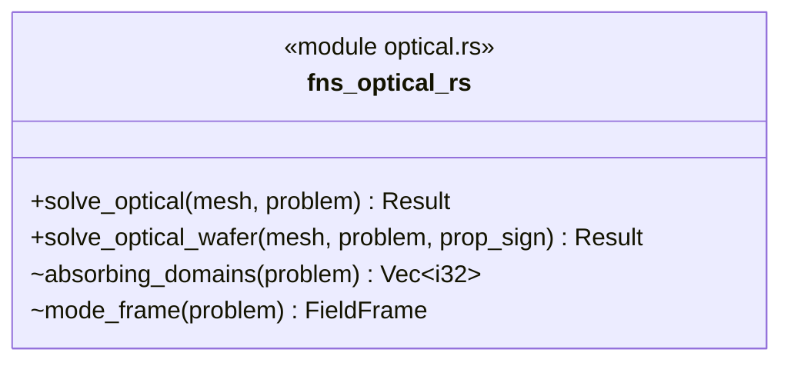

# Optical mode sets: code

C4 level 4 (code) of the component **Optical mode sets** (`ems.optical`) in the container **nyx-ems** (crate `nyx_ems`). [Component view of the container](../../3-components/ems.md) · [All code pages](../README.md)

> The mode solvers' results as an OpticalSet, with the material data needed to evaluate their fields.

**Decisions:** [ADR 45](../../../adr/0045-ems-moves-into-nyx-ems.md), [ADR 21](../../../adr/0021-polarization-analysis-from-complex-fields.md), [ADR 132](../../../adr/0132-vvuq-asme-six-pillar-code-verification.md)  
**Size:** 1 file, 101 lines.

## Files

| File | Lines | What it says about itself |
|---|---:|---|
| `crates/nyx-ems/src/optical.rs` | 101 |  |

## What it uses

| Target | Modules | Items |
|---|---|---|
| [container `femcore` (femcore)](../../3-components/femcore.md) | linalg::csr::assembly, optical, props, section | OptMode, OpticalSet, PROP_SIGN, Pml, TensorKind, c, cell_materials_signed, is_left_handed, local_tensor_signed |
| [container `physics` (nyx-physics)](../../3-components/physics.md) | crate root, frame | Discretisation, FieldFrame |
| [Mode kernel](./modes.md) | modes | EpsCell, Modes, solve_modes_tensor |
| [Complex-mode kernel](./modescx.md) | modes_complex | ModesC, solve_modes_complex |
| [Typed problem](./problem.md) | problem | Problem, Study |

## Used by

| Component | Modules | Items |
|---|---|---|
| [Physics adapter](./adapter.md) | optical | solve_optical, solve_optical_wafer |
| [3D cavity kernel](./cavity.md) | optical | absorbing_domains |
| [Driven frequency-domain and PROM](./driven.md) | optical | absorbing_domains |
| [Mode kernel](./modes.md) | optical | mode_frame |
| [Complex-mode kernel](./modescx.md) | optical | mode_frame |

## Class diagram

Public types with their public fields (or variants) and methods, free functions per file as a `module` box; arrows are field types and `impl Trait`. Capped at 36 types and a few members each; the table below is complete.

## Public items

| Kind | Item | File:line | Signature or summary |
|---|---|---|---|
| fn | `solve_optical` | `optical.rs:35` | `pub fn solve_optical(mesh: &Discretisation, problem: &Problem) -> Result<OpticalSet, String>` —  Solves the optical modes of `problem` (a `Modes` study in wafer axes), propagating along `+y`; complex materials and PMLs go through the |
| fn | `solve_optical_wafer` | `optical.rs:40` | `pub fn solve_optical_wafer(mesh: &Discretisation, problem: &Problem, prop_sign: f64) -> Result<OpticalSet, String>` —  Like `solve_optical` for a propagation axis along `prop_sign * y` (only the reciprocity test uses a sign other than `PROP_SIGN`). |
| fn | `absorbing_domains` | `optical.rs:86` | `pub(crate) fn absorbing_domains(problem: &Problem) -> Vec<i32>` —  Domains of the problem that are absorbing layers: the polarization analysis leaves their cells out. |
| fn | `mode_frame` | `optical.rs:92` | `pub(crate) fn mode_frame(problem: &Problem) -> nyx_physics::FieldFrame` —  The frame of the modes of a cross-section study: lateral x, normal z, propagation y (the local triple of the mode solvers, left-handed), |
