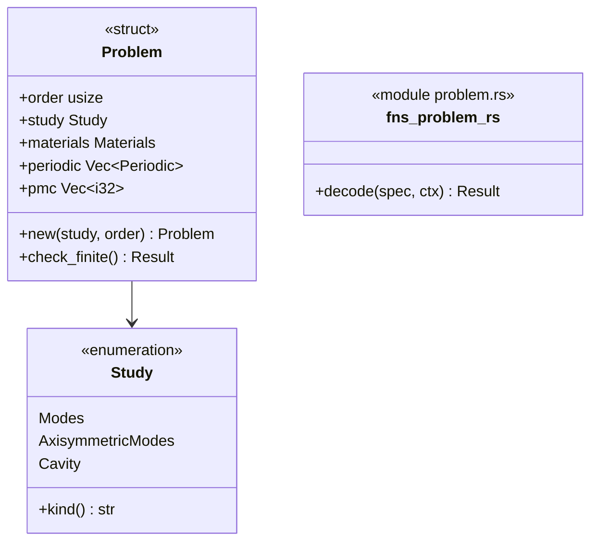

# Typed problem: code

C4 level 4 (code) of the component **Typed problem** (`ems.problem`) in the container **nyx-ems** (crate `nyx_ems`). [Component view of the container](../../3-components/ems.md) · [All code pages](../README.md)

> The typed ems problem the kernels read, decoded from the envelope.

**Decisions:** [ADR 45](../../../adr/0045-ems-moves-into-nyx-ems.md)  
**Size:** 1 file, 187 lines.

## Files

| File | Lines | What it says about itself |
|---|---:|---|
| `crates/nyx-ems/src/problem.rs` | 187 | The typed problem of `ems`: what the kernels read. It is decoded from the `ProblemSpec` envelope by `decode` (region names and selectors resolved to mesh numbers, parameters with their defaults), or built directly by code that already ha... |

## What it uses

| Target | Modules | Items |
|---|---|---|
| [container `femcore` (femcore)](../../3-components/femcore.md) | props | Materials, Periodic, Pml, PmlDir |
| [container `physics` (nyx-physics)](../../3-components/physics.md) | decode, error, physics, spec | Ctx, Error, Params, Physics, ProblemSpec, materials_by_label, resolve_conditions |
| [Physics adapter](./adapter.md) | crate root | Ems |

## Used by

| Component | Modules | Items |
|---|---|---|
| [Physics adapter](./adapter.md) | problem | Problem, Study, decode |
| [Axisymmetric kernel](./axisym.md) | problem | Problem, Study |
| [3D cavity kernel](./cavity.md) | problem | Problem, Study |
| [Mode kernel](./modes.md) | problem | Problem, Study |
| [Complex-mode kernel](./modescx.md) | problem | Problem, Study |
| [Optical mode sets](./optical.md) | problem | Problem, Study |

## Class diagram

Public types with their public fields (or variants) and methods, free functions per file as a `module` box; arrows are field types and `impl Trait`. Capped at 36 types and a few members each; the table below is complete.

## Public items

| Kind | Item | File:line | Signature or summary |
|---|---|---|---|
| enum | `Study` | `problem.rs:16` | variants: `Modes`, `AxisymmetricModes`, `Cavity` |
| struct | `Problem` | `problem.rs:40` | fields: `order`, `study`, `materials`, `periodic`, `pmc` |
| fn | `decode` | `problem.rs:111` | `pub fn decode(spec: &ProblemSpec, ctx: &Ctx) -> Result<Problem, Error>` —  Reads the envelope. The structural checks against the descriptors (`validate_spec`) are the engine's job; this resolves names and |
| fn | `Study::kind` | `problem.rs:30` | `pub fn kind(&self) -> &'static str` —  The `study.kind` of the envelope. |
| fn | `Problem::new` | `problem.rs:55` | `pub fn new(study: Study, order: usize) -> Problem` |
| fn | `Problem::check_finite` | `problem.rs:60` | `pub fn check_finite(&self) -> Result<(), String>` —  Every number the user can type must be finite: NaN or infinity does not stop a factorisation, it flows into every field. |
