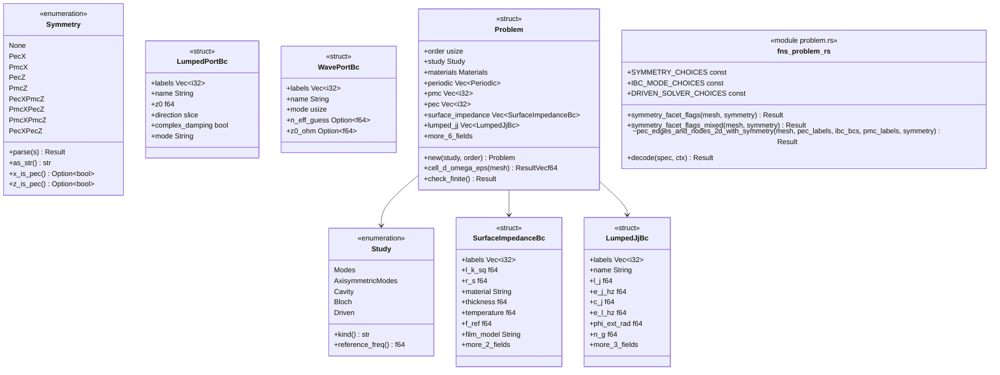

# Typed problem: code

C4 level 4 (code) of the component **Typed problem** (`ems.problem`) in the container **nyx-ems** (crate `nyx_ems`). [Component view of the container](../../3-components/ems.md) · [All code pages](../README.md)

> The typed ems problem the kernels read, decoded from the envelope.

**Decisions:** [ADR 45](../../../adr/0045-ems-moves-into-nyx-ems.md), [ADR 104](../../../adr/0104-bcs-surface-impedance-and-lumped-josephson-ports.md), [ADR 106](../../../adr/0106-driven-frequency-domain-waveports-and-hermite-prom.md)  
**Size:** 1 file, 1156 lines.

## Files

| File | Lines | What it says about itself |
|---|---:|---|
| `crates/nyx-ems/src/problem.rs` | 1156 |  |

## What it uses

| Target | Modules | Items |
|---|---|---|
| [container `femcore` (femcore)](../../3-components/femcore.md) | linalg::csr::assembly, material, material::bcs, props | FilmModel, Materials, Periodic, Pml, PmlCoord, PmlDir, PmlProfile, TensorKind, bcs_surface_impedance, c +2 |
| [container `physics` (nyx-physics)](../../3-components/physics.md) | cqed, crate root, decode, error, physics, spec | Ctx, Discretisation, Error, MaterialAssign, MixedDiscretisation, Params, Physics, ProblemSpec, TlsInterfaces, domain_names_by_label +3 |
| [Physics adapter](./adapter.md) | crate root | Ems |
| [Thin-film IBC and Josephson ROM](./ibc.md) | ibc | resolve_jj_l_and_ej |
| [Mode kernel](./modes.md) | crate root | C0 |

## Used by

| Component | Modules | Items |
|---|---|---|
| [Physics adapter](./adapter.md) | problem | DRIVEN_SOLVER_CHOICES, IBC_MODE_CHOICES, LumpedJjBc, LumpedPortBc, Problem, SYMMETRY_CHOICES, Study, SurfaceImpedanceBc +4 |
| [Axisymmetric kernel](./axisym.md) | problem | Problem, Study, SurfaceImpedanceBc |
| [3D cavity kernel](./cavity.md) | problem | Problem, Study, symmetry_facet_flags, symmetry_facet_flags_mixed |
| [Driven frequency-domain and PROM](./driven.md) | problem | LumpedPortBc, Problem, Study, SurfaceImpedanceBc, WavePortBc, symmetry_facet_flags, symmetry_facet_flags_mixed |
| [Thin-film IBC and Josephson ROM](./ibc.md) | problem | LumpedJjBc, Problem, SurfaceImpedanceBc, Symmetry, symmetry_facet_flags_mixed |
| [Native mixed-cell EM](./mixed.md) | problem | LumpedJjBc, LumpedPortBc, Problem, SurfaceImpedanceBc, symmetry_facet_flags_mixed |
| [Mode kernel](./modes.md) | problem | Problem, Study, SurfaceImpedanceBc, Symmetry, pec_edges_and_nodes_2d_with_symmetry |
| [Complex-mode kernel](./modescx.md) | problem | Problem, Study, SurfaceImpedanceBc, Symmetry, pec_edges_and_nodes_2d_with_symmetry |
| [Optical mode sets](./optical.md) | problem | Problem, Study |

## Class diagram

Public types with their public fields (or variants) and methods, free functions per file as a `module` box; arrows are field types and `impl Trait`. Capped at 36 types and a few members each; the table below is complete.

## Public items

| Kind | Item | File:line | Signature or summary |
|---|---|---|---|
| const | `SYMMETRY_CHOICES` | `problem.rs:25` | `[&str` —  Allowed values for the midplane `symmetry` parameter on `modes`, `cavity`, and `bloch`. |
| enum | `Symmetry` | `problem.rs:31` | variants: `None`, `PecX`, `PmcX`, `PecZ`, `PmcZ`, `PecXPmcZ`, `PmcXPecZ`, `PmcXPmcZ`, `PecXPecZ` —  Midplane PEC/PMC symmetry condition on exterior facets lying on `x = 0` and/or `z = 0`. |
| fn | `symmetry_facet_flags` | `problem.rs:95` | `pub fn symmetry_facet_flags(mesh: &Discretisation, symmetry: Symmetry) -> Result<(Vec<bool>, Vec<bool>), String>` —  Auto-detects exterior facets lying on `x = 0` (when `\|xmin\| <= tol` or `\|xmax\| <= tol`) and/or |
| fn | `symmetry_facet_flags_mixed` | `problem.rs:154` | `pub fn symmetry_facet_flags_mixed( mesh: &MixedDiscretisation, symmetry: Symmetry, ) -> Result<(Vec<bool>, Vec<bool>), String>` —  Auto-detects exterior facets lying on `x = 0` and/or `z = 0` on a native [`MixedDiscretisation`]. |
| fn | `pec_edges_and_nodes_2d_with_symmetry` | `problem.rs:216` | `pub(crate) fn pec_edges_and_nodes_2d_with_symmetry( mesh: &Discretisation, pec_labels: &[i32], ibc_bcs: &[SurfaceImpedanceBc], pmc_labels: &[i32], symmetry: Symmetry, ) -> Result<(Vec<usize>, Vec<usize>), String>` —  Collects PEC boundary edge indices `be` and vertex indices `bn` for a 2D mesh, honoring explicit `pec` |
| enum | `Study` | `problem.rs:248` | variants: `Modes`, `AxisymmetricModes`, `Cavity`, `Bloch`, `Driven` |
| const | `IBC_MODE_CHOICES` | `problem.rs:306` | `[&str` —  Allowed values for `surface_impedance` `ibc_mode`. |
| const | `DRIVEN_SOLVER_CHOICES` | `problem.rs:309` | `[&str` —  Allowed values for `Study::Driven` `solver`. |
| struct | `SurfaceImpedanceBc` | `problem.rs:313` | fields: `labels`, `l_k_sq`, `r_s`, `material`, `thickness`, `temperature`, `f_ref`, `film_model`, `lossless`, `ibc_mode` —  Kinetic-inductance / surface-impedance sheet boundary condition (`Z_s = R_s + i omega L_k_sq`). |
| struct | `LumpedJjBc` | `problem.rs:328` | fields: `labels`, `name`, `l_j`, `e_j_hz`, `c_j`, `e_l_hz`, `phi_ext_rad`, `n_g`, `squid_asymmetry`, `direction`, `formulation` —  Lumped Josephson junction / nonlinear port boundary condition (`cavity` and `driven` studies). |
| struct | `LumpedPortBc` | `problem.rs:344` | fields: `labels`, `name`, `z0`, `direction`, `complex_damping`, `mode` —  Lumped sheet port boundary condition (`cavity` and `driven` studies). |
| struct | `WavePortBc` | `problem.rs:355` | fields: `labels`, `name`, `mode`, `n_eff_guess`, `z0_ohm` —  2D boundary-mode waveguide port boundary condition (`driven` study). |
| struct | `Problem` | `problem.rs:364` | fields: `order`, `study`, `materials`, `periodic`, `pmc`, `pec`, `surface_impedance`, `lumped_jj`, `lumped_ports`, `waveports`, `domain_names`, `symmetry`, ... |
| fn | `decode` | `problem.rs:567` | `pub fn decode(spec: &ProblemSpec, ctx: &Ctx) -> Result<Problem, Error>` —  Reads the envelope. The structural checks against the descriptors (`validate_spec`) are the engine's job; this resolves names and |
| fn | `Symmetry::parse` | `problem.rs:45` | `pub fn parse(s: &str) -> Result<Self, String>` |
| fn | `Symmetry::as_str` | `problem.rs:60` | `pub fn as_str(self) -> &'static str` |
| fn | `Symmetry::x_is_pec` | `problem.rs:75` | `pub fn x_is_pec(self) -> Option<bool>` —  `Some(true)` for PEC on `x = 0`, `Some(false)` for PMC on `x = 0`, `None` otherwise. |
| fn | `Symmetry::z_is_pec` | `problem.rs:84` | `pub fn z_is_pec(self) -> Option<bool>` —  `Some(true)` for PEC on `z = 0`, `Some(false)` for PMC on `z = 0`, `None` otherwise. |
| fn | `Study::kind` | `problem.rs:279` | `pub fn kind(&self) -> &'static str` —  The `study.kind` of the envelope. |
| fn | `Study::reference_freq` | `problem.rs:290` | `pub fn reference_freq(&self) -> f64` —  Reference frequency of the study (Hz): `freq` for `Modes` and `Bloch`, `f_search` for `AxisymmetricModes` and `Cavity`, midband for `Driven`. |
| fn | `Problem::new` | `problem.rs:398` | `pub fn new(study: Study, order: usize) -> Problem` |
| fn | `Problem::cell_d_omega_eps` | `problem.rs:419` | `pub fn cell_d_omega_eps(&self, mesh: &Discretisation) -> Result<Vec<[[f64` —  Global-frame unstretched `Re(d(omega * eps_r) / d(omega))` tensor for every cell of `mesh`, |
| fn | `Problem::check_finite` | `problem.rs:430` | `pub fn check_finite(&self) -> Result<(), String>` —  Every number the user can type must be finite: NaN or infinity does not stop a factorisation, it flows into every field. |
