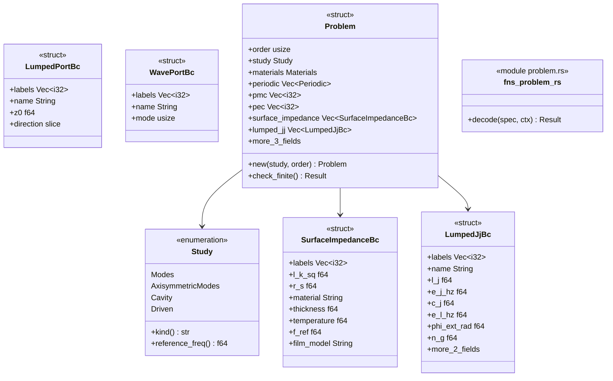

# Typed problem: code

C4 level 4 (code) of the component **Typed problem** (`ems.problem`) in the container **nyx-ems** (crate `nyx_ems`). [Component view of the container](../../3-components/ems.md) · [All code pages](../README.md)

> The typed ems problem the kernels read, decoded from the envelope.

**Decisions:** [ADR 45](../../../adr/0045-ems-moves-into-nyx-ems.md), [ADR 104](../../../adr/0104-bcs-surface-impedance-and-lumped-josephson-ports.md), [ADR 106](../../../adr/0106-driven-frequency-domain-waveports-and-hermite-prom.md)  
**Size:** 1 file, 510 lines.

## Files

| File | Lines | What it says about itself |
|---|---:|---|
| `crates/nyx-ems/src/problem.rs` | 510 |  |

## What it uses

| Target | Modules | Items |
|---|---|---|
| [container `femcore` (femcore)](../../3-components/femcore.md) | material, material::bcs, props | FilmModel, Materials, Periodic, Pml, PmlDir, bcs_surface_impedance |
| [container `physics` (nyx-physics)](../../3-components/physics.md) | decode, error, physics, spec | Ctx, Error, Params, Physics, ProblemSpec, domain_names_by_label, materials_by_label, resolve_conditions |
| [Physics adapter](./adapter.md) | crate root | Ems |
| [Thin-film IBC and Josephson ROM](./ibc.md) | ibc | resolve_jj_l_and_ej |

## Used by

| Component | Modules | Items |
|---|---|---|
| [Physics adapter](./adapter.md) | problem | LumpedJjBc, LumpedPortBc, Problem, Study, SurfaceImpedanceBc, WavePortBc, decode |
| [Axisymmetric kernel](./axisym.md) | problem | Problem, Study, SurfaceImpedanceBc |
| [3D cavity kernel](./cavity.md) | problem | Problem, Study |
| [Driven frequency-domain and PROM](./driven.md) | problem | LumpedPortBc, Problem, Study, SurfaceImpedanceBc, WavePortBc |
| [Thin-film IBC and Josephson ROM](./ibc.md) | problem | LumpedJjBc, Problem, SurfaceImpedanceBc |
| [Mode kernel](./modes.md) | problem | Problem, Study, SurfaceImpedanceBc |
| [Complex-mode kernel](./modescx.md) | problem | Problem, Study, SurfaceImpedanceBc |
| [Optical mode sets](./optical.md) | problem | Problem, Study |

## Class diagram

Public types with their public fields (or variants) and methods, free functions per file as a `module` box; arrows are field types and `impl Trait`. Capped at 36 types and a few members each; the table below is complete.

## Public items

| Kind | Item | File:line | Signature or summary |
|---|---|---|---|
| enum | `Study` | `problem.rs:21` | variants: `Modes`, `AxisymmetricModes`, `Cavity`, `Driven` |
| struct | `SurfaceImpedanceBc` | `problem.rs:59` | fields: `labels`, `l_k_sq`, `r_s`, `material`, `thickness`, `temperature`, `f_ref`, `film_model` —  Kinetic-inductance / surface-impedance sheet boundary condition (`Z_s = R_s + i omega L_k_sq`). |
| struct | `LumpedJjBc` | `problem.rs:72` | fields: `labels`, `name`, `l_j`, `e_j_hz`, `c_j`, `e_l_hz`, `phi_ext_rad`, `n_g`, `direction`, `formulation` —  Lumped Josephson junction / nonlinear port boundary condition (`cavity` and `driven` studies). |
| struct | `LumpedPortBc` | `problem.rs:87` | fields: `labels`, `name`, `z0`, `direction` —  Lumped sheet port boundary condition (`driven` study). |
| struct | `WavePortBc` | `problem.rs:96` | fields: `labels`, `name`, `mode` —  2D boundary-mode waveguide port boundary condition (`driven` study). |
| struct | `Problem` | `problem.rs:103` | fields: `order`, `study`, `materials`, `periodic`, `pmc`, `pec`, `surface_impedance`, `lumped_jj`, `lumped_ports`, `waveports`, `domain_names` |
| fn | `decode` | `problem.rs:247` | `pub fn decode(spec: &ProblemSpec, ctx: &Ctx) -> Result<Problem, Error>` —  Reads the envelope. The structural checks against the descriptors (`validate_spec`) are the engine's job; this resolves names and |
| fn | `Study::kind` | `problem.rs:38` | `pub fn kind(&self) -> &'static str` —  The `study.kind` of the envelope. |
| fn | `Study::reference_freq` | `problem.rs:48` | `pub fn reference_freq(&self) -> f64` —  Reference frequency of the study (Hz): `freq` for `Modes`, `f_search` for `AxisymmetricModes` and `Cavity`, midband for `Driven`. |
| fn | `Problem::new` | `problem.rs:130` | `pub fn new(study: Study, order: usize) -> Problem` |
| fn | `Problem::check_finite` | `problem.rs:147` | `pub fn check_finite(&self) -> Result<(), String>` —  Every number the user can type must be finite: NaN or infinity does not stop a factorisation, it flows into every field. |
