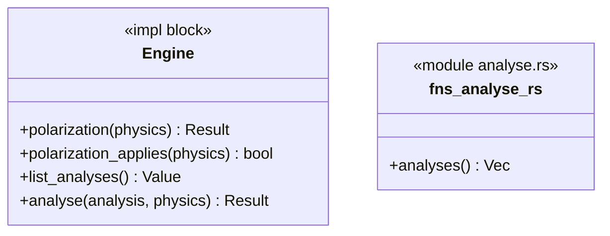

# Analyses: code

C4 level 4 (code) of the component **Analyses** (`engine.analyse`) in the container **nyx-engine** (crate `nyx_engine`). [Component view of the container](../../3-components/engine.md) · [All code pages](../README.md)

> Runs the analyses of nyx-analysis on the latest result of a physics.

**Decisions:** [ADR 56](../../../adr/0056-polarization-analysis-is-a-function-of-a-result.md)  
**Size:** 1 file, 83 lines.

## Files

| File | Lines | What it says about itself |
|---|---:|---|
| `crates/nyx-engine/src/analyse.rs` | 83 | Analyses of results as engine commands: a result is solved once, an analysis is a function of it and of the mesh it was solved on (`nyx-analysis`, ADR 56). The window draws the typed `ModeAnalysis`; the MCP server gets the same through `... |

## What it uses

| Target | Modules | Items |
|---|---|---|
| [container `analysis` (nyx-analysis)](../../3-components/analysis.md) | crate root, modes, polarization | Analysis, ModeAnalysis, PolarizationAnalysis, polarization_applies |
| [container `physics` (nyx-physics)](../../3-components/physics.md) | error, result | Error, SolveResult |
| [Commands](./commands.md) | engine | Engine |
| [Meshing seam](./meshing.md) | meshing | MeshedModel |

## Used by

Nothing else in the workspace names this component (entry points are reached by the program or by tests).

## Class diagram

Public types with their public fields (or variants) and methods, free functions per file as a `module` box; arrows are field types and `impl Trait`. Capped at 36 types and a few members each; the table below is complete.

## Public items

| Kind | Item | File:line | Signature or summary |
|---|---|---|---|
| fn | `analyses` | `analyse.rs:10` | `pub fn analyses() -> Vec<Box<dyn Analysis>>` —  The analyses of this build. |
| fn | `Engine::polarization` | `analyse.rs:33` | `pub fn polarization(&self, physics: &str) -> Result<ModeAnalysis, Error>` —  The polarization analysis of the modes of `physics`, typed (what the Analysis tab draws). |
| fn | `Engine::polarization_applies` | `analyse.rs:39` | `pub fn polarization_applies(&self, physics: &str) -> bool` —  Whether the polarization applies to the latest result of `physics`. |
| fn | `Engine::list_analyses` | `analyse.rs:44` | `pub fn list_analyses(&self) -> Value` —  Lists the analyses and says which apply to which result. |
| fn | `Engine::analyse` | `analyse.rs:57` | `pub fn analyse(&self, analysis: &str, physics: &str) -> Result<Value, Error>` —  Runs one analysis on the latest result of `physics` and returns its JSON. |
