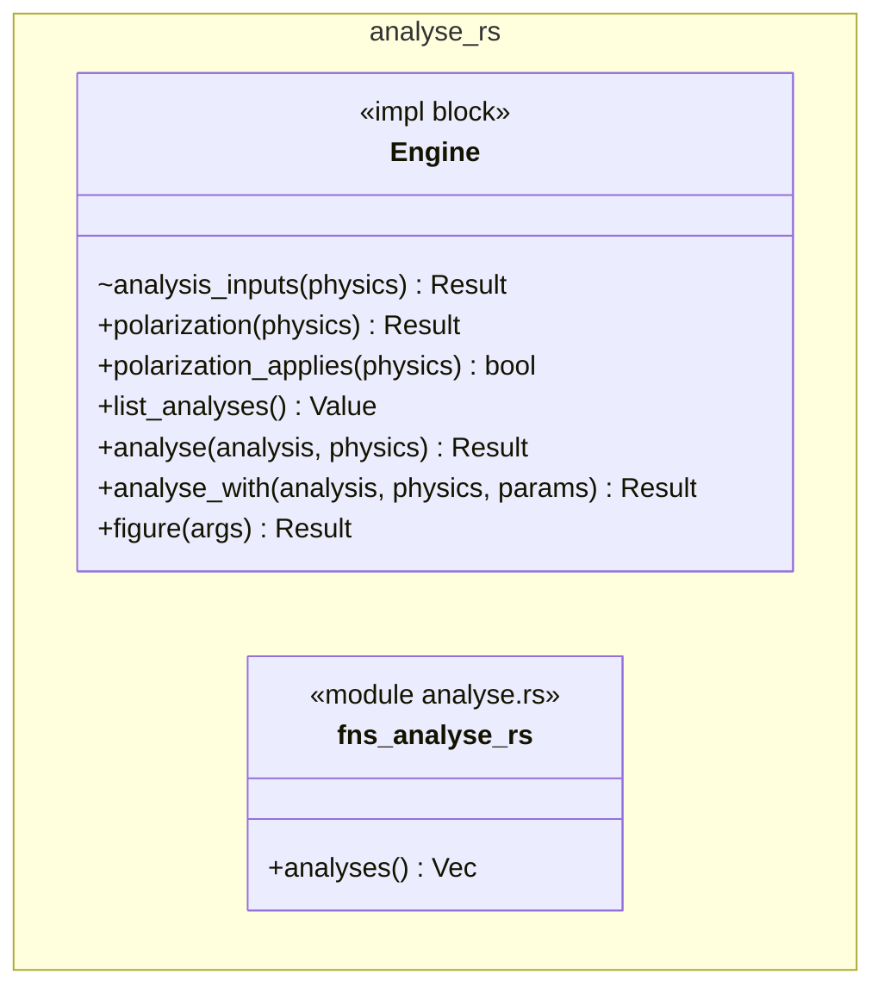

# Analyses: code

C4 level 4 (code) of the component **Analyses** (`engine.analyse`) in the container **nyx-engine** (crate `nyx_engine`). [Component view of the container](../../3-components/engine.md) · [All code pages](../README.md)

> Runs the analyses of nyx-analysis on the latest result of a physics, and draws its modes as a figure (SVG or PNG).

**Decisions:** [ADR 56](../../../adr/0056-polarization-analysis-is-a-function-of-a-result.md), [ADR 99](../../../adr/0099-figures-of-modes-and-one-node-order-in-the-results-file.md), [ADR 103](../../../adr/0103-multi-rhs-capacitance-and-gauge-stabilized-magnetostatics.md), [ADR 105](../../../adr/0105-kicq-epr-craig-bampton-quantization-and-tls-participation.md)  
**Size:** 2 files, 911 lines.

## Files

| File | Lines | What it says about itself |
|---|---:|---|
| `crates/nyx-engine/src/analyse.rs` | 404 |  |
| `crates/nyx-engine/src/figure.rs` | 507 |  |

## What it uses

| Target | Modules | Items |
|---|---|---|
| [container `analysis` (nyx-analysis)](../../3-components/analysis.md) | capacitance, crate root, figure, modes, piezo_resonator, polarization, tls, view3d | Analysis, Camera3d, CapacitanceMatrixAnalysis, ClipBox, Cmap, EdgeMode, FigureOptions, InductanceMatrixAnalysis, Kind, ModeAnalysis +7 |
| [container `femcore` (femcore)](../../3-components/femcore.md) | mesh | SimplexMesh |
| [container `physics` (nyx-physics)](../../3-components/physics.md) | cqed, error, physics, result | CapacitanceMatrixData, CircuitRom, Error, LabelResolver, Scalar, SolveResult |
| [Commands](./commands.md) | engine | Engine |
| [Meshing seam](./meshing.md) | meshing | MeshedModel |

## Used by

| Component | Modules | Items |
|---|---|---|
| [Job runner and queue](./jobs.md) | analyse | analyses |

## Class diagram

Public types with their public fields (or variants) and methods, free functions per file as a `module` box; arrows are field types and `impl Trait`. Capped at 36 types and a few members each; the table below is complete.

## Public items

| Kind | Item | File:line | Signature or summary |
|---|---|---|---|
| fn | `analyses` | `analyse.rs:16` | `pub fn analyses() -> Vec<Box<dyn Analysis>>` —  The analyses of this build. |
| fn | `Engine::analysis_inputs` | `analyse.rs:58` | `pub(crate) fn analysis_inputs( &self, physics: &str, ) -> Result<(std::sync::Arc<crate::meshing::MeshedModel>, std::sync::Arc<nyx_physics::SolveResult>), Error>` —  The mesh a result was solved on, and the result itself (`Stored.model`, ADR 90). |
| fn | `Engine::polarization` | `analyse.rs:340` | `pub fn polarization(&self, physics: &str) -> Result<ModeAnalysis, Error>` —  The polarization analysis of the modes of `physics`, typed (what the Analysis tab draws). |
| fn | `Engine::polarization_applies` | `analyse.rs:346` | `pub fn polarization_applies(&self, physics: &str) -> bool` —  Whether the polarization applies to the latest result of `physics`. |
| fn | `Engine::list_analyses` | `analyse.rs:351` | `pub fn list_analyses(&self) -> Value` —  Lists the analyses and says which apply to which result. |
| fn | `Engine::analyse` | `analyse.rs:364` | `pub fn analyse(&self, analysis: &str, physics: &str) -> Result<Value, Error>` —  Runs one analysis on the latest result of `physics` and returns its JSON. |
| fn | `Engine::analyse_with` | `analyse.rs:369` | `pub fn analyse_with(&self, analysis: &str, physics: &str, params: &Value) -> Result<Value, Error>` —  Runs one analysis on the latest result of `physics` with optional `params` and returns its JSON. |
| fn | `Engine::figure` | `figure.rs:329` | `pub fn figure(&self, args: &Value) -> Result<Value, Error>` —  Draws the modes or 3D fields of `physics` and writes the figure to `path` (`.svg` or `.png`). |
