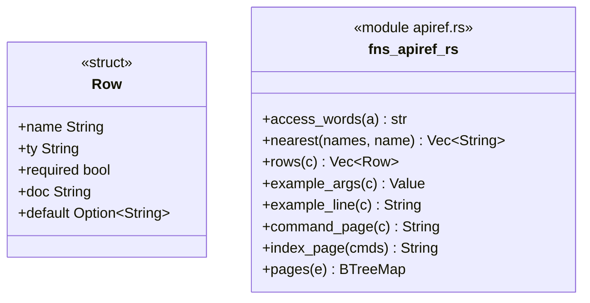

# API reference: code

C4 level 4 (code) of the component **API reference** (`engine.apiref`) in the container **nyx-engine** (crate `nyx_engine`). [Component view of the container](../../3-components/engine.md) · [All code pages](../README.md)

> One Markdown page per engine command and an index, generated from Engine::catalog() (arguments flattened from the schema, an example that passes the check); docs/api is compared with it by a test.

**Decisions:** [ADR 89](../../../adr/0089-command-lists-are-a-front-end-checked-planned-and-run.md), [ADR 57](../../../adr/0057-front-ends-are-thin-the-mcp-tools-are-engine-commands.md)  
**Size:** 1 file, 293 lines.

## Files

| File | Lines | What it says about itself |
|---|---:|---|
| `crates/nyx-engine/src/apiref.rs` | 293 |  |

## What it uses

| Target | Modules | Items |
|---|---|---|
| [container `physics` (nyx-physics)](../../3-components/physics.md) | spec | canonical_json |
| [container `store` (nyx-store)](../../3-components/store.md) | util | hash_bytes |
| [Commands](./commands.md) | commands, engine | Access, CommandDesc, Engine |

## Used by

| Component | Modules | Items |
|---|---|---|
| [app: Scripts and batch](../app/headless.md) | apiref |  |
| [Command lists](./commandlist.md) | apiref | nearest |

## Class diagram

Public types with their public fields (or variants) and methods, free functions per file as a `module` box; arrows are field types and `impl Trait`. Capped at 36 types and a few members each; the table below is complete.

## Public items

| Kind | Item | File:line | Signature or summary |
|---|---|---|---|
| fn | `access_words` | `apiref.rs:16` | `pub fn access_words(a: Access) -> &'static str` —  What an access level means, in words. |
| fn | `nearest` | `apiref.rs:33` | `pub fn nearest(names: &[String], name: &str) -> Vec<String>` —  The commands whose names are closest to `name` (at most three, within an edit distance of three): the hint of a mistyped command. |
| struct | `Row` | `apiref.rs:59` | fields: `name`, `ty`, `required`, `doc`, `default` —  One argument of a command, as the page's table shows it. |
| fn | `rows` | `apiref.rs:159` | `pub fn rows(c: &CommandDesc) -> Vec<Row>` —  The arguments of a command, flattened, in the order of the schema (sorted by name: the schema is a map). |
| fn | `example_args` | `apiref.rs:212` | `pub fn example_args(c: &CommandDesc) -> Value` —  The `args` of an example call: every required argument with a placeholder of its type (`<name>` for text, the first choice of an enumeration, |
| fn | `example_line` | `apiref.rs:217` | `pub fn example_line(c: &CommandDesc) -> String` —  The example as one line of a command list. |
| fn | `command_page` | `apiref.rs:230` | `pub fn command_page(c: &CommandDesc) -> String` —  The Markdown page of one command. |
| fn | `index_page` | `apiref.rs:264` | `pub fn index_page(cmds: &[CommandDesc]) -> String` —  The index page: every command with its access and title, and the hash of the catalog the pages were made from. |
| fn | `pages` | `apiref.rs:283` | `pub fn pages(e: &Engine) -> BTreeMap<String, String>` —  Every page of the reference by file name (`<command>.md`, `README.md`), sorted. |
