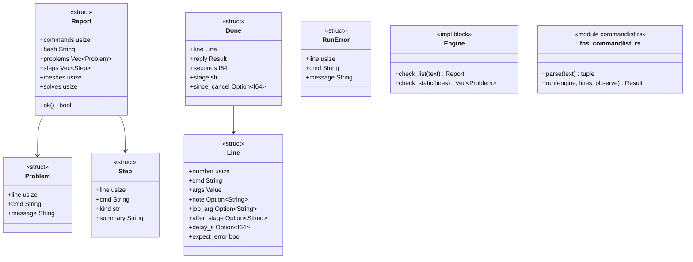

# Command lists: code

C4 level 4 (code) of the component **Command lists** (`engine.commandlist`) in the container **nyx-engine** (crate `nyx_engine`). [Component view of the container](../../3-components/engine.md) · [All code pages](../README.md)

> A JSON-lines list of engine commands is parsed, checked against the catalog and its schemas, planned on a scratch engine (what would be meshed and solved, nothing run) and run in order through Engine::call.

**Decisions:** [ADR 89](../../../adr/0089-command-lists-are-a-front-end-checked-planned-and-run.md)  
**Size:** 1 file, 567 lines.

## Files

| File | Lines | What it says about itself |
|---|---:|---|
| `crates/nyx-engine/src/commandlist.rs` | 567 | Command lists (productivity plan S1): a file of JSON lines, `{"cmd": "<command of Engine::catalog()>", "args": {...}}`, that a person or an agent writes once and the engine checks, plans and runs. A list is a third front-end over `Engine... |

## What it uses

| Target | Modules | Items |
|---|---|---|
| [container `physics` (nyx-physics)](../../3-components/physics.md) | error | Error |
| [container `store` (nyx-store)](../../3-components/store.md) | util | hash_bytes |
| [API reference](./apiref.md) | apiref | nearest |
| [Commands](./commands.md) | commands, engine | Access, Engine |

## Used by

| Component | Modules | Items |
|---|---|---|
| [app: Scripts and batch](../app/headless.md) | commandlist | Problem |

## Class diagram

Public types with their public fields (or variants) and methods, free functions per file as a `module` box; arrows are field types and `impl Trait`. Capped at 36 types and a few members each; the table below is complete.

## Public items

| Kind | Item | File:line | Signature or summary |
|---|---|---|---|
| struct | `Line` | `commandlist.rs:29` | fields: `number`, `cmd`, `args`, `note`, `job_arg`, `after_stage`, `delay_s`, `expect_error` —  One command of a list. |
| struct | `Problem` | `commandlist.rs:43` | fields: `line`, `cmd`, `message` —  What is wrong at a line, in words. |
| struct | `Step` | `commandlist.rs:61` | fields: `line`, `cmd`, `kind`, `summary` —  One line of the plan: what the line would do. |
| struct | `Report` | `commandlist.rs:71` | fields: `commands`, `hash`, `problems`, `steps`, `meshes`, `solves` —  The outcome of `check_list`. |
| fn | `parse` | `commandlist.rs:91` | `pub fn parse(text: &str) -> (Vec<Line>, Vec<Problem>)` —  Reads a list. Problems come back with the lines that parsed, so a front-end can show them all at once. |
| struct | `Done` | `commandlist.rs:477` | fields: `line`, `reply`, `seconds`, `stage`, `since_cancel` —  What the observer of `run` is told after each command. |
| struct | `RunError` | `commandlist.rs:489` | fields: `line`, `cmd`, `message` —  Why a run stopped. |
| fn | `run` | `commandlist.rs:503` | `pub fn run(engine: &mut Engine, lines: &[Line], observe: &mut dyn FnMut(&Done)) -> Result<(), RunError>` —  Sends the lines to `engine` in order. The run stops at the first command that fails (unless the line expects an error) and at a replay key that |
| fn | `Report::ok` | `commandlist.rs:85` | `pub fn ok(&self) -> bool` |
| fn | `Engine::check_list` | `commandlist.rs:265` | `pub fn check_list(&self, text: &str) -> Report` —  Checks a list: first every line against the catalog, then, when those pass, a dry run on a copy of this engine. Nothing is meshed, solved or |
| fn | `Engine::check_static` | `commandlist.rs:286` | `pub fn check_static(&self, lines: &[Line]) -> Vec<Problem>` —  The static stage: every command is in the catalog and its arguments fit its schema. |

Trait implementations in this component: `Problem: Display`, `RunError: Display`
