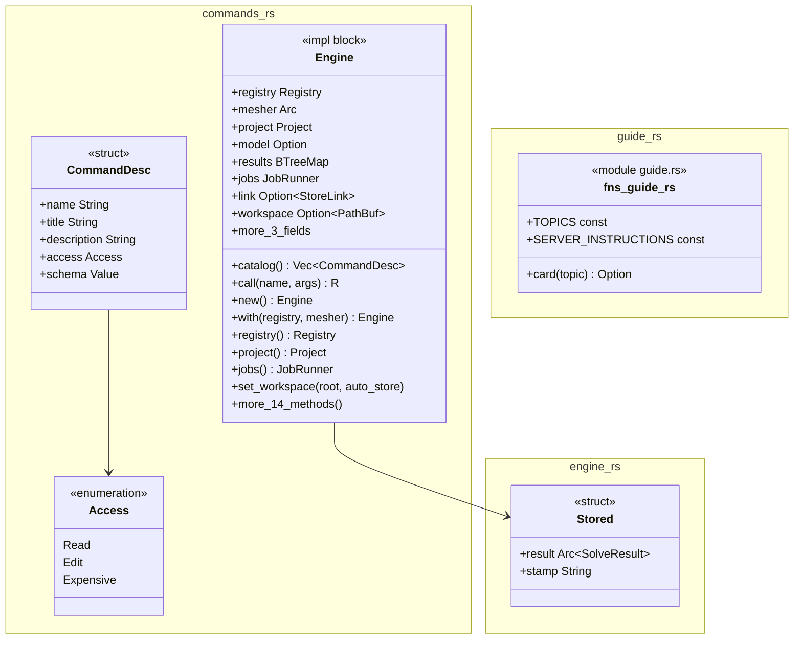

# Commands: code

C4 level 4 (code) of the component **Commands** (`engine.commands`) in the container **nyx-engine** (crate `nyx_engine`). [Component view of the container](../../3-components/engine.md) · [All code pages](../README.md)

> The Engine and its catalog: every action by name with JSON arguments, JSON Schema and JSON reply; the dispatcher; the guide cards a host reads on demand. The window and the MCP server use the same entries.

**Decisions:** [ADR 57](../../../adr/0057-front-ends-are-thin-the-mcp-tools-are-engine-commands.md), [ADR 38](../../../adr/0038-geometry-operations-are-described-once.md), [ADR 15](../../../adr/0015-ai-interface-separate-workspace-and-mcp-server.md)  
**Size:** 3 files, 990 lines.

## Files

| File | Lines | What it says about itself |
|---|---:|---|
| `crates/nyx-engine/src/commands.rs` | 631 | The commands: every action a front-end can take, by name, with JSON arguments, a JSON schema and a JSON reply. The window calls the typed methods of `Engine` directly or these commands; the MCP server turns `catalog()` into its tool list... |
| `crates/nyx-engine/src/engine.rs` | 326 | The engine: one project, the mesh built for it, the latest result of each physics, the jobs that produce them and the binding to a workflow folder. The window and the MCP server hold an `Engine` and nothing else; every action is a method... |
| `crates/nyx-engine/src/guide.rs` | 33 | Cards: short texts a host reads on demand through the `get_guide` command, embedded in the binary. They describe the commands, not a physics: how to build a geometry, assign materials, solve and read a result. |

## What it uses

| Target | Modules | Items |
|---|---|---|
| [container `femcore` (femcore)](../../3-components/femcore.md) | material::spec, progress | Library, install |
| [container `geom` (geom)](../../3-components/geom.md) | model | FeatureList, Op |
| [container `physics` (nyx-physics)](../../3-components/physics.md) | contract, crate root, error, registry, result, spec, validate | BcSpec, Error, MaterialAssign, ProblemSpec, Registry, Sizing, SolveResult, StudySpec, canonical_json, validate_spec |
| [container `store` (nyx-store)](../../3-components/store.md) | util | hash_bytes |
| [Geometry operations](./geometry.md) | geomdesc, geometry |  |
| [Job runner](./jobs.md) | convergence, jobs, solve | JobId, JobOutput, JobRunner, Matching, run_chain |
| [Materials](./materials.md) | materials | default_dirs, load_library |
| [Meshing seam](./meshing.md) | meshing | FemcoreMesher, MeshedModel, Mesher |
| [Project](./project.md) | project | MeshSettings, Project |
| [Registry and facade](./registry.md) | crate root | physics_for, registry |
| [Store link](./storeLink.md) | store_link | RunOutcome, StoreLink |

## Used by

| Component | Modules | Items |
|---|---|---|
| [app: Scripts and batch](../app/headless.md) | engine | Engine |
| [app: Shell and dashboard](../app/shell.md) | engine | Engine |
| [app: Window](../app/window.md) | engine | Engine |
| [Analyses](./analyse.md) | engine | Engine |
| [Job runner](./jobs.md) | engine | Engine |
| [Materials](./materials.md) | engine | Engine |
| [Meshing seam](./meshing.md) | engine | Engine |
| [Registry and facade](./registry.md) | commands, engine | Access, CommandDesc, Engine |
| [Results files](./resultsIO.md) | engine | Engine, Stored |

## Class diagram

Public types with their public fields (or variants) and methods, free functions per file as a `module` box; arrows are field types and `impl Trait`. Capped at 36 types and a few members each; the table below is complete.

## Public items

| Kind | Item | File:line | Signature or summary |
|---|---|---|---|
| enum | `Access` | `commands.rs:17` | variants: `Read`, `Edit`, `Expensive` —  How much a command changes or costs; a host may ask the person before an expensive or editing command. |
| struct | `CommandDesc` | `commands.rs:27` | fields: `name`, `title`, `description`, `access`, `schema` |
| fn | `Engine::catalog` | `commands.rs:105` | `pub fn catalog(&self) -> Vec<CommandDesc>` —  Every command of this build, with its schema. The geometry `add_*` commands come from `geomdesc`; the choices of physics from |
| fn | `Engine::call` | `commands.rs:208` | `pub fn call(&mut self, name: &str, args: &Value) -> R` —  Runs the command `name` with JSON arguments and returns its JSON reply. |
| struct | `Stored` | `engine.rs:18` | fields: `result`, `stamp` |
| struct | `Engine` | `engine.rs:29` | fields: `registry`, `mesher`, `project`, `model`, `results`, `jobs`, `link`, `workspace`, `auto_store`, `base_library`, `library_notes` |
| fn | `Engine::new` | `engine.rs:53` | `pub fn new() -> Engine` —  An engine with the physics compiled into this build and an empty 2D project. |
| fn | `Engine::with` | `engine.rs:61` | `pub fn with(registry: Registry, mesher: Arc<dyn Mesher>) -> Engine` |
| fn | `Engine::registry` | `engine.rs:78` | `pub fn registry(&self) -> &Registry` |
| fn | `Engine::project` | `engine.rs:82` | `pub fn project(&self) -> &Project` |
| fn | `Engine::jobs` | `engine.rs:86` | `pub fn jobs(&self) -> &JobRunner` |
| fn | `Engine::set_workspace` | `engine.rs:92` | `pub fn set_workspace(&mut self, root: PathBuf, auto_store: bool)` —  Names the workspace folder workflows are stored in. With `auto_store` the project is bound to a new workflow there at the first solve and |
| fn | `Engine::sizing` | `engine.rs:99` | `pub fn sizing(&self) -> Option<Sizing>` —  What the physics of the project want the mesh to resolve, merged: the shortest wavelength of each region, the highest order and the |
| fn | `Engine::mesh_key` | `engine.rs:119` | `pub fn mesh_key(&self) -> String` —  The hash of the geometry, the mesh settings and the sizing: what a mesh depends on. |
| fn | `Engine::stamp` | `engine.rs:125` | `pub fn stamp(&self) -> String` —  The hash of the whole project: what a result depends on. |
| fn | `Engine::set_project` | `engine.rs:130` | `pub fn set_project(&mut self, project: Project)` —  Replaces the project (a new one, or one just opened). The mesh and results are dropped and the store binding is released. |
| fn | `Engine::model` | `engine.rs:138` | `pub fn model(&self) -> Option<&Arc<MeshedModel>>` —  The mesh if one has been built for the current geometry and settings. |
| fn | `Engine::result` | `engine.rs:143` | `pub fn result(&self, physics: &str) -> Option<(&Arc<SolveResult>, bool)>` —  The latest result of a physics and whether the project has changed since. |
| fn | `Engine::start_mesh` | `engine.rs:151` | `pub fn start_mesh(&mut self) -> Result<JobId, Error>` —  Starts meshing the project on a job. |
| fn | `Engine::start_solve` | `engine.rs:167` | `pub fn start_solve(&mut self, targets: Option<Vec<String>>) -> Result<JobId, Error>` —  Starts solving `targets` (default: the active physics, else all) on a job. The mesh is built inside the job when none is current. |
| fn | `Engine::poll` | `engine.rs:206` | `pub fn poll(&mut self) -> Vec<(JobId, Result<Value, Error>)>` —  Takes the finished jobs and applies them: the mesh and results become current, a solve is recorded in the run table when the project |
| fn | `Engine::wait` | `engine.rs:218` | `pub fn wait(&mut self, id: JobId) -> Result<Value, Error>` —  Waits for a job and applies it. |
| fn | `Engine::mesh_now` | `engine.rs:278` | `pub fn mesh_now(&mut self) -> Result<Value, Error>` —  Mesh now (start and wait). |
| fn | `Engine::solve_now` | `engine.rs:284` | `pub fn solve_now(&mut self, targets: Option<Vec<String>>) -> Result<Value, Error>` —  Solve now (start and wait). |
| fn | `Engine::save_to_workspace` | `engine.rs:292` | `pub fn save_to_workspace(&mut self, workspace: Option<PathBuf>) -> Result<Value, Error>` —  Binds the project to a new workflow folder in `workspace` (or commits it, when already bound). |
| fn | `Engine::open_workflow` | `engine.rs:311` | `pub fn open_workflow(&mut self, folder: &std::path::Path, experiment: Option<&str>) -> Result<Value, Error>` —  Opens a workflow folder and makes its experiment the project. |
| const | `TOPICS` | `guide.rs:4` | `&[&str]` |
| fn | `card` | `guide.rs:6` | `pub fn card(topic: &str) -> Option<&'static str>` |
| const | `SERVER_INSTRUCTIONS` | `guide.rs:17` | `&str` —  The text a server sends with `initialize`: just enough to find the guide. |

Trait implementations in this component: `Engine: Default`
