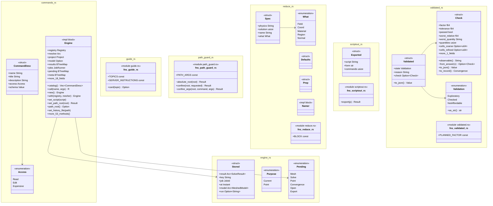

# Commands: code

C4 level 4 (code) of the component **Commands** (`engine.commands`) in the container **nyx-engine** (crate `nyx_engine`). [Component view of the container](../../3-components/engine.md) · [All code pages](../README.md)

> The Engine and its catalog: every action by name with JSON arguments, JSON Schema and JSON reply; the dispatcher; the guide cards a host reads on demand; the reductions of results (field handles, integrals, extrema, probes, overlaps). The window and the MCP server use the same entries.

**Decisions:** [ADR 57](../../../adr/0057-front-ends-are-thin-the-mcp-tools-are-engine-commands.md), [ADR 38](../../../adr/0038-geometry-operations-are-described-once.md), [ADR 15](../../../adr/0015-ai-interface-separate-workspace-and-mcp-server.md), [ADR 90](../../../adr/0090-whole-array-operations-are-engine-commands-over-a-typed-tree.md), [ADR 91](../../../adr/0091-validated-is-a-state-checked-against-the-problem-key.md), [ADR 93](../../../adr/0093-scripts-are-python-text-run-by-monty-in-a-worker-process.md), [ADR 94](../../../adr/0094-the-mcp-server-is-four-script-tools-over-one-kernel.md)  
**Size:** 7 files, 4093 lines.

## Files

| File | Lines | What it says about itself |
|---|---:|---|
| `crates/nyx-engine/src/commands.rs` | 742 | The commands: every action a front-end can take, by name, with JSON arguments, a JSON schema and a JSON reply. The window calls the typed methods of `Engine` directly or these commands; the MCP server turns `catalog()` into its tool list... |
| `crates/nyx-engine/src/engine.rs` | 921 | The engine: one project, the mesh built for it, the latest result of each physics, the jobs that produce them and the binding to a workflow folder. The window and the MCP server hold an `Engine` and nothing else; every action is a method... |
| `crates/nyx-engine/src/guide.rs` | 33 | Cards: short texts a host reads on demand through the `get_guide` command, embedded in the binary. They describe the commands, not a physics: how to build a geometry, assign materials, solve and read a result. |
| `crates/nyx-engine/src/path_guard.rs` | 157 | The path guard (productivity plan S4, ADR [89]): a front-end that runs text it did not write (a script) asks the engine to keep every file and folder argument of a command inside one folder. The guard is in the engine, not in the script ... |
| `crates/nyx-engine/src/reduce.rs` | 1731 | Whole-array operations on results (productivity plan N1, ADR 90): `field`, `field_op`, `integrate`, `extremum`, `probe`, `line_cut`, `overlap` and `confinement` as engine commands. A script, the MCP server and the window's Results tab ca... |
| `crates/nyx-engine/src/scriptout.rs` | 274 | Export as script (productivity plan S7b, ADR [94]): the project as a script that rebuilds it. A person who built a model in the window gives it to an agent (or to themselves, as text) and the agent runs it with `params` to change a value... |
| `crates/nyx-engine/src/validated.rs` | 235 | Validated is a state, not a feeling (productivity plan P6, ADR 91). A result is `exploratory` until a mesh-convergence check with a stated tolerance has passed on **the same problem key** (`Engine::problem_key`, ADR 84), then it is `chec... |

## What it uses

| Target | Modules | Items |
|---|---|---|
| [container `femcore` (femcore)](../../3-components/femcore.md) | fem, fieldexpr, formula, linalg::csr::assembly, material, material::spec, mesh, par +3 | Anisotropy, C, Fun, Library, MAX_POWER, Named, Names, Op, RefElement, SimplexMesh +12 |
| [container `geom` (geom)](../../3-components/geom.md) | model | FeatureList, Op |
| [container `physics` (nyx-physics)](../../3-components/physics.md) | contract, crate root, decode, error, physics, registry, result, spec +1 | BcSpec, Ctx, Error, LabelResolver, MaterialAssign, ProblemSpec, Registry, Sizing, Solution, SolveResult +4 |
| [container `store` (nyx-store)](../../3-components/store.md) | runs, util | Convergence, RunPatch, hash_bytes |
| [Geometry operations](./geometry.md) | geomdesc, geometry |  |
| [Job runner and queue](./jobs.md) | estimate, jobs, process, queue, solve, sweep, worker | Estimate, History, JobId, JobMeta, JobOutput, JobRunner, Lane, MemoryProbe, Opened, QueueOpts +15 |
| [Materials](./materials.md) | materials | default_dirs, load_library, study_wavelength |
| [Meshing seam](./meshing.md) | meshing | FemcoreMesher, MeshedModel, Mesher |
| [Project](./project.md) | project | MeshSettings, Project |
| [Registry and facade](./registry.md) | crate root | physics_for, registry |
| [Results files](./resultsIO.md) | results_file | read_and_mesh, write_snapshot |
| [Store link](./storeLink.md) | store_link | RunOutcome, StoreLink |

## Used by

| Component | Modules | Items |
|---|---|---|
| [app: Scripts and batch](../app/headless.md) | engine | Engine |
| [app: Shell and dashboard](../app/shell.md) | engine, validated | Engine, Validated, Validation |
| [app: Window](../app/window.md) | engine, validated | Engine, Validated |
| [Analyses](./analyse.md) | engine | Engine |
| [API reference](./apiref.md) | commands, engine | Access, CommandDesc, Engine |
| [Command lists](./commandlist.md) | commands, engine | Access, Engine |
| [Job runner and queue](./jobs.md) | commands, engine | Access, Engine, Purpose |
| [Materials](./materials.md) | engine | Engine |
| [Meshing seam](./meshing.md) | engine | Engine |
| [Registry and facade](./registry.md) | commands, engine | Access, CommandDesc, Engine |
| [Results files](./resultsIO.md) | engine | Engine |
| [script: Script host](../script/host.md) | engine | Engine |
| [script: Script kernel](../script/kernel.md) | engine | Engine |
| [script: Type stub](../script/stubs.md) | commands, engine | CommandDesc, Engine |
| [script: Tracing of script functions](../script/tracing.md) | engine | Engine |

## Class diagram

Public types with their public fields (or variants) and methods, free functions per file as a `module` box; arrows are field types and `impl Trait`. Capped at 36 types and a few members each; the table below is complete.

## Public items

| Kind | Item | File:line | Signature or summary |
|---|---|---|---|
| enum | `Access` | `commands.rs:18` | variants: `Read`, `Edit`, `Expensive` —  How much a command changes or costs; a host may ask the person before an expensive or editing command. |
| struct | `CommandDesc` | `commands.rs:28` | fields: `name`, `title`, `description`, `access`, `schema` |
| fn | `Engine::catalog` | `commands.rs:110` | `pub fn catalog(&self) -> Vec<CommandDesc>` —  Every command of this build, with its schema. The geometry `add_*` commands come from `geomdesc`; the choices of physics from |
| fn | `Engine::call` | `commands.rs:253` | `pub fn call(&mut self, name: &str, args: &Value) -> R` —  Runs the command `name` with JSON arguments and returns its JSON reply. |
| struct | `Stored` | `engine.rs:22` | fields: `result`, `key`, `job`, `at`, `model`, `run` |
| enum | `Purpose` | `engine.rs:38` | variants: `Current`, `Point` —  What a solve job is for: the engine's own project, or one point of a sweep. |
| enum | `Pending` | `engine.rs:43` | variants: `Mesh`, `Solve`, `Point`, `Convergence`, `Open`, `Export` |
| struct | `Engine` | `engine.rs:69` | fields: `registry`, `mesher`, `project`, `model`, `results`, `jobs`, `pending`, `meta`, `stages`, `owner`, `sweeps`, `next_sweep`, ... |
| fn | `Engine::new` | `engine.rs:128` | `pub fn new() -> Engine` —  An engine with the physics compiled into this build and an empty 2D project. |
| fn | `Engine::with` | `engine.rs:137` | `pub fn with(registry: Registry, mesher: Arc<dyn Mesher>) -> Engine` |
| fn | `Engine::set_script` | `engine.rs:170` | `pub fn set_script(&mut self, script: Option<(String, String)>)` —  Names the script that drives this engine (`name`, `text`): every run recorded while it is set keeps the text, with its hash in the file name, |
| fn | `Engine::set_path_root` | `engine.rs:177` | `pub fn set_path_root(&mut self, root: Option<&std::path::Path>) -> Result<(), String>` —  Keeps every file and folder argument of the commands inside `root` (S4, ADR [89]): a relative path is taken from `root`, a path that |
| fn | `Engine::path_root` | `engine.rs:186` | `pub fn path_root(&self) -> Option<&std::path::Path>` —  The folder the path guard keeps commands in, when it is on. |
| fn | `Engine::set_history_file` | `engine.rs:192` | `pub fn set_history_file(&mut self, path: &std::path::Path)` —  Keeps what solves cost in `path` (JSON lines, appended to) and learns from what it holds: the memory and time estimates of later solves |
| fn | `Engine::history` | `engine.rs:197` | `pub fn history(&self) -> &Arc<crate::estimate::History>` —  What the engine has learned about the cost of solves. |
| fn | `Engine::set_memory_probe` | `engine.rs:202` | `pub fn set_memory_probe(&mut self, probe: crate::estimate::MemoryProbe)` —  Replaces how the engine asks the machine for `(total, available)` memory in bytes (a test that plays a machine that is full). |
| fn | `Engine::set_worker` | `engine.rs:210` | `pub fn set_worker(&mut self, worker: PathBuf, by_default: bool)` —  Names the worker program (`nyx-worker`, built from this crate) that solves run in when they are isolated: a solve in a child process |
| fn | `Engine::set_self_as_worker` | `engine.rs:218` | `pub fn set_self_as_worker(&mut self, by_default: bool) -> bool` —  Makes the running program its own worker: a front-end (`nyx`, `nyx-mcp`) that answers `--job FOLDER` with `worker::serve` calls this, so |
| fn | `Engine::registry` | `engine.rs:228` | `pub fn registry(&self) -> &Registry` |
| fn | `Engine::set_mesher` | `engine.rs:234` | `pub fn set_mesher(&mut self, mesher: Arc<dyn Mesher>)` —  Replaces the mesher (a front-end with its own mesher, or a test that counts or holds its calls). The mesh the engine holds is kept; the |
| fn | `Engine::project` | `engine.rs:239` | `pub fn project(&self) -> &Project` |
| fn | `Engine::jobs` | `engine.rs:243` | `pub fn jobs(&self) -> &JobRunner` |
| fn | `Engine::set_workspace` | `engine.rs:249` | `pub fn set_workspace(&mut self, root: PathBuf, auto_store: bool)` —  Names the workspace folder workflows are stored in. With `auto_store` the project is bound to a new workflow there at the first solve and |
| fn | `Engine::sizing` | `engine.rs:256` | `pub fn sizing(&self) -> Option<Sizing>` —  What the physics of the project want the mesh to resolve, merged: the shortest wavelength of each region, the highest order and the |
| fn | `Engine::mesh_key` | `engine.rs:276` | `pub fn mesh_key(&self) -> String` —  The hash of the geometry, the mesh settings and the sizing: what a mesh depends on. |
| fn | `Engine::stamp` | `engine.rs:283` | `pub fn stamp(&self) -> String` —  The hash of the whole project. Staleness no longer uses it (`problem_key` does); it is kept for tools that want an identity of the whole |
| fn | `Engine::problem_key` | `engine.rs:291` | `pub fn problem_key(&self, physics: &str) -> Option<String>` —  What a result of `physics` depends on, as a cache key: the problem of that physics, the materials the project carries, the mesh key and the |
| fn | `Engine::problem_keys` | `engine.rs:297` | `pub fn problem_keys(&self) -> BTreeMap<String, String>` —  The problem key of every physics of the project, with the mesh key computed once. |
| fn | `Engine::is_stale` | `engine.rs:335` | `pub fn is_stale(&self, physics: &str) -> bool` —  True when the result stored for `physics` was not made from the problem the project has now (or the project has no such problem any more). |
| fn | `Engine::result_age` | `engine.rs:343` | `pub fn result_age(&self, physics: &str) -> Option<f64>` —  Seconds since the result of `physics` was stored. |
| fn | `Engine::set_project` | `engine.rs:348` | `pub fn set_project(&mut self, project: Project)` —  Replaces the project (a new one, or one just opened). The mesh and results are dropped and the store binding is released. |
| fn | `Engine::model` | `engine.rs:358` | `pub fn model(&self) -> Option<&Arc<MeshedModel>>` —  The mesh if one has been built for the current geometry and settings. |
| fn | `Engine::result` | `engine.rs:363` | `pub fn result(&self, physics: &str) -> Option<(&Arc<SolveResult>, bool)>` —  The latest result of a physics and whether what it depends on has changed since (its problem key, not the whole project). |
| fn | `Engine::start_mesh` | `engine.rs:371` | `pub fn start_mesh(&mut self) -> Result<JobId, Error>` —  Starts meshing the project on a job (queued when the heavy lane is busy). |
| fn | `Engine::start_mesh_with` | `engine.rs:376` | `pub fn start_mesh_with(&mut self, opts: &QueueOpts) -> Result<JobId, Error>` —  `start_mesh` with queue options. |
| fn | `Engine::start_solve` | `engine.rs:404` | `pub fn start_solve(&mut self, targets: Option<Vec<String>>) -> Result<JobId, Error>` —  Starts solving `targets` (default: the active physics, else all) on a job. The mesh is built inside the job when none is current. |
| fn | `Engine::start_solve_with` | `engine.rs:409` | `pub fn start_solve_with(&mut self, targets: Option<Vec<String>>, opts: &QueueOpts) -> Result<JobId, Error>` —  `start_solve` with queue options. The job waits in the queue while the heavy lane is busy; it carries a frozen copy of the project. |
| fn | `Engine::submit_solve` | `engine.rs:415` | `pub(crate) fn submit_solve( &mut self, src: Option<&Engine>, targets: Option<Vec<String>>, opts: &QueueOpts, purpose: Purpose, ) -> Result<JobId, Error>` —  The one place a solve is submitted. `src` is the engine whose project is solved (a point of a sweep is a scratch engine with the point's |
| fn | `Engine::start_convergence` | `engine.rs:573` | `pub fn start_convergence(&mut self, physics: &str, factor: f64, tolerance: Option<f64>) -> Result<JobId, Error>` —  Starts a mesh convergence check (two solves, the second on a finer mesh) on a job. Both solves run on the job's thread under its progress, |
| fn | `Engine::start_convergence_with` | `engine.rs:579` | `pub fn start_convergence_with( &mut self, physics: &str, factor: f64, tolerance: Option<f64>, opts: &QueueOpts, ) -> Result<JobId, Error>` —  `start_convergence` with queue options. When the solve of `physics` alone on the present mesh was done already by an earlier request, the |
| fn | `Engine::start_open_results` | `engine.rs:610` | `pub fn start_open_results(&mut self, path: &str) -> Result<JobId, Error>` —  Starts reading a results file, meshing its project again and checking the mesh against the stored one, on a job. The engine is not touched |
| fn | `Engine::start_export_results` | `engine.rs:625` | `pub fn start_export_results(&mut self, path: &str, parallel: bool) -> Result<JobId, Error>` —  Starts writing the results the engine holds now (the project, the mesh and the latest result of every physics) into an HDF5 file on a job. |
| fn | `Engine::poll` | `engine.rs:644` | `pub fn poll(&mut self) -> Vec<(JobId, Result<Value, Error>)>` —  Takes the finished jobs and applies them: the mesh and results become current, a solve is recorded in the run table when the project |
| fn | `Engine::job_blocked` | `engine.rs:657` | `pub fn job_blocked(&self, id: JobId) -> Option<&'static str>` —  Why a queued job cannot start however long it is waited for (it is held, or the queue is paused); `None` for a job that is running or |
| fn | `Engine::wait` | `engine.rs:662` | `pub fn wait(&mut self, id: JobId) -> Result<Value, Error>` —  Waits for a job and applies it. |
| fn | `Engine::apply` | `engine.rs:677` | `pub(crate) fn apply(&mut self, id: JobId, outcome: Result<JobOutput, Error>) -> Result<Value, Error>` |
| fn | `Engine::learn` | `engine.rs:823` | `pub(crate) fn learn(&self, results: &[SolveResult], cells: u64, dim: u8, worker: &Option<crate::jobs::WorkerRun>)` —  Learns what a finished worker run cost: its peak memory against the size of the problem, for the estimates of later solves. Only runs |
| fn | `Engine::mesh_now` | `engine.rs:873` | `pub fn mesh_now(&mut self) -> Result<Value, Error>` —  Mesh now (start and wait). |
| fn | `Engine::solve_now` | `engine.rs:879` | `pub fn solve_now(&mut self, targets: Option<Vec<String>>) -> Result<Value, Error>` —  Solve now (start and wait). |
| fn | `Engine::save_to_workspace` | `engine.rs:887` | `pub fn save_to_workspace(&mut self, workspace: Option<PathBuf>) -> Result<Value, Error>` —  Binds the project to a new workflow folder in `workspace` (or commits it, when already bound). |
| fn | `Engine::open_workflow` | `engine.rs:906` | `pub fn open_workflow(&mut self, folder: &std::path::Path, experiment: Option<&str>) -> Result<Value, Error>` —  Opens a workflow folder and makes its experiment the project. |
| const | `TOPICS` | `guide.rs:4` | `&[&str]` |
| fn | `card` | `guide.rs:6` | `pub fn card(topic: &str) -> Option<&'static str>` |
| const | `SERVER_INSTRUCTIONS` | `guide.rs:17` | `&str` —  The text a server sends with `initialize`: just enough to find the guide (the `api` tool) and to know that the work is scripts. |
| const | `PATH_ARGS` | `path_guard.rs:15` | `&[&str]` —  The names of the arguments that hold a file or a folder, in every command of the catalog. `tests/path_guard.rs` fails when a command takes |
| fn | `absolute_root` | `path_guard.rs:18` | `pub(crate) fn absolute_root(root: &Path) -> Result<PathBuf, String>` —  A root made absolute, as the guard keeps it. |
| fn | `confine` | `path_guard.rs:27` | `pub fn confine(root: &Path, requested: &str) -> Result<PathBuf, String>` —  `requested` as an absolute path inside `root`, or the reason it is not allowed. |
| fn | `confine_args` | `path_guard.rs:70` | `pub(crate) fn confine_args(root: &Path, command: &str, args: &mut Map<String, Value>) -> Result<(), Error>` —  Rewrites the path arguments of one command call, or refuses it. |
| const | `BLOCK` | `reduce.rs:50` | `usize` —  Consecutive cells summed together before the blocks are added in order. |
| enum | `What` | `reduce.rs:58` | variants: `Field`, `Coord`, `Material`, `Region`, `Normal` —  What a leaf reads (N2): a field, a coordinate, a material value or the indicator of a region. All of them live on the mesh of one result. |
| struct | `Spec` | `reduce.rs:72` | fields: `physics`, `solution`, `name`, `what` —  One leaf of an expression: a named field of one solution of one physics (or, with `what`, a coordinate, a material value, a region). |
| struct | `Defaults` | `reduce.rs:80` |  Where the arguments say a bare name comes from. |
| struct | `Prep` | `reduce.rs:117` |  The leaves of one request resolved against the stored results, and the mesh they live on. |
| fn | `Engine::prepare` | `reduce.rs:600` | `pub(crate) fn prepare(&self, specs: &[Spec]) -> Result<Prep, Error>` —  Resolves the leaves against the stored results. |
| fn | `Engine::expressions` | `reduce.rs:711` | `pub(crate) fn expressions(&self, args: &Value, exprs: &[&Value]) -> Result<(Vec<Tree>, Prep), Error>` —  Parses expressions that share one leaf table (each a handle, a name or a number), resolved against the stored results. |
| fn | `Engine::result_regions` | `reduce.rs:761` | `pub fn result_regions(&self, physics: &str) -> Vec<String>` —  The names of the regions of the mesh a result was solved on (what the Results tab offers to reduce over). |
| fn | `Engine::cmd_field` | `reduce.rs:767` | `pub(crate) fn cmd_field(&self, args: &Value) -> R` —  `field`: a handle to a field of a solution, with what it holds. A vector name (`E` when `Ex`, `Ez` exist) answers one handle per component. |
| fn | `Engine::cmd_field_op` | `reduce.rs:828` | `pub(crate) fn cmd_field_op(&self, args: &Value) -> R` —  `field_op`: arithmetic on handles. The operation is checked against the results (every leaf must resolve) and the handle comes back. |
| fn | `Engine::cmd_integrate` | `reduce.rs:1495` | `pub(crate) fn cmd_integrate(&self, args: &Value) -> R` |
| fn | `Engine::cmd_extremum` | `reduce.rs:1547` | `pub(crate) fn cmd_extremum(&self, args: &Value) -> R` |
| fn | `Engine::cmd_probe` | `reduce.rs:1601` | `pub(crate) fn cmd_probe(&self, args: &Value) -> R` |
| fn | `Engine::cmd_line_cut` | `reduce.rs:1619` | `pub(crate) fn cmd_line_cut(&self, args: &Value) -> R` |
| fn | `Engine::cmd_overlap` | `reduce.rs:1656` | `pub(crate) fn cmd_overlap(&self, args: &Value) -> R` |
| fn | `Engine::cmd_confinement` | `reduce.rs:1690` | `pub(crate) fn cmd_confinement(&self, args: &Value) -> R` |
| struct | `Exported` | `scriptout.rs:25` | fields: `script`, `form`, `commands` —  The script and how it was made. |
| fn | `export` | `scriptout.rs:33` | `pub fn export(p: &Project) -> Result<Exported, Error>` —  The project as a script that rebuilds it (it does not solve). |
| const | `PLANNED_FACTOR` | `validated.rs:20` | `f64` —  The element-size ratio a check is planned with when none was made (the step the command's own help recommends). |
| struct | `Check` | `validated.rs:24` | fields: `factor`, `tolerance`, `passed`, `worst_relative`, `worst_quantity`, `quantities`, `cells_coarse`, `cells_refined`, `seconds` —  What a mesh-convergence check with a tolerance found, for one problem key. |
| enum | `Validation` | `validated.rs:85` | variants: `Exploratory`, `Checked`, `NotAffordable` —  The three states, in the words every front-end shows. |
| struct | `Validated` | `validated.rs:115` | fields: `state`, `reason`, `check` —  The state of one result with the reason, and the check it rests on or the last one that did not pass. |
| fn | `Check::observable` | `validated.rs:38` | `pub fn observable(&self) -> String` —  What was compared and how, in words (the `observable` of the run record). |
| fn | `Check::from_answer` | `validated.rs:47` | `pub(crate) fn from_answer(v: &Value) -> Option<Check>` —  The part of a convergence answer that is a verdict; `None` for a check that had no tolerance (it says nothing is passed or failed). |
| fn | `Check::to_json` | `validated.rs:64` | `pub fn to_json(&self) -> Value` |
| fn | `Check::to_record` | `validated.rs:72` | `pub fn to_record(&self) -> nyx_store::runs::Convergence` |
| fn | `Validation::as_str` | `validated.rs:95` | `pub fn as_str(self) -> &'static str` |
| fn | `Validated::to_json` | `validated.rs:122` | `pub fn to_json(&self) -> Value` |
| fn | `Engine::validated` | `validated.rs:137` | `pub fn validated(&self, physics: &str) -> Validated` —  The validated state of the latest result of `physics`. A physics without a result is `exploratory` with that as the reason. |
| fn | `Engine::validated_json` | `validated.rs:189` | `pub fn validated_json(&self, physics: &str) -> Value` —  `validated` as the JSON every result answer carries. |
| fn | `Engine::validated_of` | `validated.rs:194` | `pub(crate) fn validated_of(&self, physics: &[String]) -> Value` —  The weakest state of several results (a reduction over more than one physics), with one row per physics. |
| fn | `Engine::note_check` | `validated.rs:210` | `pub(crate) fn note_check(&mut self, physics: &str, key: &str, answer: &Value) -> Option<(Check, Option<String>)>` —  Keeps what a finished convergence check found, under the problem key it was started for, and writes it into the run that solved that |
| fn | `Engine::checked_answer` | `validated.rs:225` | `pub(crate) fn checked_answer(&mut self, physics: &str, key: &str, mut v: Value) -> Result<Value, Error>` —  The answer of a finished check with the state it leaves the result in. |

Trait implementations in this component: `Engine: Default`, `Namer: Names`
