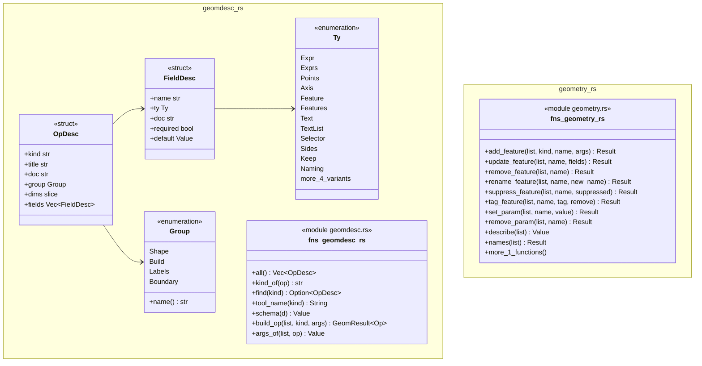

# Geometry operations: code

C4 level 4 (code) of the component **Geometry operations** (`engine.geometry`) in the container **nyx-engine** (crate `nyx_engine`). [Component view of the container](../../3-components/engine.md) · [All code pages](../README.md)

> Every edit of a geom feature list as a function that does it or says why not, and the descriptors of the geom operations (they live here because geom depends on serde only).

**Decisions:** [ADR 38](../../../adr/0038-geometry-operations-are-described-once.md), [ADR 3](../../../adr/0003-geom-is-a-lean-separate-kernel.md)  
**Size:** 2 files, 730 lines.

## Files

| File | Lines | What it says about itself |
|---|---:|---|
| `crates/nyx-engine/src/geomdesc.rs` | 527 | Descriptors of the geom feature operations (they live here, not in `geom`, because `geom` depends on serde only: ADR 3): for every `Op` its kind, what it does, its fields with their types and defaults, and the JSON Schema built from them... |
| `crates/nyx-engine/src/geometry.rs` | 203 | Editing the geometry of a project: every edit of a `geom` feature list the window or a host can make, as a function that either does it or leaves the list untouched and says why. The operations and their arguments come from `geomdesc`, s... |

## What it uses

| Target | Modules | Items |
|---|---|---|
| [container `geom` (geom)](../../3-components/geom.md) | error, eval, expr, model, select | Evaluator, Expr, Feature, FeatureList, GeomError, Op, Origin, Param, Selector, Tier +1 |
| [container `physics` (nyx-physics)](../../3-components/physics.md) | error | Error |

## Used by

| Component | Modules | Items |
|---|---|---|
| [Commands](./commands.md) | geomdesc, geometry |  |
| [Store link](./storeLink.md) | geomdesc | kind_of |

## Class diagram

Public types with their public fields (or variants) and methods, free functions per file as a `module` box; arrows are field types and `impl Trait`. Capped at 36 types and a few members each; the table below is complete.

## Public items

| Kind | Item | File:line | Signature or summary |
|---|---|---|---|
| enum | `Ty` | `geomdesc.rs:22` | variants: `Expr`, `Exprs`, `Points`, `Axis`, `Feature`, `Features`, `Text`, `TextList`, `Selector`, `Sides`, `Keep`, `Naming`, ... —  How the value of one field is written in a tool call. |
| struct | `FieldDesc` | `geomdesc.rs:56` | fields: `name`, `ty`, `doc`, `required`, `default` |
| enum | `Group` | `geomdesc.rs:67` | variants: `Shape`, `Build`, `Labels`, `Boundary` —  What an operation makes, for grouping tools. |
| struct | `OpDesc` | `geomdesc.rs:90` | fields: `kind`, `title`, `doc`, `group`, `dims`, `fields` |
| fn | `all` | `geomdesc.rs:112` | `pub fn all() -> Vec<OpDesc>` —  Every operation, in a fixed order (shapes, builders, naming, boundary). |
| fn | `kind_of` | `geomdesc.rs:232` | `pub fn kind_of(op: &Op) -> &'static str` —  The kind name of an operation. Exhaustive on purpose: a new `Op` variant does not compile until it is added here and in `all`. |
| fn | `find` | `geomdesc.rs:260` | `pub fn find(kind: &str) -> Option<OpDesc>` |
| fn | `tool_name` | `geomdesc.rs:265` | `pub fn tool_name(kind: &str) -> String` —  The tool name for an operation: `add_` and the snake_case kind (`add_rounded_rect`). |
| fn | `schema` | `geomdesc.rs:338` | `pub fn schema(d: &OpDesc) -> Value` —  The JSON Schema of the arguments of one operation (the `inputSchema` of its tool, without the fields every add tool shares). |
| fn | `build_op` | `geomdesc.rs:436` | `pub fn build_op(list: &FeatureList, kind: &str, args: &Value) -> GeomResult<Op>` —  Builds the operation `kind` from the arguments of a tool call. Features are named by name (or id), selectors are text; optional |
| fn | `args_of` | `geomdesc.rs:478` | `pub fn args_of(list: &FeatureList, op: &Op) -> Value` —  The arguments of an existing operation in the form `build_op` takes (features by name, selectors as text): what an editing tool shows |
| fn | `Group::name` | `geomdesc.rs:79` | `pub fn name(self) -> &'static str` |
| fn | `add_feature` | `geometry.rs:44` | `pub fn add_feature(list: &mut FeatureList, kind: &str, name: Option<&str>, args: &Value) -> Result<String, Error>` —  Adds the feature `kind` built from `args` (see `geomdesc`); returns the name it was given. |
| fn | `update_feature` | `geometry.rs:65` | `pub fn update_feature(list: &mut FeatureList, name: &str, fields: &Value) -> Result<(), Error>` —  Changes some fields of a feature; `fields` holds only the fields to change, in the same form `add_feature` takes. |
| fn | `remove_feature` | `geometry.rs:84` | `pub fn remove_feature(list: &mut FeatureList, name: &str) -> Result<(), Error>` —  Removes a feature that no later feature uses. |
| fn | `rename_feature` | `geometry.rs:101` | `pub fn rename_feature(list: &mut FeatureList, name: &str, new_name: &str) -> Result<(), Error>` |
| fn | `suppress_feature` | `geometry.rs:114` | `pub fn suppress_feature(list: &mut FeatureList, name: &str, suppressed: bool) -> Result<(), Error>` —  Suppressed features stay in the list and are skipped when the model is evaluated. |
| fn | `tag_feature` | `geometry.rs:123` | `pub fn tag_feature(list: &mut FeatureList, name: &str, tag: &str, remove: bool) -> Result<(), Error>` —  Adds or removes a tag of a feature (`remove` true removes it). |
| fn | `set_param` | `geometry.rs:137` | `pub fn set_param(list: &mut FeatureList, name: &str, value: &Value) -> Result<(), Error>` —  Sets a model parameter (a number, or an expression over the other parameters); creates it when new. |
| fn | `remove_param` | `geometry.rs:153` | `pub fn remove_param(list: &mut FeatureList, name: &str) -> Result<(), Error>` |
| fn | `describe` | `geometry.rs:165` | `pub fn describe(list: &FeatureList) -> Value` —  The feature list as a host reads it: each feature with its kind and its arguments in the form the add tools take. |
| fn | `names` | `geometry.rs:180` | `pub fn names(list: &FeatureList) -> Result<Value, Error>` —  Evaluates the model and returns the names a problem can refer to: regions and boundaries, before any mesh exists. |
| fn | `set_all` | `geometry.rs:198` | `pub fn set_all(list: &mut FeatureList, new: FeatureList) -> Result<(), Error>` —  Replaces the whole feature list (the window edits it as a whole); it must be a valid list of the same dimension class (2 or 3). |
