# Job runner and queue: code

C4 level 4 (code) of the component **Job runner and queue** (`engine.jobs`) in the container **nyx-engine** (crate `nyx_engine`). [Component view of the container](../../3-components/engine.md) · [All code pages](../README.md)

> Mesh, solve, convergence and file jobs on their own threads with progress and cancel, queued in lanes (priority, owners in turn, stages shared by content), solves in a worker process (killed on cancel, its stage log mirrored, results read back from a file), memory estimates learned from the workers and admission by free memory, solving physics in the order of the one-way couplings (region names put into the scalars a kernel names by domain number), mesh convergence on a scratch engine with solutions compared by index, paired by nearest eigenvalue or one mode followed; the queue of the workspace as a folder run by a queue worker that outlives the window (ADR 95); warm starts between the points of a sweep (ADR 96).

**Decisions:** [ADR 61](../../../adr/0061-convergence-is-an-engine-command.md), [ADR 80](../../../adr/0080-modes-carry-what-identifies-them-and-a-convergence-check-follows-a-mode.md), [ADR 85](../../../adr/0085-every-long-operation-is-a-job.md), [ADR 87](../../../adr/0087-work-is-queued-in-lanes-and-stages-are-shared-by-content.md), [ADR 86](../../../adr/0086-solves-run-in-a-worker-process.md), [ADR 11](../../../adr/0011-determinism-by-fixed-chunks.md), [ADR 95](../../../adr/0095-the-queue-is-a-folder-of-the-workspace-run-by-a-queue-worker.md), [ADR 96](../../../adr/0096-a-sweep-may-start-each-point-from-the-modes-of-the-one-before.md)  
**Size:** 11 files, 4568 lines.

## Files

| File | Lines | What it says about itself |
|---|---:|---|
| `crates/nyx-engine/src/bin/nyx-worker.rs` | 14 |  |
| `crates/nyx-engine/src/convergence.rs` | 699 |  |
| `crates/nyx-engine/src/estimate.rs` | 324 |  |
| `crates/nyx-engine/src/jobs.rs` | 595 |  |
| `crates/nyx-engine/src/process.rs` | 318 |  |
| `crates/nyx-engine/src/queue.rs` | 420 |  |
| `crates/nyx-engine/src/reuse.rs` | 204 |  |
| `crates/nyx-engine/src/shared_queue.rs` | 954 |  |
| `crates/nyx-engine/src/solve.rs` | 116 |  |
| `crates/nyx-engine/src/sweep.rs` | 457 |  |
| `crates/nyx-engine/src/worker.rs` | 467 |  |

## What it uses

| Target | Modules | Items |
|---|---|---|
| [container `femcore` (femcore)](../../3-components/femcore.md) | material::spec, mesh, progress, warm | Call, Library, Progress, SimplexMesh, Warm, from_bytes, install, stage, to_bytes |
| [container `physics` (nyx-physics)](../../3-components/physics.md) | error, physics, registry, result, validate | Ctx, Error, Registry, Scalar, SolveResult, validate_spec |
| [container `store` (nyx-store)](../../3-components/store.md) | workspace | default_root |
| [Commands](./commands.md) | commands, engine | Access, Engine, Purpose |
| [Materials](./materials.md) | materials | study_wavelength |
| [Meshing seam](./meshing.md) | meshing, preview | FemcoreMesher, MeshedModel, Mesher, cost_of |
| [Project](./project.md) | project | Project |
| [Registry and facade](./registry.md) | crate root | physics_for, registry |
| [Results files](./resultsIO.md) | h5io | read_results, write_results |
| [Store link](./storeLink.md) | store_link | RunOutcome, metrics_of |

## Used by

| Component | Modules | Items |
|---|---|---|
| [app: Window](../app/window.md) | process, queue, shared_queue, worker | QueueOpts, cli, opt_out_of_power_throttling, serve |
| [Commands](./commands.md) | convergence, estimate, jobs, process, queue, reuse +4 | Estimate, History, JobId, JobMeta, JobOutput, JobRunner, Lane, Limits +25 |
| [Meshing seam](./meshing.md) | estimate | Estimate, History, chain_key |
| [Registry and facade](./registry.md) | estimate, jobs, queue | Estimate, History, JobId, JobInfo, JobOutput, JobRunner, JobState, Lane +3 |
| [Results files](./resultsIO.md) | jobs | Opened |

## Class diagram

Public types with their public fields (or variants) and methods, free functions per file as a `module` box; arrows are field types and `impl Trait`. Capped at 36 types and a few members each; the table below is complete. **This component has 3 more types than the diagram shows.**

```mermaid
classDiagram
  namespace bin_nyx_worker_rs {
    class fns_bin_nyx_worker_rs {
        <<module bin/nyx-worker.rs>>
        -main()
    }
  }
  namespace convergence_rs {
    class Matching {
        <<enumeration>>
        Index
        Nearest
        Track
        +from_args(args) Result
    }
    class ConvergenceJob {
        <<struct>>
        +reuse Option
        +limits Limits
        +run(physics, factor, tolerance) Result
        +run_matched(physics, factor, tolerance, matching) Result
        +run_with(progress, physics, factor, tolerance, matching) Result
        +plan(physics, factor) Result
    }
    class Limits {
        <<struct>>
        +max_cells Option~u64~
        +max_seconds Option~f64~
        +from_args(args) Result
    }
    class Engine {
        <<impl block>>
        +convergence_job() ConvergenceJob
        +convergence_check(physics, factor, tolerance) Result
        +convergence_check_matched(physics, factor, tolerance, matching) Result
        +set_owner(owner)
        +owner() str
        ~shared() Option~SharedQueue~
        ~shared_of_job(id) Option~String~
        ~submission(label, lane, opts, key) Submit
        +more_11_methods()
    }
    class fns_convergence_rs {
        <<module convergence.rs>>
        ~numbers(r) Vec
    }
  }
  namespace estimate_rs {
    class Row {
        <<struct>>
        +chain String
        +dim u8
        +cells u64
        +dofs u64
        +peak_working_set u64
        +peak_commit u64
        +seconds f64
    }
    class Estimate {
        <<struct>>
        +bytes u64
        +bytes_with_margin u64
        +seconds Option~f64~
        +runs usize
        +extrapolated bool
        +exponent f64
    }
    class History {
        <<struct>>
        +set_file(path)
        +reload()
        +rows() Vec~Row~
        +flush()
        +add(row)
        +estimate(chain, dim, cells) Option~Estimate~
    }
    class fns_estimate_rs {
        <<module estimate.rs>>
        +estimate(rows, chain, dim, cells) Option~Estimate~
        +admit(est, force, probe, progress) Result
        +chain_key(targets) String
        +MemoryProbe type
        +REFUSE_ABOVE const
    }
  }
  namespace jobs_rs {
    class JobOutput {
        <<enumeration>>
        Mesh
        Solved
        Convergence
        Opened
        Exported
    }
    class WorkerRun {
        <<struct>>
        +peak_working_set Option~u64~
        +peak_commit Option~u64~
        +shared bool
    }
    class Opened {
        <<struct>>
        +project Project
        +model Arc~MeshedModel~
        +results Vec
        +path String
    }
    class JobState {
        <<enumeration>>
        Queued
        Running
        Done
        Cancelled
        Failed
        +is_open() bool
    }
    class Lane {
        <<enumeration>>
        Heavy
        Light
        Shared
    }
    class Submit {
        <<struct>>
        +label String
        +lane Lane
        +owner String
        +priority u8
        +key Option~String~
        +supersede bool
        +hold bool
        +new(label, lane) Submit
    }
    class JobInfo {
        <<struct>>
        +id JobId
        +label String
        +state JobState
        +lane Lane
        +owner String
        +priority u8
        +held bool
        +position Option~usize~
        +more_6_fields
    }
    class JobRunner {
        <<struct>>
        +new() JobRunner
        +start(label, work) JobId
        +submit(spec, work) JobId
        +info(id) Option~JobInfo~
        +progress(id) Option
        +list() Vec~JobInfo~
        +running() Vec~JobId~
        +cancel(id) bool
        +more_13_methods()
    }
    class fns_jobs_rs {
        <<module jobs.rs>>
        +JobId type
    }
  }
  namespace process_rs {
    class fns_process_rs {
        <<module process.rs>>
        +opt_out_of_power_throttling() bool
        +peak_memory() Option
        +system_memory() Option
        +spawn_detached(program, args) Result
    }
  }
  namespace queue_rs {
    class QueueOpts {
        <<struct>>
        +priority Option~u8~
        +supersede bool
        +hold bool
        +isolate Option~bool~
        +force bool
        +shared Option~bool~
        +warm Option~WarmLink~
    }
    class JobMeta {
        <<struct>>
        +kind str
        +targets Vec~String~
        +stamp String
        +estimate Arc
        +shared_id Option
    }
    class SolveSummary {
        <<struct>>
        +dofs usize
        +cells usize
        +numbers Vec
        +of(r, cells) SolveSummary
    }
    class Stages {
        <<struct>>
        +mesh(key) Option
        +put_mesh(key, m)
        +solve(key) Option
        +put_solve(key, r)
        +clear()
    }
    class fns_queue_rs {
        <<module queue.rs>>
        ~solve_key(problem_key, targets) String
    }
  }
  namespace reuse_rs {
    class WarmDone {
        <<struct>>
        +bytes Option
        +calls Vec~Value~
    }
    class WarmCell {
        <<struct>>
        +new() Arc~WarmCell~
        +get() Option~WarmDone~
        +set(d)
    }
    class WarmSource {
        <<enumeration>>
        Cold
        Bytes
        Cell
    }
    class WarmLink {
        <<struct>>
        +source WarmSource
        +mine Arc~WarmCell~
        +index usize
        +guard() CellGuard
        +for_worker(input, mine) WarmLink
        +resolve(jobs, wait, progress) Result
    }
    class Resolved {
        <<struct>>
        +bytes Option
        +from Option~usize~
        +why_cold Option
    }
    class CellGuard {
        <<struct>>
    }
    class fns_reuse_rs {
        <<module reuse.rs>>
        +reuse_json(link, r, calls) Value
        +call_json(c) Value
        +with_context(resolved, f) tuple
    }
  }
  namespace shared_queue_rs {
    class Request {
        <<struct>>
        +id String
        +owner String
        +priority u8
        +label String
        +targets Vec~String~
        +stamp String
        +submitted_ms u64
        +force bool
        +more_2_fields
    }
    class NewItem {
        <<struct>>
        +owner String
        +priority u8
        +label String
        +stamp String
        +hold bool
        +force bool
        +estimate Option~Estimate~
    }
    class State {
        <<struct>>
        +state String
        +stage String
        +stage_seconds f64
        +fraction Option~f64~
        +log Vec~String~
        +error Option~Value~
        +has_results bool
        +peak_working_set Option~u64~
        +more_5_fields
        +is_finished() bool
    }
    class Item {
        <<struct>>
        +request Request
        +state Option~State~
        +held bool
        +cancel_requested bool
        +priority u8
        +position Option~usize~
        +state_name() str
        +is_open() bool
        +to_json(workspace_queue) Value
    }
    class SharedQueue {
        <<struct>>
        +new(workspace) SharedQueue
        +root() Path
        +item_dir(id) PathBuf
        ~submit(n, spec) Result
        +item(id) Option~Item~
        +items() Vec~Item~
        +cancel(id) bool
        +hold(id) bool
        +more_9_methods()
    }
    class RunnerOptions {
        <<struct>>
        +worker PathBuf
        +idle_exit Duration
        +tick Duration
        +age Duration
        +probe MemoryProbe
        +history Arc~History~
        +standard(workspace) RunnerOptions
    }
    class fns_shared_queue_rs {
        <<module shared_queue.rs>>
        +default_workspace() PathBuf
        +run_queue(workspace, o) Result
        ~run_shared(q, program, n, spec, progress, id_slot, own) Result
        ~run_shared(_q, _program, _n, _spec, _progress, _id_slot, _own) Result
        +cli(args) i32
        +LEASE_DEAD const
        +KEEP_FINISHED const
    }
  }
  namespace solve_rs {
    class fns_solve_rs {
        <<module solve.rs>>
        +run_chain(registry, project, model, targets, library, progress) Result
        +run_chain_partial(registry, project, model, targets, library, progress) tuple
    }
  }
  namespace sweep_rs {
    class Point {
        <<struct>>
        +label String
        +edits Vec~Value~
        +job JobId
        +row Option~Value~
    }
    class Sweep {
        <<struct>>
        +name String
        +targets Vec~String~
        +points Vec~Point~
    }
    class Prepared {
        <<struct>>
        +targets Option
        +engines Vec~Engine~
    }
    class fns_sweep_rs {
        <<module sweep.rs>>
        +MAX_POINTS const
    }
  }
  namespace worker_rs {
    class RemoteSpec {
        <<struct>>
        +worker PathBuf
        +project_json String
        +materials BTreeMap
        +targets Vec~String~
        +warm Option~WarmIo~
    }
    class WarmIo {
        <<struct>>
        +input Option
    }
    class fns_worker_rs {
        <<module worker.rs>>
        +material_texts(lib) BTreeMap
        +serve(args) i32
        ~write_job_files(dir, spec) Result
        ~run_child(worker, dir, on_status, on_spawn, cancelled) Result
        ~stopped_words(status, stderr) String
        ~read_done(d, dir, progress) Result
        ~run_remote(spec, progress) Result
        ~run_remote(_spec, _progress) Result
        ~same_mesh(a, b) bool
        +PREFIX const
    }
  }
  ConvergenceJob --> Stages
  ConvergenceJob --> Limits
  JobOutput --> WorkerRun
  JobOutput --> Opened
  Submit --> Lane
  JobInfo --> JobState
  JobInfo --> Lane
  QueueOpts --> WarmLink
  JobMeta --> Estimate
  WarmSource --> WarmCell
  WarmLink --> WarmSource
  WarmLink --> WarmCell
  NewItem --> Estimate
  Item --> Request
  Item --> State
  RunnerOptions --> History
  Sweep --> Point
  Prepared --> Engine
  RemoteSpec --> WarmIo
```

## Public items

| Kind | Item | File:line | Signature or summary |
|---|---|---|---|
| fn | `main` | `bin/nyx-worker.rs:5` | `fn main()` |
| fn | `numbers` | `convergence.rs:45` | `pub(crate) fn numbers(r: &SolveResult) -> Vec<(String, f64)>` —  Every named number of a result, in a fixed order: `eigenvalue[i].re`, `eigenvalue[i].im`, `value[i]` and the numeric scalars. |
| enum | `Matching` | `convergence.rs:70` | variants: `Index`, `Nearest`, `Track` —  How the solutions of the two meshes are paired. |
| struct | `ConvergenceJob` | `convergence.rs:258` | fields: `reuse`, `limits` —  Everything a convergence check needs, owned, so that a front-end can run it on its own thread while the engine stays usable. |
| struct | `Limits` | `convergence.rs:274` | fields: `max_cells`, `max_seconds` —  What a convergence check may cost: it is refused, before any solve, when the finer mesh has more cells than `max_cells` or when the solves it |
| fn | `Matching::from_args` | `convergence.rs:84` | `pub fn from_args(args: &Value) -> Result<Matching, Error>` —  From the arguments of the command: `match` is `index` or `nearest`, `track` is `{ "f": <value> }` and implies `nearest`. |
| fn | `Limits::from_args` | `convergence.rs:281` | `pub fn from_args(args: &Value) -> Result<Limits, Error>` —  `max_cells` and `max_seconds` of the arguments of the command. |
| fn | `ConvergenceJob::run` | `convergence.rs:311` | `pub fn run(&self, physics: &str, factor: f64, tolerance: Option<f64>) -> Result<Value, Error>` —  Runs the check (see `Engine::convergence_check`); blocks until both solves are done. |
| fn | `ConvergenceJob::run_matched` | `convergence.rs:316` | `pub fn run_matched( &self, physics: &str, factor: f64, tolerance: Option<f64>, matching: &Matching, ) -> Result<Value, Error>` —  The check with the solutions paired as `matching` says. |
| fn | `ConvergenceJob::run_with` | `convergence.rs:327` | `pub fn run_with( &self, progress: &Arc<Progress>, physics: &str, factor: f64, tolerance: Option<f64>, matching: &Matching, ) -> Result<Value, Error>` —  Runs the check on the calling thread under `progress`: its two solves are two stages of it, and its cancel flag stops either. |
| fn | `ConvergenceJob::plan` | `convergence.rs:383` | `pub fn plan(&self, physics: &str, factor: f64) -> Result<Value, Error>` —  What the check would cost, without solving anything: the present mesh and the finer one are built (milliseconds against a solve), and the |
| fn | `Engine::convergence_job` | `convergence.rs:414` | `pub fn convergence_job(&self) -> ConvergenceJob` —  A snapshot of what `convergence_check` needs. |
| fn | `Engine::convergence_check` | `convergence.rs:430` | `pub fn convergence_check(&self, physics: &str, factor: f64, tolerance: Option<f64>) -> Result<Value, Error>` —  Solves `physics` on the current mesh and on one made finer by `factor`, and compares the numbers of the two results, on the calling thread |
| fn | `Engine::convergence_check_matched` | `convergence.rs:437` | `pub fn convergence_check_matched( &self, physics: &str, factor: f64, tolerance: Option<f64>, matching: &Matching, ) -> Result<Value, Error>` —  `convergence_check` with the modes of the two meshes paired by their eigenvalues (`Matching::Nearest`) or one mode followed |
| struct | `Row` | `estimate.rs:19` | fields: `chain`, `dim`, `cells`, `dofs`, `peak_working_set`, `peak_commit`, `seconds` —  One finished worker run. |
| struct | `Estimate` | `estimate.rs:33` | fields: `bytes`, `bytes_with_margin`, `seconds`, `runs`, `extrapolated`, `exponent` —  An estimate with its basis. |
| fn | `estimate` | `estimate.rs:63` | `pub fn estimate(rows: &[Row], chain: &str, dim: u8, cells: u64) -> Option<Estimate>` —  The estimate for a solve of `chain` in `dim` dimensions on `cells` cells from `rows`, or `None` when the rows do not support one. |
| struct | `History` | `estimate.rs:133` |  The rows an engine has learned from, in memory and, when a file is set, appended to it as JSON lines (one `write` per line, like the run |
| type | `MemoryProbe` | `estimate.rs:201` |  What the machine says about its memory: `(total, available)` in bytes. Replaceable, so a test can play a machine that is full. |
| const | `REFUSE_ABOVE` | `estimate.rs:205` | `f64` —  How much of the machine's memory a solve may be expected to take at most: above this fraction of the physical memory a solve is refused, |
| fn | `admit` | `estimate.rs:215` | `pub fn admit( est: &Estimate, force: bool, probe: &MemoryProbe, progress: &std::sync::Arc<femcore::progress::Progress>, ) -> Result<(), nyx_physics::Error>` —  Lets a solve start only when its estimate fits. Above `REFUSE_ABOVE` of the physical memory it fails at once, unless `force`: it cannot be |
| fn | `chain_key` | `estimate.rs:258` | `pub fn chain_key(targets: &[String]) -> String` —  The chain's key: codes sorted and joined. |
| fn | `History::set_file` | `estimate.rs:152` | `pub fn set_file(&self, path: &Path)` —  Keeps the rows in `path` from now on and reads the ones it holds; a line that cannot be read is skipped. |
| fn | `History::reload` | `estimate.rs:163` | `pub fn reload(&self)` —  Reads the file again: another program (the queue worker of the workspace) appends rows to it too. |
| fn | `History::rows` | `estimate.rs:170` | `pub fn rows(&self) -> Vec<Row>` |
| fn | `History::flush` | `estimate.rs:175` | `pub fn flush(&self)` —  Waits until every line added so far has been written to the file. |
| fn | `History::add` | `estimate.rs:185` | `pub fn add(&self, row: Row)` |
| fn | `History::estimate` | `estimate.rs:195` | `pub fn estimate(&self, chain: &str, dim: u8, cells: u64) -> Option<Estimate>` |
| type | `JobId` | `jobs.rs:22` |  |
| enum | `JobOutput` | `jobs.rs:25` | variants: `Mesh`, `Solved`, `Convergence`, `Opened`, `Exported` —  What a finished job hands back. The engine applies it to its state (`Engine::apply`). |
| struct | `WorkerRun` | `jobs.rs:49` | fields: `peak_working_set`, `peak_commit`, `shared` —  What a worker process measured of its own solve: the most memory it used, in bytes (the in-process job cannot know: the process is shared). |
| struct | `Opened` | `jobs.rs:58` | fields: `project`, `model`, `results`, `path` —  What opening a results file gives the engine to apply. |
| enum | `JobState` | `jobs.rs:68` | variants: `Queued`, `Running`, `Done`, `Cancelled`, `Failed` |
| enum | `Lane` | `jobs.rs:87` | variants: `Heavy`, `Light`, `Shared` —  The resource class of a job. The heavy lane runs one job at a time; the light lane (I/O) runs beside it. |
| struct | `Submit` | `jobs.rs:97` | fields: `label`, `lane`, `owner`, `priority`, `key`, `supersede`, `hold` —  How a job is submitted: its name, lane, owner and priority. |
| struct | `JobInfo` | `jobs.rs:120` | fields: `id`, `label`, `state`, `lane`, `owner`, `priority`, `held`, `position`, `queued_seconds`, `stage`, `stage_seconds`, `fraction`, ... |
| struct | `JobRunner` | `jobs.rs:189` |  |
| fn | `JobState::is_open` | `jobs.rs:79` | `pub fn is_open(&self) -> bool` —  Queued or running: the job has not finished. |
| fn | `Submit::new` | `jobs.rs:114` | `pub fn new(label: &str, lane: Lane) -> Submit` |
| fn | `JobRunner::new` | `jobs.rs:300` | `pub fn new() -> JobRunner` |
| fn | `JobRunner::start` | `jobs.rs:319` | `pub fn start<F>(&self, label: &str, work: F) -> JobId` —  Submits `work` to the heavy lane with the default owner and priority. |
| fn | `JobRunner::submit` | `jobs.rs:328` | `pub fn submit<F>(&self, spec: Submit, work: F) -> JobId` —  Submits `work`. It starts at once when its lane is free, otherwise it waits in the queue. The closure gets the job's `Progress`; a panic in |
| fn | `JobRunner::info` | `jobs.rs:375` | `pub fn info(&self, id: JobId) -> Option<JobInfo>` |
| fn | `JobRunner::progress` | `jobs.rs:415` | `pub fn progress(&self, id: JobId) -> Option<Arc<Progress>>` —  The progress handle of a job: the stage it is in, the log so far, the cancel flag. A front-end that shows a bar reads it. |
| fn | `JobRunner::list` | `jobs.rs:420` | `pub fn list(&self) -> Vec<JobInfo>` —  All jobs, oldest first. |
| fn | `JobRunner::running` | `jobs.rs:426` | `pub fn running(&self) -> Vec<JobId>` —  The jobs that have not finished (queued or running). |
| fn | `JobRunner::cancel` | `jobs.rs:448` | `pub fn cancel(&self, id: JobId) -> bool` —  Asks the job to stop. A queued job stops at once and never runs; a running one notices at its next check (a factorisation finishes first). |
| fn | `JobRunner::hold` | `jobs.rs:461` | `pub fn hold(&self, id: JobId) -> bool` —  Keeps a queued job from starting until `release`. False when it is not queued. |
| fn | `JobRunner::release` | `jobs.rs:476` | `pub fn release(&self, id: JobId) -> bool` |
| fn | `JobRunner::set_priority` | `jobs.rs:493` | `pub fn set_priority(&self, id: JobId, priority: u8) -> bool` —  Changes the priority of a queued job. False when it is not queued. |
| fn | `JobRunner::pause` | `jobs.rs:509` | `pub fn pause(&self)` —  Stops the queue from starting anything new; what runs finishes. |
| fn | `JobRunner::resume` | `jobs.rs:513` | `pub fn resume(&self)` |
| fn | `JobRunner::paused` | `jobs.rs:518` | `pub fn paused(&self) -> bool` |
| fn | `JobRunner::set_limit` | `jobs.rs:523` | `pub fn set_limit(&self, lane: Lane, n: usize)` —  How many jobs a lane runs at once (heavy 1, light 2 by default). |
| fn | `JobRunner::set_age` | `jobs.rs:536` | `pub fn set_age(&self, age: Duration)` —  After this long in the queue a job competes one priority level higher. |
| fn | `JobRunner::log` | `jobs.rs:541` | `pub fn log(&self, id: JobId) -> Vec<String>` —  The stage log of the job so far. |
| fn | `JobRunner::try_take` | `jobs.rs:546` | `pub fn try_take(&self, id: JobId) -> Option<Result<JobOutput, Error>>` —  The outcome if the job has finished and it has not been taken; `None` while queued or running, or after it was taken. |
| fn | `JobRunner::blocked` | `jobs.rs:552` | `pub fn blocked(&self, id: JobId) -> Option<&'static str>` —  Why a queued job cannot start however long it is waited for: it is held, or the queue is paused. `None` for a job that is running or will |
| fn | `JobRunner::wait` | `jobs.rs:568` | `pub fn wait(&self, id: JobId) -> Result<JobOutput, Error>` —  Blocks until the job has finished and takes its outcome. |
| fn | `JobRunner::wait_timeout` | `jobs.rs:578` | `pub fn wait_timeout(&self, id: JobId, timeout: Duration) -> Option<Result<JobOutput, Error>>` —  Like `wait`, but gives up after `timeout`: `None` when the job is still queued or running then (it keeps going and can be waited for again). |
| fn | `opt_out_of_power_throttling` | `process.rs:14` | `pub fn opt_out_of_power_throttling() -> bool` —  Asks Windows not to throttle this process. True when the request was accepted; false when it was refused (an older Windows) or on another |
| fn | `peak_memory` | `process.rs:56` | `pub fn peak_memory() -> Option<(u64, u64)>` —  The most memory this process has used so far, in bytes: `(peak working set, peak commit)`. The working set is what was in RAM, the commit what |
| fn | `system_memory` | `process.rs:95` | `pub fn system_memory() -> Option<(u64, u64)>` —  The physical memory of the machine and what is available now without paging, in bytes: `(total, available)`. Admission (`estimate.rs`) |
| fn | `spawn_detached` | `process.rs:144` | `pub fn spawn_detached(program: &std::path::Path, args: &[std::ffi::OsString]) -> std::io::Result<()>` —  Starts `program args...` as a process that belongs to nobody: it outlives the program that started it, has no console and no standard |
| struct | `QueueOpts` | `queue.rs:19` | fields: `priority`, `supersede`, `hold`, `isolate`, `force`, `shared`, `warm` —  How a request is queued. The default is the engine's owner at its usual priority, with nothing superseded. |
| struct | `JobMeta` | `queue.rs:39` | fields: `kind`, `targets`, `stamp`, `estimate`, `shared_id` —  What the engine remembers of a job beyond the runner's own record. |
| struct | `SolveSummary` | `queue.rs:52` | fields: `dofs`, `cells`, `numbers` —  What a mesh convergence check needs of the coarse solve: the numbers that identify its solutions, the unknowns and the cells. A result's |
| struct | `Stages` | `queue.rs:66` |  Recent stages, found by content. Small on purpose: a mesh of a large model is gigabytes. |
| fn | `solve_key` | `queue.rs:110` | `pub(crate) fn solve_key(problem_key: &str, targets: &[String]) -> String` —  The cache key of a solve: the problem key of the physics and the chain it was solved in (the sorted targets of its job). |
| fn | `SolveSummary::of` | `queue.rs:59` | `pub fn of(r: &SolveResult, cells: usize) -> SolveSummary` |
| fn | `Stages::mesh` | `queue.rs:75` | `pub fn mesh(&self, key: &str) -> Option<Arc<MeshedModel>>` |
| fn | `Stages::put_mesh` | `queue.rs:79` | `pub fn put_mesh(&self, key: &str, m: &Arc<MeshedModel>)` |
| fn | `Stages::solve` | `queue.rs:89` | `pub fn solve(&self, key: &str) -> Option<Arc<SolveSummary>>` |
| fn | `Stages::put_solve` | `queue.rs:93` | `pub fn put_solve(&self, key: &str, r: &Arc<SolveSummary>)` |
| fn | `Stages::clear` | `queue.rs:103` | `pub fn clear(&self)` |
| fn | `Engine::set_owner` | `queue.rs:133` | `pub fn set_owner(&mut self, owner: &str)` —  Names who this engine's requests are made for (`gui`, `ai`, `cli`): the queue serves owners in turn, and a person's requests run first. |
| fn | `Engine::owner` | `queue.rs:137` | `pub fn owner(&self) -> &str` |
| fn | `Engine::shared` | `queue.rs:142` | `pub(crate) fn shared(&self) -> Option<crate::shared_queue::SharedQueue>` —  The queue of the workspace, when the engine has a workspace. |
| fn | `Engine::shared_of_job` | `queue.rs:147` | `pub(crate) fn shared_of_job(&self, id: JobId) -> Option<String>` —  The item id of a job of this engine that was handed to the workspace queue. |
| fn | `Engine::submission` | `queue.rs:164` | `pub(crate) fn submission(&self, label: &str, lane: Lane, opts: &QueueOpts, key: &str) -> Submit` —  The submission of a job of this engine: owner, priority by owner unless given, and the key a newer request of the same kind replaces. |
| fn | `Engine::queue_entry` | `queue.rs:175` | `pub fn queue_entry(&self, id: JobId) -> Option<Value>` —  A job as the queue commands show it: the runner's record plus what was asked and whether the project has changed since. |
| fn | `Engine::queue_list` | `queue.rs:202` | `pub fn queue_list(&self, owner: Option<&str>, state: Option<&str>) -> Vec<Value>` —  The queue, oldest first, optionally of one owner or one state (`queued`, `running`, `done`, `cancelled`, `failed`). |
| fn | `Engine::wait_timeout` | `queue.rs:243` | `pub fn wait_timeout(&mut self, id: JobId, timeout: Duration) -> Result<Value, Error>` —  Waits for a job up to `timeout` and applies its outcome; at the timeout the job's entry comes back with `waiting: true` and the job goes on. |
| fn | `Engine::queue_command` | `queue.rs:260` | `pub(crate) fn queue_command(&mut self, name: &str, args: &Value) -> Result<Value, Error>` —  The `queue_*` commands (see the catalog). |
| fn | `Engine::note_shared` | `queue.rs:398` | `pub(crate) fn note_shared(&mut self, id: JobId, item: Option<Arc<Mutex<Option<String>>>>)` —  Remembers that the job `id` was handed to the workspace queue, and under which item. |
| fn | `Engine::note_job` | `queue.rs:404` | `pub(crate) fn note_job(&mut self, id: JobId, kind: &'static str, targets: Vec<String>)` |
| fn | `Engine::note_job_estimate` | `queue.rs:409` | `pub(crate) fn note_job_estimate( &mut self, id: JobId, kind: &'static str, targets: Vec<String>, estimate: Arc<Mutex<Option<crate::estimate::Estimate>>>, )` —  `note_job` for a job that fills in its own estimate (a solve, once its mesh is known). |
| struct | `WarmDone` | `reuse.rs:25` | fields: `bytes`, `calls` —  What a finished point leaves for the next: the modes as bytes (none when it failed, or its eigensolves left none) and what its eigensolves did. |
| struct | `WarmCell` | `reuse.rs:32` |  Where a point leaves its modes. Empty until the point's job has ended. |
| enum | `WarmSource` | `reuse.rs:54` | variants: `Cold`, `Bytes`, `Cell` —  Where a point's start block comes from. |
| struct | `WarmLink` | `reuse.rs:65` | fields: `source`, `mine`, `index` —  A point's place in a warm sweep. |
| struct | `Resolved` | `reuse.rs:78` | fields: `bytes`, `from`, `why_cold` —  What a point found to start from. |
| struct | `CellGuard` | `reuse.rs:87` |  Sets the point's cell empty-handed if its job ends without having filled it. |
| fn | `reuse_json` | `reuse.rs:170` | `pub fn reuse_json(link: &WarmLink, r: &Resolved, calls: &[Value]) -> Value` —  The record of what a point did with its start, for the table row and the run: whether it started warm and from which point, how many |
| fn | `call_json` | `reuse.rs:187` | `pub fn call_json(c: &femcore::warm::Call) -> Value` —  One eigensolve's record as JSON. |
| fn | `with_context` | `reuse.rs:193` | `pub fn with_context<R>(resolved: &Resolved, f: impl FnOnce() -> R) -> (R, WarmDone)` —  Runs `f` (the in-process solve of one point) under a warm context made from `resolved`, and returns what it returned with the modes the |
| fn | `WarmCell::new` | `reuse.rs:35` | `pub fn new() -> Arc<WarmCell>` |
| fn | `WarmCell::get` | `reuse.rs:39` | `pub fn get(&self) -> Option<WarmDone>` |
| fn | `WarmCell::set` | `reuse.rs:43` | `pub fn set(&self, d: WarmDone)` |
| fn | `WarmLink::guard` | `reuse.rs:98` | `pub fn guard(&self) -> CellGuard` |
| fn | `WarmLink::for_worker` | `reuse.rs:103` | `pub fn for_worker(input: Option<Arc<Vec<u8>>>, mine: Arc<WarmCell>) -> WarmLink` —  A link for a worker process: it is given the previous point's modes (or none) and leaves its own in `mine`. |
| fn | `WarmLink::resolve` | `reuse.rs:109` | `pub fn resolve( &self, jobs: &JobRunner, wait: bool, progress: &Arc<femcore::progress::Progress>, ) -> Result<Resolved, Error>` —  Finds what to start from. With `wait` a point whose predecessor is still running waits for it (and stops at once on its own cancel); |
| fn | `default_workspace` | `shared_queue.rs:33` | `pub fn default_workspace() -> PathBuf` —  The folder the window and the MCP server share by default: `NYX_WORKSPACE`, else the person's `Documents/nyx` (the window's workspace). |
| const | `LEASE_DEAD` | `shared_queue.rs:38` | `Duration` —  A lease not touched for this long belongs to a queue worker that is gone. |
| const | `KEEP_FINISHED` | `shared_queue.rs:40` | `Duration` —  A finished item nobody collected is removed after this long. |
| struct | `Request` | `shared_queue.rs:48` | fields: `id`, `owner`, `priority`, `label`, `targets`, `stamp`, `submitted_ms`, `force`, `estimate`, `from_pid` —  What was asked, written once by the front-end. |
| struct | `NewItem` | `shared_queue.rs:69` | fields: `owner`, `priority`, `label`, `stamp`, `hold`, `force`, `estimate` —  What a front-end puts in an item besides the frozen project. |
| struct | `State` | `shared_queue.rs:81` | fields: `state`, `stage`, `stage_seconds`, `fraction`, `log`, `error`, `has_results`, `peak_working_set`, `peak_commit`, `started_ms`, `ended_ms`, `child_pid`, ... —  What the queue worker says of an item. An item with no `state.json` is queued. |
| struct | `Item` | `shared_queue.rs:108` | fields: `request`, `state`, `held`, `cancel_requested`, `priority`, `position` —  An item as a front-end sees it: the request, the worker's state and the markers. |
| struct | `SharedQueue` | `shared_queue.rs:220` |  The queue folder of one workspace. |
| struct | `RunnerOptions` | `shared_queue.rs:422` | fields: `worker`, `idle_exit`, `tick`, `age`, `probe`, `history` —  What the queue worker is told. |
| fn | `run_queue` | `shared_queue.rs:507` | `pub fn run_queue(workspace: &Path, o: &RunnerOptions) -> Result<(), String>` —  Runs the queue of `workspace` until it has been idle for `idle_exit`, or another queue worker holds the lease. Returns at once (and `Ok`) when |
| fn | `run_shared` | `shared_queue.rs:716` | `pub(crate) fn run_shared( q: &SharedQueue, program: &Path, n: &NewItem, spec: &crate::worker::RemoteSpec, progress: &std::sync::Arc<femcore::progress::Progress>, id_slot: &std::sync::Mutex<Option<String>>, own: &std::sync::Mutex<std::collections::BTreeSet<String>>, ) -> Result<crate::worker::RemoteDone, Error>` —  Hands a solve to the queue of the workspace and waits for it there, as one job of this engine: writes the item, makes sure a queue worker is |
| fn | `run_shared` | `shared_queue.rs:793` | `pub(crate) fn run_shared( _q: &SharedQueue, _program: &Path, _n: &NewItem, _spec: &crate::worker::RemoteSpec, _progress: &std::sync::Arc<femcore::progress::Progress>, _id_slot: &std::sync::Mutex<Option<String>>, _own: &std::sync::Mutex<std::collections::BTreeSet<String>>, ) -> Result<crate::worker::RemoteDone, Error>` |
| fn | `cli` | `shared_queue.rs:823` | `pub fn cli(args: &[String]) -> i32` —  `nyx queue list\|cancel\|hold\|release\|priority\|pause\|resume\|clear WORKSPACE [ID [N]]`: what a person at a terminal does with the queue of a |
| fn | `State::is_finished` | `shared_queue.rs:101` | `pub fn is_finished(&self) -> bool` |
| fn | `Item::state_name` | `shared_queue.rs:121` | `pub fn state_name(&self) -> &str` —  `queued`, `held`, `running`, `done`, `failed` or `cancelled` |
| fn | `Item::is_open` | `shared_queue.rs:130` | `pub fn is_open(&self) -> bool` |
| fn | `Item::to_json` | `shared_queue.rs:135` | `pub fn to_json(&self, workspace_queue: &SharedQueue) -> Value` —  The entry the queue commands show. |
| fn | `SharedQueue::new` | `shared_queue.rs:226` | `pub fn new(workspace: &Path) -> SharedQueue` —  The queue of `workspace` (the folder is made when the first item is written). |
| fn | `SharedQueue::root` | `shared_queue.rs:230` | `pub fn root(&self) -> &Path` |
| fn | `SharedQueue::item_dir` | `shared_queue.rs:238` | `pub fn item_dir(&self, id: &str) -> PathBuf` |
| fn | `SharedQueue::submit` | `shared_queue.rs:259` | `pub(crate) fn submit(&self, n: &NewItem, spec: &crate::worker::RemoteSpec) -> Result<String, Error>` —  Writes a solve as an item and returns its id. The folder appears under its name only when it is complete. |
| fn | `SharedQueue::item` | `shared_queue.rs:305` | `pub fn item(&self, id: &str) -> Option<Item>` —  The item `id`, if it is there. |
| fn | `SharedQueue::items` | `shared_queue.rs:325` | `pub fn items(&self) -> Vec<Item>` —  Every item, oldest first, with its place in the order of starting where the queue worker has ranked it. |
| fn | `SharedQueue::cancel` | `shared_queue.rs:358` | `pub fn cancel(&self, id: &str) -> bool` —  Asks for `id` to be cancelled: a queued item is cancelled at the next look of the queue worker, a running one has its solver killed. |
| fn | `SharedQueue::hold` | `shared_queue.rs:362` | `pub fn hold(&self, id: &str) -> bool` |
| fn | `SharedQueue::release` | `shared_queue.rs:366` | `pub fn release(&self, id: &str) -> bool` |
| fn | `SharedQueue::set_priority` | `shared_queue.rs:370` | `pub fn set_priority(&self, id: &str, priority: u8) -> bool` |
| fn | `SharedQueue::pause` | `shared_queue.rs:375` | `pub fn pause(&self) -> bool` —  The queue is paused: the queue worker finishes what it runs and starts nothing. |
| fn | `SharedQueue::resume` | `shared_queue.rs:379` | `pub fn resume(&self)` |
| fn | `SharedQueue::paused` | `shared_queue.rs:383` | `pub fn paused(&self) -> bool` |
| fn | `SharedQueue::remove` | `shared_queue.rs:388` | `pub fn remove(&self, id: &str) -> bool` —  Removes an item (the results of a finished one included); false when it is still open. |
| fn | `SharedQueue::clear_finished` | `shared_queue.rs:397` | `pub fn clear_finished(&self) -> usize` —  Removes the finished items; returns how many. |
| fn | `SharedQueue::runner_alive` | `shared_queue.rs:402` | `pub fn runner_alive(&self) -> bool` —  Whether a queue worker holds the lease now. |
| fn | `SharedQueue::ensure_runner` | `shared_queue.rs:409` | `pub fn ensure_runner(&self, program: &Path) -> Result<(), Error>` —  Starts a queue worker (`program --worker <workspace>`) unless one holds the lease. The program runs on its own (`process::spawn_detached`: |
| fn | `RunnerOptions::standard` | `shared_queue.rs:437` | `pub fn standard(workspace: &Path) -> RunnerOptions` —  The settings of a real queue worker: the program itself as the solver, the machine's memory, an end after 30 s idle (`NYX_QUEUE_IDLE_SECS`). |
| fn | `run_chain` | `solve.rs:41` | `pub fn run_chain( registry: &Registry, project: &Project, model: &MeshedModel, targets: &[String], library: &Arc<femcore::material::Library>, progress: Arc<Progress>, ) -> Result<Vec<SolveResult>, Error>` —  Solves `targets` (and nothing else) in coupling order. The result of each is returned in the order it was solved. |
| fn | `run_chain_partial` | `solve.rs:57` | `pub fn run_chain_partial( registry: &Registry, project: &Project, model: &MeshedModel, targets: &[String], library: &Arc<femcore::material::Library>, progress: Arc<Progress>, ) -> (Vec<SolveResult>, Option<Error>)` —  Like `run_chain`, but when a physics fails the physics solved before it are returned with the error: a failed `sms` keeps the `ems` result |
| const | `MAX_POINTS` | `sweep.rs:20` | `usize` —  The most points one request may make: a sweep is a queue of jobs, not a way to start ten thousand. |
| struct | `Point` | `sweep.rs:22` | fields: `label`, `edits`, `job`, `row` |
| struct | `Sweep` | `sweep.rs:30` | fields: `name`, `targets`, `points` |
| struct | `Prepared` | `sweep.rs:37` | fields: `targets`, `engines` —  A checked sweep request: the points, the physics named (if any), the queue options and one engine per point. |
| fn | `Engine::scratch` | `sweep.rs:110` | `pub(crate) fn scratch(&self) -> Engine` —  A copy of this engine for editing: the project is a copy, the mesher, the registry and the material library are shared. Nothing it does |
| fn | `Engine::sweep_command` | `sweep.rs:152` | `pub(crate) fn sweep_command(&mut self, name: &str, args: &Value) -> Result<Value, Error>` |
| fn | `Engine::sweep_prepare` | `sweep.rs:168` | `pub(crate) fn sweep_prepare(&self, args: &Value) -> Result<Prepared, Error>` —  Reads and checks a sweep request without submitting anything: the points, what they solve, how they queue, and the engine of every point |
| fn | `Engine::apply_point` | `sweep.rs:331` | `pub(crate) fn apply_point( &mut self, id: JobId, sweep: u64, index: usize, project: crate::project::Project, outcome: Result<JobOutput, Error>, ) -> Result<Value, Error>` —  Applies a finished point: records its run, keeps its numbers in the table and drops its result. The engine's own results and mesh are |
| const | `PREFIX` | `worker.rs:28` | `&str` —  Every line of the worker's standard output that is a message starts with this. |
| struct | `RemoteSpec` | `worker.rs:32` | fields: `worker`, `project_json`, `materials`, `targets`, `warm` —  What a worker is asked to solve. |
| struct | `WarmIo` | `worker.rs:44` | fields: `input` —  The modes handed to a worker for a warm start (none for the first point, which only records). |
| struct | `RemoteDone` | `worker.rs:49` | fields: `results`, `mesh`, `failed`, `run`, `warm_out`, `warm_calls` —  What a worker handed back. |
| fn | `material_texts` | `worker.rs:64` | `pub fn material_texts(lib: &femcore::material::Library) -> BTreeMap<String, String>` —  The materials of a library as TOML by name, what a worker rebuilds the library from. |
| fn | `serve` | `worker.rs:83` | `pub fn serve(args: &[String]) -> i32` —  The worker program: `nyx-worker --job FOLDER` solves one job; `nyx-worker --worker WORKSPACE` is the queue worker of a workspace (Q3, |
| struct | `ChildEnd` | `worker.rs:285` | fields: `done`, `status`, `stderr` —  What a worker child left when it ended: its last `done` message (none when it stopped without one), how it ended and what it wrote to stderr. |
| fn | `write_job_files` | `worker.rs:293` | `pub(crate) fn write_job_files(dir: &Path, spec: &RemoteSpec) -> Result<(), Error>` —  Writes what a worker is given into `dir`: the frozen project and the job's description. |
| fn | `run_child` | `worker.rs:311` | `pub(crate) fn run_child( worker: &Path, dir: &Path, on_status: &mut dyn FnMut(&Value), on_spawn: &mut dyn FnMut(u32), cancelled: &dyn Fn() -> bool, ) -> Result<ChildEnd, Error>` —  Runs `worker --job dir` as a child and waits for it. Every `status` message goes to `on_status`; `on_spawn` gets the child's process id once |
| fn | `stopped_words` | `worker.rs:377` | `pub(crate) fn stopped_words(status: &std::process::ExitStatus, stderr: &str) -> String` —  The words for a worker that ended without a `done` message. |
| fn | `read_done` | `worker.rs:386` | `pub(crate) fn read_done(d: &Value, dir: &Path, progress: Option<&Arc<Progress>>) -> Result<RemoteDone, Error>` —  Reads what a finished worker handed back: the error it reports, the results file in `dir` and what the process cost. |
| fn | `run_remote` | `worker.rs:416` | `pub(crate) fn run_remote(spec: &RemoteSpec, progress: &Arc<Progress>) -> Result<RemoteDone, Error>` —  Solves `spec` in a worker and waits for it, mirroring its stage log into `progress`. A cancel on `progress` kills the worker at once. |
| fn | `run_remote` | `worker.rs:450` | `pub(crate) fn run_remote(_spec: &RemoteSpec, _progress: &Arc<Progress>) -> Result<RemoteDone, Error>` |
| fn | `same_mesh` | `worker.rs:459` | `pub(crate) fn same_mesh(a: &femcore::mesh::SimplexMesh, b: &femcore::mesh::SimplexMesh) -> bool` —  True when the mesh a worker stored is the mesh the parent holds (meshing is deterministic, ADR 55): the check that parent and worker solved |

Trait implementations in this component: `History: Drop`, `JobRunner: Default`, `WarmLink: Debug`, `CellGuard: Drop`, `JobDir: Drop`
