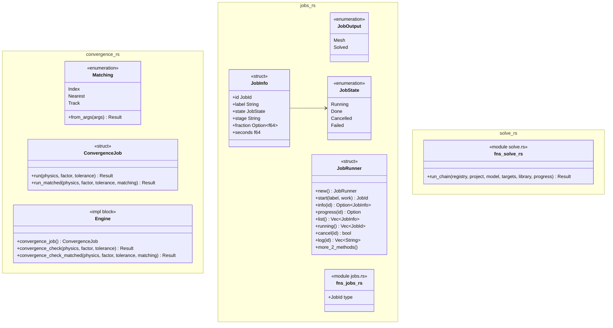

# Job runner: code

C4 level 4 (code) of the component **Job runner** (`engine.jobs`) in the container **nyx-engine** (crate `nyx_engine`). [Component view of the container](../../3-components/engine.md) · [All code pages](../README.md)

> Mesh and solve jobs on their own threads with progress and cancel, solving physics in the order of the one-way couplings (region names put into the scalars a kernel names by domain number), mesh convergence on a scratch engine with solutions compared by index, paired by nearest eigenvalue or one mode followed.

**Decisions:** [ADR 61](../../../adr/0061-convergence-is-an-engine-command.md), [ADR 80](../../../adr/0080-modes-carry-what-identifies-them-and-a-convergence-check-follows-a-mode.md)  
**Size:** 3 files, 608 lines.

## Files

| File | Lines | What it says about itself |
|---|---:|---|
| `crates/nyx-engine/src/convergence.rs` | 362 | Mesh convergence as an engine command: the same project is solved on a finer mesh (on a scratch engine, so the project, the mesh and the results of the caller are untouched) and every number that identifies a solution is compared: the ei... |
| `crates/nyx-engine/src/jobs.rs` | 171 | The job runner: a mesh build or a solve runs on its own thread with a `Progress` handle, so it can be watched (stage, fraction, elapsed) and cancelled, by the window, a script or the MCP server alike. The runner knows nothing of windows:... |
| `crates/nyx-engine/src/solve.rs` | 75 | Solving a project: the physics in an order that satisfies the one-way couplings, each checked against its descriptors and the mesh, then solved with the fields it imports from the physics before it. Everything goes through `Physics`, so ... |

## What it uses

| Target | Modules | Items |
|---|---|---|
| [container `femcore` (femcore)](../../3-components/femcore.md) | material::spec, progress | Library, Progress |
| [container `physics` (nyx-physics)](../../3-components/physics.md) | error, physics, registry, result, validate | Ctx, Error, Registry, Scalar, SolveResult, validate_spec |
| [Commands](./commands.md) | engine | Engine |
| [Materials](./materials.md) | materials | study_wavelength |
| [Meshing seam](./meshing.md) | meshing | MeshedModel, Mesher |
| [Project](./project.md) | project | Project |
| [Registry and facade](./registry.md) | crate root | physics_for |

## Used by

| Component | Modules | Items |
|---|---|---|
| [Commands](./commands.md) | convergence, jobs, solve | JobId, JobOutput, JobRunner, Matching, run_chain |
| [Registry and facade](./registry.md) | jobs | JobId, JobInfo, JobOutput, JobRunner, JobState |

## Class diagram

Public types with their public fields (or variants) and methods, free functions per file as a `module` box; arrows are field types and `impl Trait`. Capped at 36 types and a few members each; the table below is complete.

## Public items

| Kind | Item | File:line | Signature or summary |
|---|---|---|---|
| enum | `Matching` | `convergence.rs:64` | variants: `Index`, `Nearest`, `Track` —  How the solutions of the two meshes are paired. |
| struct | `ConvergenceJob` | `convergence.rs:191` |  Everything a convergence check needs, owned, so that a front-end can run it on its own thread while the engine stays usable. |
| fn | `Matching::from_args` | `convergence.rs:78` | `pub fn from_args(args: &Value) -> Result<Matching, Error>` —  From the arguments of the command: `match` is `index` or `nearest`, `track` is `{ "f": <value> }` and implies `nearest`. |
| fn | `ConvergenceJob::run` | `convergence.rs:207` | `pub fn run(&self, physics: &str, factor: f64, tolerance: Option<f64>) -> Result<Value, Error>` —  Runs the check (see `Engine::convergence_check`); blocks until both solves are done. |
| fn | `ConvergenceJob::run_matched` | `convergence.rs:212` | `pub fn run_matched( &self, physics: &str, factor: f64, tolerance: Option<f64>, matching: &Matching, ) -> Result<Value, Error>` —  The check with the solutions paired as `matching` says. |
| fn | `Engine::convergence_job` | `convergence.rs:225` | `pub fn convergence_job(&self) -> ConvergenceJob` —  A snapshot of what `convergence_check` needs. |
| fn | `Engine::convergence_check` | `convergence.rs:237` | `pub fn convergence_check(&self, physics: &str, factor: f64, tolerance: Option<f64>) -> Result<Value, Error>` —  Solves `physics` on the current mesh and on one made finer by `factor`, and compares the numbers of the two results. `tolerance`, |
| fn | `Engine::convergence_check_matched` | `convergence.rs:244` | `pub fn convergence_check_matched( &self, physics: &str, factor: f64, tolerance: Option<f64>, matching: &Matching, ) -> Result<Value, Error>` —  `convergence_check` with the modes of the two meshes paired by their eigenvalues (`Matching::Nearest`) or one mode followed |
| type | `JobId` | `jobs.rs:14` |  |
| enum | `JobOutput` | `jobs.rs:17` | variants: `Mesh`, `Solved` —  What a finished job hands back. The engine applies it to its state (`Engine::apply`). |
| enum | `JobState` | `jobs.rs:28` | variants: `Running`, `Done`, `Cancelled`, `Failed` |
| struct | `JobInfo` | `jobs.rs:36` | fields: `id`, `label`, `state`, `stage`, `fraction`, `seconds` |
| struct | `JobRunner` | `jobs.rs:62` |  |
| fn | `JobRunner::new` | `jobs.rs:68` | `pub fn new() -> JobRunner` |
| fn | `JobRunner::start` | `jobs.rs:73` | `pub fn start<F>(&self, label: &str, work: F) -> JobId` —  Starts `work` on a new thread. The closure gets the job's `Progress`; a panic in it becomes a failed job, not a dead process. |
| fn | `JobRunner::info` | `jobs.rs:110` | `pub fn info(&self, id: JobId) -> Option<JobInfo>` |
| fn | `JobRunner::progress` | `jobs.rs:125` | `pub fn progress(&self, id: JobId) -> Option<Arc<Progress>>` —  The progress handle of a job: the stage it is in, the log so far, the cancel flag. A front-end that shows a bar reads it. |
| fn | `JobRunner::list` | `jobs.rs:130` | `pub fn list(&self) -> Vec<JobInfo>` —  All jobs, oldest first. |
| fn | `JobRunner::running` | `jobs.rs:136` | `pub fn running(&self) -> Vec<JobId>` —  The jobs that have not finished. |
| fn | `JobRunner::cancel` | `jobs.rs:141` | `pub fn cancel(&self, id: JobId) -> bool` —  Asks the job to stop; the solver notices at its next check. False when no such running job. |
| fn | `JobRunner::log` | `jobs.rs:152` | `pub fn log(&self, id: JobId) -> Vec<String>` —  The stage log of the job so far. |
| fn | `JobRunner::try_take` | `jobs.rs:157` | `pub fn try_take(&self, id: JobId) -> Option<Result<JobOutput, Error>>` —  The outcome if the job has finished and it has not been taken; `None` while running or after it was taken. |
| fn | `JobRunner::wait` | `jobs.rs:162` | `pub fn wait(&self, id: JobId) -> Result<JobOutput, Error>` —  Blocks until the job has finished and takes its outcome. |
| fn | `run_chain` | `solve.rs:39` | `pub fn run_chain( registry: &Registry, project: &Project, model: &MeshedModel, targets: &[String], library: &Arc<femcore::material::Library>, progress: Arc<Progress>, ) -> Result<Vec<SolveResult>, Error>` —  Solves `targets` (and nothing else) in coupling order. The result of each is returned in the order it was solved. |
