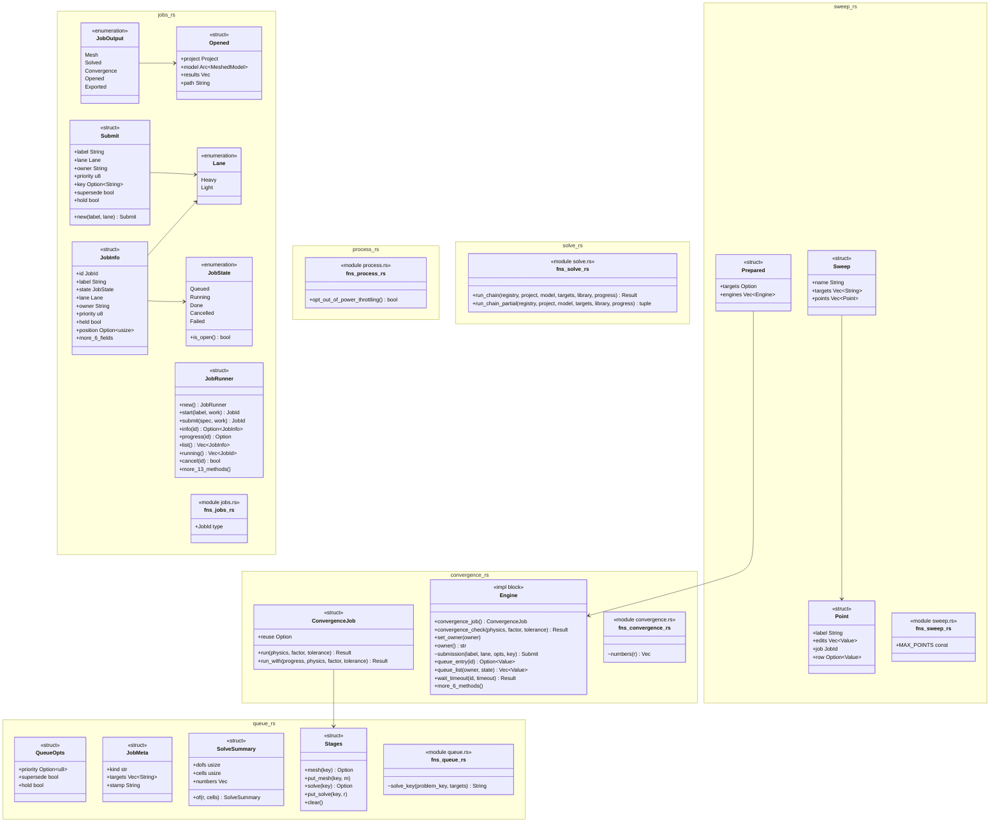

# Job runner and queue: code

C4 level 4 (code) of the component **Job runner and queue** (`engine.jobs`) in the container **nyx-engine** (crate `nyx_engine`). [Component view of the container](../../3-components/engine.md) · [All code pages](../README.md)

> Mesh, solve, convergence and file jobs on their own threads with progress and cancel, queued in lanes (priority, owners in turn, stages shared by content), solving physics in the order of the one-way couplings, mesh convergence on a scratch engine.

**Decisions:** [ADR 61](../../../adr/0061-convergence-is-an-engine-command.md), [ADR 85](../../../adr/0085-every-long-operation-is-a-job.md), [ADR 87](../../../adr/0087-work-is-queued-in-lanes-and-stages-are-shared-by-content.md), [ADR 11](../../../adr/0011-determinism-by-fixed-chunks.md)  
**Size:** 6 files, 1593 lines.

## Files

| File | Lines | What it says about itself |
|---|---:|---|
| `crates/nyx-engine/src/convergence.rs` | 210 | Mesh convergence as an engine command: the same project is solved on a finer mesh (on a scratch engine, so the project, the mesh and the results of the caller are untouched) and every number that identifies a solution is compared: the ei... |
| `crates/nyx-engine/src/jobs.rs` | 568 | The job runner and its queue (productivity plan P2 and Q1, ADR 85 and 87): a mesh build, a solve, a convergence check, opening or writing a results file is a job with a `Progress` handle, so it can be watched (stage, elapsed) and cancell... |
| `crates/nyx-engine/src/process.rs` | 61 | Process-wide settings of the program that hosts the engine. Today one: on Windows, opt the process out of power throttling. |
| `crates/nyx-engine/src/queue.rs` | 271 | The queue of the engine (productivity plan Q1, ADR 87): what a front-end sees of the job runner's lanes (`queue_*` commands), the options a request is submitted with, and the stage caches that let queued requests share work. A request th... |
| `crates/nyx-engine/src/solve.rs` | 93 | Solving a project: the physics in an order that satisfies the one-way couplings, each checked against its descriptors and the mesh, then solved with the fields it imports from the physics before it. Everything goes through `Physics`, so ... |
| `crates/nyx-engine/src/sweep.rs` | 390 | Sweeps (productivity plan Q6, ADR 87): one run per point, recorded. A point is a list of edits (any command of access `edit`: a geometry parameter, a study value such as the wavelength, a material, a mesh setting) applied to a copy of th... |

## What it uses

| Target | Modules | Items |
|---|---|---|
| [container `femcore` (femcore)](../../3-components/femcore.md) | material::spec, mesh, progress | Library, Progress, SimplexMesh, install, stage |
| [container `physics` (nyx-physics)](../../3-components/physics.md) | error, physics, registry, result, validate | Ctx, Error, Registry, Scalar, SolveResult, validate_spec |
| [Commands](./commands.md) | commands, engine | Access, Engine, Purpose |
| [Materials](./materials.md) | materials | study_wavelength |
| [Meshing seam](./meshing.md) | meshing | MeshedModel, Mesher |
| [Project](./project.md) | project | Project |
| [Registry and facade](./registry.md) | crate root | physics_for |
| [Store link](./storeLink.md) | store_link | RunOutcome |

## Used by

| Component | Modules | Items |
|---|---|---|
| [app: Window](../app/window.md) | process, queue | QueueOpts, opt_out_of_power_throttling |
| [Commands](./commands.md) | jobs, queue, solve, sweep | JobId, JobMeta, JobOutput, JobRunner, Lane, Opened, QueueOpts, SolveSummary +4 |
| [Registry and facade](./registry.md) | jobs, queue | JobId, JobInfo, JobOutput, JobRunner, JobState, Lane, QueueOpts, Submit |
| [Results files](./resultsIO.md) | jobs | Opened |

## Class diagram

Public types with their public fields (or variants) and methods, free functions per file as a `module` box; arrows are field types and `impl Trait`. Capped at 36 types and a few members each; the table below is complete.

## Public items

| Kind | Item | File:line | Signature or summary |
|---|---|---|---|
| fn | `numbers` | `convergence.rs:38` | `pub(crate) fn numbers(r: &SolveResult) -> Vec<(String, f64)>` —  Every named number of a result, in a fixed order: `eigenvalue[i].re`, `eigenvalue[i].im`, `value[i]` and the numeric scalars. |
| struct | `ConvergenceJob` | `convergence.rs:63` | fields: `reuse` —  Everything a convergence check needs, owned, so that a front-end can run it on its own thread while the engine stays usable. |
| fn | `ConvergenceJob::run` | `convergence.rs:81` | `pub fn run(&self, physics: &str, factor: f64, tolerance: Option<f64>) -> Result<Value, Error>` —  Runs the check (see `Engine::convergence_check`); blocks until both solves are done. |
| fn | `ConvergenceJob::run_with` | `convergence.rs:86` | `pub fn run_with( &self, progress: &Arc<Progress>, physics: &str, factor: f64, tolerance: Option<f64>, ) -> Result<Value, Error>` —  Runs the check on the calling thread under `progress`: its two solves are two stages of it, and its cancel flag stops either. |
| fn | `Engine::convergence_job` | `convergence.rs:121` | `pub fn convergence_job(&self) -> ConvergenceJob` —  A snapshot of what `convergence_check` needs. |
| fn | `Engine::convergence_check` | `convergence.rs:135` | `pub fn convergence_check(&self, physics: &str, factor: f64, tolerance: Option<f64>) -> Result<Value, Error>` —  Solves `physics` on the current mesh and on one made finer by `factor`, and compares the numbers of the two results, on the calling thread |
| type | `JobId` | `jobs.rs:20` |  |
| enum | `JobOutput` | `jobs.rs:23` | variants: `Mesh`, `Solved`, `Convergence`, `Opened`, `Exported` —  What a finished job hands back. The engine applies it to its state (`Engine::apply`). |
| struct | `Opened` | `jobs.rs:42` | fields: `project`, `model`, `results`, `path` —  What opening a results file gives the engine to apply. |
| enum | `JobState` | `jobs.rs:52` | variants: `Queued`, `Running`, `Done`, `Cancelled`, `Failed` |
| enum | `Lane` | `jobs.rs:71` | variants: `Heavy`, `Light` —  The resource class of a job. The heavy lane runs one job at a time; the light lane (I/O) runs beside it. |
| struct | `Submit` | `jobs.rs:78` | fields: `label`, `lane`, `owner`, `priority`, `key`, `supersede`, `hold` —  How a job is submitted: its name, lane, owner and priority. |
| struct | `JobInfo` | `jobs.rs:101` | fields: `id`, `label`, `state`, `lane`, `owner`, `priority`, `held`, `position`, `queued_seconds`, `stage`, `stage_seconds`, `fraction`, ... |
| struct | `JobRunner` | `jobs.rs:168` |  |
| fn | `JobState::is_open` | `jobs.rs:63` | `pub fn is_open(&self) -> bool` —  Queued or running: the job has not finished. |
| fn | `Submit::new` | `jobs.rs:95` | `pub fn new(label: &str, lane: Lane) -> Submit` |
| fn | `JobRunner::new` | `jobs.rs:275` | `pub fn new() -> JobRunner` |
| fn | `JobRunner::start` | `jobs.rs:293` | `pub fn start<F>(&self, label: &str, work: F) -> JobId` —  Submits `work` to the heavy lane with the default owner and priority. |
| fn | `JobRunner::submit` | `jobs.rs:302` | `pub fn submit<F>(&self, spec: Submit, work: F) -> JobId` —  Submits `work`. It starts at once when its lane is free, otherwise it waits in the queue. The closure gets the job's `Progress`; a panic in |
| fn | `JobRunner::info` | `jobs.rs:349` | `pub fn info(&self, id: JobId) -> Option<JobInfo>` |
| fn | `JobRunner::progress` | `jobs.rs:389` | `pub fn progress(&self, id: JobId) -> Option<Arc<Progress>>` —  The progress handle of a job: the stage it is in, the log so far, the cancel flag. A front-end that shows a bar reads it. |
| fn | `JobRunner::list` | `jobs.rs:394` | `pub fn list(&self) -> Vec<JobInfo>` —  All jobs, oldest first. |
| fn | `JobRunner::running` | `jobs.rs:400` | `pub fn running(&self) -> Vec<JobId>` —  The jobs that have not finished (queued or running). |
| fn | `JobRunner::cancel` | `jobs.rs:422` | `pub fn cancel(&self, id: JobId) -> bool` —  Asks the job to stop. A queued job stops at once and never runs; a running one notices at its next check (a factorisation finishes first). |
| fn | `JobRunner::hold` | `jobs.rs:435` | `pub fn hold(&self, id: JobId) -> bool` —  Keeps a queued job from starting until `release`. False when it is not queued. |
| fn | `JobRunner::release` | `jobs.rs:450` | `pub fn release(&self, id: JobId) -> bool` |
| fn | `JobRunner::set_priority` | `jobs.rs:467` | `pub fn set_priority(&self, id: JobId, priority: u8) -> bool` —  Changes the priority of a queued job. False when it is not queued. |
| fn | `JobRunner::pause` | `jobs.rs:483` | `pub fn pause(&self)` —  Stops the queue from starting anything new; what runs finishes. |
| fn | `JobRunner::resume` | `jobs.rs:487` | `pub fn resume(&self)` |
| fn | `JobRunner::paused` | `jobs.rs:492` | `pub fn paused(&self) -> bool` |
| fn | `JobRunner::set_limit` | `jobs.rs:497` | `pub fn set_limit(&self, lane: Lane, n: usize)` —  How many jobs a lane runs at once (heavy 1, light 2 by default). |
| fn | `JobRunner::set_age` | `jobs.rs:509` | `pub fn set_age(&self, age: Duration)` —  After this long in the queue a job competes one priority level higher. |
| fn | `JobRunner::log` | `jobs.rs:514` | `pub fn log(&self, id: JobId) -> Vec<String>` —  The stage log of the job so far. |
| fn | `JobRunner::try_take` | `jobs.rs:519` | `pub fn try_take(&self, id: JobId) -> Option<Result<JobOutput, Error>>` —  The outcome if the job has finished and it has not been taken; `None` while queued or running, or after it was taken. |
| fn | `JobRunner::blocked` | `jobs.rs:525` | `pub fn blocked(&self, id: JobId) -> Option<&'static str>` —  Why a queued job cannot start however long it is waited for: it is held, or the queue is paused. `None` for a job that is running or will |
| fn | `JobRunner::wait` | `jobs.rs:541` | `pub fn wait(&self, id: JobId) -> Result<JobOutput, Error>` —  Blocks until the job has finished and takes its outcome. |
| fn | `JobRunner::wait_timeout` | `jobs.rs:551` | `pub fn wait_timeout(&self, id: JobId, timeout: Duration) -> Option<Result<JobOutput, Error>>` —  Like `wait`, but gives up after `timeout`: `None` when the job is still queued or running then (it keeps going and can be waited for again). |
| fn | `opt_out_of_power_throttling` | `process.rs:12` | `pub fn opt_out_of_power_throttling() -> bool` —  Asks Windows not to throttle this process. True when the request was accepted; false when it was refused (an older Windows) or on another |
| struct | `QueueOpts` | `queue.rs:17` | fields: `priority`, `supersede`, `hold` —  How a request is queued. The default is the engine's owner at its usual priority, with nothing superseded. |
| struct | `JobMeta` | `queue.rs:27` | fields: `kind`, `targets`, `stamp` —  What the engine remembers of a job beyond the runner's own record. |
| struct | `SolveSummary` | `queue.rs:36` | fields: `dofs`, `cells`, `numbers` —  What a mesh convergence check needs of the coarse solve: the numbers that identify its solutions, the unknowns and the cells. A result's |
| struct | `Stages` | `queue.rs:50` |  Recent stages, found by content. Small on purpose: a mesh of a large model is gigabytes. |
| fn | `solve_key` | `queue.rs:94` | `pub(crate) fn solve_key(problem_key: &str, targets: &[String]) -> String` —  The cache key of a solve: the problem key of the physics and the chain it was solved in (the sorted targets of its job). |
| fn | `SolveSummary::of` | `queue.rs:43` | `pub fn of(r: &SolveResult, cells: usize) -> SolveSummary` |
| fn | `Stages::mesh` | `queue.rs:59` | `pub fn mesh(&self, key: &str) -> Option<Arc<MeshedModel>>` |
| fn | `Stages::put_mesh` | `queue.rs:63` | `pub fn put_mesh(&self, key: &str, m: &Arc<MeshedModel>)` |
| fn | `Stages::solve` | `queue.rs:73` | `pub fn solve(&self, key: &str) -> Option<Arc<SolveSummary>>` |
| fn | `Stages::put_solve` | `queue.rs:77` | `pub fn put_solve(&self, key: &str, r: &Arc<SolveSummary>)` |
| fn | `Stages::clear` | `queue.rs:87` | `pub fn clear(&self)` |
| fn | `Engine::set_owner` | `queue.rs:113` | `pub fn set_owner(&mut self, owner: &str)` —  Names who this engine's requests are made for (`gui`, `ai`, `cli`): the queue serves owners in turn, and a person's requests run first. |
| fn | `Engine::owner` | `queue.rs:117` | `pub fn owner(&self) -> &str` |
| fn | `Engine::submission` | `queue.rs:122` | `pub(crate) fn submission(&self, label: &str, lane: Lane, opts: &QueueOpts, key: &str) -> Submit` —  The submission of a job of this engine: owner, priority by owner unless given, and the key a newer request of the same kind replaces. |
| fn | `Engine::queue_entry` | `queue.rs:133` | `pub fn queue_entry(&self, id: JobId) -> Option<Value>` —  A job as the queue commands show it: the runner's record plus what was asked and whether the project has changed since. |
| fn | `Engine::queue_list` | `queue.rs:146` | `pub fn queue_list(&self, owner: Option<&str>, state: Option<&str>) -> Vec<Value>` —  The queue, oldest first, optionally of one owner or one state (`queued`, `running`, `done`, `cancelled`, `failed`). |
| fn | `Engine::wait_timeout` | `queue.rs:164` | `pub fn wait_timeout(&mut self, id: JobId, timeout: Duration) -> Result<Value, Error>` —  Waits for a job up to `timeout` and applies its outcome; at the timeout the job's entry comes back with `waiting: true` and the job goes on. |
| fn | `Engine::queue_command` | `queue.rs:181` | `pub(crate) fn queue_command(&mut self, name: &str, args: &Value) -> Result<Value, Error>` —  The `queue_*` commands (see the catalog). |
| fn | `Engine::note_job` | `queue.rs:266` | `pub(crate) fn note_job(&mut self, id: JobId, kind: &'static str, targets: Vec<String>)` |
| fn | `run_chain` | `solve.rs:20` | `pub fn run_chain( registry: &Registry, project: &Project, model: &MeshedModel, targets: &[String], library: &Arc<femcore::material::Library>, progress: Arc<Progress>, ) -> Result<Vec<SolveResult>, Error>` —  Solves `targets` (and nothing else) in coupling order. The result of each is returned in the order it was solved. |
| fn | `run_chain_partial` | `solve.rs:36` | `pub fn run_chain_partial( registry: &Registry, project: &Project, model: &MeshedModel, targets: &[String], library: &Arc<femcore::material::Library>, progress: Arc<Progress>, ) -> (Vec<SolveResult>, Option<Error>)` —  Like `run_chain`, but when a physics fails the physics solved before it are returned with the error: a failed `sms` keeps the `ems` result |
| const | `MAX_POINTS` | `sweep.rs:18` | `usize` —  The most points one request may make: a sweep is a queue of jobs, not a way to start ten thousand. |
| struct | `Point` | `sweep.rs:20` | fields: `label`, `edits`, `job`, `row` |
| struct | `Sweep` | `sweep.rs:28` | fields: `name`, `targets`, `points` |
| struct | `Prepared` | `sweep.rs:35` | fields: `targets`, `engines` —  A checked sweep request: the points, the physics named (if any), the queue options and one engine per point. |
| fn | `Engine::scratch` | `sweep.rs:106` | `pub(crate) fn scratch(&self) -> Engine` —  A copy of this engine for editing: the project is a copy, the mesher, the registry and the material library are shared. Nothing it does |
| fn | `Engine::sweep_command` | `sweep.rs:148` | `pub(crate) fn sweep_command(&mut self, name: &str, args: &Value) -> Result<Value, Error>` |
| fn | `Engine::sweep_prepare` | `sweep.rs:164` | `pub(crate) fn sweep_prepare(&self, args: &Value) -> Result<Prepared, Error>` —  Reads and checks a sweep request without submitting anything: the points, what they solve, how they queue, and the engine of every point |
| fn | `Engine::apply_point` | `sweep.rs:298` | `pub(crate) fn apply_point( &mut self, id: JobId, sweep: u64, index: usize, project: crate::project::Project, outcome: Result<JobOutput, Error>, ) -> Result<Value, Error>` —  Applies a finished point: records its run, keeps its numbers in the table and drops its result. The engine's own results and mesh are |

Trait implementations in this component: `JobRunner: Default`
