# Job runner and queue: code

C4 level 4 (code) of the component **Job runner and queue** (`engine.jobs`) in the container **nyx-engine** (crate `nyx_engine`). [Component view of the container](../../3-components/engine.md) · [All code pages](../README.md)

> Mesh, solve, convergence and file jobs on their own threads with progress and cancel, queued in lanes (priority, owners in turn, stages shared by content), solves in a worker process (killed on cancel, its stage log mirrored, results read back from a file), memory estimates learned from the workers and admission by free memory, solving physics in the order of the one-way couplings, mesh convergence on a scratch engine.

**Decisions:** [ADR 61](../../../adr/0061-convergence-is-an-engine-command.md), [ADR 85](../../../adr/0085-every-long-operation-is-a-job.md), [ADR 87](../../../adr/0087-work-is-queued-in-lanes-and-stages-are-shared-by-content.md), [ADR 86](../../../adr/0086-solves-run-in-a-worker-process.md), [ADR 11](../../../adr/0011-determinism-by-fixed-chunks.md)  
**Size:** 9 files, 2415 lines.

## Files

| File | Lines | What it says about itself |
|---|---:|---|
| `crates/nyx-engine/src/bin/nyx-worker.rs` | 8 | nyx-worker: solves one frozen project in its own process and writes the results file (productivity plan P4, ADR 86). It is started by the window or the MCP server (`Engine::set_worker`), never by hand: see `nyx_engine::worker` for what i... |
| `crates/nyx-engine/src/convergence.rs` | 217 | Mesh convergence as an engine command: the same project is solved on a finer mesh (on a scratch engine, so the project, the mesh and the results of the caller are untouched) and every number that identifies a solution is compared: the ei... |
| `crates/nyx-engine/src/estimate.rs` | 314 | What a solve will cost, learned from what solves cost (productivity plan Q2, ADR 86). Every solve that runs in a worker process measures its own peak memory exactly (`process::peak_memory`); the engine keeps one row per such run (the phy... |
| `crates/nyx-engine/src/jobs.rs` | 577 | The job runner and its queue (productivity plan P2 and Q1, ADR 85 and 87): a mesh build, a solve, a convergence check, opening or writing a results file is a job with a `Progress` handle, so it can be watched (stage, elapsed) and cancell... |
| `crates/nyx-engine/src/process.rs` | 164 | Process-wide settings of the program that hosts the engine. Today one: on Windows, opt the process out of power throttling. |
| `crates/nyx-engine/src/queue.rs` | 294 | The queue of the engine (productivity plan Q1, ADR 87): what a front-end sees of the job runner's lanes (`queue_*` commands), the options a request is submitted with, and the stage caches that let queued requests share work. A request th... |
| `crates/nyx-engine/src/solve.rs` | 93 | Solving a project: the physics in an order that satisfies the one-way couplings, each checked against its descriptors and the mesh, then solved with the fields it imports from the physics before it. Everything goes through `Physics`, so ... |
| `crates/nyx-engine/src/sweep.rs` | 405 | Sweeps (productivity plan Q6, ADR 87): one run per point, recorded. A point is a list of edits (any command of access `edit`: a geometry parameter, a study value such as the wavelength, a material, a mesh setting) applied to a copy of th... |
| `crates/nyx-engine/src/worker.rs` | 343 | Solving in a child process (productivity plan P4, ADR 86). A solve that needs more memory than the machine has, or a factorisation that nobody can interrupt, must not take the window or the MCP server with it. A *worker* is a small progr... |

## What it uses

| Target | Modules | Items |
|---|---|---|
| [container `femcore` (femcore)](../../3-components/femcore.md) | material::spec, mesh, progress | Library, Progress, SimplexMesh, install, stage |
| [container `physics` (nyx-physics)](../../3-components/physics.md) | error, physics, registry, result, validate | Ctx, Error, Registry, Scalar, SolveResult, validate_spec |
| [Commands](./commands.md) | commands, engine | Access, Engine, Purpose |
| [Materials](./materials.md) | materials | study_wavelength |
| [Meshing seam](./meshing.md) | meshing | FemcoreMesher, MeshedModel, Mesher |
| [Project](./project.md) | project | Project |
| [Registry and facade](./registry.md) | crate root | physics_for, registry |
| [Results files](./resultsIO.md) | h5io | read_results, write_results |
| [Store link](./storeLink.md) | store_link | RunOutcome, metrics_of |

## Used by

| Component | Modules | Items |
|---|---|---|
| [app: Window](../app/window.md) | process, queue, worker | QueueOpts, opt_out_of_power_throttling, serve |
| [Commands](./commands.md) | estimate, jobs, process, queue, solve, sweep +1 | Estimate, History, JobId, JobMeta, JobOutput, JobRunner, Lane, MemoryProbe +17 |
| [Meshing seam](./meshing.md) | estimate | Estimate, History, chain_key |
| [Registry and facade](./registry.md) | estimate, jobs, queue | Estimate, History, JobId, JobInfo, JobOutput, JobRunner, JobState, Lane +3 |
| [Results files](./resultsIO.md) | jobs | Opened |

## Class diagram

Public types with their public fields (or variants) and methods, free functions per file as a `module` box; arrows are field types and `impl Trait`. Capped at 36 types and a few members each; the table below is complete.

```mermaid
classDiagram
  namespace bin_nyx_worker_rs {
    class fns_bin_nyx_worker_rs {
        <<module bin/nyx-worker.rs>>
        -main()
    }
  }
  namespace convergence_rs {
    class ConvergenceJob {
        <<struct>>
        +reuse Option
        +run(physics, factor, tolerance) Result
        +run_with(progress, physics, factor, tolerance) Result
    }
    class Engine {
        <<impl block>>
        +convergence_job() ConvergenceJob
        +convergence_check(physics, factor, tolerance) Result
        +set_owner(owner)
        +owner() str
        ~submission(label, lane, opts, key) Submit
        +queue_entry(id) Option~Value~
        +queue_list(owner, state) Vec~Value~
        +wait_timeout(id, timeout) Result
        +more_7_methods()
    }
    class fns_convergence_rs {
        <<module convergence.rs>>
        ~numbers(r) Vec
    }
  }
  namespace estimate_rs {
    class Row {
        <<struct>>
        +chain String
        +dim u8
        +cells u64
        +dofs u64
        +peak_working_set u64
        +peak_commit u64
        +seconds f64
    }
    class Estimate {
        <<struct>>
        +bytes u64
        +bytes_with_margin u64
        +seconds Option~f64~
        +runs usize
        +extrapolated bool
        +exponent f64
    }
    class History {
        <<struct>>
        +set_file(path)
        +rows() Vec~Row~
        +flush()
        +add(row)
        +estimate(chain, dim, cells) Option~Estimate~
    }
    class fns_estimate_rs {
        <<module estimate.rs>>
        +estimate(rows, chain, dim, cells) Option~Estimate~
        +admit(est, force, probe, progress) Result
        +chain_key(targets) String
        +MemoryProbe type
        +REFUSE_ABOVE const
    }
  }
  namespace jobs_rs {
    class JobOutput {
        <<enumeration>>
        Mesh
        Solved
        Convergence
        Opened
        Exported
    }
    class WorkerRun {
        <<struct>>
        +peak_working_set Option~u64~
        +peak_commit Option~u64~
    }
    class Opened {
        <<struct>>
        +project Project
        +model Arc~MeshedModel~
        +results Vec
        +path String
    }
    class JobState {
        <<enumeration>>
        Queued
        Running
        Done
        Cancelled
        Failed
        +is_open() bool
    }
    class Lane {
        <<enumeration>>
        Heavy
        Light
    }
    class Submit {
        <<struct>>
        +label String
        +lane Lane
        +owner String
        +priority u8
        +key Option~String~
        +supersede bool
        +hold bool
        +new(label, lane) Submit
    }
    class JobInfo {
        <<struct>>
        +id JobId
        +label String
        +state JobState
        +lane Lane
        +owner String
        +priority u8
        +held bool
        +position Option~usize~
        +more_6_fields
    }
    class JobRunner {
        <<struct>>
        +new() JobRunner
        +start(label, work) JobId
        +submit(spec, work) JobId
        +info(id) Option~JobInfo~
        +progress(id) Option
        +list() Vec~JobInfo~
        +running() Vec~JobId~
        +cancel(id) bool
        +more_13_methods()
    }
    class fns_jobs_rs {
        <<module jobs.rs>>
        +JobId type
    }
  }
  namespace process_rs {
    class fns_process_rs {
        <<module process.rs>>
        +opt_out_of_power_throttling() bool
        +peak_memory() Option
        +system_memory() Option
    }
  }
  namespace queue_rs {
    class QueueOpts {
        <<struct>>
        +priority Option~u8~
        +supersede bool
        +hold bool
        +isolate Option~bool~
        +force bool
    }
    class JobMeta {
        <<struct>>
        +kind str
        +targets Vec~String~
        +stamp String
        +estimate Arc
    }
    class SolveSummary {
        <<struct>>
        +dofs usize
        +cells usize
        +numbers Vec
        +of(r, cells) SolveSummary
    }
    class Stages {
        <<struct>>
        +mesh(key) Option
        +put_mesh(key, m)
        +solve(key) Option
        +put_solve(key, r)
        +clear()
    }
    class fns_queue_rs {
        <<module queue.rs>>
        ~solve_key(problem_key, targets) String
    }
  }
  namespace solve_rs {
    class fns_solve_rs {
        <<module solve.rs>>
        +run_chain(registry, project, model, targets, library, progress) Result
        +run_chain_partial(registry, project, model, targets, library, progress) tuple
    }
  }
  namespace sweep_rs {
    class Point {
        <<struct>>
        +label String
        +edits Vec~Value~
        +job JobId
        +row Option~Value~
    }
    class Sweep {
        <<struct>>
        +name String
        +targets Vec~String~
        +points Vec~Point~
    }
    class Prepared {
        <<struct>>
        +targets Option
        +engines Vec~Engine~
    }
    class fns_sweep_rs {
        <<module sweep.rs>>
        +MAX_POINTS const
    }
  }
  namespace worker_rs {
    class RemoteSpec {
        <<struct>>
        +worker PathBuf
        +project_json String
        +materials BTreeMap
        +targets Vec~String~
    }
    class RemoteDone {
        <<struct>>
        +results Vec
        +mesh Option~SimplexMesh~
        +failed Option~Error~
        +run WorkerRun
    }
    class JobDir {
        <<impl block>>
    }
    class fns_worker_rs {
        <<module worker.rs>>
        +material_texts(lib) BTreeMap
        +serve(args) i32
        ~run_remote(spec, progress) Result
        ~run_remote(_spec, _progress) Result
        ~same_mesh(a, b) bool
        +PREFIX const
    }
  }
  ConvergenceJob --> Stages
  JobOutput --> WorkerRun
  JobOutput --> Opened
  Submit --> Lane
  JobInfo --> JobState
  JobInfo --> Lane
  JobMeta --> Estimate
  Sweep --> Point
  Prepared --> Engine
  RemoteDone --> WorkerRun
```

## Public items

| Kind | Item | File:line | Signature or summary |
|---|---|---|---|
| fn | `main` | `bin/nyx-worker.rs:3` | `fn main()` |
| fn | `numbers` | `convergence.rs:38` | `pub(crate) fn numbers(r: &SolveResult) -> Vec<(String, f64)>` —  Every named number of a result, in a fixed order: `eigenvalue[i].re`, `eigenvalue[i].im`, `value[i]` and the numeric scalars. |
| struct | `ConvergenceJob` | `convergence.rs:63` | fields: `reuse` —  Everything a convergence check needs, owned, so that a front-end can run it on its own thread while the engine stays usable. |
| fn | `ConvergenceJob::run` | `convergence.rs:81` | `pub fn run(&self, physics: &str, factor: f64, tolerance: Option<f64>) -> Result<Value, Error>` —  Runs the check (see `Engine::convergence_check`); blocks until both solves are done. |
| fn | `ConvergenceJob::run_with` | `convergence.rs:86` | `pub fn run_with( &self, progress: &Arc<Progress>, physics: &str, factor: f64, tolerance: Option<f64>, ) -> Result<Value, Error>` —  Runs the check on the calling thread under `progress`: its two solves are two stages of it, and its cancel flag stops either. |
| fn | `Engine::convergence_job` | `convergence.rs:121` | `pub fn convergence_job(&self) -> ConvergenceJob` —  A snapshot of what `convergence_check` needs. |
| fn | `Engine::convergence_check` | `convergence.rs:135` | `pub fn convergence_check(&self, physics: &str, factor: f64, tolerance: Option<f64>) -> Result<Value, Error>` —  Solves `physics` on the current mesh and on one made finer by `factor`, and compares the numbers of the two results, on the calling thread |
| struct | `Row` | `estimate.rs:17` | fields: `chain`, `dim`, `cells`, `dofs`, `peak_working_set`, `peak_commit`, `seconds` —  One finished worker run. |
| struct | `Estimate` | `estimate.rs:31` | fields: `bytes`, `bytes_with_margin`, `seconds`, `runs`, `extrapolated`, `exponent` —  An estimate with its basis. |
| fn | `estimate` | `estimate.rs:61` | `pub fn estimate(rows: &[Row], chain: &str, dim: u8, cells: u64) -> Option<Estimate>` —  The estimate for a solve of `chain` in `dim` dimensions on `cells` cells from `rows`, or `None` when the rows do not support one. |
| struct | `History` | `estimate.rs:131` |  The rows an engine has learned from, in memory and, when a file is set, appended to it as JSON lines (one `write` per line, like the run |
| type | `MemoryProbe` | `estimate.rs:191` |  What the machine says about its memory: `(total, available)` in bytes. Replaceable, so a test can play a machine that is full. |
| const | `REFUSE_ABOVE` | `estimate.rs:195` | `f64` —  How much of the machine's memory a solve may be expected to take at most: above this fraction of the physical memory a solve is refused, |
| fn | `admit` | `estimate.rs:205` | `pub fn admit( est: &Estimate, force: bool, probe: &MemoryProbe, progress: &std::sync::Arc<femcore::progress::Progress>, ) -> Result<(), nyx_physics::Error>` —  Lets a solve start only when its estimate fits. Above `REFUSE_ABOVE` of the physical memory it fails at once, unless `force`: it cannot be |
| fn | `chain_key` | `estimate.rs:248` | `pub fn chain_key(targets: &[String]) -> String` —  The chain's key: codes sorted and joined. |
| fn | `History::set_file` | `estimate.rs:150` | `pub fn set_file(&self, path: &Path)` —  Keeps the rows in `path` from now on and reads the ones it holds; a line that cannot be read is skipped. |
| fn | `History::rows` | `estimate.rs:160` | `pub fn rows(&self) -> Vec<Row>` |
| fn | `History::flush` | `estimate.rs:165` | `pub fn flush(&self)` —  Waits until every line added so far has been written to the file. |
| fn | `History::add` | `estimate.rs:175` | `pub fn add(&self, row: Row)` |
| fn | `History::estimate` | `estimate.rs:185` | `pub fn estimate(&self, chain: &str, dim: u8, cells: u64) -> Option<Estimate>` |
| type | `JobId` | `jobs.rs:20` |  |
| enum | `JobOutput` | `jobs.rs:23` | variants: `Mesh`, `Solved`, `Convergence`, `Opened`, `Exported` —  What a finished job hands back. The engine applies it to its state (`Engine::apply`). |
| struct | `WorkerRun` | `jobs.rs:45` | fields: `peak_working_set`, `peak_commit` —  What a worker process measured of its own solve: the most memory it used, in bytes (the in-process job cannot know: the process is shared). |
| struct | `Opened` | `jobs.rs:51` | fields: `project`, `model`, `results`, `path` —  What opening a results file gives the engine to apply. |
| enum | `JobState` | `jobs.rs:61` | variants: `Queued`, `Running`, `Done`, `Cancelled`, `Failed` |
| enum | `Lane` | `jobs.rs:80` | variants: `Heavy`, `Light` —  The resource class of a job. The heavy lane runs one job at a time; the light lane (I/O) runs beside it. |
| struct | `Submit` | `jobs.rs:87` | fields: `label`, `lane`, `owner`, `priority`, `key`, `supersede`, `hold` —  How a job is submitted: its name, lane, owner and priority. |
| struct | `JobInfo` | `jobs.rs:110` | fields: `id`, `label`, `state`, `lane`, `owner`, `priority`, `held`, `position`, `queued_seconds`, `stage`, `stage_seconds`, `fraction`, ... |
| struct | `JobRunner` | `jobs.rs:177` |  |
| fn | `JobState::is_open` | `jobs.rs:72` | `pub fn is_open(&self) -> bool` —  Queued or running: the job has not finished. |
| fn | `Submit::new` | `jobs.rs:104` | `pub fn new(label: &str, lane: Lane) -> Submit` |
| fn | `JobRunner::new` | `jobs.rs:284` | `pub fn new() -> JobRunner` |
| fn | `JobRunner::start` | `jobs.rs:302` | `pub fn start<F>(&self, label: &str, work: F) -> JobId` —  Submits `work` to the heavy lane with the default owner and priority. |
| fn | `JobRunner::submit` | `jobs.rs:311` | `pub fn submit<F>(&self, spec: Submit, work: F) -> JobId` —  Submits `work`. It starts at once when its lane is free, otherwise it waits in the queue. The closure gets the job's `Progress`; a panic in |
| fn | `JobRunner::info` | `jobs.rs:358` | `pub fn info(&self, id: JobId) -> Option<JobInfo>` |
| fn | `JobRunner::progress` | `jobs.rs:398` | `pub fn progress(&self, id: JobId) -> Option<Arc<Progress>>` —  The progress handle of a job: the stage it is in, the log so far, the cancel flag. A front-end that shows a bar reads it. |
| fn | `JobRunner::list` | `jobs.rs:403` | `pub fn list(&self) -> Vec<JobInfo>` —  All jobs, oldest first. |
| fn | `JobRunner::running` | `jobs.rs:409` | `pub fn running(&self) -> Vec<JobId>` —  The jobs that have not finished (queued or running). |
| fn | `JobRunner::cancel` | `jobs.rs:431` | `pub fn cancel(&self, id: JobId) -> bool` —  Asks the job to stop. A queued job stops at once and never runs; a running one notices at its next check (a factorisation finishes first). |
| fn | `JobRunner::hold` | `jobs.rs:444` | `pub fn hold(&self, id: JobId) -> bool` —  Keeps a queued job from starting until `release`. False when it is not queued. |
| fn | `JobRunner::release` | `jobs.rs:459` | `pub fn release(&self, id: JobId) -> bool` |
| fn | `JobRunner::set_priority` | `jobs.rs:476` | `pub fn set_priority(&self, id: JobId, priority: u8) -> bool` —  Changes the priority of a queued job. False when it is not queued. |
| fn | `JobRunner::pause` | `jobs.rs:492` | `pub fn pause(&self)` —  Stops the queue from starting anything new; what runs finishes. |
| fn | `JobRunner::resume` | `jobs.rs:496` | `pub fn resume(&self)` |
| fn | `JobRunner::paused` | `jobs.rs:501` | `pub fn paused(&self) -> bool` |
| fn | `JobRunner::set_limit` | `jobs.rs:506` | `pub fn set_limit(&self, lane: Lane, n: usize)` —  How many jobs a lane runs at once (heavy 1, light 2 by default). |
| fn | `JobRunner::set_age` | `jobs.rs:518` | `pub fn set_age(&self, age: Duration)` —  After this long in the queue a job competes one priority level higher. |
| fn | `JobRunner::log` | `jobs.rs:523` | `pub fn log(&self, id: JobId) -> Vec<String>` —  The stage log of the job so far. |
| fn | `JobRunner::try_take` | `jobs.rs:528` | `pub fn try_take(&self, id: JobId) -> Option<Result<JobOutput, Error>>` —  The outcome if the job has finished and it has not been taken; `None` while queued or running, or after it was taken. |
| fn | `JobRunner::blocked` | `jobs.rs:534` | `pub fn blocked(&self, id: JobId) -> Option<&'static str>` —  Why a queued job cannot start however long it is waited for: it is held, or the queue is paused. `None` for a job that is running or will |
| fn | `JobRunner::wait` | `jobs.rs:550` | `pub fn wait(&self, id: JobId) -> Result<JobOutput, Error>` —  Blocks until the job has finished and takes its outcome. |
| fn | `JobRunner::wait_timeout` | `jobs.rs:560` | `pub fn wait_timeout(&self, id: JobId, timeout: Duration) -> Option<Result<JobOutput, Error>>` —  Like `wait`, but gives up after `timeout`: `None` when the job is still queued or running then (it keeps going and can be waited for again). |
| fn | `opt_out_of_power_throttling` | `process.rs:12` | `pub fn opt_out_of_power_throttling() -> bool` —  Asks Windows not to throttle this process. True when the request was accepted; false when it was refused (an older Windows) or on another |
| fn | `peak_memory` | `process.rs:54` | `pub fn peak_memory() -> Option<(u64, u64)>` —  The most memory this process has used so far, in bytes: `(peak working set, peak commit)`. The working set is what was in RAM, the commit what |
| fn | `system_memory` | `process.rs:93` | `pub fn system_memory() -> Option<(u64, u64)>` —  The physical memory of the machine and what is available now without paging, in bytes: `(total, available)`. Admission (`estimate.rs`) |
| struct | `QueueOpts` | `queue.rs:17` | fields: `priority`, `supersede`, `hold`, `isolate`, `force` —  How a request is queued. The default is the engine's owner at its usual priority, with nothing superseded. |
| struct | `JobMeta` | `queue.rs:32` | fields: `kind`, `targets`, `stamp`, `estimate` —  What the engine remembers of a job beyond the runner's own record. |
| struct | `SolveSummary` | `queue.rs:43` | fields: `dofs`, `cells`, `numbers` —  What a mesh convergence check needs of the coarse solve: the numbers that identify its solutions, the unknowns and the cells. A result's |
| struct | `Stages` | `queue.rs:57` |  Recent stages, found by content. Small on purpose: a mesh of a large model is gigabytes. |
| fn | `solve_key` | `queue.rs:101` | `pub(crate) fn solve_key(problem_key: &str, targets: &[String]) -> String` —  The cache key of a solve: the problem key of the physics and the chain it was solved in (the sorted targets of its job). |
| fn | `SolveSummary::of` | `queue.rs:50` | `pub fn of(r: &SolveResult, cells: usize) -> SolveSummary` |
| fn | `Stages::mesh` | `queue.rs:66` | `pub fn mesh(&self, key: &str) -> Option<Arc<MeshedModel>>` |
| fn | `Stages::put_mesh` | `queue.rs:70` | `pub fn put_mesh(&self, key: &str, m: &Arc<MeshedModel>)` |
| fn | `Stages::solve` | `queue.rs:80` | `pub fn solve(&self, key: &str) -> Option<Arc<SolveSummary>>` |
| fn | `Stages::put_solve` | `queue.rs:84` | `pub fn put_solve(&self, key: &str, r: &Arc<SolveSummary>)` |
| fn | `Stages::clear` | `queue.rs:94` | `pub fn clear(&self)` |
| fn | `Engine::set_owner` | `queue.rs:120` | `pub fn set_owner(&mut self, owner: &str)` —  Names who this engine's requests are made for (`gui`, `ai`, `cli`): the queue serves owners in turn, and a person's requests run first. |
| fn | `Engine::owner` | `queue.rs:124` | `pub fn owner(&self) -> &str` |
| fn | `Engine::submission` | `queue.rs:129` | `pub(crate) fn submission(&self, label: &str, lane: Lane, opts: &QueueOpts, key: &str) -> Submit` —  The submission of a job of this engine: owner, priority by owner unless given, and the key a newer request of the same kind replaces. |
| fn | `Engine::queue_entry` | `queue.rs:140` | `pub fn queue_entry(&self, id: JobId) -> Option<Value>` —  A job as the queue commands show it: the runner's record plus what was asked and whether the project has changed since. |
| fn | `Engine::queue_list` | `queue.rs:156` | `pub fn queue_list(&self, owner: Option<&str>, state: Option<&str>) -> Vec<Value>` —  The queue, oldest first, optionally of one owner or one state (`queued`, `running`, `done`, `cancelled`, `failed`). |
| fn | `Engine::wait_timeout` | `queue.rs:174` | `pub fn wait_timeout(&mut self, id: JobId, timeout: Duration) -> Result<Value, Error>` —  Waits for a job up to `timeout` and applies its outcome; at the timeout the job's entry comes back with `waiting: true` and the job goes on. |
| fn | `Engine::queue_command` | `queue.rs:191` | `pub(crate) fn queue_command(&mut self, name: &str, args: &Value) -> Result<Value, Error>` —  The `queue_*` commands (see the catalog). |
| fn | `Engine::note_job` | `queue.rs:278` | `pub(crate) fn note_job(&mut self, id: JobId, kind: &'static str, targets: Vec<String>)` |
| fn | `Engine::note_job_estimate` | `queue.rs:283` | `pub(crate) fn note_job_estimate( &mut self, id: JobId, kind: &'static str, targets: Vec<String>, estimate: Arc<Mutex<Option<crate::estimate::Estimate>>>, )` —  `note_job` for a job that fills in its own estimate (a solve, once its mesh is known). |
| fn | `run_chain` | `solve.rs:20` | `pub fn run_chain( registry: &Registry, project: &Project, model: &MeshedModel, targets: &[String], library: &Arc<femcore::material::Library>, progress: Arc<Progress>, ) -> Result<Vec<SolveResult>, Error>` —  Solves `targets` (and nothing else) in coupling order. The result of each is returned in the order it was solved. |
| fn | `run_chain_partial` | `solve.rs:36` | `pub fn run_chain_partial( registry: &Registry, project: &Project, model: &MeshedModel, targets: &[String], library: &Arc<femcore::material::Library>, progress: Arc<Progress>, ) -> (Vec<SolveResult>, Option<Error>)` —  Like `run_chain`, but when a physics fails the physics solved before it are returned with the error: a failed `sms` keeps the `ems` result |
| const | `MAX_POINTS` | `sweep.rs:18` | `usize` —  The most points one request may make: a sweep is a queue of jobs, not a way to start ten thousand. |
| struct | `Point` | `sweep.rs:20` | fields: `label`, `edits`, `job`, `row` |
| struct | `Sweep` | `sweep.rs:28` | fields: `name`, `targets`, `points` |
| struct | `Prepared` | `sweep.rs:35` | fields: `targets`, `engines` —  A checked sweep request: the points, the physics named (if any), the queue options and one engine per point. |
| fn | `Engine::scratch` | `sweep.rs:106` | `pub(crate) fn scratch(&self) -> Engine` —  A copy of this engine for editing: the project is a copy, the mesher, the registry and the material library are shared. Nothing it does |
| fn | `Engine::sweep_command` | `sweep.rs:148` | `pub(crate) fn sweep_command(&mut self, name: &str, args: &Value) -> Result<Value, Error>` |
| fn | `Engine::sweep_prepare` | `sweep.rs:164` | `pub(crate) fn sweep_prepare(&self, args: &Value) -> Result<Prepared, Error>` —  Reads and checks a sweep request without submitting anything: the points, what they solve, how they queue, and the engine of every point |
| fn | `Engine::apply_point` | `sweep.rs:300` | `pub(crate) fn apply_point( &mut self, id: JobId, sweep: u64, index: usize, project: crate::project::Project, outcome: Result<JobOutput, Error>, ) -> Result<Value, Error>` —  Applies a finished point: records its run, keeps its numbers in the table and drops its result. The engine's own results and mesh are |
| const | `PREFIX` | `worker.rs:26` | `&str` —  Every line of the worker's standard output that is a message starts with this. |
| struct | `RemoteSpec` | `worker.rs:30` | fields: `worker`, `project_json`, `materials`, `targets` —  What a worker is asked to solve. |
| struct | `RemoteDone` | `worker.rs:39` | fields: `results`, `mesh`, `failed`, `run` —  What a worker handed back. |
| fn | `material_texts` | `worker.rs:51` | `pub fn material_texts(lib: &femcore::material::Library) -> BTreeMap<String, String>` —  The materials of a library as TOML by name, what a worker rebuilds the library from. |
| fn | `serve` | `worker.rs:70` | `pub fn serve(args: &[String]) -> i32` —  The worker program: `nyx-worker --job FOLDER`. Returns the exit code (0 when it ran, whatever the solve's outcome: the outcome is in the |
| fn | `run_remote` | `worker.rs:220` | `pub(crate) fn run_remote(spec: &RemoteSpec, progress: &Arc<Progress>) -> Result<RemoteDone, Error>` —  Solves `spec` in a worker and waits for it, mirroring its stage log into `progress`. A cancel on `progress` kills the worker at once. |
| fn | `run_remote` | `worker.rs:326` | `pub(crate) fn run_remote(_spec: &RemoteSpec, _progress: &Arc<Progress>) -> Result<RemoteDone, Error>` |
| fn | `same_mesh` | `worker.rs:335` | `pub(crate) fn same_mesh(a: &femcore::mesh::SimplexMesh, b: &femcore::mesh::SimplexMesh) -> bool` —  True when the mesh a worker stored is the mesh the parent holds (meshing is deterministic, ADR 55): the check that parent and worker solved |

Trait implementations in this component: `History: Drop`, `JobRunner: Default`, `JobDir: Drop`
