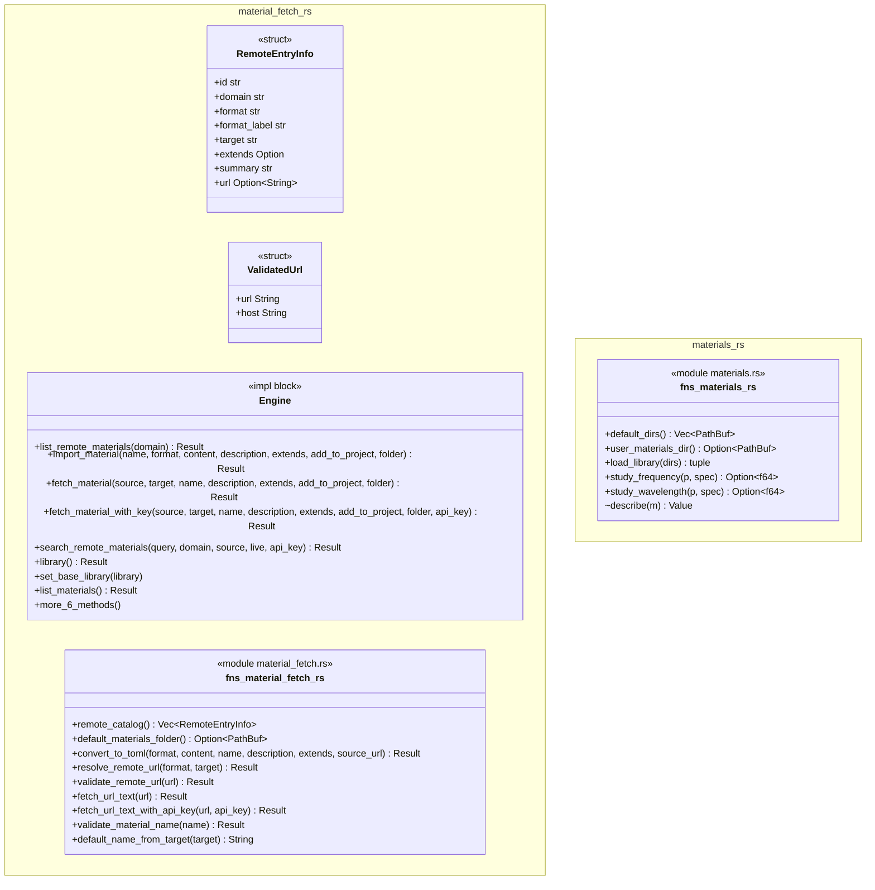

# Materials: code

C4 level 4 (code) of the component **Materials** (`engine.materials`) in the container **nyx-engine** (crate `nyx_engine`). [Component view of the container](../../3-components/engine.md) · [All code pages](../README.md)

> The material library plus the materials a project carries, resolved at the study wavelength or BCS superconducting operating point.

**Decisions:** [ADR 58](../../../adr/0058-the-engine-resolves-materials-from-the-library-and-the-project.md), [ADR 104](../../../adr/0104-bcs-surface-impedance-and-lumped-josephson-ports.md)  
**Size:** 2 files, 1347 lines.

## Files

| File | Lines | What it says about itself |
|---|---:|---|
| `crates/nyx-engine/src/material_fetch.rs` | 726 |  |
| `crates/nyx-engine/src/materials.rs` | 621 |  |

## What it uses

| Target | Modules | Items |
|---|---|---|
| [container `femcore` (femcore)](../../3-components/femcore.md) | material, material::bcs, material::coupled, material::import, material::spec | EV_TO_J, FilmModel, ImportFormat, ImportOptions, Library, M3, M6, MaterialSpec, PiezoForm, Piezoelectric +10 |
| container `materialLibrary` (Material library) |  (declared: Loads) |  |
| [container `physics` (nyx-physics)](../../3-components/physics.md) | desc, error, physics, spec | Error, ParamKind, Physics, ProblemSpec |
| [Commands](./commands.md) | engine | Engine |
| [Job runner and queue](./jobs.md) | shared_queue | default_workspace |

## Used by

| Component | Modules | Items |
|---|---|---|
| [app: Scripts and batch](../app/headless.md) | material_fetch | default_materials_folder, default_name_from_target |
| [app: Inspector tabs](../app/inspector.md) | material_fetch | convert_to_toml, default_materials_folder, fetch_url_text_with_api_key, remote_catalog, resolve_remote_url |
| [Commands](./commands.md) | materials | default_dirs, load_library, study_wavelength |
| [Job runner and queue](./jobs.md) | materials | study_frequency, study_wavelength |

## Class diagram

Public types with their public fields (or variants) and methods, free functions per file as a `module` box; arrows are field types and `impl Trait`. Capped at 36 types and a few members each; the table below is complete.

## Public items

| Kind | Item | File:line | Signature or summary |
|---|---|---|---|
| struct | `RemoteEntryInfo` | `material_fetch.rs:17` | fields: `id`, `domain`, `format`, `format_label`, `target`, `extends`, `summary`, `url` —  One curated remote preset exposed to front-ends (`nyx` GUI and CLI) without leaking `femcore` types. |
| fn | `remote_catalog` | `material_fetch.rs:29` | `pub fn remote_catalog() -> Vec<RemoteEntryInfo>` —  Returns every curated remote preset together with its resolved HTTPS source URL (when directly downloadable without an API key). |
| fn | `default_materials_folder` | `material_fetch.rs:73` | `pub fn default_materials_folder() -> Option<PathBuf>` —  First writable `materials/` directory for CLI `--save` or GUI save-to-library toggles. |
| fn | `convert_to_toml` | `material_fetch.rs:90` | `pub fn convert_to_toml( format: &str, content: &str, name: &str, description: Option<&str>, extends: Option<&str>, source_url: Option<&str>, ) -> Result<String, Error>` —  Converts raw external database text into validated `format = 1` material TOML text (`rii`, `aflow`, `mp`, `numbat`). |
| fn | `resolve_remote_url` | `material_fetch.rs:104` | `pub fn resolve_remote_url(format: &str, target: &str) -> Result<String, Error>` —  Resolves a format + database coordinate into its HTTPS URL (for GUI hints or diagnostics). |
| struct | `ValidatedUrl` | `material_fetch.rs:117` | fields: `url`, `host` |
| fn | `validate_remote_url` | `material_fetch.rs:123` | `pub fn validate_remote_url(url: &str) -> Result<ValidatedUrl, Error>` —  Validates that `url` is a clean `https://` URL targeting an allowlisted remote material host (no userinfo, custom port, backslash, or path traversal). |
| fn | `fetch_url_text` | `material_fetch.rs:200` | `pub fn fetch_url_text(url: &str) -> Result<String, Error>` —  Downloads a UTF-8 text payload over HTTPS using system `curl` (`--proto =https --max-redirs 0 --max-time 20`, 5 MiB cap). |
| fn | `fetch_url_text_with_api_key` | `material_fetch.rs:206` | `pub fn fetch_url_text_with_api_key(url: &str, api_key: Option<&str>) -> Result<String, Error>` —  Downloads a UTF-8 text payload over HTTPS using system `curl` (`--proto =https --max-redirs 0 --max-time 20`, 5 MiB cap), |
| fn | `validate_material_name` | `material_fetch.rs:261` | `pub fn validate_material_name(name: &str) -> Result<&str, Error>` |
| fn | `default_name_from_target` | `material_fetch.rs:277` | `pub fn default_name_from_target(target: &str) -> String` —  Derives a safe material filename/identifier stem from a database entry path or query. |
| fn | `Engine::list_remote_materials` | `material_fetch.rs:345` | `pub fn list_remote_materials(&self, domain: Option<&str>) -> Result<Value, Error>` —  Lists curated remote materials in `REMOTE_CATALOG`, optionally filtered by `domain` (`photonics`, `phononics`, `superconducting`, `all`). |
| fn | `Engine::import_material` | `material_fetch.rs:375` | `pub fn import_material( &mut self, name: &str, format: &str, content: &str, description: Option<&str>, extends: Option<&str>, add_to_project: bool, folder: Option<&Path>, ) -> Result<Value, Error>` —  Converts raw database text (`rii`, `aflow`, `mp`, `numbat`), validates it against the library and adds/saves as requested. |
| fn | `Engine::fetch_material` | `material_fetch.rs:394` | `pub fn fetch_material( &mut self, source: &str, target: Option<&str>, name: Option<&str>, description: Option<&str>, extends: Option<&str>, add_to_project: bool, folder: Option<&Path>, ) -> Result<Value, Error>` —  Downloads a remote database entry or catalog preset over HTTPS, converts it into validated TOML, and adds/saves as requested. |
| fn | `Engine::fetch_material_with_key` | `material_fetch.rs:410` | `pub fn fetch_material_with_key( &mut self, source: &str, target: Option<&str>, name: Option<&str>, description: Option<&str>, extends: Option<&str>, add_to_project: bool, folder: Option<&Path>, api_key: Option<&str>, ) -> Result<Value, Error>` —  Downloads a remote database entry or catalog preset over HTTPS (using `api_key` or `MP_API_KEY` via `curl --config -` stdin for Materials Project), |
| fn | `Engine::search_remote_materials` | `material_fetch.rs:513` | `pub fn search_remote_materials( &self, query: &str, domain: Option<&str>, source: Option<&str>, live: bool, api_key: Option<&str>, ) -> Result<Value, Error>` —  Searches the curated `REMOTE_CATALOG` and (when `live` is true) live AFLOW and Materials Project HTTPS endpoints. |
| fn | `default_dirs` | `materials.rs:17` | `pub fn default_dirs() -> Vec<PathBuf>` —  The folders searched for bundled/configured material files, first valid match wins when loading the base library: |
| fn | `user_materials_dir` | `materials.rs:77` | `pub fn user_materials_dir() -> Option<PathBuf>` —  The user's writable material overlay folder (`<workspace>/materials`, i.e. `$NYX_WORKSPACE/materials` or `Documents/nyx/materials`). |
| fn | `load_library` | `materials.rs:106` | `pub fn load_library(dirs: &[PathBuf]) -> (Library, Vec<String>)` —  Loads the first folder that has material files as the base library, then overlays any user `*.toml` files |
| fn | `study_frequency` | `materials.rs:161` | `pub fn study_frequency(p: &dyn Physics, spec: &ProblemSpec) -> Option<f64>` —  The frequency (Hz) of a study, from the first parameter of the study descriptor with the unit Hz (given, else its default), |
| fn | `study_wavelength` | `materials.rs:216` | `pub fn study_wavelength(p: &dyn Physics, spec: &ProblemSpec) -> Option<f64>` —  The frequency (Hz) of a study, from the first parameter of the study descriptor with the unit Hz (given, else its default); the free-space |
| fn | `describe` | `materials.rs:224` | `pub(crate) fn describe(m: &MaterialSpec) -> Value` |
| fn | `Engine::library` | `materials.rs:260` | `pub fn library(&self) -> Result<Arc<Library>, Error>` —  The library a solve sees: the folder's materials and the project's own, which may extend them. |
| fn | `Engine::set_base_library` | `materials.rs:274` | `pub fn set_base_library(&mut self, library: Library)` —  Replaces the folder library (tests, or a front-end that lets the person pick another folder). |
| fn | `Engine::list_materials` | `materials.rs:278` | `pub fn list_materials(&self) -> Result<Value, Error>` |
| fn | `Engine::describe_material` | `materials.rs:303` | `pub fn describe_material(&self, name: &str) -> Result<Value, Error>` |
| fn | `Engine::evaluate_material` | `materials.rs:311` | `pub fn evaluate_material( &self, name: &str, temperature_k: Option<f64>, frequency_hz: Option<f64>, wavelength_m: Option<f64>, e_field_v_per_m: Option<f64>, thickness_m: Option<f64>, film_model: Option<&str>, euler_deg: Option<[f64; 3]>, ) -> Result<Value, Error>` —  Evaluates a material's temperature-, frequency-, wavelength-, and field-dependent multi-physics properties. |
| fn | `Engine::bcs_surface_impedance_cmd` | `materials.rs:499` | `pub fn bcs_surface_impedance_cmd(&self, args: &Value) -> Result<Value, Error>` —  Evaluates Zimmermann arbitrary-purity BCS + sub-gap mK surface impedance for a named superconducting |
| fn | `Engine::add_material` | `materials.rs:593` | `pub fn add_material(&mut self, name: &str, toml_text: &str) -> Result<Value, Error>` —  Adds (or replaces) a material the project carries, given as TOML text. It is read now, so a mistake is reported here. |
| fn | `Engine::remove_material` | `materials.rs:609` | `pub fn remove_material(&mut self, name: &str) -> Result<(), Error>` |
| fn | `Engine::bcs_surface_impedance` | `materials.rs:617` | `pub fn bcs_surface_impedance(&self, args: &Value) -> Result<Value, Error>` —  Evaluates Zimmermann arbitrary-purity BCS complex conductivity and thin-film surface impedance. |
