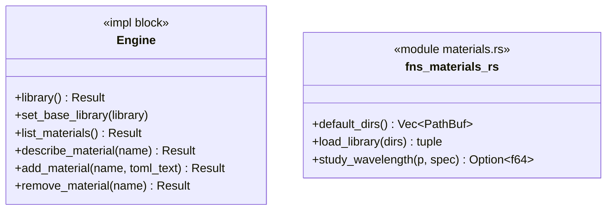

# Materials: code

C4 level 4 (code) of the component **Materials** (`engine.materials`) in the container **nyx-engine** (crate `nyx_engine`). [Component view of the container](../../3-components/engine.md) · [All code pages](../README.md)

> The material library plus the materials a project carries, resolved at the study wavelength.

**Decisions:** [ADR 58](../../../adr/0058-the-engine-resolves-materials-from-the-library-and-the-project.md)  
**Size:** 1 file, 157 lines.

## Files

| File | Lines | What it says about itself |
|---|---:|---|
| `crates/nyx-engine/src/materials.rs` | 157 |  |

## What it uses

| Target | Modules | Items |
|---|---|---|
| [container `femcore` (femcore)](../../3-components/femcore.md) | material, material::spec | Library, MaterialSpec |
| container `materialLibrary` (Material library) |  (declared: Loads) |  |
| [container `physics` (nyx-physics)](../../3-components/physics.md) | desc, error, physics, spec | Error, ParamKind, Physics, ProblemSpec |
| [Commands](./commands.md) | engine | Engine |

## Used by

| Component | Modules | Items |
|---|---|---|
| [Commands](./commands.md) | materials | default_dirs, load_library, study_wavelength |
| [Job runner and queue](./jobs.md) | materials | study_wavelength |

## Class diagram

Public types with their public fields (or variants) and methods, free functions per file as a `module` box; arrows are field types and `impl Trait`. Capped at 36 types and a few members each; the table below is complete.

## Public items

| Kind | Item | File:line | Signature or summary |
|---|---|---|---|
| fn | `default_dirs` | `materials.rs:16` | `pub fn default_dirs() -> Vec<PathBuf>` —  The folders searched for material files, first match wins: `NYX_MATERIALS` (a path list), `materials` next to the program, and a |
| fn | `load_library` | `materials.rs:50` | `pub fn load_library(dirs: &[PathBuf]) -> (Library, Vec<String>)` —  Loads the first folder that has material files; an empty library (and the reason) when none loads. |
| fn | `study_wavelength` | `materials.rs:68` | `pub fn study_wavelength(p: &dyn Physics, spec: &ProblemSpec) -> Option<f64>` —  The frequency (Hz) of a study, from the first parameter of the study descriptor with the unit Hz (given, else its default); the free-space |
| fn | `Engine::library` | `materials.rs:94` | `pub fn library(&self) -> Result<Arc<Library>, Error>` —  The library a solve sees: the folder's materials and the project's own, which may extend them. |
| fn | `Engine::set_base_library` | `materials.rs:108` | `pub fn set_base_library(&mut self, library: Library)` —  Replaces the folder library (tests, or a front-end that lets the person pick another folder). |
| fn | `Engine::list_materials` | `materials.rs:112` | `pub fn list_materials(&self) -> Result<Value, Error>` |
| fn | `Engine::describe_material` | `materials.rs:127` | `pub fn describe_material(&self, name: &str) -> Result<Value, Error>` |
| fn | `Engine::add_material` | `materials.rs:134` | `pub fn add_material(&mut self, name: &str, toml_text: &str) -> Result<Value, Error>` —  Adds (or replaces) a material the project carries, given as TOML text. It is read now, so a mistake is reported here. |
| fn | `Engine::remove_material` | `materials.rs:150` | `pub fn remove_material(&mut self, name: &str) -> Result<(), Error>` |
