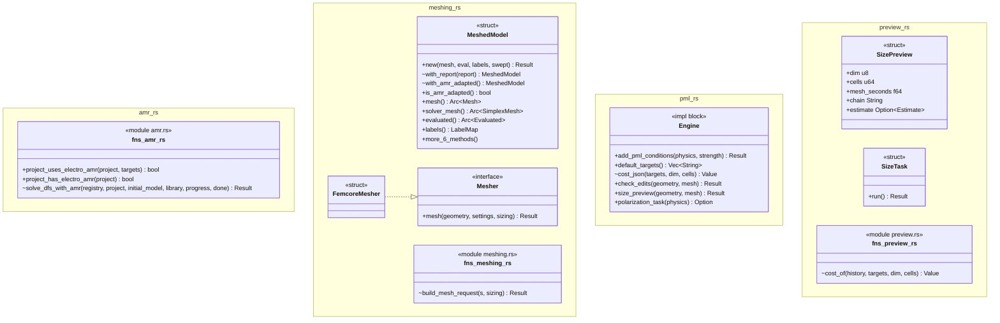

# Meshing seam: code

C4 level 4 (code) of the component **Meshing seam** (`engine.meshing`) in the container **nyx-engine** (crate `nyx_engine`). [Component view of the container](../../3-components/engine.md) · [All code pages](../README.md)

> MeshRequest to MeshedModel (mesh, names, label resolver); the only caller of the femcore mesher; absorbing layers across the two halves of a project; trial meshes and edit checks for the feedback while editing (ADR 92).

**Decisions:** [ADR 54](../../../adr/0054-mesh-request-and-report-as-data.md), [ADR 50](../../../adr/0050-wavelength-sizing-in-3d.md), [ADR 92](../../../adr/0092-feedback-while-editing-is-a-value-never-a-job.md)  
**Size:** 4 files, 1075 lines.

## Files

| File | Lines | What it says about itself |
|---|---:|---|
| `crates/nyx-engine/src/amr.rs` | 333 |  |
| `crates/nyx-engine/src/meshing.rs` | 493 |  |
| `crates/nyx-engine/src/pml.rs` | 75 |  |
| `crates/nyx-engine/src/preview.rs` | 174 |  |

## What it uses

| Target | Modules | Items |
|---|---|---|
| [container `analysis` (nyx-analysis)](../../3-components/analysis.md) | modes, polarization | ModeAnalysis |
| [container `femcore` (femcore)](../../3-components/femcore.md) | adapt::electro, material::spec, mesh, meshing, meshing::geomdrive, meshing::geomdrive3, meshing::mesher, meshing::physics_size +4 | Adaptive, CANCELLED, ElectroMetric2dOptions, ElectroMetric3dOptions, Layer, Library, MeshReport, MeshRequest, MeshedGeom, MesherRequest +23 |
| [container `geom` (geom)](../../3-components/geom.md) | eval, labels, model, select | EntityKind, EntitySet, Evaluated, FeatureList, LabelMap, Selector |
| [container `physics` (nyx-physics)](../../3-components/physics.md) | cqed, crate root, error, physics, registry, result, spec | AdaptPassRecord, BcSpec, CAPACITANCE_KEY, CapacitanceMatrixData, ElectroAmrData, Error, LabelResolver, Mesh, ProblemSpec, Registry +4 |
| [Commands](./commands.md) | engine | Engine |
| [Job runner and queue](./jobs.md) | estimate, solve | Estimate, History, chain_key, solve_one_single |
| [Project](./project.md) | project | MeshSettings, Project, SweepLayer |
| [Registry and facade](./registry.md) | crate root | physics_for |

## Used by

| Component | Modules | Items |
|---|---|---|
| [app: Window](../app/window.md) | meshing, preview | MeshedModel, SizePreview |
| [Analyses](./analyse.md) | meshing | MeshedModel |
| [Commands](./commands.md) | amr, meshing | FemcoreMesher, MeshedModel, Mesher, project_uses_electro_amr |
| [Job runner and queue](./jobs.md) | amr, meshing, preview | FemcoreMesher, MeshedModel, Mesher, cost_of, project_uses_electro_amr, solve_dfs_with_amr |
| [Registry and facade](./registry.md) | meshing | FemcoreMesher, MeshedModel, Mesher |
| [Results files](./resultsIO.md) | amr, meshing | MeshedModel, Mesher, project_has_electro_amr |

## Class diagram

Public types with their public fields (or variants) and methods, free functions per file as a `module` box; arrows are field types and `impl Trait`. Capped at 36 types and a few members each; the table below is complete.

## Public items

| Kind | Item | File:line | Signature or summary |
|---|---|---|---|
| fn | `project_uses_electro_amr` | `amr.rs:66` | `pub fn project_uses_electro_amr(project: &Project, targets: &[String]) -> bool` —  True when `project` and `targets` request multi-pass electrostatic AMR (`adapt_passes > 1`) on an unswept mesh. |
| fn | `project_has_electro_amr` | `amr.rs:74` | `pub fn project_has_electro_amr(project: &Project) -> bool` —  True when `project` carries a `dfs` `electrostatic` study configured with `adapt_passes > 1`. |
| fn | `solve_dfs_with_amr` | `amr.rs:132` | `pub(crate) fn solve_dfs_with_amr( registry: &Registry, project: &Project, initial_model: Arc<MeshedModel>, library: &Arc<femcore::material::Library>, progress: &Arc<Progress>, done: &[(String, SolveResult)], ) -> Result<(Arc<MeshedModel>, SolveResult), Error>` —  Runs the multi-pass goal-oriented AMR loop for `dfs` `electrostatic` and returns `(final_model, final_result)`. |
| struct | `MeshedModel` | `meshing.rs:17` |  |
| trait | `Mesher` | `meshing.rs:244` | methods: `mesh` —  Builds the mesh of a model. `sizing` is what the physics of the project want resolved (`MeshSettings::physics_sizing`); the engine |
| struct | `FemcoreMesher` | `meshing.rs:264` |  The mesher of `femcore`, driven by a `MeshRequest` (ADR 54): 2D and 3D models, simple or adaptive, inline or structured absorbing |
| fn | `build_mesh_request` | `meshing.rs:300` | `pub(crate) fn build_mesh_request( s: &MeshSettings, sizing: Option<&Sizing>, ) -> Result<femcore::meshing::request::MeshRequest, Error>` —  Validates `MeshSettings` and builds the corresponding [`femcore::meshing::request::MeshRequest`]. |
| fn | `MeshedModel::new` | `meshing.rs:35` | `pub fn new( mesh: femcore::mesh::SimplexMesh, eval: Arc<Evaluated>, labels: LabelMap, swept: bool, ) -> Result<MeshedModel, Error>` —  From the mesh the mesher made (the solver mesh of femcore) to the exchange mesh the physics are given. |
| fn | `MeshedModel::with_report` | `meshing.rs:81` | `pub(crate) fn with_report(mut self, report: femcore::meshing::request::MeshReport) -> MeshedModel` —  The same, with the report the mesher made of it. |
| fn | `MeshedModel::with_amr_adapted` | `meshing.rs:87` | `pub(crate) fn with_amr_adapted(mut self) -> MeshedModel` —  Marks this model as produced by multi-pass AMR (`AF-1`). |
| fn | `MeshedModel::is_amr_adapted` | `meshing.rs:93` | `pub fn is_amr_adapted(&self) -> bool` —  True when this model was adapted during multi-pass AMR rather than built solely from `MeshSettings`. |
| fn | `MeshedModel::mesh` | `meshing.rs:97` | `pub fn mesh(&self) -> &Arc<Mesh>` |
| fn | `MeshedModel::solver_mesh` | `meshing.rs:103` | `pub fn solver_mesh(&self) -> Arc<femcore::mesh::SimplexMesh>` —  The mesh in the numbering the plots read (vertices, edges, P2 dofs): the exchange mesh cut into simplices, as every solve sees it. |
| fn | `MeshedModel::evaluated` | `meshing.rs:110` | `pub fn evaluated(&self) -> &Arc<Evaluated>` —  The geometry the mesh was made from, evaluated: what a front-end needs to name an entity it points at (selector suggestions). |
| fn | `MeshedModel::labels` | `meshing.rs:115` | `pub fn labels(&self) -> &LabelMap` —  The names of the model: region and boundary numbers. |
| fn | `MeshedModel::swept_ends` | `meshing.rs:120` | `pub fn swept_ends(&self) -> Option<(i32, i32)>` —  The boundary labels of the two end faces of a model swept along y. |
| fn | `MeshedModel::report` | `meshing.rs:124` | `pub fn report(&self) -> Option<&femcore::meshing::request::MeshReport>` |
| fn | `MeshedModel::regions` | `meshing.rs:129` | `pub fn regions(&self) -> Vec<(i32, String)>` —  Region labels with their names. |
| fn | `MeshedModel::info` | `meshing.rs:134` | `pub fn info(&self) -> Value` —  What a person or a host needs to choose names: the regions, the boundary names and the size of the mesh. |
| fn | `MeshedModel::suggest` | `meshing.rs:462` | `pub fn suggest(&self, labels: &[i32]) -> Vec<String>` —  Selectors, simplest first, that pick exactly the boundaries with these numbers; empty when no selector does. What the window offers |
| fn | `MeshedModel::boundary_names` | `meshing.rs:489` | `pub fn boundary_names(&self) -> Vec<(i32, String)>` —  The names of the boundaries with their numbers (a boundary name may stand for several numbers). |
| fn | `Engine::add_pml_conditions` | `pml.rs:14` | `pub fn add_pml_conditions(&mut self, physics: &str, strength: f64) -> Result<Value, Error>` —  Adds a `pml` condition for every absorbing piece of the geometry to `physics` (replacing the conditions it had on those pieces). |
| fn | `Engine::default_targets` | `pml.rs:53` | `pub fn default_targets(&self) -> Vec<String>` —  The physics solved when none is named: the active one and, before it, those of the project that export what it imports (a heat |
| struct | `SizePreview` | `preview.rs:31` | fields: `dim`, `cells`, `mesh_seconds`, `chain`, `estimate` —  The size and cost of a model that is being edited. |
| fn | `cost_of` | `preview.rs:51` | `pub(crate) fn cost_of(history: &History, targets: &[String], dim: u8, cells: u64) -> serde_json::Value` —  What a solve of `targets` on a mesh of `cells` cells costs, from the solves `history` has seen (the answer of `mesh_build` and `convergence_check` |
| struct | `SizeTask` | `preview.rs:74` |  A trial mesh waiting to run. It owns copies of everything it needs and is `Send`, so the caller chooses the thread. |
| fn | `SizeTask::run` | `preview.rs:87` | `pub fn run(self) -> Result<SizePreview, Error>` —  Meshes the copy of the edits and looks up the estimate. Blocks for as long as the mesher takes (milliseconds for the models this is |
| fn | `Engine::cost_json` | `preview.rs:103` | `pub(crate) fn cost_json(&self, targets: &[String], dim: u8, cells: u64) -> serde_json::Value` —  What a solve of `targets` on a mesh of `cells` cells costs, as the answer of `mesh_build` and `convergence_check` shows it: the estimate from the |
| fn | `Engine::check_edits` | `preview.rs:109` | `pub fn check_edits(&self, geometry: &FeatureList, mesh: &MeshSettings) -> Result<(), Error>` —  The first problem of this project with `geometry` and `mesh` in place of its own, in plain words, or `Ok` when it passes |
| fn | `Engine::size_preview` | `preview.rs:119` | `pub fn size_preview(&self, geometry: FeatureList, mesh: MeshSettings) -> Result<SizeTask, Error>` —  A trial mesh of the project with `geometry` and `mesh` applied, as a task that can run on any thread. Refused (with the reason, in plain |
| fn | `Engine::polarization_task` | `preview.rs:146` | `pub fn polarization_task( &self, physics: &str, ) -> Option<(Arc<SolveResult>, impl FnOnce() -> Result<ModeAnalysis, Error> + Send + 'static)>` —  The polarization analysis of the latest result of `physics` as a function that does not borrow the engine, so it can run beside the |

Trait implementations in this component: `MeshedModel: LabelResolver`, `FemcoreMesher: Mesher`
