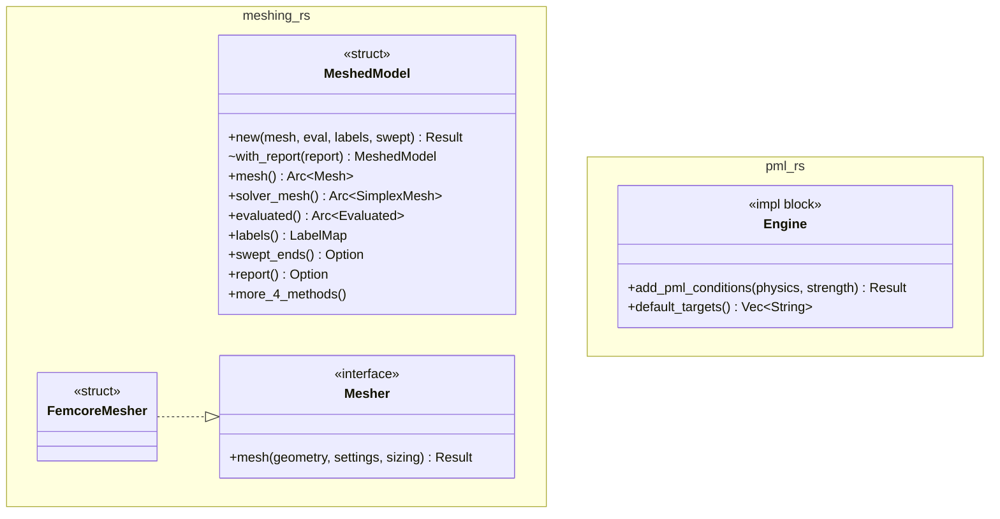

# Meshing seam: code

C4 level 4 (code) of the component **Meshing seam** (`engine.meshing`) in the container **nyx-engine** (crate `nyx_engine`). [Component view of the container](../../3-components/engine.md) · [All code pages](../README.md)

> MeshRequest to MeshedModel (mesh, names, label resolver); the only caller of the femcore mesher; absorbing layers across the two halves of a project.

**Decisions:** [ADR 54](../../../adr/0054-mesh-request-and-report-as-data.md), [ADR 50](../../../adr/0050-wavelength-sizing-in-3d.md)  
**Size:** 2 files, 354 lines.

## Files

| File | Lines | What it says about itself |
|---|---:|---|
| `crates/nyx-engine/src/meshing.rs` | 281 | Meshing seam. `MeshedModel` is a mesh together with the names of the model (regions, boundaries) and the label resolver the physics use; `Mesher` builds one from a feature list. `FemcoreMesher` is the **only** code of the engine that cal... |
| `crates/nyx-engine/src/pml.rs` | 73 | Absorbing layers across the two halves of a project: the geometry cuts a region into the physical part and one piece per side of the window (`Pml` feature), the physics stretches the coordinates in each piece (`pml` condition). `add_pml_... |

## What it uses

| Target | Modules | Items |
|---|---|---|
| [container `femcore` (femcore)](../../3-components/femcore.md) | mesh, meshing::geomdrive, meshing::mesher, meshing::request | Layer, MeshReport, MeshRequest, MesherRequest, SimplexMesh, WavesRequest, evaluate, extrude_y, mesh_request, sort_nodes |
| [container `geom` (geom)](../../3-components/geom.md) | eval, labels, model, select | EntityKind, EntitySet, Evaluated, FeatureList, LabelMap, Selector |
| [container `physics` (nyx-physics)](../../3-components/physics.md) | crate root, error, physics, spec | BcSpec, Error, LabelResolver, Mesh, Sizing |
| [Commands](./commands.md) | engine | Engine |
| [Project](./project.md) | project | MeshSettings |
| [Registry and facade](./registry.md) | crate root | physics_for |

## Used by

| Component | Modules | Items |
|---|---|---|
| [app: Window](../app/window.md) | meshing | MeshedModel |
| [Analyses](./analyse.md) | meshing | MeshedModel |
| [Commands](./commands.md) | meshing | FemcoreMesher, MeshedModel, Mesher |
| [Job runner](./jobs.md) | meshing | MeshedModel, Mesher |
| [Registry and facade](./registry.md) | meshing | FemcoreMesher, MeshedModel, Mesher |

## Class diagram

Public types with their public fields (or variants) and methods, free functions per file as a `module` box; arrows are field types and `impl Trait`. Capped at 36 types and a few members each; the table below is complete.

## Public items

| Kind | Item | File:line | Signature or summary |
|---|---|---|---|
| struct | `MeshedModel` | `meshing.rs:15` |  |
| trait | `Mesher` | `meshing.rs:171` | methods: `mesh` —  Builds the mesh of a model. `sizing` is what the physics of the project want resolved (`MeshSettings::physics_sizing`); the engine |
| struct | `FemcoreMesher` | `meshing.rs:182` |  The mesher of `femcore`, driven by a `MeshRequest` (ADR 54): 2D and 3D models, simple or adaptive, inline or structured absorbing |
| fn | `MeshedModel::new` | `meshing.rs:29` | `pub fn new( mesh: femcore::mesh::SimplexMesh, eval: Arc<Evaluated>, labels: LabelMap, swept: bool, ) -> Result<MeshedModel, Error>` —  From the mesh the mesher made (the solver mesh of femcore) to the exchange mesh the physics are given. |
| fn | `MeshedModel::with_report` | `meshing.rs:44` | `pub(crate) fn with_report(mut self, report: femcore::meshing::request::MeshReport) -> MeshedModel` —  The same, with the report the mesher made of it. |
| fn | `MeshedModel::mesh` | `meshing.rs:49` | `pub fn mesh(&self) -> &Arc<Mesh>` |
| fn | `MeshedModel::solver_mesh` | `meshing.rs:55` | `pub fn solver_mesh(&self) -> Arc<femcore::mesh::SimplexMesh>` —  The mesh in the numbering the plots read (vertices, edges, P2 dofs): the exchange mesh cut into simplices, as every solve sees it. |
| fn | `MeshedModel::evaluated` | `meshing.rs:62` | `pub fn evaluated(&self) -> &Arc<Evaluated>` —  The geometry the mesh was made from, evaluated: what a front-end needs to name an entity it points at (selector suggestions). |
| fn | `MeshedModel::labels` | `meshing.rs:67` | `pub fn labels(&self) -> &LabelMap` —  The names of the model: region and boundary numbers. |
| fn | `MeshedModel::swept_ends` | `meshing.rs:72` | `pub fn swept_ends(&self) -> Option<(i32, i32)>` —  The boundary labels of the two end faces of a model swept along y. |
| fn | `MeshedModel::report` | `meshing.rs:76` | `pub fn report(&self) -> Option<&femcore::meshing::request::MeshReport>` |
| fn | `MeshedModel::regions` | `meshing.rs:81` | `pub fn regions(&self) -> Vec<(i32, String)>` —  Region labels with their names. |
| fn | `MeshedModel::info` | `meshing.rs:86` | `pub fn info(&self) -> Value` —  What a person or a host needs to choose names: the regions, the boundary names and the size of the mesh. |
| fn | `MeshedModel::suggest` | `meshing.rs:250` | `pub fn suggest(&self, labels: &[i32]) -> Vec<String>` —  Selectors, simplest first, that pick exactly the boundaries with these numbers; empty when no selector does. What the window offers |
| fn | `MeshedModel::boundary_names` | `meshing.rs:277` | `pub fn boundary_names(&self) -> Vec<(i32, String)>` —  The names of the boundaries with their numbers (a boundary name may stand for several numbers). |
| fn | `Engine::add_pml_conditions` | `pml.rs:12` | `pub fn add_pml_conditions(&mut self, physics: &str, strength: f64) -> Result<Value, Error>` —  Adds a `pml` condition for every absorbing piece of the geometry to `physics` (replacing the conditions it had on those pieces). |
| fn | `Engine::default_targets` | `pml.rs:51` | `pub fn default_targets(&self) -> Vec<String>` —  The physics solved when none is named: the active one and, before it, those of the project that export what it imports (a heat |

Trait implementations in this component: `MeshedModel: LabelResolver`, `FemcoreMesher: Mesher`
