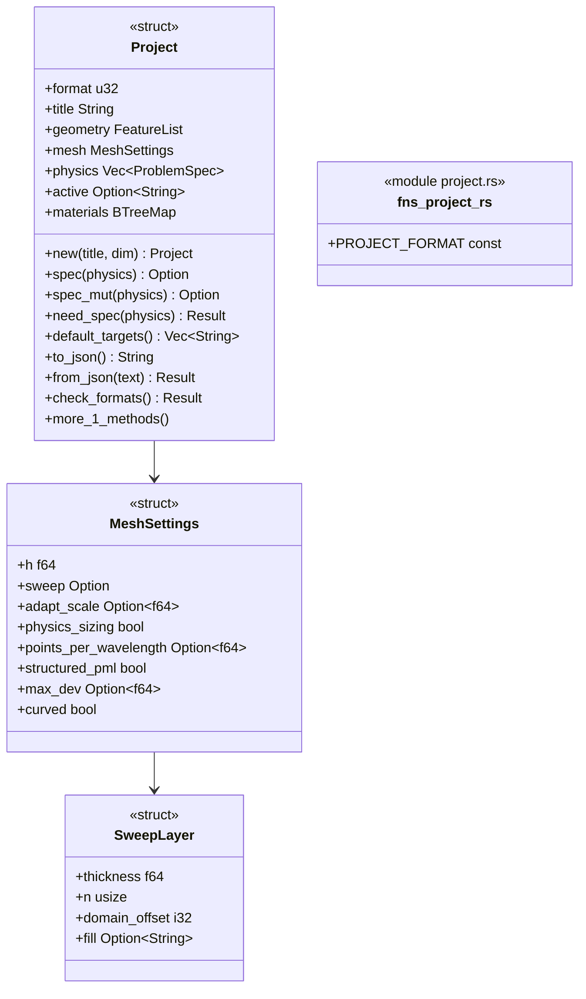

# Project: code

C4 level 4 (code) of the component **Project** (`engine.project`) in the container **nyx-engine** (crate `nyx_engine`). [Component view of the container](../../3-components/engine.md) · [All code pages](../README.md)

> The saved state: feature list, mesh settings, one ProblemSpec per physics, project materials. The format key is checked at the file boundary.

**Decisions:** [ADR 63](../../../adr/0063-the-format-key-and-no-json-for-bulk-data.md)  
**Size:** 1 file, 206 lines.

## Files

| File | Lines | What it says about itself |
|---|---:|---|
| `crates/nyx-engine/src/project.rs` | 206 | The project: what is saved. A geometry (a `geom` feature list), the mesh settings, one problem (`ProblemSpec` envelope) per physics the project loads, and which physics is active. It is plain serde data; `to_json` writes it with sorted k... |

## What it uses

| Target | Modules | Items |
|---|---|---|
| [container `geom` (geom)](../../3-components/geom.md) | model | FORMAT, FeatureList |
| [container `physics` (nyx-physics)](../../3-components/physics.md) | error, registry, spec, validate | Error, FORMAT, ProblemSpec, Registry, canonical_json, validate_spec |
| container `projectFile` (Project file) |  (declared: Saves and loads) |  |
| [Registry and facade](./registry.md) | crate root | physics_for |

## Used by

| Component | Modules | Items |
|---|---|---|
| [app: Inspector tabs](../app/inspector.md) | project | SweepLayer |
| [app: Window](../app/window.md) | project | MeshSettings |
| [Commands](./commands.md) | project | MeshSettings, Project |
| [Job runner](./jobs.md) | project | Project |
| [Meshing seam](./meshing.md) | project | MeshSettings |
| [Registry and facade](./registry.md) | project | MeshSettings, Project, SweepLayer |
| [Results files](./resultsIO.md) | project | Project |
| [Store link](./storeLink.md) | project | Project |

## Class diagram

Public types with their public fields (or variants) and methods, free functions per file as a `module` box; arrows are field types and `impl Trait`. Capped at 36 types and a few members each; the table below is complete.

## Public items

| Kind | Item | File:line | Signature or summary |
|---|---|---|---|
| struct | `SweepLayer` | `project.rs:12` | fields: `thickness`, `n`, `domain_offset`, `fill` —  One layer of a model swept along y into a 3D mesh (the 2D cross-section is extruded with `n` cells across `thickness`). |
| struct | `MeshSettings` | `project.rs:26` | fields: `h`, `sweep`, `adapt_scale`, `physics_sizing`, `points_per_wavelength`, `structured_pml`, `max_dev`, `curved` —  How the geometry is meshed. |
| const | `PROJECT_FORMAT` | `project.rs:70` | `u32` —  The file format of a project (ADR 63). |
| struct | `Project` | `project.rs:77` | fields: `format`, `title`, `geometry`, `mesh`, `physics`, `active`, `materials` |
| fn | `Project::new` | `project.rs:97` | `pub fn new(title: &str, dim: u8) -> Project` —  An empty project: no features, no physics. |
| fn | `Project::spec` | `project.rs:109` | `pub fn spec(&self, physics: &str) -> Option<&ProblemSpec>` |
| fn | `Project::spec_mut` | `project.rs:113` | `pub fn spec_mut(&mut self, physics: &str) -> Option<&mut ProblemSpec>` |
| fn | `Project::need_spec` | `project.rs:118` | `pub fn need_spec(&mut self, physics: &str) -> Result<&mut ProblemSpec, Error>` —  The spec of a physics the project must have, with the list of those it has in the message when it has not. |
| fn | `Project::default_targets` | `project.rs:129` | `pub fn default_targets(&self) -> Vec<String>` —  The codes to solve when none is named: the active physics, else all of them. |
| fn | `Project::to_json` | `project.rs:137` | `pub fn to_json(&self) -> String` —  The project as JSON text with sorted keys. |
| fn | `Project::from_json` | `project.rs:144` | `pub fn from_json(text: &str) -> Result<Project, Error>` —  Reads a project file. The `format` key must be present (in the project, the feature list and every problem) and supported: a file of |
| fn | `Project::check_formats` | `project.rs:166` | `pub fn check_formats(&self) -> Result<(), Error>` —  Refuses a format this program does not read, in the project, its feature list and its problems. |
| fn | `Project::check` | `project.rs:186` | `pub fn check(&self, registry: &Registry) -> Result<(), Error>` —  Everything that can be checked without a mesh: the feature list, the element size, the physics against the registry and each problem |

Trait implementations in this component: `MeshSettings: Default`
