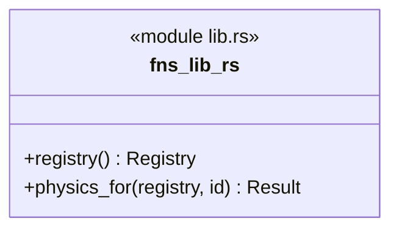

# Registry and facade: code

C4 level 4 (code) of the component **Registry and facade** (`engine.registry`) in the container **nyx-engine** (crate `nyx_engine`). [Component view of the container](../../3-components/engine.md) · [All code pages](../README.md)

> The physics compiled in (cargo features dfs, sms, ems) and the facade that re-exports what a front-end draws with.

**Decisions:** [ADR 25](../../../adr/0025-physics-trait-registry-and-problem-envelope.md)  
**Size:** 1 file, 96 lines.

## Files

| File | Lines | What it says about itself |
|---|---:|---|
| `crates/nyx-engine/src/lib.rs` | 96 | nyx-engine: the one place that knows how a nyx session works. The window (`app`) and the MCP server (`nyx-mcp`) are thin front-ends over it: every action of either is a command of the engine (restructure phase 7, ADR 23 and 25). |

## What it uses

| Target | Modules | Items |
|---|---|---|
| [container `analysis` (nyx-analysis)](../../3-components/analysis.md) | crate root |  |
| [container `dfs` (nyx-dfs)](../../3-components/dfs.md) | crate root | Dfs |
| [container `ems` (nyx-ems)](../../3-components/ems.md) | crate root | Ems |
| [container `femcore` (femcore)](../../3-components/femcore.md) | fields, mesh, mesh::view, meshing::geomdrive, progress | Display, Progress, SimplexMesh, ViewMesh |
| [container `geom` (geom)](../../3-components/geom.md) | crate root |  |
| [container `physics` (nyx-physics)](../../3-components/physics.md) | crate root, error, physics, registry | Error, Physics, Registry |
| [container `sms` (nyx-sms)](../../3-components/sms.md) | crate root | Sms |
| [container `store` (nyx-store)](../../3-components/store.md) | crate root |  |
| [Commands](./commands.md) | commands, engine | Access, CommandDesc, Engine |
| [Job runner and queue](./jobs.md) | estimate, jobs, queue | Estimate, History, JobId, JobInfo, JobOutput, JobRunner, JobState, Lane, QueueOpts, Submit +1 |
| [Meshing seam](./meshing.md) | meshing | FemcoreMesher, MeshedModel, Mesher |
| [Project](./project.md) | project | MeshSettings, Project, SweepLayer |

## Used by

| Component | Modules | Items |
|---|---|---|
| [app: Scripts and batch](../app/headless.md) | crate root | Done, Scalar |
| [app: Inspector tabs](../app/inspector.md) | crate root | Applies, BcSpec, Both, Env, Evaluated, Expr, FeatureList, LabelMap +21 |
| [app: Shell and dashboard](../app/shell.md) | crate root | Active, Artifact, Done, Entry, ExportOptions, FeatureList, Filter, Inspection +35 |
| [app: Viewport](../app/viewport.md) | crate root | Display, ViewMesh |
| [app: Window](../app/window.md) | crate root | Cancelled, Display, Domain, Failed, FeatureList, LabelResolver, MaterialAssign, ModeAnalysis +9 |
| [Commands](./commands.md) | crate root | physics_for, registry |
| [Job runner and queue](./jobs.md) | crate root | physics_for, registry |
| [Meshing seam](./meshing.md) | crate root | physics_for |
| [Project](./project.md) | crate root | physics_for |

## Class diagram

Public types with their public fields (or variants) and methods, free functions per file as a `module` box; arrows are field types and `impl Trait`. Capped at 36 types and a few members each; the table below is complete.

## Public items

| Kind | Item | File:line | Signature or summary |
|---|---|---|---|
| fn | `registry` | `lib.rs:60` | `pub fn registry() -> Registry` —  The physics compiled into this build: `dfs`, `sms`, `ems`, each behind the cargo feature of the same name. |
| fn | `physics_for` | `lib.rs:73` | `pub fn physics_for<'a>(registry: &'a Registry, id: &str) -> Result<&'a dyn nyx_physics::Physics, Error>` —  Looks up the physics a problem names; the error text lists what this build has. |
