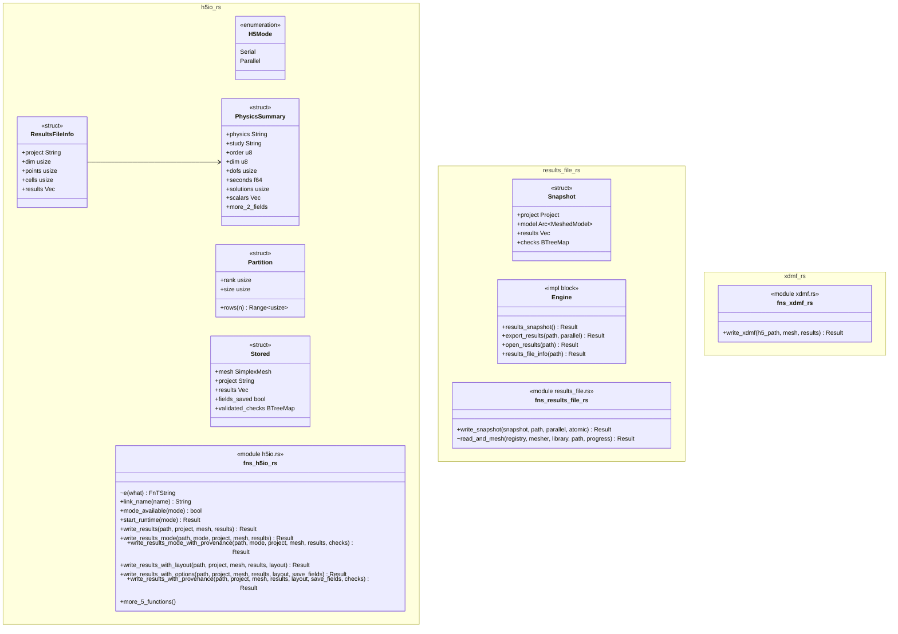

# Results files: code

C4 level 4 (code) of the component **Results files** (`engine.resultsIO`) in the container **nyx-engine** (crate `nyx_engine`). [Component view of the container](../../3-components/engine.md) · [All code pages](../README.md)

> HDF5 results via pure-Rust hdf5-pure and nyx-storage (packed 5D Shuffle+LZF layout L2 and per-solution datasets), the XDMF description (`CurvedEdgesIgnored` R32 note), and opening a results file as a project with its results.

**Decisions:** [ADR 62](../../../adr/0062-results-are-stored-in-hdf5.md), [ADR 63](../../../adr/0063-the-format-key-and-no-json-for-bulk-data.md), [ADR 99](../../../adr/0099-figures-of-modes-and-one-node-order-in-the-results-file.md), [ADR 107](../../../adr/0107-pure-rust-hdf5-storage-and-packed-lzf-layout.md), [ADR 132](../../../adr/0132-vvuq-asme-six-pillar-code-verification.md)  
**Size:** 3 files, 1844 lines.

## Files

| File | Lines | What it says about itself |
|---|---:|---|
| `crates/nyx-engine/src/h5io.rs` | 1464 |  |
| `crates/nyx-engine/src/results_file.rs` | 220 |  |
| `crates/nyx-engine/src/xdmf.rs` | 160 |  |

## What it uses

| Target | Modules | Items |
|---|---|---|
| [container `femcore` (femcore)](../../3-components/femcore.md) | material::spec, mesh, progress | Library, Progress, SimplexMesh, install, stage |
| [container `physics` (nyx-physics)](../../3-components/physics.md) | error, registry, result | CellField, Error, Field, NumericalErrorBudget, Registry, Scalar, Solution, SolveResult, SolverDiagnostics |
| container `resultsFile` (Results file) |  (declared: Writes and opens) |  |
| [container `storage` (nyx-storage)](../../3-components/storage.md) | crate root | FieldStorageLayout, PackedComponentMeta, ReadBudgetConfig |
| [Commands](./commands.md) | engine, validated | Check, Engine |
| [Job runner and queue](./jobs.md) | jobs | Opened |
| [Meshing seam](./meshing.md) | amr, meshing | MeshedModel, Mesher, project_has_amr |
| [Project](./project.md) | project | Project |

## Used by

| Component | Modules | Items |
|---|---|---|
| [Commands](./commands.md) | results_file | read_and_mesh, write_snapshot |
| [Job runner and queue](./jobs.md) | crate root, h5io | L2ShuffleLzfPacked, read_results, write_results_with_provenance |
| [Store link](./storeLink.md) | crate root, h5io, xdmf | L2ShuffleLzfPacked, file_bytes, write_results_with_options, write_xdmf |

## Class diagram

Public types with their public fields (or variants) and methods, free functions per file as a `module` box; arrows are field types and `impl Trait`. Capped at 36 types and a few members each; the table below is complete.

## Public items

| Kind | Item | File:line | Signature or summary |
|---|---|---|---|
| fn | `e` | `h5io.rs:51` | `pub(crate) fn e<T: std::fmt::Display>(what: &str) -> impl Fn(T) -> String + '_` |
| fn | `link_name` | `h5io.rs:176` | `pub fn link_name(name: &str) -> String` —  Name usable as an HDF5 link: `/` is the path separator, everything else is allowed. |
| enum | `H5Mode` | `h5io.rs:187` | variants: `Serial`, `Parallel` —  How a results file is written: with the sequential pure-Rust HDF5 writer, or (stub) parallel MPI-IO. |
| fn | `mode_available` | `h5io.rs:193` | `pub fn mode_available(mode: H5Mode) -> bool` —  True if this build can write with the mode: serial always, parallel never (`hdf5-pure` has no MPI-IO driver; `phdf5` is a zero-C stub). |
| fn | `start_runtime` | `h5io.rs:203` | `pub fn start_runtime(mode: H5Mode) -> Result<(usize, usize), String>` —  Starts what the mode needs before a solve. Returns `(0, 1)` for `Serial` and an explanatory error for `Parallel`. |
| struct | `Partition` | `h5io.rs:213` | fields: `rank`, `size` —  Process `rank` of `size` that write one results file together. Each process owns a contiguous block of rows of every dataset; a serial |
| fn | `write_results` | `h5io.rs:332` | `pub fn write_results( path: &Path, project: &Project, mesh: &SimplexMesh, results: &[(String, &SolveResult)], ) -> Result<(), String>` —  Writes `results` (physics code and result) solved on `mesh` for `project` into a new file at `path`, serially using `L2ShuffleLzfPacked`. |
| fn | `write_results_mode` | `h5io.rs:343` | `pub fn write_results_mode( path: &Path, mode: H5Mode, project: &Project, mesh: &SimplexMesh, results: &[(String, &SolveResult)], ) -> Result<bool, String>` —  The same in the chosen mode (`Serial` uses `L2ShuffleLzfPacked`; `Parallel` returns an error because `hdf5-pure` has no MPI-IO driver). |
| fn | `write_results_mode_with_provenance` | `h5io.rs:354` | `pub fn write_results_mode_with_provenance( path: &Path, mode: H5Mode, project: &Project, mesh: &SimplexMesh, results: &[(String, &SolveResult)], checks: Option<&BTreeMap<String, crate::validated::Check>>, ) -> Result<bool, String>` —  Like [`write_results_mode`], additionally storing `checks` (`Engine::checks`) at `/provenance/validated_json`. |
| fn | `write_results_with_layout` | `h5io.rs:380` | `pub fn write_results_with_layout( path: &Path, project: &Project, mesh: &SimplexMesh, results: &[(String, &SolveResult)], layout: FieldStorageLayout, ) -> Result<(), String>` —  Writes `results` solved on `mesh` for `project` into `path` using the requested [`FieldStorageLayout`]. |
| fn | `write_results_with_options` | `h5io.rs:392` | `pub fn write_results_with_options( path: &Path, project: &Project, mesh: &SimplexMesh, results: &[(String, &SolveResult)], layout: FieldStorageLayout, save_fields: bool, ) -> Result<(), String>` —  Writes `results` solved on `mesh` for `project` into `path` using `layout`, optionally omitting all mesh and field arrays when |
| fn | `write_results_with_provenance` | `h5io.rs:405` | `pub fn write_results_with_provenance( path: &Path, project: &Project, mesh: &SimplexMesh, results: &[(String, &SolveResult)], layout: FieldStorageLayout, save_fields: bool, checks: Option<&BTreeMap<String, crate::validated::Check>>, ) -> Result<(), String>` —  Writes `results` solved on `mesh` for `project` into `path` using `layout`, optionally persisting `checks` at |
| fn | `cell_order_text` | `h5io.rs:599` | `pub fn cell_order_text(dim: usize, order: usize) -> &'static str` —  The text of the `cell_order` attribute: the cell node order of the cell fields and of `cells`. |
| struct | `PhysicsSummary` | `h5io.rs:771` | fields: `physics`, `study`, `order`, `dim`, `dofs`, `seconds`, `solutions`, `scalars`, `diagnostics`, `error_budget` —  Summary of one solved physics in a results file, read without loading heavy field or mesh arrays. |
| struct | `ResultsFileInfo` | `h5io.rs:786` | fields: `project`, `dim`, `points`, `cells`, `results` —  Lightweight metadata summary of a results file (`results_file_info`), read via streaming metadata only. |
| fn | `read_results_summary` | `h5io.rs:795` | `pub fn read_results_summary(path: &Path) -> Result<ResultsFileInfo, String>` —  Reads the header summary of a results file via `File::open_streaming` without loading mesh or field arrays. |
| struct | `Stored` | `h5io.rs:854` | fields: `mesh`, `project`, `results`, `fields_saved`, `validated_checks` —  What a results file holds. |
| fn | `read_results` | `h5io.rs:867` | `pub fn read_results(path: &Path) -> Result<Stored, String>` —  Reads a results file back using `File::open_streaming` and [`ReadBudgetConfig::from_env()`]. |
| fn | `read_results_with_budget` | `h5io.rs:872` | `pub fn read_results_with_budget(path: &Path, budget: ReadBudgetConfig) -> Result<Stored, String>` —  Reads a results file back using `File::open_streaming` and an explicit [`ReadBudgetConfig`]. |
| fn | `file_bytes` | `h5io.rs:1125` | `pub fn file_bytes(path: &Path) -> u64` —  The size of a results file in bytes and how it divides: for the Share screen and the tests that compare with JSON. |
| fn | `Partition::rows` | `h5io.rs:222` | `pub fn rows(&self, n: usize) -> std::ops::Range<usize>` —  The rows `[start, end)` of `n` this process writes; the blocks of all processes tile `0..n` exactly, with sizes differing by at most one. |
| struct | `Snapshot` | `results_file.rs:13` | fields: `project`, `model`, `results`, `checks` —  What a results file is written from: the project, the mesh and the latest result of every physics, as they were when the write was asked for. |
| fn | `write_snapshot` | `results_file.rs:22` | `pub fn write_snapshot(snapshot: &Snapshot, path: &str, parallel: bool, atomic: bool) -> Result<Value, Error>` —  Writes `snapshot` into the HDF5 file `path` and its XDMF description. With `atomic` the file is written under another name and renamed when it |
| fn | `read_and_mesh` | `results_file.rs:80` | `pub(crate) fn read_and_mesh( registry: &nyx_physics::Registry, mesher: &std::sync::Arc<dyn crate::meshing::Mesher>, library: &std::sync::Arc<femcore::material::Library>, path: &str, progress: &std::sync::Arc<femcore::progress::Progress>, ) -> Result<crate::jobs::Opened, Error>` —  Reads the results file `path`, meshes its project again on the calling thread (under `progress`) and checks that the mesh is the stored one. |
| fn | `Engine::results_snapshot` | `results_file.rs:162` | `pub fn results_snapshot(&self) -> Result<Snapshot, Error>` —  The project, the mesh and the latest result of every solved physics, to be written to a file (`write_snapshot`). |
| fn | `Engine::export_results` | `results_file.rs:180` | `pub fn export_results(&self, path: &str, parallel: bool) -> Result<Value, Error>` —  Writes the project, the mesh and the latest result of every solved physics into an HDF5 file, and waits for it. With `parallel` the file |
| fn | `Engine::open_results` | `results_file.rs:188` | `pub fn open_results(&mut self, path: &str) -> Result<Value, Error>` —  Opens a results file: its project becomes the project, the project is meshed again and the stored results become the latest results |
| fn | `Engine::results_file_info` | `results_file.rs:194` | `pub fn results_file_info(&self, path: &str) -> Result<Value, Error>` —  What a results file holds: the project title, the mesh size and, per physics, the study, the solutions, the scalars, diagnostics and error budgets. |
| fn | `write_xdmf` | `xdmf.rs:30` | `pub fn write_xdmf( h5_path: &Path, mesh: &SimplexMesh, results: &[(String, &SolveResult)], ) -> Result<std::path::PathBuf, String>` —  Writes the XDMF description of the results in `h5_path` next to it (same name, extension `.xdmf`). Every physics is a collection of |
