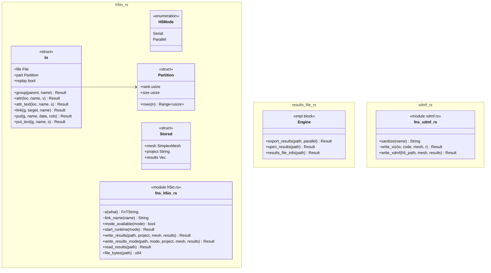

# Results files: code

C4 level 4 (code) of the component **Results files** (`engine.resultsIO`) in the container **nyx-engine** (crate `nyx_engine`). [Component view of the container](../../3-components/engine.md) · [All code pages](../README.md)

> HDF5 results (serial or MPI-IO), the XDMF description, and opening a results file as a project with its results.

**Decisions:** [ADR 62](../../../adr/0062-results-are-stored-in-hdf5.md), [ADR 63](../../../adr/0063-the-format-key-and-no-json-for-bulk-data.md)  
**Size:** 3 files, 947 lines.

## Files

| File | Lines | What it says about itself |
|---|---:|---|
| `crates/nyx-engine/src/h5io.rs` | 621 | Results in HDF5 files (cargo feature `hdf5`): the project, the mesh and every solution of every solved physics with all its fields and cell fields, written compressed and read back exactly (ADR 62). This is the efficient store of the dat... |
| `crates/nyx-engine/src/results_file.rs` | 143 | Writing and reading the results file as engine commands. The HDF5 writer lives in `h5io` (cargo feature `hdf5`); a build without the feature answers these commands with a plain refusal, so a host can tell. |
| `crates/nyx-engine/src/xdmf.rs` | 183 | The visualisation layer of a results file and its XDMF description (ADR 62), recovered from the writer of the old `femcore::h5io` and moved to the new result types. `/viz/<physics>` holds the nodes (dofs) and cells in the node order XDMF... |

## What it uses

| Target | Modules | Items |
|---|---|---|
| [container `femcore` (femcore)](../../3-components/femcore.md) | mesh | SimplexMesh |
| [container `physics` (nyx-physics)](../../3-components/physics.md) | error, result | CellField, Error, Field, Scalar, Solution, SolveResult |
| container `resultsFile` (Results file) |  (declared: Writes and opens) |  |
| [Commands](./commands.md) | engine | Engine, Stored |
| [Project](./project.md) | project | Project |

## Used by

| Component | Modules | Items |
|---|---|---|
| [Store link](./storeLink.md) | h5io, xdmf | file_bytes, write_results, write_xdmf |

## Class diagram

Public types with their public fields (or variants) and methods, free functions per file as a `module` box; arrows are field types and `impl Trait`. Capped at 36 types and a few members each; the table below is complete.

## Public items

| Kind | Item | File:line | Signature or summary |
|---|---|---|---|
| fn | `e` | `h5io.rs:30` | `pub(crate) fn e<T: std::fmt::Display>(what: &str) -> impl Fn(T) -> String + '_` |
| fn | `link_name` | `h5io.rs:65` | `pub(crate) fn link_name(name: &str) -> String` —  Name usable as an HDF5 link: `/` is the path separator, everything else is allowed. |
| enum | `H5Mode` | `h5io.rs:76` | variants: `Serial`, `Parallel` —  How a results file is written: with the ordinary sequential HDF5 driver, or with the MPI-IO driver by several processes at once. |
| fn | `mode_available` | `h5io.rs:83` | `pub fn mode_available(mode: H5Mode) -> bool` —  True if this build can write with the mode: serial always, parallel only when it was built with the `phdf5` feature (an MPI-enabled |
| fn | `start_runtime` | `h5io.rs:95` | `pub fn start_runtime(mode: H5Mode) -> Result<(usize, usize), String>` —  Starts what the mode needs before a solve: the MPI runtime for parallel output (a run under `mpiexec` has one process per rank). |
| struct | `Partition` | `h5io.rs:111` | fields: `rank`, `size` —  Process `rank` of `size` that write one results file together. Each process owns a contiguous block of rows of every dataset; a serial |
| struct | `Io` | `h5io.rs:172` | fields: `file`, `part`, `replay` —  An open results file and the share of it this process writes. Every process runs the same sequence of group, dataset and attribute |
| fn | `write_results` | `h5io.rs:282` | `pub fn write_results( path: &Path, project: &Project, mesh: &SimplexMesh, results: &[(String, &SolveResult)], ) -> Result<(), String>` —  Writes `results` (physics code and result) solved on `mesh` for `project` into a new file at `path`, serially. |
| fn | `write_results_mode` | `h5io.rs:293` | `pub fn write_results_mode( path: &Path, mode: H5Mode, project: &Project, mesh: &SimplexMesh, results: &[(String, &SolveResult)], ) -> Result<bool, String>` —  The same in the chosen mode. In a parallel run every process calls this with the same arguments; the file is the same as a serial one. |
| struct | `Stored` | `h5io.rs:409` | fields: `mesh`, `project`, `results` —  What a results file holds. |
| fn | `read_results` | `h5io.rs:418` | `pub fn read_results(path: &Path) -> Result<Stored, String>` —  Reads a results file back. |
| fn | `file_bytes` | `h5io.rs:516` | `pub fn file_bytes(path: &Path) -> u64` —  The size of a results file in bytes and how it divides: for the Share screen and the tests that compare with JSON. |
| fn | `Partition::rows` | `h5io.rs:120` | `pub fn rows(&self, n: usize) -> std::ops::Range<usize>` —  The rows `[start, end)` of `n` this process writes; the blocks of all processes tile `0..n` exactly, with sizes differing by at most one. |
| fn | `Io::group` | `h5io.rs:181` | `pub fn group(&self, parent: &h5::Group, name: &str) -> Result<h5::Group, String>` |
| fn | `Io::attr` | `h5io.rs:190` | `pub fn attr<T: h5::H5Type>(&self, loc: &h5::Location, name: &str, v: &T) -> Result<(), String>` |
| fn | `Io::attr_text` | `h5io.rs:197` | `pub fn attr_text(&self, loc: &h5::Location, name: &str, s: &str) -> Result<(), String>` |
| fn | `Io::link` | `h5io.rs:201` | `pub fn link(&self, g: &h5::Group, target: &str, name: &str) -> Result<(), String>` |
| fn | `Io::put` | `h5io.rs:209` | `pub fn put<T: h5::H5Type>( &self, g: &h5::Group, name: &str, data: &[T], cols: usize, ) -> Result<h5::Dataset, String>` —  A dataset of shape `[rows, cols]` (`[rows]` when `cols` is 0) holding `data` row by row. |
| fn | `Io::put_text` | `h5io.rs:242` | `pub fn put_text(&self, g: &h5::Group, name: &str, s: &str) -> Result<(), String>` —  Text as UTF-8 bytes in a 1-D `u8` dataset (variable-length strings cannot be written in parallel). |
| fn | `Engine::export_results` | `results_file.rs:13` | `pub fn export_results(&self, path: &str, parallel: bool) -> Result<Value, Error>` —  Writes the project, the mesh and the latest result of every solved physics into an HDF5 file. With `parallel` the file is written with |
| fn | `Engine::open_results` | `results_file.rs:55` | `pub fn open_results(&mut self, path: &str) -> Result<Value, Error>` —  Opens a results file: its project becomes the project, the project is meshed again and the stored results become the latest results |
| fn | `Engine::results_file_info` | `results_file.rs:118` | `pub fn results_file_info(&self, path: &str) -> Result<Value, Error>` —  What a results file holds: the project title, the mesh size and, per physics, the study, the solutions and the scalars. |
| fn | `sanitize` | `xdmf.rs:11` | `pub fn sanitize(name: &str) -> String` —  Name usable in a plain HDF5/XDMF path: letters, digits and underscores. |
| fn | `write_viz` | `xdmf.rs:35` | `pub(crate) fn write_viz(io: &Io, code: &str, mesh: &SimplexMesh, r: &SolveResult) -> Result<(), String>` —  `/viz/<physics>`: the nodes and cells in the node order XDMF reads, and for each solution the fields it points at: a scalar field is a |
| fn | `write_xdmf` | `xdmf.rs:83` | `pub fn write_xdmf( h5_path: &Path, mesh: &SimplexMesh, results: &[(String, &SolveResult)], ) -> Result<std::path::PathBuf, String>` —  Writes the XDMF description of the results in `h5_path` next to it (same name, extension `.xdmf`). Every physics is a collection of |
