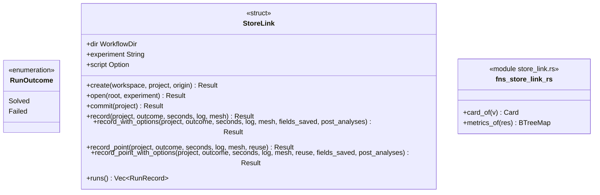

# Store link: code

C4 level 4 (code) of the component **Store link** (`engine.storeLink`) in the container **nyx-engine** (crate `nyx_engine`). [Component view of the container](../../3-components/engine.md) · [All code pages](../README.md)

> Binds the project to a workflow of the workspace, commits versions, records runs (card and metrics made here).

**Decisions:** [ADR 39](../../../adr/0039-the-store-takes-spec-text-and-a-card-function.md), [ADR 59](../../../adr/0059-the-store-knows-nothing-of-a-project.md)  
**Size:** 1 file, 360 lines.

## Files

| File | Lines | What it says about itself |
|---|---:|---|
| `crates/nyx-engine/src/store_link.rs` | 360 |  |

## What it uses

| Target | Modules | Items |
|---|---|---|
| [container `femcore` (femcore)](../../3-components/femcore.md) | mesh | SimplexMesh |
| [container `geom` (geom)](../../3-components/geom.md) | expr, model | Expr, Op |
| [container `physics` (nyx-physics)](../../3-components/physics.md) | error, result, spec | Error, MaterialAssign, Scalar, SolveResult |
| [container `store` (nyx-store)](../../3-components/store.md) | flow, model, runs, util | Artifact, Card, Dim, GeoCard, RunRecord, RunStatus, WorkflowDir, hash_bytes, write_atomic |
| [Geometry operations](./geometry.md) | geomdesc | kind_of |
| [Project](./project.md) | project | Project |
| [Results files](./resultsIO.md) | crate root, h5io, xdmf | L2ShuffleLzfPacked, file_bytes, write_results_with_options, write_xdmf |

## Used by

| Component | Modules | Items |
|---|---|---|
| [app: Shell and dashboard](../app/shell.md) | store_link | card_of, metrics_of |
| [Commands](./commands.md) | store_link | RunOutcome, StoreLink |
| [Job runner and queue](./jobs.md) | store_link | RunOutcome, metrics_of |

## Class diagram

Public types with their public fields (or variants) and methods, free functions per file as a `module` box; arrows are field types and `impl Trait`. Capped at 36 types and a few members each; the table below is complete.

## Public items

| Kind | Item | File:line | Signature or summary |
|---|---|---|---|
| fn | `card_of` | `store_link.rs:19` | `pub fn card_of(v: &serde_json::Value) -> Card` —  The search card of a project (`nyx_store::CardFn`): what the dashboard shows and search finds, generated, never typed. |
| fn | `metrics_of` | `store_link.rs:98` | `pub fn metrics_of(res: &SolveResult) -> BTreeMap<String, f64>` —  The numbers of one result that go in the run table: the first solution's value and eigenvalue, the counts, and every numeric scalar the |
| enum | `RunOutcome` | `store_link.rs:130` | variants: `Solved`, `Failed` —  How a run ended. |
| struct | `StoreLink` | `store_link.rs:136` | fields: `dir`, `experiment`, `script` —  The binding of a project to one experiment of a workflow folder. |
| fn | `StoreLink::create` | `store_link.rs:145` | `pub fn create(workspace: &Path, project: &Project, origin: &str) -> Result<StoreLink, Error>` —  Makes a new workflow folder in `workspace` holding `project` as its first experiment. |
| fn | `StoreLink::open` | `store_link.rs:153` | `pub fn open(root: &Path, experiment: Option<&str>) -> Result<(StoreLink, Project), Error>` —  Opens a workflow folder and reads the project of its first experiment (or of `experiment`). |
| fn | `StoreLink::commit` | `store_link.rs:174` | `pub fn commit(&mut self, project: &Project) -> Result<Option<u32>, Error>` —  Stores the project when it differs from the saved one; returns the new version number, `None` when nothing changed. |
| fn | `StoreLink::record` | `store_link.rs:180` | `pub fn record( &mut self, project: &Project, outcome: RunOutcome, seconds: f64, log: &[String], mesh: Option<&femcore::mesh::SimplexMesh>, ) -> Result<RunRecord, Error>` —  Adds a run to the table: the project as it was solved (frozen), the metrics of the results and the stage log. The heavy files |
| fn | `StoreLink::record_with_options` | `store_link.rs:193` | `pub fn record_with_options( &mut self, project: &Project, outcome: RunOutcome, seconds: f64, log: &[String], mesh: Option<&femcore::mesh::SimplexMesh>, fields_saved: bool, post_analyses: &[serde_json::Value], ) -> Result<RunRecord, Error>` —  `record` with explicit `fields_saved` and optional `post_analyses` results. |
| fn | `StoreLink::record_point` | `store_link.rs:209` | `pub fn record_point( &mut self, project: &Project, outcome: RunOutcome, seconds: f64, log: &[String], mesh: Option<&femcore::mesh::SimplexMesh>, reuse: Option<&serde_json::Value>, ) -> Result<RunRecord, Error>` —  Adds a run for a project that is not the experiment's own (a point of a sweep): the run freezes the project it solved, and the |
| fn | `StoreLink::record_point_with_options` | `store_link.rs:223` | `pub fn record_point_with_options( &mut self, project: &Project, outcome: RunOutcome, seconds: f64, log: &[String], mesh: Option<&femcore::mesh::SimplexMesh>, reuse: Option<&serde_json::Value>, fields_saved: bool, post_analyses: &[serde_json::Value], ) -> Result<RunRecord, Error>` —  `record_point` with explicit `fields_saved` and optional `post_analyses` results. |
| fn | `StoreLink::runs` | `store_link.rs:356` | `pub fn runs(&self) -> Vec<RunRecord>` —  The run table of the bound experiment, oldest first. |
