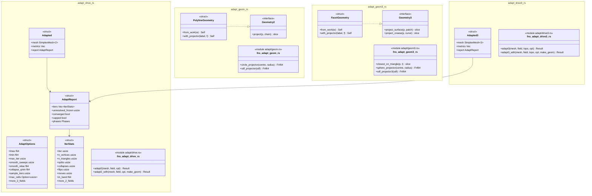

# Adaptation drivers: code

C4 level 4 (code) of the component **Adaptation drivers** (`femcore.adaptdrive`) in the container **femcore** (crate `femcore`). [Component view of the container](../../3-components/femcore.md) · [All code pages](../README.md)

> Passes of operators until the mesh conforms to the metric, with geometry oracles saying where a boundary vertex may go.

**Decisions:** [ADR 7](../../../adr/0007-metric-adaptation-and-structured-pml.md), [ADR 51](../../../adr/0051-adaptive-meshing-of-3d-geom-models.md)  
**Size:** 4 files, 720 lines.

## Files

| File | Lines | What it says about itself |
|---|---:|---|
| `crates/femcore/src/adapt/drive.rs` | 211 | The adaptation driver: iterate split, collapse, flip and smooth passes until the mesh conforms to the metric field. |
| `crates/femcore/src/adapt/drive3.rs` | 160 | The 3D adaptation driver: iterate split, collapse, flip and smooth passes until the mesh conforms to the metric field (the 3D counterpart of `drive`, with the operators of `ops3`). |
| `crates/femcore/src/adapt/geom.rs` | 132 | Geometry oracle for 2D: where may a vertex of a boundary or interface chain go? |
| `crates/femcore/src/adapt/geom3.rs` | 217 | Geometry oracle for 3D: where may a vertex of a surface patch or a crease curve go? |

## What it uses

| Target | Modules | Items |
|---|---|---|
| [Adaptation operators](./adaptops.md) | adapt::ops, adapt::ops3, adapt::topo, adapt::topo3 | AdaptOptions3, Face, Sig, TopoOptions, TopoOptions3, Work2, Work3, all_edges, all_edges_of, collapse_pass +9 |
| [Metric fields](./metric.md) | adapt::field, adapt::metric, adapt::timer, adapt::work | MetricField, Phases, SimplexMesh, Sym |
| [Runtime services](./runtime.md) | progress | check |

## Used by

| Component | Modules | Items |
|---|---|---|
| [Adaptation operators](./adaptops.md) | adapt::drive, adapt::geom, adapt::geom3 | AdaptOptions, Geometry2, Geometry3 |
| [Error estimators](./estimators.md) | adapt::drive3 | adapt3 |
| [Meshing facade](./meshing.md) | adapt::drive, adapt::drive3, adapt::geom | AdaptOptions, AdaptReport, Geometry2, adapt2_with, adapt3 |
| [3D meshing](./meshing3d.md) | adapt::drive, adapt::drive3, adapt::geom3 | AdaptReport, FacetGeometry, Geometry3, adapt3_with |

## Class diagram

Public types with their public fields (or variants) and methods, free functions per file as a `module` box; arrows are field types and `impl Trait`. Capped at 36 types and a few members each; the table below is complete.

## Public items

| Kind | Item | File:line | Signature or summary |
|---|---|---|---|
| struct | `AdaptOptions` | `adapt/drive.rs:13` | fields: `lmax`, `lmin`, `max_iter`, `smooth_sweeps`, `smooth_relax`, `collapse_qmin`, `sample_iters`, `max_cells`, `converge_frac`, `topo` |
| struct | `IterStats` | `adapt/drive.rs:58` | fields: `iter`, `n_vertices`, `n_triangles`, `splits`, `collapses`, `flips`, `moves`, `in_band`, `q_min`, `q_mean` |
| struct | `AdaptReport` | `adapt/drive.rs:73` | fields: `iters`, `unresolved_frozen`, `converged`, `capped`, `phases` |
| struct | `Adapted` | `adapt/drive.rs:86` | fields: `mesh`, `metrics`, `report` |
| fn | `adapt2` | `adapt/drive.rs:131` | `pub fn adapt2(mesh: &SimplexMesh<2>, field: &dyn MetricField<2>, opt: &AdaptOptions) -> Result<Adapted, String>` —  Adapt `mesh` to `field` with the polyline geometry of its own boundary and interfaces. |
| fn | `adapt2_with` | `adapt/drive.rs:137` | `pub fn adapt2_with<G: Geometry2>( mesh: &SimplexMesh<2>, field: &dyn MetricField<2>, opt: &AdaptOptions, make_geom: impl FnOnce(&Work2) -> G, ) -> Result<Adapted, String>` —  Adapt with a geometry built from the classified working mesh (for example a |
| struct | `Adapted3` | `adapt/drive3.rs:12` | fields: `mesh`, `metrics`, `report` |
| fn | `adapt3` | `adapt/drive3.rs:49` | `pub fn adapt3(mesh: &SimplexMesh<3>, field: &dyn MetricField<3>, topo: &TopoOptions3, opt: &AdaptOptions3) -> Result<Adapted3, String>` —  Adapt `mesh` to `field` with the facet geometry of its own boundary and interfaces. `AdaptReport::iters[..].n_triangles` counts |
| fn | `adapt3_with` | `adapt/drive3.rs:55` | `pub fn adapt3_with<G: Geometry3>( mesh: &SimplexMesh<3>, field: &dyn MetricField<3>, topo: &TopoOptions3, opt: &AdaptOptions3, make_geom: impl FnOnce(&Work3) -> G, ) -> Result<Adapted3, String>` —  Adapt with a geometry built from the classified working mesh (for example a [`FacetGeometry`] with analytic projectors for curved |
| trait | `Geometry2` | `adapt/geom.rs:13` | methods: `project` |
| struct | `PolylineGeometry` | `adapt/geom.rs:19` |  Polyline chains taken from the input mesh, with optional analytic overrides per boundary label. |
| fn | `circle_projector` | `adapt/geom.rs:73` | `pub fn circle_projector(centre: [f64; 2], radius: f64) -> impl Fn([f64` —  Projector onto the circle of the given centre and radius. |
| fn | `sdf_projector` | `adapt/geom.rs:83` | `pub fn sdf_projector( sdf: impl Fn(&[f64; 2]) -> f64 + Send + Sync + 'static, ) -> impl Fn([f64` —  Projector onto the zero set of a smooth signed-distance-like function (Newton steps along the |
| fn | `PolylineGeometry::from_work` | `adapt/geom.rs:26` | `pub fn from_work(w: &Work2) -> Self` |
| fn | `PolylineGeometry::with_projector` | `adapt/geom.rs:41` | `pub fn with_projector(mut self, label: i32, f: impl Fn([f64; 2]) -> [f64; 2] + Send + Sync + 'static) -> Self` —  Use `f` to project every chain of boundary label `label`. |
| trait | `Geometry3` | `adapt/geom3.rs:15` | methods: `project_surface`, `project_crease` |
| struct | `FacetGeometry` | `adapt/geom3.rs:23` |  Triangles and polylines taken from the input mesh, with optional analytic overrides per boundary label. |
| fn | `closest_on_triangle` | `adapt/geom3.rs:104` | `pub fn closest_on_triangle(p: [f64; 3], t: &[[f64; 3]; 3]) -> [f64` —  Closest point of triangle `t` to `p` (the case analysis of Ericson, *Real-Time Collision Detection*, 5.1.5). |
| fn | `sphere_projector` | `adapt/geom3.rs:142` | `pub fn sphere_projector(centre: [f64; 3], radius: f64) -> impl Fn([f64` —  Projector onto the sphere of the given centre and radius. |
| fn | `sdf_projector3` | `adapt/geom3.rs:151` | `pub fn sdf_projector3(sdf: impl Fn(&[f64; 3]) -> f64 + Send + Sync + 'static) -> impl Fn([f64` —  Projector onto the zero set of a smooth signed-distance-like function (Newton steps along the numerical gradient). |
| fn | `FacetGeometry::from_work` | `adapt/geom3.rs:31` | `pub fn from_work(w: &Work3) -> Self` |
| fn | `FacetGeometry::with_projector` | `adapt/geom3.rs:48` | `pub fn with_projector(mut self, label: i32, f: impl Fn([f64; 3]) -> [f64; 3] + Send + Sync + 'static) -> Self` —  Use `f` to project every patch of boundary label `label`. |

Trait implementations in this component: `AdaptOptions: Default`, `PolylineGeometry: Geometry2`, `FacetGeometry: Geometry3`
