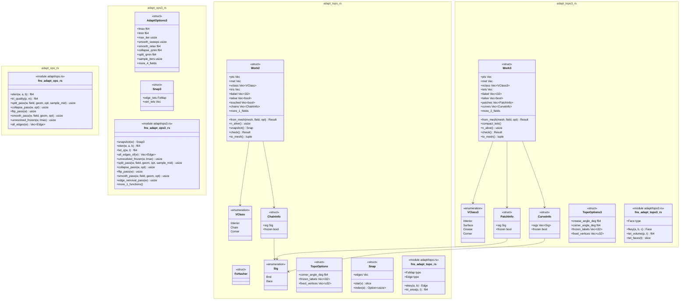

# Adaptation operators: code

C4 level 4 (code) of the component **Adaptation operators** (`femcore.adaptops`) in the container **femcore** (crate `femcore`). [Component view of the container](../../3-components/femcore.md) · [All code pages](../README.md)

> Edge split, collapse, flip and smoothing on the working meshes in 2D and 3D, with the vertex classification.

**Decisions:** [ADR 7](../../../adr/0007-metric-adaptation-and-structured-pml.md), [ADR 51](../../../adr/0051-adaptive-meshing-of-3d-geom-models.md)  
**Size:** 4 files, 2255 lines.

## Files

| File | Lines | What it says about itself |
|---|---:|---|
| `crates/femcore/src/adapt/ops.rs` | 422 | Local mesh operators for 2D metric adaptation: edge split, edge collapse, edge flip, and length-equalising smoothing. |
| `crates/femcore/src/adapt/ops3.rs` | 903 | Local mesh operators for 3D metric adaptation: edge split, collapse of interior vertices, 3-2 and 2-3 flips, and length-equalising smoothing (the 3D counterparts of `ops`). |
| `crates/femcore/src/adapt/topo.rs` | 435 | Working mesh for 2D adaptation: triangles, per-vertex metrics, and the classification of vertices and edges that tells the operators what must be preserved. |
| `crates/femcore/src/adapt/topo3.rs` | 495 | Working mesh for 3D adaptation: tetrahedra, per-vertex metrics, and the classification of vertices that tells the operators what must be preserved (the 3D counterpart of `topo`). |

## What it uses

| Target | Modules | Items |
|---|---|---|
| [Adaptation drivers](./adaptdrive.md) | adapt::drive, adapt::geom, adapt::geom3 | AdaptOptions, Geometry2, Geometry3 |
| [Mesh](./mesh.md) | mesh::quality | simplex_quality |
| [Metric fields](./metric.md) | adapt::field, adapt::metric, adapt::work | MetricField, SimplexMesh, Sym, edge_length, facet_key, simplex_signed_measure |

## Used by

| Component | Modules | Items |
|---|---|---|
| [Adaptation drivers](./adaptdrive.md) | adapt::ops, adapt::ops3, adapt::topo, adapt::topo3 | AdaptOptions3, Face, Sig, TopoOptions, TopoOptions3, Work2, Work3, all_edges +11 |
| [Error estimators](./estimators.md) | adapt::ops3, adapt::topo3 | AdaptOptions3, TopoOptions3 |
| [Meshing facade](./meshing.md) | adapt::ops3, adapt::topo, adapt::topo3 | AdaptOptions3, Sig, TopoOptions3, Work2 |
| [3D meshing](./meshing3d.md) | adapt::ops3, adapt::topo, adapt::topo3 | AdaptOptions3, Sig, TopoOptions3, Work3 |

## Class diagram

Public types with their public fields (or variants) and methods, free functions per file as a `module` box; arrows are field types and `impl Trait`. Capped at 36 types and a few members each; the table below is complete.

## Public items

| Kind | Item | File:line | Signature or summary |
|---|---|---|---|
| fn | `elen` | `adapt/ops.rs:22` | `pub fn elen(w: &Work2, a: u32, b: u32) -> f64` —  Metric length of the edge `(a, b)`. |
| fn | `tri_quality` | `adapt/ops.rs:28` | `pub fn tri_quality(p: [[f64; 2]; 3], m: [&Sym<2>; 3]) -> f64` —  Mean-ratio quality in the metric of a triangle given by positions and vertex metrics. |
| fn | `split_pass` | `adapt/ops.rs:42` | `pub fn split_pass( w: &mut Work2, field: &dyn MetricField<2>, geom: &dyn Geometry2, opt: &AdaptOptions, sample_mid: bool, ) -> usize` —  Split every edge longer than `opt.lmax`. Returns the number of splits. |
| fn | `collapse_pass` | `adapt/ops.rs:213` | `pub fn collapse_pass(w: &mut Work2, opt: &AdaptOptions) -> usize` —  Collapse every edge shorter than `opt.lmin` that can be collapsed. Returns the number done. |
| fn | `flip_pass` | `adapt/ops.rs:276` | `pub fn flip_pass(w: &mut Work2) -> usize` —  Flip interior edges when that improves the worst quality of the two triangles. |
| fn | `smooth_pass` | `adapt/ops.rs:324` | `pub fn smooth_pass(w: &mut Work2, field: &dyn MetricField<2>, geom: &dyn Geometry2, opt: &AdaptOptions) -> usize` —  One Gauss-Seidel sweep of length-equalising smoothing over the movable vertices. A vertex moves |
| fn | `unresolved_frozen` | `adapt/ops.rs:408` | `pub fn unresolved_frozen(w: &Work2, lmax: f64) -> usize` —  Number of frozen edges longer than `lmax` (they cannot be split, so the input must resolve them). |
| fn | `all_edges` | `adapt/ops.rs:419` | `pub fn all_edges(w: &Work2) -> Vec<Edge>` —  Sorted list of the edges (helper for statistics). |
| struct | `AdaptOptions3` | `adapt/ops3.rs:27` | fields: `lmax`, `lmin`, `max_iter`, `smooth_sweeps`, `smooth_relax`, `collapse_qmin`, `split_qmin`, `sample_iters`, `max_cells`, `converge_frac`, `edge_removal`, `sweep_frac` —  Thresholds of the operators. |
| struct | `Snap3` | `adapt/ops3.rs:73` | fields: `edge_tets`, `vert_tets` —  Incidence of the alive tetrahedra. |
| fn | `snapshot` | `adapt/ops3.rs:78` | `pub fn snapshot(w: &Work3) -> Snap3` |
| fn | `elen` | `adapt/ops3.rs:96` | `pub fn elen(w: &Work3, a: u32, b: u32) -> f64` —  Metric length of the edge `(a, b)`. |
| fn | `tet_q` | `adapt/ops3.rs:102` | `pub fn tet_q(w: &Work3, t: &[u32; 4]) -> f64` —  Mean-ratio quality in the metric of the tetrahedron `t` with the points and metrics of `w`. |
| fn | `all_edges_of` | `adapt/ops3.rs:109` | `pub fn all_edges_of(w: &Work3) -> Vec<Edge>` —  All edges of the alive tetrahedra, sorted. |
| fn | `unresolved_frozen` | `adapt/ops3.rs:142` | `pub fn unresolved_frozen(w: &Work3, lmax: f64) -> usize` —  Number of edges on a frozen curve or patch that are longer than `lmax`. |
| fn | `split_pass` | `adapt/ops3.rs:155` | `pub fn split_pass(w: &mut Work3, field: &dyn MetricField<3>, geom: &dyn Geometry3, opt: &AdaptOptions3, sample_mid: bool) -> usize` —  Split every edge longer than `opt.lmax`. Returns the number of splits. |
| fn | `collapse_pass` | `adapt/ops3.rs:415` | `pub fn collapse_pass(w: &mut Work3, opt: &AdaptOptions3) -> usize` —  Collapse every edge shorter than `opt.lmin` that can be collapsed (one end moves onto the other, along its patch or curve when it is on one). Returns the number. |
| fn | `flip_pass` | `adapt/ops3.rs:486` | `pub fn flip_pass(w: &mut Work3) -> usize` —  Quality-improving 3-2 and 2-3 flips of interior edges and faces. Returns the number of flips. |
| fn | `smooth_pass` | `adapt/ops3.rs:617` | `pub fn smooth_pass(w: &mut Work3, field: &dyn MetricField<3>, geom: &dyn Geometry3, opt: &AdaptOptions3) -> usize` —  One sweep of length-equalising smoothing: every free vertex moves towards the position where its edges would have unit metric length |
| fn | `edge_removal_pass` | `adapt/ops3.rs:741` | `pub fn edge_removal_pass(w: &mut Work3) -> usize` —  Edge removal: an interior edge with `n` (4 to 7) tetrahedra around it is replaced by the `2(n - 2)` tetrahedra of the best |
| fn | `surface_flip_pass` | `adapt/ops3.rs:838` | `pub fn surface_flip_pass(w: &mut Work3) -> usize` —  Flip of a boundary edge between two coplanar faces of a boundary patch with exactly two tetrahedra on it: the diagonal of the |
| struct | `FxHasher` | `adapt/topo.rs:25` |  Small multiplicative hasher (the well-known Fx scheme) for the integer-keyed maps in the hot |
| type | `FxMap` | `adapt/topo.rs:47` | `<K, V>` |
| type | `Edge` | `adapt/topo.rs:50` |  Sorted vertex pair. |
| fn | `ekey` | `adapt/topo.rs:52` | `pub fn ekey(a: u32, b: u32) -> Edge` |
| enum | `VClass` | `adapt/topo.rs:57` | variants: `Interior`, `Chain`, `Corner` |
| enum | `Sig` | `adapt/topo.rs:66` | variants: `Bnd`, `Iface` —  What a chain separates: the label of its boundary facets, or the two cell labels of an |
| struct | `ChainInfo` | `adapt/topo.rs:72` | fields: `sig`, `frozen` |
| struct | `TopoOptions` | `adapt/topo.rs:80` | fields: `corner_angle_deg`, `frozen_labels`, `fixed_vertices` —  Options for building the classification. |
| struct | `Snap` | `adapt/topo.rs:97` | fields: `edges` —  Edge-triangle incidence and vertex stars of the current triangles. |
| struct | `Work2` | `adapt/topo.rs:117` | fields: `pts`, `met`, `vclass`, `tris`, `tlabel`, `talive`, `touched`, `chains`, `chain_of` |
| fn | `tri_area` | `adapt/topo.rs:131` | `pub fn tri_area(p: &[[f64; 2]], t: &[u32; 3]) -> f64` |
| fn | `Snap::star` | `adapt/topo.rs:106` | `pub fn star(&self, v: u32) -> &[u32]` —  Alive triangles incident to vertex `v`, in increasing order. |
| fn | `Snap::index` | `adapt/topo.rs:111` | `pub fn index(&self, e: &Edge) -> Option<usize>` —  Index of an edge in `edges`. |
| fn | `Work2::from_mesh` | `adapt/topo.rs:138` | `pub fn from_mesh(mesh: &SimplexMesh<2>, field: &dyn MetricField<2>, opt: &TopoOptions) -> Result<Work2, String>` —  Build from a mesh; the vertex metrics are `field` evaluated at the vertices. |
| fn | `Work2::n_alive` | `adapt/topo.rs:232` | `pub fn n_alive(&self) -> usize` |
| fn | `Work2::snapshot` | `adapt/topo.rs:239` | `pub fn snapshot(&self) -> Snap` —  Edge and vertex incidence of the alive triangles. Linear time: vertex stars in CSR form, then |
| fn | `Work2::check` | `adapt/topo.rs:286` | `pub fn check(&self) -> Result<(), String>` —  Internal consistency: positive areas, manifold edges, every boundary and interface edge |
| fn | `Work2::to_mesh` | `adapt/topo.rs:327` | `pub fn to_mesh(&self) -> (SimplexMesh<2>, Vec<Sym<2>>)` —  Compact into a simplex mesh (alive triangles, used vertices in index order). Boundary |
| type | `Face` | `adapt/topo3.rs:27` |  Sorted vertex triple. |
| enum | `VClass3` | `adapt/topo3.rs:30` | variants: `Interior`, `Surface`, `Crease`, `Corner` |
| struct | `PatchInfo` | `adapt/topo3.rs:39` | fields: `sig`, `frozen` —  A connected piece of surface of one signature. |
| struct | `CurveInfo` | `adapt/topo3.rs:46` | fields: `sigs`, `frozen` —  A connected run of crease edges. |
| struct | `TopoOptions3` | `adapt/topo3.rs:54` | fields: `crease_angle_deg`, `corner_angle_deg`, `frozen_labels`, `fixed_vertices` —  Options for building the classification. |
| struct | `Work3` | `adapt/topo3.rs:72` | fields: `pts`, `met`, `vclass`, `tets`, `tlabel`, `talive`, `patches`, `curves`, `patch_of`, `curve_of` |
| fn | `fkey` | `adapt/topo3.rs:87` | `pub fn fkey(a: u32, b: u32, c: u32) -> Face` |
| fn | `tet_volume` | `adapt/topo3.rs:93` | `pub fn tet_volume(p: &[[f64; 3]], t: &[u32; 4]) -> f64` |
| fn | `tet_faces` | `adapt/topo3.rs:114` | `pub fn tet_faces(t: &[u32; 4]) -> [(Face, u32)` —  The four faces of a tetrahedron, each with the opposite vertex. |
| fn | `Work3::from_mesh` | `adapt/topo3.rs:128` | `pub fn from_mesh(mesh: &SimplexMesh<3>, field: &dyn MetricField<3>, opt: &TopoOptions3) -> Result<Work3, String>` —  Build from a mesh; the vertex metrics are `field` evaluated at the vertices. |
| fn | `Work3::compact_tets` | `adapt/topo3.rs:299` | `pub fn compact_tets(&mut self)` —  Drops the dead tetrahedra from the arrays. Operators append the tetrahedra they make and only mark the old ones dead, so without |
| fn | `Work3::n_alive` | `adapt/topo3.rs:314` | `pub fn n_alive(&self) -> usize` |
| fn | `Work3::check` | `adapt/topo3.rs:320` | `pub fn check(&self) -> Result<(), String>` —  Internal consistency: positive volumes, manifold faces, every surface face registered in a patch and vice versa, vertex classes |
| fn | `Work3::to_mesh` | `adapt/topo3.rs:383` | `pub fn to_mesh(&self) -> (SimplexMesh<3>, Vec<Sym<3>>)` —  Compact into a simplex mesh (alive tetrahedra, used vertices in index order). Boundary facets carry the patch's facet label; |

Trait implementations in this component: `AdaptOptions3: Default`, `FxHasher: Hasher`, `TopoOptions: Default`, `TopoOptions3: Default`
