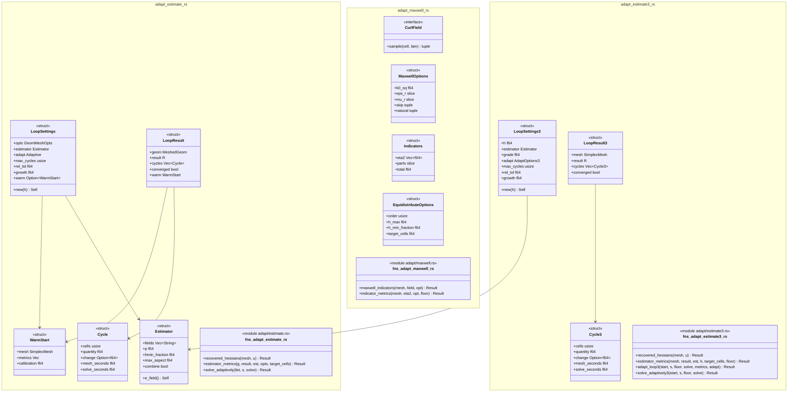

# Error estimators: code

C4 level 4 (code) of the component **Error estimators** (`femcore.estimators`) in the container **femcore** (crate `femcore`). [Component view of the container](../../3-components/femcore.md) · [All code pages](../README.md)

> Error estimation and the solve-estimate-adapt loop; the Maxwell residual estimator for edge elements.

**Decisions:** [ADR 7](../../../adr/0007-metric-adaptation-and-structured-pml.md), [ADR 17](../../../adr/0017-physics-driven-mesh-sizing.md), [ADR 53](../../../adr/0053-maxwell-residual-estimator-and-the-generic-adaptation-loop.md)  
**Size:** 3 files, 1125 lines.

## Files

| File | Lines | What it says about itself |
|---|---:|---|
| `crates/femcore/src/adapt/estimate.rs` | 344 | Error estimation and the solve-estimate-adapt loop for the meshes of `meshing`. |
| `crates/femcore/src/adapt/estimate3.rs` | 317 | Error estimation and the solve-estimate-adapt loop for tetrahedral meshes (the 3D counterpart of `estimate`, without the 2D geometry pipeline: the start mesh is any tetrahedral mesh, adaptation is `adapt::drive3`). |
| `crates/femcore/src/adapt/maxwell.rs` | 464 | A posteriori error estimator for time-harmonic Maxwell fields on tetrahedra (ADR 53), and the metric it asks for. |

## What it uses

| Target | Modules | Items |
|---|---|---|
| [container `geom` (geom)](../../3-components/geom.md) | model | FeatureList |
| [Adaptation drivers](./adaptdrive.md) | adapt::drive3 | adapt3 |
| [Adaptation operators](./adaptops.md) | adapt::ops3, adapt::topo3 | AdaptOptions3, TopoOptions3 |
| [Finite-element basics](./fem.md) | fem | quad_rule |
| [Matrices and vectors](./lacore.md) | linalg::csr::assembly | C |
| [Mesh](./mesh.md) | mesh | SimplexMesh |
| [Meshing facade](./meshing.md) | meshing, meshing::geomdrive | Adaptive, GeomMeshOpts, MeshedGeom, adapt_to_field, adapt_to_metrics, evaluate, geometry_floor, mesh_geom_2d |
| [Metric fields](./metric.md) | adapt, adapt::field, adapt::field3, adapt::metric, adapt::work | BackgroundMetric2, BackgroundMetric3, LpOptions, PlotFields, Sym, complexity_for_elements, intersect, isotropic, lp_metrics, map_eig +3 |

## Used by

Nothing else in the workspace names this component (entry points are reached by the program or by tests).

## Class diagram

Public types with their public fields (or variants) and methods, free functions per file as a `module` box; arrows are field types and `impl Trait`. Capped at 36 types and a few members each; the table below is complete.

## Public items

| Kind | Item | File:line | Signature or summary |
|---|---|---|---|
| struct | `Estimator` | `adapt/estimate.rs:31` | fields: `fields`, `p`, `hmin_fraction`, `max_aspect`, `combine` —  What the metric is built from and how. |
| fn | `recovered_hessians` | `adapt/estimate.rs:69` | `pub fn recovered_hessians(mesh: &SimplexMesh, u: &[f64]) -> Result<Vec<Sym<2>>, String>` —  Recovered Hessian of a P1 field at every vertex of a triangle mesh, intersected over the domains meeting at the vertex. |
| fn | `estimator_metrics` | `adapt/estimate.rs:173` | `pub fn estimator_metrics<R: PlotFields>(g: &MeshedGeom, result: &R, est: &Estimator, opts: &GeomMeshOpts, target_cells: f64) -> Result<Vec<Sym<2>>, String>` —  The metric the solution asks for at every vertex of the mesh of `g`, for about `target_cells` triangles, intersected with the floor of the |
| struct | `LoopSettings` | `adapt/estimate.rs:237` | fields: `opts`, `estimator`, `adapt`, `max_cycles`, `rel_tol`, `growth`, `warm` —  Settings of the loop. |
| struct | `WarmStart` | `adapt/estimate.rs:256` | fields: `mesh`, `metrics`, `calibration` —  The mesh and metric an adaptive run ended with. |
| struct | `Cycle` | `adapt/estimate.rs:272` | fields: `cells`, `quantity`, `change`, `mesh_seconds`, `solve_seconds` —  One cycle of the loop. |
| struct | `LoopResult` | `adapt/estimate.rs:281` | fields: `geom`, `result`, `cycles`, `converged`, `warm` |
| fn | `solve_adaptively` | `adapt/estimate.rs:294` | `pub fn solve_adaptively<R: PlotFields>( list: &FeatureList, s: &LoopSettings, solve: &mut dyn FnMut(&MeshedGeom) -> Result<(R, f64), String>, ) -> Result<LoopResult<R>, String>` —  Solve on the start mesh, then adapt to the solution and solve again until the quantity of interest settles. `solve` meshes nothing: it |
| fn | `Estimator::e_field` | `adapt/estimate.rs:57` | `pub fn e_field() -> Self` —  For the mode fields of electromagnetic studies: the signed Cartesian components of E as one vector field. The magnitude `\|E\|` is the |
| fn | `LoopSettings::new` | `adapt/estimate.rs:265` | `pub fn new(h: f64) -> Self` |
| fn | `recovered_hessians` | `adapt/estimate3.rs:24` | `pub fn recovered_hessians(mesh: &SimplexMesh, u: &[f64]) -> Result<Vec<Sym<3>>, String>` —  Recovered Hessian of a P1 field at every vertex of a tetrahedral mesh, intersected over the domains meeting at the vertex. |
| fn | `estimator_metrics` | `adapt/estimate3.rs:127` | `pub fn estimator_metrics<R: PlotFields>(mesh: &SimplexMesh, result: &R, est: &Estimator, h: f64, target_cells: f64, floor: Option<&[Sym<3>]>) -> Result<Vec<Sym<3>>, String>` —  The metric the solution asks for at every vertex of `mesh`, for about `target_cells` tetrahedra, with sizes between `hmin_fraction * h` |
| struct | `LoopSettings3` | `adapt/estimate3.rs:189` | fields: `h`, `estimator`, `grade`, `adapt`, `max_cycles`, `rel_tol`, `growth` —  Settings of the loop. |
| struct | `Cycle3` | `adapt/estimate3.rs:212` | fields: `cells`, `quantity`, `change`, `mesh_seconds`, `solve_seconds` —  One cycle of the loop. |
| struct | `LoopResult3` | `adapt/estimate3.rs:220` | fields: `mesh`, `result`, `cycles`, `converged` |
| fn | `adapt_loop3` | `adapt/estimate3.rs:231` | `pub fn adapt_loop3<R>( start: &SimplexMesh, s: &LoopSettings3, floor: Option<&dyn Fn(&SimplexMesh) -> Result<Vec<Sym<3>>, String>>, solve: &mut dyn FnMut(&SimplexMesh) -> Result<(R, f64), String>, metrics: &mut dyn FnMut(&SimplexMesh, &R, f64, Option<&[Sym<3>]>) -> Result<Vec<Sym<3>>, String>, adapt: &mut dyn FnMut(&SimplexMesh, &[Sym<3>], f64) -> Result<SimplexMesh, String>, ) -> Result<LoopResult3<R>, String>` —  The loop of `solve_adaptively3` with the two choices left to the caller: what the solution asks of the mesh (`metrics`: the mesh, the |
| fn | `solve_adaptively3` | `adapt/estimate3.rs:271` | `pub fn solve_adaptively3<R: PlotFields>( start: &SimplexMesh, s: &LoopSettings3, floor: Option<&dyn Fn(&SimplexMesh) -> Result<Vec<Sym<3>>, String>>, solve: &mut dyn FnMut(&SimplexMesh) -> Result<(R, f64), String>, ) -> Result<LoopResult3<R>, String>` —  Solve on `start`, adapt to the solution, solve again, until the quantity of interest settles. `solve` gets a mesh and returns the |
| fn | `LoopSettings3::new` | `adapt/estimate3.rs:205` | `pub fn new(h: f64) -> Self` |
| trait | `CurlField` | `adapt/maxwell.rs:43` | methods: `sample` —  The field of one solution, as the estimator reads it. |
| struct | `MaxwellOptions` | `adapt/maxwell.rs:50` | fields: `k0_sq`, `eps_r`, `mu_r`, `skip`, `natural` —  The medium and the boundary conditions of the problem the field solves. |
| struct | `Indicators` | `adapt/maxwell.rs:66` | fields: `eta2`, `parts`, `total` —  The indicators of one field. |
| fn | `maxwell_indicators` | `adapt/maxwell.rs:158` | `pub fn maxwell_indicators(mesh: &SimplexMesh, field: &dyn CurlField, opt: &MaxwellOptions) -> Result<Indicators, String>` —  The indicators `eta_T^2` of `field` on `mesh`. |
| struct | `EquidistributeOptions` | `adapt/maxwell.rs:317` | fields: `order`, `h_max`, `h_min_fraction`, `target_cells` —  Settings of [`indicator_metrics`]. |
| fn | `indicator_metrics` | `adapt/maxwell.rs:333` | `pub fn indicator_metrics(mesh: &SimplexMesh, eta2: &[f64], opt: &EquidistributeOptions, floor: Option<&[Sym<3>]>) -> Result<Vec<Sym<3>>, String>` —  The isotropic metric at every vertex that equidistributes the indicators over about `target_cells` cells. A cell of size `s` with |

Trait implementations in this component: `Estimator: Default`
