# Error estimators: code

C4 level 4 (code) of the component **Error estimators** (`femcore.estimators`) in the container **femcore** (crate `femcore`). [Component view of the container](../../3-components/femcore.md) · [All code pages](../README.md)

> Error estimation and the solve-estimate-adapt loop; analytic/CurvedTet Maxwell residual estimator (`maxwell.rs`) and `estimate`/`estimate3` for `sms` R6f AMR.

**Decisions:** [ADR 7](../../../adr/0007-metric-adaptation-and-structured-pml.md), [ADR 17](../../../adr/0017-physics-driven-mesh-sizing.md), [ADR 53](../../../adr/0053-maxwell-residual-estimator-and-the-generic-adaptation-loop.md), [ADR 133](../../../adr/0133-vvuq-error-budgets-gci-provenance-and-uq.md)  
**Size:** 4 files, 3730 lines.

## Files

| File | Lines | What it says about itself |
|---|---:|---|
| `crates/femcore/src/adapt/electro.rs` | 1528 |  |
| `crates/femcore/src/adapt/estimate.rs` | 344 | Error estimation and the solve-estimate-adapt loop for the meshes of `meshing`. |
| `crates/femcore/src/adapt/estimate3.rs` | 317 | Error estimation and the solve-estimate-adapt loop for tetrahedral meshes (the 3D counterpart of `estimate`, without the 2D geometry pipeline: the start mesh is any tetrahedral mesh, adaptation is `adapt::drive3`). |
| `crates/femcore/src/adapt/maxwell.rs` | 1541 | A posteriori error estimator for time-harmonic Maxwell fields on tetrahedra (ADR 53), and the metric it asks for. |

## What it uses

| Target | Modules | Items |
|---|---|---|
| [container `geom` (geom)](../../3-components/geom.md) | model | FeatureList |
| [Adaptation drivers](./adaptdrive.md) | adapt::drive3 | adapt3 |
| [Adaptation operators](./adaptops.md) | adapt::ops3, adapt::topo3 | AdaptOptions3, TopoOptions3 |
| [Finite-element basics](./fem.md) | fem | CurvedTet, TET_EDGES, build_face_to_cells_3d, facet_rule, geometry, quad_rule, quad_rule_collapsed, shape |
| [Matrices and vectors](./lacore.md) | linalg::csr::assembly | C |
| [Material specification](./material.md) | material | M3 |
| [Mesh](./mesh.md) | mesh | SimplexMesh |
| [Meshing facade](./meshing.md) | meshing, meshing::geomdrive | Adaptive, GeomMeshOpts, MeshedGeom, adapt_to_field, adapt_to_metrics, evaluate, geometry_floor, mesh_geom_2d |
| [Metric fields](./metric.md) | adapt, adapt::field, adapt::field3, adapt::metric, adapt::work | BackgroundMetric2, BackgroundMetric3, LpOptions, PlotFields, Sym, complexity_for_elements, elements_for_complexity, from_sizes, grade, identity +8 |
| [Runtime services](./runtime.md) | par |  |

## Used by

| Component | Modules | Items |
|---|---|---|
| [dfs: Electrostatics kernel](../dfs/electro.md) | adapt::electro, adapt::estimate, adapt::estimate3 | DEFAULT_EPS_FLOOR, ElectroEstimatorOptions, Permittivity, electro_goal_indicators, electro_term_indicators, recovered_hessians |
| [engine: Meshing seam](../engine/meshing.md) | adapt::electro, adapt::estimate, adapt::estimate3, adapt::maxwell | CurlField, ElectroMetric2dOptions, ElectroMetric3dOptions, EquidistributeOptions, Estimator, MaxwellOptions, electro_metrics_3d, electro_overlay_metrics_2d +4 |

## Class diagram

Public types with their public fields (or variants) and methods, free functions per file as a `module` box; arrows are field types and `impl Trait`. Capped at 36 types and a few members each; the table below is complete.

```mermaid
classDiagram
  namespace adapt_electro_rs {
    class Permittivity {
        <<enumeration>>
        Scalar
        Tensor
    }
    class ElectroEstimatorOptions {
        <<struct>>
        +order usize
        +eps0 f64
        +permittivity Permittivity
        +dirichlet_facets slice
        +robin_alpha Option
        +include_neumann_exterior bool
        +skip_domain OptionadynFni32bool
        +new(order, permittivity, dirichlet_facets) Self
    }
    class ElectroTermIndicators {
        <<struct>>
        +eta2_by_term Vec
        +vol_part Vec~f64~
        +jump_part Vec~f64~
        +robin_part Vec~f64~
    }
    class ElectroGoalIndicators {
        <<struct>>
        +eta2 Vec~f64~
        +total f64
        +terms ElectroTermIndicators
    }
    class ElectroMetric2dOptions {
        <<struct>>
        +order usize
        +q_sing f64
        +h_max f64
        +h_min_fraction f64
        +target_cells f64
        +max_aspect f64
        +rim_anisotropy f64
        +rim_segments slice
        +more_3_fields
        +new(order, h_max, h_min_fraction, target_cells) Self
    }
    class ElectroMetric3dOptions {
        <<struct>>
        +order usize
        +q_sing f64
        +h_max f64
        +h_min_fraction f64
        +target_cells f64
        +rim_vertices Option
        +new(order, h_max, h_min_fraction, target_cells) Self
    }
    class fns_adapt_electro_rs {
        <<module adapt/electro.rs>>
        +kunert_h_min_tet(p, vol) f64
        +kunert_h_min_tri(p, area) f64
        +electro_term_indicators(mesh, potentials, opt) Result
        +combine_goal_oriented(terms, cap_matrix, eps_floor) Result
        +electro_goal_indicators(mesh, potentials, cap_matrix, eps_floor, opt) Result
        +project_indicators_to_overlay_2d(mesh3, m2, eta2_3d, plane_axes) Result
        +electro_overlay_metrics_2d(m2, eta2_2d, opt, floor) Result
        +electro_vertex_sizes_3d(mesh, eta2, opt) Result
        +electro_metrics_3d(mesh, eta2, opt, floor) Result
        +EPS0 const
        +DEFAULT_EPS_FLOOR const
    }
  }
  namespace adapt_estimate_rs {
    class Estimator {
        <<struct>>
        +fields Vec~String~
        +p f64
        +hmin_fraction f64
        +max_aspect f64
        +combine bool
        +e_field() Self
    }
    class LoopSettings {
        <<struct>>
        +opts GeomMeshOpts
        +estimator Estimator
        +adapt Adaptive
        +max_cycles usize
        +rel_tol f64
        +growth f64
        +warm Option~WarmStart~
        +new(h) Self
    }
    class WarmStart {
        <<struct>>
        +mesh SimplexMesh
        +metrics Vec
        +calibration f64
    }
    class Cycle {
        <<struct>>
        +cells usize
        +quantity f64
        +change Option~f64~
        +mesh_seconds f64
        +solve_seconds f64
    }
    class LoopResult {
        <<struct>>
        +geom MeshedGeom
        +result R
        +cycles Vec~Cycle~
        +converged bool
        +warm WarmStart
    }
    class fns_adapt_estimate_rs {
        <<module adapt/estimate.rs>>
        +recovered_hessians(mesh, u) Result
        +estimator_metrics(g, result, est, opts, target_cells) Result
        +solve_adaptively(list, s, solve) Result
    }
  }
  namespace adapt_estimate3_rs {
    class LoopSettings3 {
        <<struct>>
        +h f64
        +estimator Estimator
        +grade f64
        +adapt AdaptOptions3
        +max_cycles usize
        +rel_tol f64
        +growth f64
        +new(h) Self
    }
    class Cycle3 {
        <<struct>>
        +cells usize
        +quantity f64
        +change Option~f64~
        +mesh_seconds f64
        +solve_seconds f64
    }
    class LoopResult3 {
        <<struct>>
        +mesh SimplexMesh
        +result R
        +cycles Vec~Cycle3~
        +converged bool
    }
    class fns_adapt_estimate3_rs {
        <<module adapt/estimate3.rs>>
        +recovered_hessians(mesh, u) Result
        +estimator_metrics(mesh, result, est, h, target_cells, floor) Result
        +adapt_loop3(start, s, floor, solve, metrics, adapt) Result
        +solve_adaptively3(start, s, floor, solve) Result
    }
  }
  namespace adapt_maxwell_rs {
    class CurlField {
        <<interface>>
        +sample(cell, lam) tuple
        +sample_derivatives(_cell, _lam) OptionCC
    }
    class DomainSkipRule {
        <<struct>>
        +pml_labels BTreeSet~i32~
        +anisotropic_labels BTreeSet~i32~
        +new(pml_labels, anisotropic_labels) Self
        +should_skip(label) bool
    }
    class MaxwellOptions {
        <<struct>>
        +k0_sq f64
        +eps_r slice
        +mu_r slice
        +skip tuple
        +natural tuple
    }
    class Indicators {
        <<struct>>
        +eta2 Vec~f64~
        +parts slice
        +total f64
    }
    class NedelecEval {
        <<struct>>
        +w Vec~V3~
        +curl Vec~V3~
        +div Vec~f64~
        +curl_curl Vec~V3~
    }
    class NedelecTetField {
        <<struct>>
        +mesh SimplexMesh
        +order usize
        +cell_dofs slice
        +cell_keys slice
        +dofs slice
    }
    class EquidistributeOptions {
        <<struct>>
        +order usize
        +h_max f64
        +h_min_fraction f64
        +target_cells f64
    }
    class fns_adapt_maxwell_rs {
        <<module adapt/maxwell.rs>>
        +eval_nedelec_tet_with_derivatives(order, lam, j_mat, g, det, h_jac, gid) Result
        +maxwell_indicators(mesh, field, opt) Result
        +indicator_metrics(mesh, eta2, opt, floor) Result
    }
  }
  ElectroEstimatorOptions --> Permittivity
  ElectroGoalIndicators --> ElectroTermIndicators
  LoopSettings --> Estimator
  LoopSettings --> WarmStart
  LoopResult --> Cycle
  LoopResult --> WarmStart
  LoopSettings3 --> Estimator
  LoopResult3 --> Cycle3
  NedelecTetField ..|> CurlField
```

## Public items

| Kind | Item | File:line | Signature or summary |
|---|---|---|---|
| const | `EPS0` | `adapt/electro.rs:22` | `f64` —  Vacuum permittivity `eps_0` in F/m (matching `nyx-dfs` electrostatics). |
| const | `DEFAULT_EPS_FLOOR` | `adapt/electro.rs:25` | `f64` —  Default relative floor for off-diagonal capacitance weights `W_ij`. |
| enum | `Permittivity` | `adapt/electro.rs:29` | variants: `Scalar`, `Tensor` —  Per-cell relative permittivity specification (dimensionless). |
| struct | `ElectroEstimatorOptions` | `adapt/electro.rs:104` | fields: `order`, `eps0`, `permittivity`, `dirichlet_facets`, `robin_alpha`, `include_neumann_exterior`, `skip_domain` —  Options for [`electro_term_indicators`] and [`electro_goal_indicators`]. |
| struct | `ElectroTermIndicators` | `adapt/electro.rs:141` | fields: `eta2_by_term`, `vol_part`, `jump_part`, `robin_part` —  Per-terminal cell error indicators `eta_{T,i}^2` (in Farads for 1 V terminal excitations). |
| struct | `ElectroGoalIndicators` | `adapt/electro.rs:154` | fields: `eta2`, `total`, `terms` —  Combined goal-oriented cell error indicators `eta_T^2` across all terminal pairs. |
| fn | `kunert_h_min_tet` | `adapt/electro.rs:196` | `pub fn kunert_h_min_tet(p: &[[f64; 3]; 4], vol: f64) -> f64` —  Kunert minimum altitude `h_{min,T} = 3 * V / max_face_area` of a 3D tetrahedron. |
| fn | `kunert_h_min_tri` | `adapt/electro.rs:206` | `pub fn kunert_h_min_tri(p: &[[f64; 2]; 3], area: f64) -> f64` —  Kunert minimum altitude `h_{min,T} = 2 * A / max_edge_len` of a 2D triangle. |
| fn | `electro_term_indicators` | `adapt/electro.rs:239` | `pub fn electro_term_indicators( mesh: &SimplexMesh, potentials: &[Vec<f64>], opt: &ElectroEstimatorOptions, ) -> Result<ElectroTermIndicators, String>` —  Computes per-terminal dual-weighted residual indicators `eta_{T,i}^2` on `mesh`. |
| fn | `combine_goal_oriented` | `adapt/electro.rs:914` | `pub fn combine_goal_oriented( terms: ElectroTermIndicators, cap_matrix: &[Vec<f64>], eps_floor: f64, ) -> Result<ElectroGoalIndicators, String>` —  Combines per-terminal indicators `eta_{T,i}^2` into goal-oriented relative capacitance error |
| fn | `electro_goal_indicators` | `adapt/electro.rs:952` | `pub fn electro_goal_indicators( mesh: &SimplexMesh, potentials: &[Vec<f64>], cap_matrix: &[Vec<f64>], eps_floor: f64, opt: &ElectroEstimatorOptions, ) -> Result<ElectroGoalIndicators, String>` —  Evaluates per-terminal indicators and combines them with `cap_matrix` (`eps_floor` defaults to [`DEFAULT_EPS_FLOOR`]). |
| fn | `project_indicators_to_overlay_2d` | `adapt/electro.rs:971` | `pub fn project_indicators_to_overlay_2d( mesh3: &SimplexMesh, m2: &SimplexMesh, eta2_3d: &[f64], plane_axes: [usize; 2], ) -> Result<Vec<f64>, String>` —  Projects 3D cell indicators `eta2_3d` onto the 2D overlay triangles of `m2` along `plane_axes` |
| struct | `ElectroMetric2dOptions` | `adapt/electro.rs:1145` | fields: `order`, `q_sing`, `h_max`, `h_min_fraction`, `target_cells`, `max_aspect`, `rim_anisotropy`, `rim_segments`, `corners`, `corner_ball_factor`, `grade` —  Options for 2D column-projected metric generation [`electro_overlay_metrics_2d`]. |
| fn | `electro_overlay_metrics_2d` | `adapt/electro.rs:1218` | `pub fn electro_overlay_metrics_2d( m2: &SimplexMesh, eta2_2d: &[f64], opt: &ElectroMetric2dOptions, floor: Option<&[Sym<2>]>, ) -> Result<Vec<Sym<2>>, String>` —  Converts column-projected 2D triangle indicators `eta2_2d` into per-vertex 2D Riemannian metrics |
| struct | `ElectroMetric3dOptions` | `adapt/electro.rs:1417` | fields: `order`, `q_sing`, `h_max`, `h_min_fraction`, `target_cells`, `rim_vertices` —  Options for 3D electrostatic equidistribution [`electro_vertex_sizes_3d`] / [`electro_metrics_3d`]. |
| fn | `electro_vertex_sizes_3d` | `adapt/electro.rs:1440` | `pub fn electro_vertex_sizes_3d( mesh: &SimplexMesh, eta2: &[f64], opt: &ElectroMetric3dOptions, ) -> Result<Vec<f64>, String>` —  Computes target 3D per-vertex element sizes `vh[v]` in `[h_max * h_min_fraction, h_max]` from |
| fn | `electro_metrics_3d` | `adapt/electro.rs:1508` | `pub fn electro_metrics_3d( mesh: &SimplexMesh, eta2: &[f64], opt: &ElectroMetric3dOptions, floor: Option<&[Sym<3>]>, ) -> Result<Vec<Sym<3>>, String>` —  Computes target 3D per-vertex metrics `Vec<Sym<3>>` from 3D cell indicators `eta2`, |
| fn | `ElectroEstimatorOptions::new` | `adapt/electro.rs:126` | `pub fn new(order: usize, permittivity: Permittivity<'a>, dirichlet_facets: &'a [bool]) -> Self` —  Constructs default options for `order` (`1` or `2`), `permittivity`, and `dirichlet_facets`. |
| fn | `ElectroMetric2dOptions::new` | `adapt/electro.rs:1172` | `pub fn new(order: usize, h_max: f64, h_min_fraction: f64, target_cells: f64) -> Self` |
| fn | `ElectroMetric3dOptions::new` | `adapt/electro.rs:1433` | `pub fn new(order: usize, h_max: f64, h_min_fraction: f64, target_cells: f64) -> Self` |
| struct | `Estimator` | `adapt/estimate.rs:31` | fields: `fields`, `p`, `hmin_fraction`, `max_aspect`, `combine` —  What the metric is built from and how. |
| fn | `recovered_hessians` | `adapt/estimate.rs:69` | `pub fn recovered_hessians(mesh: &SimplexMesh, u: &[f64]) -> Result<Vec<Sym<2>>, String>` —  Recovered Hessian of a P1 field at every vertex of a triangle mesh, intersected over the domains meeting at the vertex. |
| fn | `estimator_metrics` | `adapt/estimate.rs:173` | `pub fn estimator_metrics<R: PlotFields>(g: &MeshedGeom, result: &R, est: &Estimator, opts: &GeomMeshOpts, target_cells: f64) -> Result<Vec<Sym<2>>, String>` —  The metric the solution asks for at every vertex of the mesh of `g`, for about `target_cells` triangles, intersected with the floor of the |
| struct | `LoopSettings` | `adapt/estimate.rs:237` | fields: `opts`, `estimator`, `adapt`, `max_cycles`, `rel_tol`, `growth`, `warm` —  Settings of the loop. |
| struct | `WarmStart` | `adapt/estimate.rs:256` | fields: `mesh`, `metrics`, `calibration` —  The mesh and metric an adaptive run ended with. |
| struct | `Cycle` | `adapt/estimate.rs:272` | fields: `cells`, `quantity`, `change`, `mesh_seconds`, `solve_seconds` —  One cycle of the loop. |
| struct | `LoopResult` | `adapt/estimate.rs:281` | fields: `geom`, `result`, `cycles`, `converged`, `warm` |
| fn | `solve_adaptively` | `adapt/estimate.rs:294` | `pub fn solve_adaptively<R: PlotFields>( list: &FeatureList, s: &LoopSettings, solve: &mut dyn FnMut(&MeshedGeom) -> Result<(R, f64), String>, ) -> Result<LoopResult<R>, String>` —  Solve on the start mesh, then adapt to the solution and solve again until the quantity of interest settles. `solve` meshes nothing: it |
| fn | `Estimator::e_field` | `adapt/estimate.rs:57` | `pub fn e_field() -> Self` —  For the mode fields of electromagnetic studies: the signed Cartesian components of E as one vector field. The magnitude `\|E\|` is the |
| fn | `LoopSettings::new` | `adapt/estimate.rs:265` | `pub fn new(h: f64) -> Self` |
| fn | `recovered_hessians` | `adapt/estimate3.rs:24` | `pub fn recovered_hessians(mesh: &SimplexMesh, u: &[f64]) -> Result<Vec<Sym<3>>, String>` —  Recovered Hessian of a P1 field at every vertex of a tetrahedral mesh, intersected over the domains meeting at the vertex. |
| fn | `estimator_metrics` | `adapt/estimate3.rs:127` | `pub fn estimator_metrics<R: PlotFields>(mesh: &SimplexMesh, result: &R, est: &Estimator, h: f64, target_cells: f64, floor: Option<&[Sym<3>]>) -> Result<Vec<Sym<3>>, String>` —  The metric the solution asks for at every vertex of `mesh`, for about `target_cells` tetrahedra, with sizes between `hmin_fraction * h` |
| struct | `LoopSettings3` | `adapt/estimate3.rs:189` | fields: `h`, `estimator`, `grade`, `adapt`, `max_cycles`, `rel_tol`, `growth` —  Settings of the loop. |
| struct | `Cycle3` | `adapt/estimate3.rs:212` | fields: `cells`, `quantity`, `change`, `mesh_seconds`, `solve_seconds` —  One cycle of the loop. |
| struct | `LoopResult3` | `adapt/estimate3.rs:220` | fields: `mesh`, `result`, `cycles`, `converged` |
| fn | `adapt_loop3` | `adapt/estimate3.rs:231` | `pub fn adapt_loop3<R>( start: &SimplexMesh, s: &LoopSettings3, floor: Option<&dyn Fn(&SimplexMesh) -> Result<Vec<Sym<3>>, String>>, solve: &mut dyn FnMut(&SimplexMesh) -> Result<(R, f64), String>, metrics: &mut dyn FnMut(&SimplexMesh, &R, f64, Option<&[Sym<3>]>) -> Result<Vec<Sym<3>>, String>, adapt: &mut dyn FnMut(&SimplexMesh, &[Sym<3>], f64) -> Result<SimplexMesh, String>, ) -> Result<LoopResult3<R>, String>` —  The loop of `solve_adaptively3` with the two choices left to the caller: what the solution asks of the mesh (`metrics`: the mesh, the |
| fn | `solve_adaptively3` | `adapt/estimate3.rs:271` | `pub fn solve_adaptively3<R: PlotFields>( start: &SimplexMesh, s: &LoopSettings3, floor: Option<&dyn Fn(&SimplexMesh) -> Result<Vec<Sym<3>>, String>>, solve: &mut dyn FnMut(&SimplexMesh) -> Result<(R, f64), String>, ) -> Result<LoopResult3<R>, String>` —  Solve on `start`, adapt to the solution, solve again, until the quantity of interest settles. `solve` gets a mesh and returns the |
| fn | `LoopSettings3::new` | `adapt/estimate3.rs:205` | `pub fn new(h: f64) -> Self` |
| trait | `CurlField` | `adapt/maxwell.rs:66` | methods: `sample`, `sample_derivatives` —  The field of one solution, as the estimator reads it. |
| struct | `DomainSkipRule` | `adapt/maxwell.rs:82` | fields: `pml_labels`, `anisotropic_labels` —  Skip-rule helper identifying non-isotropic / absorbing domain labels (PML and anisotropic regions) for [`MaxwellOptions::skip`]. |
| struct | `MaxwellOptions` | `adapt/maxwell.rs:104` | fields: `k0_sq`, `eps_r`, `mu_r`, `skip`, `natural` —  The medium and the boundary conditions of the problem the field solves. |
| struct | `Indicators` | `adapt/maxwell.rs:120` | fields: `eta2`, `parts`, `total` —  The indicators of one field. |
| struct | `NedelecEval` | `adapt/maxwell.rs:341` | fields: `w`, `curl`, `div`, `curl_curl` —  Evaluates all local Nedelec `H(curl)` basis functions (`6` for `order == 1`, `20` for `order == 2`) and their exact |
| fn | `eval_nedelec_tet_with_derivatives` | `adapt/maxwell.rs:356` | `pub fn eval_nedelec_tet_with_derivatives( order: usize, lam: &[f64; 4], j_mat: &[[f64; 3]; 3], g: &[V3; 4], det: f64, h_jac: &JacHessian, gid: &[(u32, u32); 4], ) -> Result<NedelecEval, String>` —  Evaluates Nedelec order-1 (`6`) or order-2 (`20`) tetrahedral basis functions and exact analytic physical derivatives |
| struct | `NedelecTetField` | `adapt/maxwell.rs:493` | fields: `mesh`, `order`, `cell_dofs`, `cell_keys`, `dofs` —  Self-contained complex Nedelec [`CurlField`] over a [`SimplexMesh`] (straight or [`CurvedTet`]) |
| fn | `maxwell_indicators` | `adapt/maxwell.rs:755` | `pub fn maxwell_indicators(mesh: &SimplexMesh, field: &dyn CurlField, opt: &MaxwellOptions) -> Result<Indicators, String>` —  The indicators `eta_T^2` of `field` on `mesh`. |
| struct | `EquidistributeOptions` | `adapt/maxwell.rs:1040` | fields: `order`, `h_max`, `h_min_fraction`, `target_cells` —  Settings of [`indicator_metrics`]. |
| fn | `indicator_metrics` | `adapt/maxwell.rs:1056` | `pub fn indicator_metrics(mesh: &SimplexMesh, eta2: &[f64], opt: &EquidistributeOptions, floor: Option<&[Sym<3>]>) -> Result<Vec<Sym<3>>, String>` —  The isotropic metric at every vertex that equidistributes the indicators over about `target_cells` cells. A cell of size `s` with |
| fn | `DomainSkipRule::new` | `adapt/maxwell.rs:89` | `pub fn new(pml_labels: impl IntoIterator<Item = i32>, anisotropic_labels: impl IntoIterator<Item = i32>) -> Self` —  Constructs a skip rule from PML and anisotropic cell domain labels. |
| fn | `DomainSkipRule::should_skip` | `adapt/maxwell.rs:98` | `pub fn should_skip(&self, label: i32) -> bool` —  Returns `true` when `label` belongs to either the PML or anisotropic domain sets. |

Trait implementations in this component: `Estimator: Default`, `NedelecTetField: CurlField`
