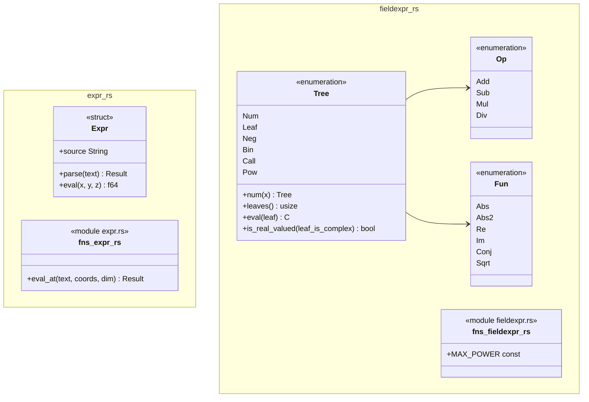

# Expressions: code

C4 level 4 (code) of the component **Expressions** (`femcore.expr`) in the container **femcore** (crate `femcore`). [Component view of the container](../../3-components/femcore.md) · [All code pages](../README.md)

> A small safe expression evaluator for user input (a copy of geom's kept equal by a corpus test), and the typed tree over complex field values that the reductions of results evaluate (ADR 90).

**Decisions:** [ADR 65](../../../adr/0065-closing-the-restructure-what-the-structure-replaced.md), [ADR 2](../../../adr/0002-geometry-as-named-feature-list.md), [ADR 90](../../../adr/0090-whole-array-operations-are-engine-commands-over-a-typed-tree.md)  
**Size:** 2 files, 465 lines.

## Files

| File | Lines | What it says about itself |
|---|---:|---|
| `crates/femcore/src/expr.rs` | 286 | A small, safe expression evaluator for user input such as `293.15 + 50*exp(-((x-0.5)^2)/0.01)` (initial temperature fields, for example). Numbers, `+ - * / ^`, parentheses, the functions `sin cos tan exp log ln log10 sqrt abs sinh cosh t... |
| `crates/femcore/src/fieldexpr.rs` | 179 | A typed expression tree over complex field values, evaluated at one point at a time (productivity plan N1, ADR 90). |

## What it uses

| Target | Modules | Items |
|---|---|---|
| [Matrices and vectors](./lacore.md) | linalg::csr::assembly | C |
| [Frame and sections](./section.md) | section | wafer_point |

## Used by

| Component | Modules | Items |
|---|---|---|
| [dfs: Heat kernel](../dfs/heat.md) | expr | eval_at |
| [engine: Commands](../engine/commands.md) | fieldexpr | Fun, MAX_POWER, Op, Tree |

## Class diagram

Public types with their public fields (or variants) and methods, free functions per file as a `module` box; arrows are field types and `impl Trait`. Capped at 36 types and a few members each; the table below is complete.

## Public items

| Kind | Item | File:line | Signature or summary |
|---|---|---|---|
| struct | `Expr` | `expr.rs:34` | fields: `source` |
| fn | `eval_at` | `expr.rs:256` | `pub fn eval_at(text: &str, coords: &[f64], dim: usize) -> Result<Vec<f64>, String>` —  Evaluates `text` at dof coordinates (flat, `dim` per point) in the wafer axes: `x`, `y`, `z`. On a 2D cross-section the mesh is the x-z |
| fn | `Expr::parse` | `expr.rs:199` | `pub fn parse(text: &str) -> Result<Expr, String>` |
| fn | `Expr::eval` | `expr.rs:212` | `pub fn eval(&self, x: f64, y: f64, z: f64) -> f64` |
| enum | `Op` | `fieldexpr.rs:16` | variants: `Add`, `Sub`, `Mul`, `Div` —  Binary operations. |
| enum | `Fun` | `fieldexpr.rs:25` | variants: `Abs`, `Abs2`, `Re`, `Im`, `Conj`, `Sqrt` —  Functions of one value. |
| enum | `Tree` | `fieldexpr.rs:38` | variants: `Num`, `Leaf`, `Neg`, `Bin`, `Call`, `Pow` |
| const | `MAX_POWER` | `fieldexpr.rs:50` | `u32` —  Largest integer power a tree may carry. |
| fn | `Tree::num` | `fieldexpr.rs:73` | `pub fn num(x: f64) -> Tree` |
| fn | `Tree::leaves` | `fieldexpr.rs:78` | `pub fn leaves(&self) -> usize` —  The number of leaf slots the tree reads (one more than the largest slot). |
| fn | `Tree::eval` | `fieldexpr.rs:88` | `pub fn eval(&self, leaf: &[C]) -> C` —  The value at one point; `leaf[i]` holds slot `i`. |
| fn | `Tree::is_real_valued` | `fieldexpr.rs:129` | `pub fn is_real_valued(&self, leaf_is_complex: &[bool]) -> bool` —  Whether the value is real for real leaves (no leaf is complex): used to report a real answer as a number, not a pair. |
