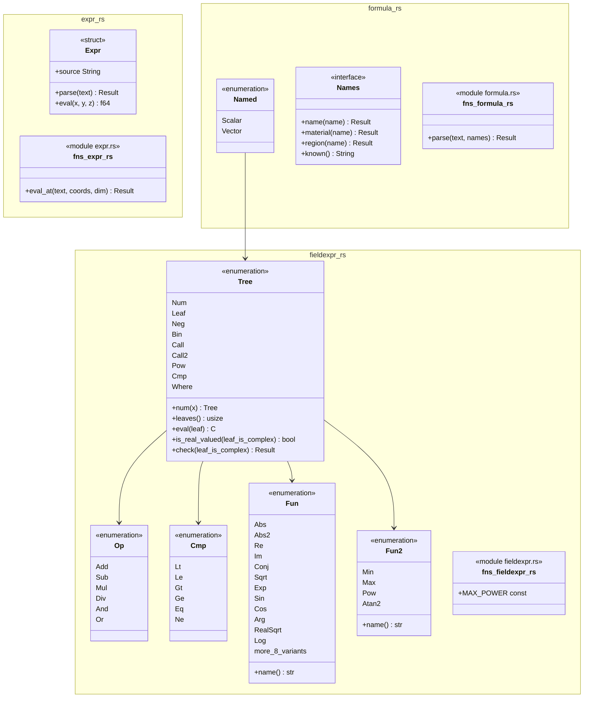

# Expressions: code

C4 level 4 (code) of the component **Expressions** (`femcore.expr`) in the container **femcore** (crate `femcore`). [Component view of the container](../../3-components/femcore.md) · [All code pages](../README.md)

> A small safe expression evaluator for user input (a copy of geom's kept equal by a corpus test), and the typed tree over complex field values that the reductions of results evaluate, and the text formulas parsed into it (ADR 90).

**Decisions:** [ADR 65](../../../adr/0065-closing-the-restructure-what-the-structure-replaced.md), [ADR 2](../../../adr/0002-geometry-as-named-feature-list.md), [ADR 90](../../../adr/0090-whole-array-operations-are-engine-commands-over-a-typed-tree.md)  
**Size:** 3 files, 1568 lines.

## Files

| File | Lines | What it says about itself |
|---|---:|---|
| `crates/femcore/src/expr.rs` | 288 |  |
| `crates/femcore/src/fieldexpr.rs` | 438 |  |
| `crates/femcore/src/formula.rs` | 842 |  |

## What it uses

| Target | Modules | Items |
|---|---|---|
| [Matrices and vectors](./lacore.md) | linalg::csr::assembly | C |
| [Frame and sections](./section.md) | section | wafer_point |

## Used by

| Component | Modules | Items |
|---|---|---|
| [analysis: Mode figures](../analysis/figures.md) | fieldexpr, formula | Fun, Named, Names, Op, Tree |
| [dfs: Heat kernel](../dfs/heat.md) | expr | eval_at |
| [engine: Commands](../engine/commands.md) | fieldexpr, formula | Fun, MAX_POWER, Named, Names, Op, Tree |

## Class diagram

Public types with their public fields (or variants) and methods, free functions per file as a `module` box; arrows are field types and `impl Trait`. Capped at 36 types and a few members each; the table below is complete.

## Public items

| Kind | Item | File:line | Signature or summary |
|---|---|---|---|
| struct | `Expr` | `expr.rs:36` | fields: `source` |
| fn | `eval_at` | `expr.rs:258` | `pub fn eval_at(text: &str, coords: &[f64], dim: usize) -> Result<Vec<f64>, String>` —  Evaluates `text` at dof coordinates (flat, `dim` per point) in the wafer axes: `x`, `y`, `z`. On a 2D cross-section the mesh is the x-z |
| fn | `Expr::parse` | `expr.rs:201` | `pub fn parse(text: &str) -> Result<Expr, String>` |
| fn | `Expr::eval` | `expr.rs:214` | `pub fn eval(&self, x: f64, y: f64, z: f64) -> f64` |
| enum | `Op` | `fieldexpr.rs:20` | variants: `Add`, `Sub`, `Mul`, `Div`, `And`, `Or` —  Binary operations. `And` and `Or` read the truth of the real parts (nonzero is true) and answer 1 or 0. |
| enum | `Cmp` | `fieldexpr.rs:31` | variants: `Lt`, `Le`, `Gt`, `Ge`, `Eq`, `Ne` —  Comparisons of two real values; the answer is 1 or 0 (false when either side is NaN). |
| enum | `Fun` | `fieldexpr.rs:42` | variants: `Abs`, `Abs2`, `Re`, `Im`, `Conj`, `Sqrt`, `Exp`, `Sin`, `Cos`, `Arg`, `RealSqrt`, `Log`, ... —  Functions of one value. |
| enum | `Fun2` | `fieldexpr.rs:114` | variants: `Min`, `Max`, `Pow`, `Atan2` —  Functions of two real values. |
| enum | `Tree` | `fieldexpr.rs:135` | variants: `Num`, `Leaf`, `Neg`, `Bin`, `Call`, `Call2`, `Pow`, `Cmp`, `Where` |
| const | `MAX_POWER` | `fieldexpr.rs:151` | `u32` —  Largest integer power a tree may carry. |
| fn | `Fun::name` | `fieldexpr.rs:78` | `pub fn name(self) -> &'static str` —  The name a formula uses. |
| fn | `Fun2::name` | `fieldexpr.rs:124` | `pub fn name(self) -> &'static str` |
| fn | `Tree::num` | `fieldexpr.rs:182` | `pub fn num(x: f64) -> Tree` |
| fn | `Tree::leaves` | `fieldexpr.rs:187` | `pub fn leaves(&self) -> usize` —  The number of leaf slots the tree reads (one more than the largest slot). |
| fn | `Tree::eval` | `fieldexpr.rs:198` | `pub fn eval(&self, leaf: &[C]) -> C` —  The value at one point; `leaf[i]` holds slot `i`. |
| fn | `Tree::is_real_valued` | `fieldexpr.rs:285` | `pub fn is_real_valued(&self, leaf_is_complex: &[bool]) -> bool` —  Whether the value is real for these leaves: `true` when the tree ends in a function that answers a real value, or reads no imaginary |
| fn | `Tree::check` | `fieldexpr.rs:302` | `pub fn check(&self, leaf_is_complex: &[bool]) -> Result<(), String>` —  Refuses what has no meaning for the leaves' values: an order, a comparison, a logical operation, `log`, `tan`, a non-integer power |
| enum | `Named` | `formula.rs:28` | variants: `Scalar`, `Vector` —  What a name stands for. |
| trait | `Names` | `formula.rs:35` | methods: `name`, `material`, `region`, `known` —  The caller's side of a formula: what its names mean. |
| fn | `parse` | `formula.rs:80` | `pub fn parse(text: &str, names: &mut dyn Names) -> Result<Tree, String>` —  Parses `text` into a scalar tree; `names` says what its names are. |
