# Finite-element basics: code

C4 level 4 (code) of the component **Finite-element basics** (`femcore.fem`) in the container **femcore** (crate `femcore`). [Component view of the container](../../3-components/femcore.md) · [All code pages](../README.md)

> Lagrange P1/P2 elements and quadrature, the 2D edge-element basis, derived fields, PML coordinate stretching, Floquet pairs and material properties per domain.

**Decisions:** [ADR 9](../../../adr/0009-kernels-are-three-stages.md), [ADR 4](../../../adr/0004-simplexmesh-is-the-solver-contract.md), [ADR 45](../../../adr/0045-ems-moves-into-nyx-ems.md), [ADR 69](../../../adr/0069-axis-conditions-and-cylindrical-stretch-of-the-axisymmetric-solid.md)  
**Size:** 8 files, 5106 lines.

## Files

| File | Lines | What it says about itself |
|---|---:|---|
| `crates/femcore/src/edge.rs` | 81 |  |
| `crates/femcore/src/farfield.rs` | 617 |  |
| `crates/femcore/src/fem.rs` | 1350 |  |
| `crates/femcore/src/fields.rs` | 277 |  |
| `crates/femcore/src/periodic.rs` | 290 |  |
| `crates/femcore/src/pml.rs` | 98 |  |
| `crates/femcore/src/props.rs` | 266 |  |
| `crates/femcore/src/rt.rs` | 2127 |  |

## What it uses

| Target | Modules | Items |
|---|---|---|
| [Matrices and vectors](./lacore.md) | linalg::csr, linalg::csr::assembly | C, CCoo, CCsr, Coo, RCsr, c |
| [Linear algebra driver](./ladriver.md) | linalg::driver | DirectSolver, dense_eigh |
| [Preconditioners](./laprecond.md) | linalg::amg_elastic | Amg, AmgOptions, block_pcg, pcg |
| [Material specification](./material.md) | material | Anisotropy, M3, M6 |
| [Mesh](./mesh.md) | mesh | SimplexMesh |
| [Runtime services](./runtime.md) | par, progress | check, lap_since, stage, threads, threads_up_to |
| [Frame and sections](./section.md) | section | mesh_pml_dirs |

## Used by

| Component | Modules | Items |
|---|---|---|
| [analysis: Capacitance and inductance matrices](../analysis/capacitance.md) | fem | geometry, quad_rule, shape |
| [analysis: cQED quantization and TLS participation](../analysis/cqed.md) | fem | facet_rule, geometry, quad_rule, shape |
| [analysis: Field samples](../analysis/samples.md) | fem, fields | geometry, local_bary, quad_rule, shape |
| [dfs: Shared helpers](../dfs/common.md) | fields | gradients_at_nodes |
| [dfs: Electrostatics kernel](../dfs/electro.md) | fem, fields, props, rt | CellFields, CellPermittivity, EquilibratedFluxResult, LinearSolver, RobinBoundary, TensorKind, boundary_dofs, build_face_to_cells_3d +3 |
| [dfs: Heat kernel](../dfs/heat.md) | fem, fields, props | AmgSystem, CellFields, LinearSolver, TensorKind, amg_wanted, node_average |
| [dfs: Magnetostatics kernel](../dfs/magneto.md) | fem, fields, props | CellFields, LinearSolver, local_bary, node_average |
| [dfs: Typed problem](../dfs/problem.md) | props | LinearSolver, Materials |
| [ems: Physics adapter](../ems/adapter.md) | props | PmlDir |
| [ems: Axisymmetric kernel](../ems/axisym.md) | edge, fem, fields, pml, props | CellData, CellFields, Materials, Pml, PmlDir, TensorKind, cell_data, edge_basis +5 |
| [ems: 3D cavity kernel](../ems/cavity.md) | fem, fields, periodic, pml, props | CellFields, CurvedTet, Match, PmlDir, Reduction, ccsr_adjoint, ccsr_mul, cell_stretches +9 |
| [ems: Driven frequency-domain and PROM](../ems/driven.md) | edge, fem, fields, periodic, pml | CellFields, CurvedTet, Geometry, Match, Reduction, cell_data, cell_stretches, congruence +8 |
| [ems: Thin-film IBC and Josephson ROM](../ems/ibc.md) | edge, fem, periodic | CurvedTet, Geometry, Reduction, build_face_to_cell_3d, ccsr_adjoint, cell_data, congruence, edge_basis +6 |
| [ems: Mode kernel](../ems/modes.md) | edge, fem, fields, props | CellFields, TensorKind, cell_data, edge_basis, local_bary, node_average, tri_g |
| [ems: Complex-mode kernel](../ems/modescx.md) | edge, fem, fields, props | CellFields, PmlDir, TensorKind, cell_data, edge_basis, local_bary, node_average, tri_g |
| [ems: Optical mode sets](../ems/optical.md) | props | PmlDir, TensorKind |
| [ems: Typed problem](../ems/problem.md) | props | Materials, Periodic, Pml, PmlDir, TensorKind |
| [engine: Commands](../engine/commands.md) | fem, props | RefElement, TensorKind, facet_rule, facets_with, geometry, quad_rule, shape |
| [engine: Registry and facade](../engine/registry.md) | fields | Display |
| [Error estimators](./estimators.md) | fem | CurvedTet, TET_EDGES, build_face_to_cells_3d, facet_rule, geometry, quad_rule, quad_rule_collapsed, shape |
| [Matrices and vectors](./lacore.md) | fem | quad_rule |
| [Meshing facade](./meshing.md) | props | Pml, PmlDir |
| [3D meshing](./meshing3d.md) | fem | CurvedTet, quad_rule_collapsed |
| [Optical mode sets](./optical.md) | edge, fem, pml, props | CellData, cell_data, edge_basis, stretch, tri_g |
| [Frame and sections](./section.md) | props |  |
| [Structured absorbing layers](./structpml.md) | props | Materials, Pml, PmlDir |
| [physics: Problem envelope](../physics/envelope.md) | props | Materials |
| [physics: Result and frame](../physics/result.md) | fields | CellField, CellFields |
| [physics: Test support](../physics/testsupport.md) | fields | node_average |
| [sms: Axisymmetric kernel](../sms/axisym.md) | fem, pml, props | Pml, PmlDir, cell_stretches, radial_coordinate |
| [sms: Cross-section study kernel](../sms/crosssection.md) | fem, fields, periodic, pml, props | CellFields, PmlDir, Reduction, cell_stretches, check_boundary_labels, congruence, match_vertices, nodal_relations |
| [sms: Floquet kernel](../sms/floquet.md) | periodic | Reduction, congruence, match_vertices, nodal_relations |
| [sms: Low-reflecting boundary](../sms/lrb.md) | fem |  |
| [sms: Absorbing-layer kernel](../sms/pml.md) | fem, periodic, pml | Reduction, cell_stretches, congruence, match_vertices, nodal_relations |
| [sms: Typed problem](../sms/problem.md) | props | LinearSolver, Materials, Periodic, Pml, PmlDir |
| [sms: Solid kernel](../sms/solid.md) | fem, fields, props | AMG_THRESHOLD, AmgSystem, CellFields, FACTORISE_MAX_FREE, LOBPCG_MAX_FACTOR, LOBPCG_MIN_FREE, LinearSolver, Materials +5 |
| [sms: Waveguide kernel](../sms/waveguide.md) | fem |  |

## Class diagram

Public types with their public fields (or variants) and methods, free functions per file as a `module` box; arrows are field types and `impl Trait`. Capped at 36 types and a few members each; the table below is complete.

```mermaid
classDiagram
  namespace edge_rs {
    class CellData {
        <<struct>>
        +sign Vec
        +gdofs Vec
        +net usize
    }
    class fns_edge_rs {
        <<module edge.rs>>
        +edge_basis(l, g, sign, order, w, curl)
        +cell_data(mesh, order) CellData
        +tri_g(geo, c) slice
    }
  }
  namespace farfield_rs {
    class FarFieldPermittivity {
        <<enumeration>>
        Scalar
        Tensor
    }
    class fns_farfield_rs {
        <<module farfield.rs>>
        +farfield_centroid(mesh, labels) slice
        +farfield_positive_measure(mesh, labels, center) f64
        +assemble_boundary_mass_weighted(mesh, labels, order, weight) Csr
        +assemble_farfield_robin(mesh, labels, fe_order, bc_order, decay_power, center, eps0, eps_r) Csr
    }
  }
  namespace fem_rs {
    class Quad {
        <<struct>>
        +lam Vec
        +w Vec~f64~
    }
    class RefElement {
        <<struct>>
        +dim usize
        +order usize
        +nloc usize
        +w Vec~f64~
        +n Vec
        +dn Vec
        +new(dim, order, degree) Self
    }
    class Geometry {
        <<struct>>
        +vol Vec~f64~
        +g Vec~f64~
    }
    class CurvedTet {
        <<struct>>
        +x slice
        +new(x) Self
        +straight(v) Self
        +dx_dlam(lam) slice
        +position(lam) slice
        +jacobian_matrix(lam) slice
        +jacobian(lam) tuple
        +min_det_at_nodes() f64
        +volume() f64
    }
    class AmgSystem {
        <<struct>>
        +setup_seconds f64
        +new(mesh, order, ncomp, a, fixed) Result
        +new_with(mesh, order, ncomp, a, fixed, opts) Result
        +n_levels() usize
        +sizes() Vec~usize~
        +line_smooth_active() bool
        +n_line_columns() usize
        +solve_with(matrix, b, fixed_values, tol, max_iter) tuple
        +solve_block_with(matrix, b_list, fixed_values_list, tol, max_iter) tuple
        +more_3_methods()
    }
    class fns_fem_rs {
        <<module fem.rs>>
        +quad_rule(dim, degree) Quad
        +facet_rule(facet_dim) Quad
        +shape(lam, order) tuple
        +geometry(mesh) Geometry
        +quad_rule_collapsed(degree) Quad
        +shape_gradients(re, geo, c, q, out)
        +assemble_parallel(nc, nrows, ncols, f) Csr
        +assemble_laplace(mesh, order, coeff) Csr
        +assemble_laplace_tensor(mesh, order, k) Csr
        +assemble_mass(mesh, order, coeff) Csr
        +more_19_functions()
        +TET_EDGES const
        +TET_FACES const
        +AMG_THRESHOLD const
        +AMG_THRESHOLD_3D const
        +more_3_items
    }
  }
  namespace fields_rs {
    class Display {
        <<struct>>
        +dim usize
        +dofs Vec~usize~
        +points Vec
        +tris Vec
        +tri_label Vec~i32~
        +new(mesh, order) Self
        +pick(values) Vec~f32~
    }
    class CellField {
        <<struct>>
        +name String
        +unit String
        +re Vec~f64~
        +im Vec~f64~
    }
    class CellFields {
        <<struct>>
        +order usize
        +nloc usize
        +fields Vec~CellField~
        +new(mesh, order) Self
        +get(name) Option
        +push_real(name, unit, re)
        +push_complex(name, unit, re, im)
        +push_components(prefix, names, unit, g)
        +node_average(mesh, name) Option
    }
    class fns_fields_rs {
        <<module fields.rs>>
        +local_bary(dim, order) Vec
        +gradients_at_nodes(mesh, u, ncomp, order) Vec~f64~
        +node_average(mesh, vals, m, order) Vec~f64~
    }
  }
  namespace periodic_rs {
    class Match {
        <<struct>>
        +map HashMap
        +src_facets Vec~usize~
        +shift Vec~f64~
    }
    class Reduction {
        <<struct>>
        +n usize
        +roots Vec~usize~
        +index_of Vec~usize~
        +ratio Vec~C~
        +build(n, relations, fixed) Reduction
        +n_reduced() usize
        +prolong() CCsr
        +expand(xr) Vec~C~
    }
    class fns_periodic_rs {
        <<module periodic.rs>>
        +phase_factor(phase) C
        +match_vertices(mesh, p) Result
        +nodal_relations(mesh, order, ncomp, m, phase) Result
        +ccsr_mul(a, b) CCsr
        +ccsr_adjoint(a) CCsr
        +congruence(p, a) CCsr
    }
  }
  namespace pml_rs {
    class fns_pml_rs {
        <<module pml.rs>>
        +stretch(p, dirs, centre, lo, hi) tuple
        +radial_coordinate(p, r, lo, hi) C
        +cell_stretches(mesh, pml) VecC
    }
  }
  namespace props_rs {
    class Materials {
        <<struct>>
        +domains BTreeMap
        +default BTreeMap
        +aniso BTreeMap
        +pml BTreeMap
        +has_pml() bool
        +has_complex_permittivity() bool
        +has_viscosity() bool
        +get(domain, name) Option~f64~
        +set(domain, name, v)
        +has_tensor(kind) bool
        +has_stiffness() bool
        +cell_stiffness(mesh) Result
        +more_6_methods()
    }
    class PmlDir {
        <<enumeration>>
        Off
        Plus
        Minus
    }
    class Pml {
        <<struct>>
        +x PmlDir
        +y PmlDir
        +z PmlDir
        +strength f64
        +order f64
        +re f64
    }
    class TensorKind {
        <<enumeration>>
        Conductivity
        Permittivity
        PermittivityIm
        Expansion
    }
    class Periodic {
        <<struct>>
        +source Vec~i32~
        +dest Vec~i32~
        +phase f64
    }
    class LinearSolver {
        <<enumeration>>
        Auto
        Direct
        Iterative
        +name() str
    }
  }
  namespace rt_rs {
    class CellPermittivity {
        <<enumeration>>
        Scalar
        Tensor
    }
    class RobinBoundary {
        <<enumeration>>
        None
        FacetAlpha
        Pointwise
    }
    class EquilibratedFluxResult {
        <<struct>>
        +order usize
        +rt_order usize
        +dim usize
        +n_patches usize
        +n_sheet_splits usize
        +max_div_l2 f64
        +cell_rt_coeffs Vec
        +w_flux_matrix Vec
        +more_7_fields
        +eval_cell_flux(mesh, terminal, cell, sorted_lam) Resultf64
        +interior_non_sheet_normal_jump_l2(mesh, sheet_facets, terminal) Result
    }
    class fns_rt_rs {
        <<module rt.rs>>
        +rt_nloc(dim, order) usize
        +eval_rt_ref(dim, order, lam, out_vec, out_div)
        +eval_rt_piola(dim, order, j_mat, det_j, lam, out_vec, out_div)
        +goal_weighted_cell_eta2(terminal_cell_eta2, c_ref, eps_floor) Vec~f64~
        +equilibrate_electro_flux_bounds(mesh, order, potentials, eps, dirichlet_labels, robin, c_upper_override) Result
        +equilibrate_flux_patches(mesh, order, potentials, eps, dirichlet_facets, sheet_facets, robin, c_upper_override) Result
    }
  }
  CellFields --> CellField
  Materials --> Pml
  Pml --> PmlDir
```

## Public items

| Kind | Item | File:line | Signature or summary |
|---|---|---|---|
| fn | `edge_basis` | `edge.rs:21` | `pub fn edge_basis(l: &[f64], g: &[[f64; 2]; 3], sign: &[f64; 3], order: usize, w: &mut [[f64; 2]], curl: &mut [f64])` —  Nedelec basis at barycentric point `l` of one cell with barycentric gradients `g[i]`: |
| struct | `CellData` | `edge.rs:48` | fields: `sign`, `gdofs`, `net` |
| fn | `cell_data` | `edge.rs:54` | `pub fn cell_data(mesh: &SimplexMesh, order: usize) -> CellData` |
| fn | `tri_g` | `edge.rs:76` | `pub fn tri_g(geo: &Geometry, c: usize) -> [[f64` |
| enum | `FarFieldPermittivity` | `farfield.rs:24` | variants: `Scalar`, `Tensor` —  Relative permittivity field passed to [`assemble_farfield_robin`]. |
| fn | `farfield_centroid` | `farfield.rs:157` | `pub fn farfield_centroid(mesh: &SimplexMesh, labels: &[i32]) -> [f64` —  Computes the deterministic area-weighted (3D) or length-weighted (2D) centroid of all facets carrying |
| fn | `farfield_positive_measure` | `farfield.rs:201` | `pub fn farfield_positive_measure(mesh: &SimplexMesh, labels: &[i32], center: [f64; 3]) -> f64` —  Computes the total outward-facing positive measure (`\int_{f: \mathbf{r}\cdot\mathbf{n}_f > 0} dS`) |
| fn | `assemble_boundary_mass_weighted` | `farfield.rs:273` | `pub fn assemble_boundary_mass_weighted<W>(mesh: &SimplexMesh, labels: &[i32], order: usize, weight: W) -> Csr` —  Assembles the weighted boundary mass matrix |
| fn | `assemble_farfield_robin` | `farfield.rs:404` | `pub fn assemble_farfield_robin( mesh: &SimplexMesh, labels: &[i32], fe_order: usize, bc_order: usize, decay_power: f64, center: [f64; 3], eps0: f64, eps_r: FarFieldPermittivity<'_>, ) -> Csr` —  Assembles the far-field Robin (`bc_order = 1`) or second-order symmetric Bayliss-Turkel |
| struct | `Quad` | `fem.rs:30` | fields: `lam`, `w` —  Quadrature on the reference simplex: barycentric points and weights summing to 1 |
| fn | `quad_rule` | `fem.rs:41` | `pub fn quad_rule(dim: usize, degree: usize) -> Quad` |
| fn | `facet_rule` | `fem.rs:86` | `pub fn facet_rule(facet_dim: usize) -> Quad` —  Rule on a boundary facet (Gauss on edges in 2D, degree-4 Dunavant on triangles in 3D). |
| fn | `shape` | `fem.rs:104` | `pub fn shape(lam: &[f64], order: usize) -> (Vec<f64>, Vec<f64>)` —  Shape functions at barycentric point `lam`: values `n[a]` and derivatives with respect to |
| struct | `RefElement` | `fem.rs:133` | fields: `dim`, `order`, `nloc`, `w`, `n`, `dn` —  Quadrature rule with shape functions tabulated at its points. |
| struct | `Geometry` | `fem.rs:161` | fields: `vol`, `g` —  Per-cell volume and gradients of the barycentric coordinates: `g[c*(d+1)*d + b*d + k]`. |
| fn | `geometry` | `fem.rs:166` | `pub fn geometry(mesh: &SimplexMesh) -> Geometry` |
| fn | `quad_rule_collapsed` | `fem.rs:261` | `pub fn quad_rule_collapsed(degree: usize) -> Quad` —  A quadrature rule on the reference tetrahedron that is exact to at least `degree`, built by collapsing the unit cube (Duffy |
| const | `TET_EDGES` | `fem.rs:279` | `[(usize, usize)` —  The local vertex pairs of a tetrahedron in the order of its edge numbering (and of the geometry nodes 4 to 9 of [`CurvedTet`]). |
| struct | `CurvedTet` | `fem.rs:289` | fields: `x` —  A tetrahedron with quadratic (isoparametric) geometry: the map from the reference cell is the quadratic Lagrange interpolation of ten |
| fn | `shape_gradients` | `fem.rs:401` | `pub fn shape_gradients(re: &RefElement, geo: &Geometry, c: usize, q: usize, out: &mut [f64])` —  Physical gradients of the shape functions at quadrature point `q` of cell `c`: |
| fn | `assemble_parallel` | `fem.rs:420` | `pub fn assemble_parallel<F>(nc: usize, nrows: usize, ncols: usize, f: F) -> Csr` —  Runs `f(range, &mut coo)` over fixed cell chunks on all available threads and merges the results |
| fn | `assemble_laplace` | `fem.rs:471` | `pub fn assemble_laplace(mesh: &SimplexMesh, order: usize, coeff: &[f64]) -> Csr` —  `K_ij = integral coeff grad(phi_i) . grad(phi_j)`; `coeff` holds one value per cell. |
| fn | `assemble_laplace_tensor` | `fem.rs:505` | `pub fn assemble_laplace_tensor(mesh: &SimplexMesh, order: usize, k: &[[[f64; 3]; 3]]) -> Csr` —  `K_ij = integral grad(phi_i) . K grad(phi_j)` with a symmetric tensor `K` per cell (only |
| fn | `assemble_mass` | `fem.rs:545` | `pub fn assemble_mass(mesh: &SimplexMesh, order: usize, coeff: &[f64]) -> Csr` —  `M_ij = integral coeff phi_i phi_j`. |
| fn | `assemble_source` | `fem.rs:574` | `pub fn assemble_source(mesh: &SimplexMesh, order: usize, coeff: &[f64]) -> Vec<f64>` —  Integral of `coeff phi_i` over every cell: the load of a per-cell source density. |
| const | `TET_FACES` | `fem.rs:582` | `[[usize` —  Local vertex triples of the four faces of a tetrahedron. |
| fn | `build_face_to_cell_3d` | `fem.rs:587` | `pub fn build_face_to_cell_3d(mesh: &SimplexMesh) -> std::collections::HashMap<[u32` —  Builds a map from each sorted triangle face `[v0, v1, v2]` in a 3D tetrahedral mesh to one adjacent |
| fn | `build_face_to_cells_3d` | `fem.rs:606` | `pub fn build_face_to_cells_3d(mesh: &SimplexMesh) -> std::collections::HashMap<[u32` —  Builds a map from each sorted triangle face `[v0, v1, v2]` in a 3D tetrahedral mesh to all adjacent |
| fn | `facet_measure` | `fem.rs:623` | `pub fn facet_measure(mesh: &SimplexMesh, f: usize) -> f64` |
| fn | `facets_with` | `fem.rs:637` | `pub fn facets_with<'a>(mesh: &'a SimplexMesh, labels: &'a [i32]) -> impl Iterator<Item = usize> + 'a` |
| fn | `assemble_boundary_mass` | `fem.rs:642` | `pub fn assemble_boundary_mass(mesh: &SimplexMesh, labels: &[i32], order: usize, coeff: f64) -> Csr` —  `integral coeff phi_i phi_j` over the facets carrying one of `labels` (convective term). |
| fn | `assemble_boundary_load` | `fem.rs:668` | `pub fn assemble_boundary_load(mesh: &SimplexMesh, labels: &[i32], value: f64, order: usize) -> Vec<f64>` —  Load `integral value phi_i` over the facets carrying one of `labels`. |
| fn | `add_boundary_load` | `fem.rs:676` | `pub fn add_boundary_load(mesh: &SimplexMesh, labels: &[i32], value: &dyn Fn(usize) -> f64, order: usize, out: &mut [f64], ncomp: usize, comp: usize)` —  Adds the boundary load of a per-facet value into component `comp` of a vector of `ncomp` |
| fn | `boundary_dofs` | `fem.rs:699` | `pub fn boundary_dofs(mesh: &SimplexMesh, labels: &[i32], order: usize) -> Vec<usize>` —  Dofs on the boundary facets with any of the given boundary numbers (sorted, unique). |
| fn | `dirichlet_constraints` | `fem.rs:712` | `pub fn dirichlet_constraints(mesh: &SimplexMesh, values: &BTreeMap<i32, f64>, order: usize) -> (Vec<usize>, Vec<f64>)` —  Fixed dofs and values for `{boundary number: value}`. A dof shared by boundaries with |
| fn | `solve_dirichlet` | `fem.rs:731` | `pub fn solve_dirichlet(k: &Csr, f: &[f64], fixed: &[usize], values: &[f64]) -> Result<Vec<f64>, String>` —  Solves `K u = f` with `u[fixed] = values` by elimination. |
| fn | `untouched_dofs` | `fem.rs:758` | `pub fn untouched_dofs(mesh: &SimplexMesh, order: usize, ncomp: usize, inactive: &[i32]) -> Vec<usize>` —  Dofs (of `ncomp` component blocks of `n_dofs(order)`) that no active cell touches: the cells |
| fn | `free_dofs` | `fem.rs:781` | `pub fn free_dofs(n: usize, fixed: &[usize]) -> Vec<usize>` —  Free dof indices (complement of `fixed`). |
| const | `AMG_THRESHOLD` | `fem.rs:795` | `usize` —  Free-dof count above which `LinearSolver::Auto` switches to multigrid in 2D. In 3D multigrid |
| const | `AMG_THRESHOLD_3D` | `fem.rs:796` | `usize` |
| const | `LOBPCG_MIN_FREE` | `fem.rs:800` | `usize` —  Free dofs above which eigenfrequency studies (Auto) try LOBPCG instead of a factorisation. Measured with the shared |
| const | `FACTORISE_MAX_FREE` | `fem.rs:802` | `usize` —  Above this many free dofs a factorisation is not attempted for eigenfrequencies. |
| const | `LOBPCG_MAX_FACTOR` | `fem.rs:804` | `f64` —  Multigrid is used for eigenfrequencies when its convergence factor is at most this. |
| fn | `amg_wanted` | `fem.rs:807` | `pub fn amg_wanted(dim: usize, n_free: usize) -> bool` —  Whether `LinearSolver::Auto` should use multigrid for a system with `n_free` unknowns. |
| fn | `detect_vertical_columns` | `fem.rs:870` | `pub fn detect_vertical_columns(mesh: &SimplexMesh, order: usize) -> (Vec<Vec<usize>>, Vec<Vec<usize>>)` —  Auto-detects vertical prismatic columns on a 3D mesh by grouping P1 vertices with identical |
| struct | `AmgSystem` | `fem.rs:945` | fields: `setup_seconds` —  A symmetric positive definite system over all dofs with some dofs constrained, prepared for |
| fn | `solve_spd` | `fem.rs:1207` | `pub fn solve_spd(mesh: &SimplexMesh, order: usize, ncomp: usize, solver: crate::props::LinearSolver, k: &Csr, f: &[f64], fixed: &[usize], values: &[f64]) -> Result<(Vec<f64>, Option<String>), String>` —  Solves `K u = f` with `u[fixed] = values` choosing between the sparse direct solver and |
| fn | `solve_spd_with` | `fem.rs:1213` | `pub fn solve_spd_with( mesh: &SimplexMesh, order: usize, ncomp: usize, solver: crate::props::LinearSolver, k: &Csr, f: &[f64], fixed: &[usize], values: &[f64], tol: f64, line_smooth: bool, ) -> Result<(Vec<f64>, Option<String>), String>` —  Like [`solve_spd`] with explicit iterative tolerance `tol` and vertical-line smoother toggle `line_smooth`. |
| fn | `check_boundary_labels` | `fem.rs:1270` | `pub fn check_boundary_labels(mesh: &SimplexMesh, labels: impl IntoIterator<Item = i32>) -> Result<(), String>` —  Refuses boundary numbers that the mesh does not have, naming the ones it has. Every physics checks its conditions with it. |
| fn | `cell_values_at_nodes` | `fem.rs:1283` | `pub fn cell_values_at_nodes(mesh: &SimplexMesh, u: &[f64], order: usize) -> Vec<f64>` —  The values of a dof field at the local dofs of every cell: `out[c*nloc + a]`. |
| fn | `RefElement::new` | `fem.rs:145` | `pub fn new(dim: usize, order: usize, degree: usize) -> Self` |
| fn | `CurvedTet::new` | `fem.rs:294` | `pub fn new(x: [[f64; 3]; 10]) -> Self` |
| fn | `CurvedTet::straight` | `fem.rs:299` | `pub fn straight(v: [[f64; 3]; 4]) -> Self` —  The straight cell with vertices `v` (edge nodes at the midpoints). |
| fn | `CurvedTet::dx_dlam` | `fem.rs:312` | `pub fn dx_dlam(&self, lam: &[f64; 4]) -> [[f64` —  Derivatives of the position with respect to each barycentric coordinate treated as independent: `d[b]` is the sum over nodes of |
| fn | `CurvedTet::position` | `fem.rs:332` | `pub fn position(&self, lam: &[f64; 4]) -> [f64` —  Position at the barycentric point `lam`. |
| fn | `CurvedTet::jacobian_matrix` | `fem.rs:350` | `pub fn jacobian_matrix(&self, lam: &[f64; 4]) -> [[f64` —  The Jacobian matrix `J[i][k] = dx_i / dxi_k` with respect to the reference coordinates `(lambda_1, lambda_2, lambda_3)`. |
| fn | `CurvedTet::jacobian` | `fem.rs:363` | `pub fn jacobian(&self, lam: &[f64; 4]) -> ([[f64` —  Physical gradients of the four barycentric functions at `lam`, and the determinant of the Jacobian (negative for an inverted |
| fn | `CurvedTet::min_det_at_nodes` | `fem.rs:380` | `pub fn min_det_at_nodes(&self) -> f64` —  The smallest determinant over the ten nodes of the cell (vertices and edge nodes), a cheap validity probe. |
| fn | `CurvedTet::volume` | `fem.rs:392` | `pub fn volume(&self) -> f64` —  Volume of the curved cell: the integral of `\|det J\|` over the reference tetrahedron, with a rule exact to degree 8. |
| fn | `AmgSystem::new` | `fem.rs:960` | `pub fn new(mesh: &SimplexMesh, order: usize, ncomp: usize, a: &Csr, fixed: &[usize]) -> Result<AmgSystem, String>` —  `a` is the matrix over all `n = ncomp * n_dofs(order)` dofs (entries in constrained rows and |
| fn | `AmgSystem::new_with` | `fem.rs:965` | `pub fn new_with( mesh: &SimplexMesh, order: usize, ncomp: usize, a: &Csr, fixed: &[usize], mut opts: crate::linalg::amg_elastic::AmgOptions, ) -> Result<AmgSystem, String>` —  Like [`AmgSystem::new`] with explicit [`crate::linalg::amg_elastic::AmgOptions`] (such as `line_smooth`). |
| fn | `AmgSystem::n_levels` | `fem.rs:1053` | `pub fn n_levels(&self) -> usize` |
| fn | `AmgSystem::sizes` | `fem.rs:1057` | `pub fn sizes(&self) -> Vec<usize>` |
| fn | `AmgSystem::line_smooth_active` | `fem.rs:1062` | `pub fn line_smooth_active(&self) -> bool` —  Whether Thomas tridiagonal vertical-line smoothing is active in the hierarchy. |
| fn | `AmgSystem::n_line_columns` | `fem.rs:1067` | `pub fn n_line_columns(&self) -> usize` —  Number of vertical columns detected and smoothed on the primary P1/P2 levels. |
| fn | `AmgSystem::solve_with` | `fem.rs:1074` | `pub fn solve_with(&self, matrix: Option<&Csr>, b: &[f64], fixed_values: &[(usize, f64)], tol: f64, max_iter: usize) -> (Vec<f64>, usize, f64)` —  Solves `A x = b` for the right-hand side over all dofs (entries at constrained dofs are taken |
| fn | `AmgSystem::solve_block_with` | `fem.rs:1104` | `pub fn solve_block_with( &self, matrix: Option<&Csr>, b_list: &[Vec<f64>], fixed_values_list: &[Vec<(usize, f64)>], tol: f64, max_iter: usize, ) -> (Vec<Vec<f64>>, usize, f64)` —  Solves `A X = B` simultaneously for `K = b_list.len()` right-hand sides using multi-RHS |
| fn | `AmgSystem::convergence_factor` | `fem.rs:1154` | `pub fn convergence_factor(&self) -> f64` —  Average residual reduction per iteration of multigrid-preconditioned CG on a random |
| fn | `AmgSystem::precondition_free` | `fem.rs:1172` | `pub fn precondition_free(&self, r_free: &[f64]) -> Vec<f64>` —  One multigrid cycle applied to a vector over the free dofs: an approximation of the inverse |
| fn | `AmgSystem::solve_free` | `fem.rs:1187` | `pub fn solve_free(&self, matrix: Option<&Csr>, b_free: &[f64], tol: f64) -> Result<Vec<f64>, String>` —  Solves for the unconstrained dofs only: `b` and the result are vectors over the free dofs. |
| fn | `local_bary` | `fields.rs:15` | `pub fn local_bary(dim: usize, order: usize) -> Vec<Vec<f64>>` —  Barycentric coordinates of the local dofs (vertices, then edge midpoints). |
| fn | `gradients_at_nodes` | `fields.rs:35` | `pub fn gradients_at_nodes(mesh: &SimplexMesh, u: &[f64], ncomp: usize, order: usize) -> Vec<f64>` —  Gradients of `ncomp` stacked scalar dof fields (each `n_dofs` long) at the local dofs of |
| fn | `node_average` | `fields.rs:131` | `pub fn node_average(mesh: &SimplexMesh, vals: &[f64], m: usize, order: usize) -> Vec<f64>` —  Mean over the cells touching each dof of per-cell nodal values `vals[(c*nloc + a)*m + j]`. |
| struct | `Display` | `fields.rs:161` | fields: `dim`, `dofs`, `points`, `tris`, `tri_label` —  Surface mesh for plotting: the cells in 2D, the boundary facets in 3D, with every P2 |
| struct | `CellField` | `fields.rs:228` | fields: `name`, `unit`, `re`, `im` —  One quantity at the local dofs of every cell, not averaged over the cells that share a node: |
| struct | `CellFields` | `fields.rs:238` | fields: `order`, `nloc`, `fields` —  The un-averaged per-cell fields of one solution. This is what an error estimator needs (the jump of a flux |
| fn | `Display::new` | `fields.rs:172` | `pub fn new(mesh: &SimplexMesh, order: usize) -> Self` |
| fn | `Display::pick` | `fields.rs:218` | `pub fn pick(&self, values: &[f64]) -> Vec<f32>` |
| fn | `CellFields::new` | `fields.rs:246` | `pub fn new(mesh: &SimplexMesh, order: usize) -> Self` |
| fn | `CellFields::get` | `fields.rs:250` | `pub fn get(&self, name: &str) -> Option<&CellField>` |
| fn | `CellFields::push_real` | `fields.rs:254` | `pub fn push_real(&mut self, name: impl Into<String>, unit: impl Into<String>, re: Vec<f64>)` |
| fn | `CellFields::push_complex` | `fields.rs:258` | `pub fn push_complex(&mut self, name: impl Into<String>, unit: impl Into<String>, re: Vec<f64>, im: Vec<f64>)` |
| fn | `CellFields::push_components` | `fields.rs:264` | `pub fn push_components(&mut self, prefix: &str, names: &[&str], unit: &str, g: &[f64])` —  The `ncomp` interleaved per-cell values `g[(c*nloc + a)*ncomp + j]` as one real field per component, named |
| fn | `CellFields::node_average` | `fields.rs:273` | `pub fn node_average(&self, mesh: &SimplexMesh, name: &str) -> Option<Vec<f64>>` —  The node average of a real component (the plot field it must reproduce). |
| fn | `phase_factor` | `periodic.rs:17` | `pub fn phase_factor(phase: f64) -> C` —  The Floquet factor `exp(-i phase)`. |
| struct | `Match` | `periodic.rs:22` | fields: `map`, `src_facets`, `shift` —  Vertex correspondence of a periodic pair. |
| fn | `match_vertices` | `periodic.rs:46` | `pub fn match_vertices(mesh: &SimplexMesh, p: &Periodic) -> Result<Match, String>` —  Matches the vertices of the source boundaries to those of the destination boundaries. |
| fn | `nodal_relations` | `periodic.rs:113` | `pub fn nodal_relations(mesh: &SimplexMesh, order: usize, ncomp: usize, m: &Match, phase: f64) -> Result<Vec<(usize, usize, C)>, String>` —  Relations for nodal fields of `ncomp` component blocks (dof layout: component blocks of |
| struct | `Reduction` | `periodic.rs:184` | fields: `n`, `roots`, `index_of`, `ratio` —  `x_full = P x_red`: the reduced dofs are the roots of the constraint classes that contain no |
| fn | `ccsr_mul` | `periodic.rs:247` | `pub fn ccsr_mul(a: &CCsr, b: &CCsr) -> CCsr` —  Sparse complex product. |
| fn | `ccsr_adjoint` | `periodic.rs:278` | `pub fn ccsr_adjoint(a: &CCsr) -> CCsr` —  Conjugate transpose. |
| fn | `congruence` | `periodic.rs:284` | `pub fn congruence(p: &CCsr, a: &CCsr) -> CCsr` —  `P^H A P`. |
| fn | `Reduction::build` | `periodic.rs:195` | `pub fn build(n: usize, relations: &[(usize, usize, C)], fixed: &[usize]) -> Reduction` |
| fn | `Reduction::n_reduced` | `periodic.rs:224` | `pub fn n_reduced(&self) -> usize` |
| fn | `Reduction::prolong` | `periodic.rs:229` | `pub fn prolong(&self) -> CCsr` —  The prolongation `P` (`n x n_reduced`). |
| fn | `Reduction::expand` | `periodic.rs:241` | `pub fn expand(&self, xr: &[C]) -> Vec<C>` |
| fn | `stretch` | `pml.rs:13` | `pub fn stretch(p: &Pml, dirs: [PmlDir; 2], centre: [f64; 2], lo: [f64; 2], hi: [f64; 2]) -> (C, C)` —  Stretch factors along the two axes of the mesh (`dirs`, the layer directions of each) of a cell centre for a PML specification and the |
| fn | `radial_coordinate` | `pml.rs:31` | `pub fn radial_coordinate(p: &Pml, r: f64, lo: f64, hi: f64) -> C` —  The complex radius `r~ = int s_r dr` (from the interface of the layer) of a point at radius `r` for a layer whose `x` direction is the |
| fn | `cell_stretches` | `pml.rs:49` | `pub fn cell_stretches(mesh: &SimplexMesh, pml: &std::collections::BTreeMap<i32, Pml>) -> Vec<[C` —  Complex stretch factors `(sx, sy, sz)` of every cell of a 2D or 3D mesh for the PML domains of |
| struct | `Materials` | `props.rs:17` | fields: `domains`, `default`, `aniso`, `pml` —  Material properties per domain; `default` applies to domains without their own value. |
| enum | `PmlDir` | `props.rs:31` | variants: `Off`, `Plus`, `Minus` —  Which side of a domain a perfectly matched layer absorbs towards, per axis. |
| struct | `Pml` | `props.rs:43` | fields: `x`, `y`, `z`, `strength`, `order`, `re` —  A perfectly matched layer by coordinate stretching, `s = re - j strength t^order` with `t` |
| enum | `TensorKind` | `props.rs:65` | variants: `Conductivity`, `Permittivity`, `PermittivityIm`, `Expansion` |
| struct | `Periodic` | `props.rs:238` | fields: `source`, `dest`, `phase` —  A periodic condition with a Floquet phase between two boundaries of equal meshes: the dofs on the |
| enum | `LinearSolver` | `props.rs:247` | variants: `Auto`, `Direct`, `Iterative` —  How the large symmetric positive definite systems of static problems are solved. |
| fn | `Materials::has_pml` | `props.rs:93` | `pub fn has_pml(&self) -> bool` —  True if any domain has an active perfectly matched layer. |
| fn | `Materials::has_complex_permittivity` | `props.rs:98` | `pub fn has_complex_permittivity(&self) -> bool` —  True if any domain carries a non-zero imaginary permittivity (dielectric/optical loss). |
| fn | `Materials::has_viscosity` | `props.rs:105` | `pub fn has_viscosity(&self) -> bool` —  True if any domain carries a non-zero phonon/structural viscosity tensor or scalar `eta`. |
| fn | `Materials::get` | `props.rs:111` | `pub fn get(&self, domain: i32, name: &str) -> Option<f64>` |
| fn | `Materials::set` | `props.rs:114` | `pub fn set(&mut self, domain: i32, name: &str, v: f64)` |
| fn | `Materials::has_tensor` | `props.rs:118` | `pub fn has_tensor(&self, kind: TensorKind) -> bool` —  True if any domain defines the tensor `kind` anisotropically. |
| fn | `Materials::has_stiffness` | `props.rs:122` | `pub fn has_stiffness(&self) -> bool` |
| fn | `Materials::cell_stiffness` | `props.rs:128` | `pub fn cell_stiffness(&self, mesh: &SimplexMesh) -> Result<Vec<M6>, String>` —  Stiffness matrix (solver Voigt order) of every cell: crystal data where defined, else |
| fn | `Materials::cell_stiffness_skipping` | `props.rs:133` | `pub fn cell_stiffness_skipping(&self, mesh: &SimplexMesh, skip: &[i32]) -> Result<Vec<M6>, String>` —  Stiffness of every cell; domains in `skip` (not part of this physics) get a zero matrix. |
| fn | `Materials::cell_tensor` | `props.rs:163` | `pub fn cell_tensor(&self, mesh: &SimplexMesh, kind: TensorKind, fallback: Option<f64>) -> Result<Vec<M3>, String>` —  Symmetric tensor property of every cell (global frame): tensor data where defined, |
| fn | `Materials::cell_complex_permittivity` | `props.rs:181` | `pub fn cell_complex_permittivity(&self, mesh: &SimplexMesh, fallback_re: Option<f64>) -> Result<Vec<(M3, M3)>, String>` —  Global-frame `(eps_re, eps_im_loss)` permittivity pair of every cell. |
| fn | `Materials::cell_viscosity` | `props.rs:188` | `pub fn cell_viscosity(&self, mesh: &SimplexMesh) -> Result<Vec<M6>, String>` —  Global-frame `6x6` dynamic viscosity tensor `eta` (solver Voigt order, `Pa*s`) of every cell. |
| fn | `Materials::cell_viscosity_skipping` | `props.rs:194` | `pub fn cell_viscosity_skipping(&self, mesh: &SimplexMesh, skip: &[i32]) -> Result<Vec<M6>, String>` —  Global-frame `6x6` dynamic viscosity tensor `eta` (solver Voigt order, `Pa*s`) of every cell; |
| fn | `Materials::cell_values` | `props.rs:221` | `pub fn cell_values(&self, mesh: &SimplexMesh, name: &str, fallback: Option<f64>) -> Result<Vec<f64>, String>` —  One value of `name` per cell. Without a `fallback`, a domain lacking the property is an error. |
| fn | `LinearSolver::name` | `props.rs:257` | `pub fn name(self) -> &'static str` |
| enum | `CellPermittivity` | `rt.rs:20` | variants: `Scalar`, `Tensor` —  Per-cell permittivity `eps` (in F/m, e.g. `eps0 * eps_r` or `eps0 * eps_tensor`). |
| enum | `RobinBoundary` | `rt.rs:32` | variants: `None`, `FacetAlpha`, `Pointwise` —  Optional exterior Robin (`FarField`) boundary specification `D . n = alpha * V` (`alpha > 0`) on `Gamma_inf`. |
| struct | `EquilibratedFluxResult` | `rt.rs:43` | fields: `order`, `rt_order`, `dim`, `n_patches`, `n_sheet_splits`, `max_div_l2`, `cell_rt_coeffs`, `w_flux_matrix`, `q_pairing_matrix`, `c_upper_matrix`, `c_lower_matrix`, `c_mid_matrix`, ... —  Output of `RT_{p-1}` vertex-patch equilibration and Thomson / Prager-Synge complementary matrix bounds. |
| fn | `rt_nloc` | `rt.rs:78` | `pub fn rt_nloc(dim: usize, order: usize) -> usize` —  Number of local degrees of freedom of `RT_{order - 1}` on a `dim`-simplex (`dim` in `{2, 3}`, `order` in `{1, 2}`). |
| fn | `eval_rt_ref` | `rt.rs:98` | `pub fn eval_rt_ref( dim: usize, order: usize, lam: &[f64], out_vec: &mut [[f64; 3]], out_div: &mut [f64], )` —  Evaluates the reference `RT_{order - 1}(hat_K)` basis vectors and reference divergences at barycentric coordinates `lam` (`len == dim + 1`). |
| fn | `eval_rt_piola` | `rt.rs:154` | `pub fn eval_rt_piola( dim: usize, order: usize, j_mat: &[[f64; 3]; 3], det_j: f64, lam: &[f64], out_vec: &mut [[f64; 3]], out_div: &mut [f64], )` —  Evaluates contravariant Piola-mapped physical `RT_{order - 1}(K)` basis vectors `(1 / \|det J\|) J * phi_hat` |
| fn | `goal_weighted_cell_eta2` | `rt.rs:813` | `pub fn goal_weighted_cell_eta2( terminal_cell_eta2: &[Vec<f64>], c_ref: &[Vec<f64>], eps_floor: f64, ) -> Vec<f64>` —  Goal-oriented Cauchy-Schwarz combination of per-terminal Prager-Synge cell indicators `terminal_cell_eta2[j][c]`, |
| fn | `equilibrate_electro_flux_bounds` | `rt.rs:856` | `pub fn equilibrate_electro_flux_bounds( mesh: &SimplexMesh, order: usize, potentials: &[Vec<f64>], eps: CellPermittivity<'_>, dirichlet_labels: &[i32], robin: RobinBoundary<'_>, c_upper_override: Option<&[Vec<f64>]>, ) -> Result<EquilibratedFluxResult, String>` —  High-level electrostatic flux equilibration and complementary capacitance bound computation from boundary label lists. |
| fn | `equilibrate_flux_patches` | `rt.rs:893` | `pub fn equilibrate_flux_patches( mesh: &SimplexMesh, order: usize, potentials: &[Vec<f64>], eps: CellPermittivity<'_>, dirichlet_facets: &[bool], sheet_facets: &[bool], robin: RobinBoundary<'_>, c_upper_override: Option<&[Vec<f64>]>, ) -> Result<EquilibratedFluxResult, String>` —  Braess-Schoberl / Ern-Vohralik `RT_{order - 1}` vertex-patch flux equilibration and complementary Thomson / |
| fn | `EquilibratedFluxResult::eval_cell_flux` | `rt.rs:1993` | `pub fn eval_cell_flux( &self, mesh: &SimplexMesh, terminal: usize, cell: usize, sorted_lam: &[f64], ) -> Result<([f64` —  Evaluates physical `(D_tilde^(terminal)(x), div D_tilde^(terminal)(x))` on `cell` at barycentric coordinates |
| fn | `EquilibratedFluxResult::interior_non_sheet_normal_jump_l2` | `rt.rs:2056` | `pub fn interior_non_sheet_normal_jump_l2( &self, mesh: &SimplexMesh, sheet_facets: &[bool], terminal: usize, ) -> Result<f64, String>` —  Computes `(sum_{F not in sheet} \|\|[[D_tilde^(terminal) . n_F]]\|\|^2_{L^2(F)})^{1/2}` over all interior non-sheet faces, |

Trait implementations in this component: `Pml: Default`
