# Finite-element basics: code

C4 level 4 (code) of the component **Finite-element basics** (`femcore.fem`) in the container **femcore** (crate `femcore`). [Component view of the container](../../3-components/femcore.md) · [All code pages](../README.md)

> Lagrange P1/P2 and mixed-cell Q1/Q2 elements and quadrature, 2D and mixed Nedelec edge-element bases, derived fields, PML coordinate stretching, Floquet pairs and material properties per domain.

**Decisions:** [ADR 9](../../../adr/0009-kernels-are-three-stages.md), [ADR 4](../../../adr/0004-simplexmesh-is-the-solver-contract.md), [ADR 45](../../../adr/0045-ems-moves-into-nyx-ems.md), [ADR 69](../../../adr/0069-axis-conditions-and-cylindrical-stretch-of-the-axisymmetric-solid.md), [ADR 128](../../../adr/0128-structured-curvilinear-pml-and-open-boundaries.md)  
**Size:** 10 files, 10398 lines.

## Files

| File | Lines | What it says about itself |
|---|---:|---|
| `crates/femcore/src/edge.rs` | 81 |  |
| `crates/femcore/src/edge_mixed.rs` | 1741 |  |
| `crates/femcore/src/farfield.rs` | 617 |  |
| `crates/femcore/src/fem.rs` | 1350 |  |
| `crates/femcore/src/fem_mixed.rs` | 1764 |  |
| `crates/femcore/src/fields.rs` | 277 |  |
| `crates/femcore/src/periodic.rs` | 663 |  |
| `crates/femcore/src/pml.rs` | 1245 |  |
| `crates/femcore/src/props.rs` | 533 |  |
| `crates/femcore/src/rt.rs` | 2127 |  |

## What it uses

| Target | Modules | Items |
|---|---|---|
| [Matrices and vectors](./lacore.md) | linalg::csr, linalg::csr::assembly, linalg::par, linalg::scalar | C, CCoo, CCsr, Coo, Csr, RCsr, Scalar, c |
| [Linear algebra driver](./ladriver.md) | linalg::driver | DirectSolver, dense_eigh |
| [Preconditioners](./laprecond.md) | linalg::amg_elastic, linalg::ams | Amg, AmgOptions, AmsP2Topology, block_pcg, pcg |
| [Material specification](./material.md) | material | Anisotropy, M3, M6 |
| [Mesh](./mesh.md) | mesh, mesh::cells, mesh::mixed | CellType, FacetType, HEX_EDGES, HEX_QUAD_FACES, MixedDiscretisation, PRISM_QUAD_FACES, PRISM_TRI_FACES, QUAD_EDGES, SimplexMesh, TET_EDGES +8 |
| [Runtime services](./runtime.md) | par, progress | check, lap_since, stage, threads, threads_up_to |
| [Frame and sections](./section.md) | section | mesh_pml_dirs, wafer_point |

## Used by

| Component | Modules | Items |
|---|---|---|
| [analysis: Capacitance and inductance matrices](../analysis/capacitance.md) | fem | geometry, quad_rule, shape |
| [analysis: cQED quantization and TLS participation](../analysis/cqed.md) | fem | facet_rule, geometry, quad_rule, shape |
| [analysis: Field samples](../analysis/samples.md) | fem, fields | geometry, local_bary, quad_rule, shape |
| [dfs: Shared helpers](../dfs/common.md) | farfield, fem, fem_mixed, fields, pml, props | FarFieldPermittivity, IsoparametricCell, JacobianEval, LagrangeSpace, LinearSolver, Materials, MixedLagrangeDofMap, Pml +14 |
| [dfs: Electrostatics kernel](../dfs/electro.md) | fem, fem_mixed, fields, props, rt | CellFields, CellPermittivity, EquilibratedFluxResult, LagrangeSpace, LinearSolver, MixedLagrangeDofMap, RobinBoundary, TensorKind +5 |
| [dfs: Heat kernel](../dfs/heat.md) | fem, fem_mixed, fields, props | AmgSystem, CellFields, LagrangeSpace, LinearSolver, MixedLagrangeDofMap, TensorKind, amg_wanted, assemble_mass_mixed +1 |
| [dfs: Magnetostatics kernel](../dfs/magneto.md) | edge_mixed, fem, fem_mixed, fields, props | CellFields, IsoparametricCell, LagrangeSpace, LinearSolver, MixedLagrangeDofMap, NedEvalScratch, NedMixed, cell_corner_ref_coords +7 |
| [dfs: Typed problem](../dfs/problem.md) | props | LinearSolver, Materials, PmlDir |
| [ems: Physics adapter](../ems/adapter.md) | props | PmlDir |
| [ems: Axisymmetric kernel](../ems/axisym.md) | edge, edge_mixed, fem, fem_mixed, fields, pml +1 | CellData, CellFields, IsoparametricCell, LagrangeSpace, Materials, MixedLagrangeDofMap, NedEvalScratch, NedMixed +14 |
| [ems: 3D cavity kernel](../ems/cavity.md) | edge_mixed, fem, fem_mixed, fields, periodic, props | CellFields, CurvedTet, IsoparametricCell, Match, NedEvalScratch, NedMixed, PmlCoord, PmlDir +17 |
| [ems: Driven frequency-domain and PROM](../ems/driven.md) | edge, edge_mixed, fem, fem_mixed, fields, periodic | CellFields, CurvedTet, Geometry, IsoparametricCell, Match, NedEvalScratch, NedMixed, Reduction +14 |
| [ems: Thin-film IBC and Josephson ROM](../ems/ibc.md) | edge, edge_mixed, fem, fem_mixed, periodic | CurvedTet, Geometry, IsoparametricCell, LagrangeSpace, MixedLagrangeDofMap, NedEvalScratch, NedMixed, Reduction +19 |
| [ems: Native mixed-cell EM](../ems/mixed.md) | edge, edge_mixed, fem, fem_mixed, periodic, pml +1 | CellData, Geometry, IsoparametricCell, LagrangeSpace, Materials, NedEvalScratch, NedMixed, Periodic +26 |
| [ems: Mode kernel](../ems/modes.md) | edge, edge_mixed, fem, fem_mixed, fields, props | CellFields, IsoparametricCell, LagrangeSpace, MixedLagrangeDofMap, NedEvalScratch, NedMixed, TensorKind, cell_data +8 |
| [ems: Complex-mode kernel](../ems/modescx.md) | edge, edge_mixed, fem, fem_mixed, fields, props | CellFields, IsoparametricCell, LagrangeSpace, MixedLagrangeDofMap, NedEvalScratch, NedMixed, Pml, PmlCoord +12 |
| [ems: Optical mode sets](../ems/optical.md) | props | Pml, TensorKind |
| [ems: Typed problem](../ems/problem.md) | props | Materials, Periodic, Pml, PmlCoord, PmlDir, PmlProfile, TensorKind |
| [engine: Commands](../engine/commands.md) | fem, props | RefElement, TensorKind, facet_rule, facets_with, geometry, quad_rule, shape |
| [engine: Meshing seam](../engine/meshing.md) | pml | auto_scale_params |
| [engine: Registry and facade](../engine/registry.md) | fields | Display |
| [Error estimators](./estimators.md) | fem | CurvedTet, TET_EDGES, build_face_to_cells_3d, facet_rule, geometry, quad_rule, quad_rule_collapsed, shape |
| [Matrices and vectors](./lacore.md) | fem | quad_rule |
| [Meshing facade](./meshing.md) | fem, props | CurvedTet, Pml, PmlCoord, PmlDir, quad_rule_collapsed |
| [3D meshing](./meshing3d.md) | fem | CurvedTet, quad_rule_collapsed |
| [Optical mode sets](./optical.md) | edge, fem, pml, props | CellData, cell_data, edge_basis, stretch, tri_g |
| [Frame and sections](./section.md) | props |  |
| [Structured absorbing layers](./structpml.md) | fem, fem_mixed, props | CurvedTet, IsoparametricCell, LagrangeSpace, Materials, Pml, PmlDir, lagrange_ref_nodes, quad_rule_collapsed +1 |
| [physics: Problem envelope](../physics/envelope.md) | props | Materials |
| [physics: Result and frame](../physics/result.md) | fem_mixed, fields | CellField, CellFields, LagrangeSpace, MixedLagrangeDofMap, cell_corner_ref_coords, lagrange_shape_into |
| [physics: Test support](../physics/testsupport.md) | fields | node_average |
| [sms: Axisymmetric kernel](../sms/axisym.md) | fem, fem_mixed, pml, props | IsoparametricCell, LagrangeSpace, MixedLagrangeDofMap, Pml, PmlDir, PmlJacobian, cell_stretches, lagrange_shape_into +2 |
| [sms: Cross-section study kernel](../sms/crosssection.md) | fem, fem_mixed, fields, periodic | CellFields, LagrangeSpace, MixedLagrangeDofMap, Reduction, assemble_mass_mixed, check_boundary_labels, congruence, match_vertices +1 |
| [sms: Floquet kernel](../sms/floquet.md) | fem_mixed, periodic, props | LagrangeSpace, MixedLagrangeDofMap, Periodic, Reduction, congruence, match_vertices, nodal_relations, phase_factor |
| [sms: Low-reflecting boundary](../sms/lrb.md) | fem, fem_mixed | MixedLagrangeDofMap, eval_facet_jacobian, facet_lagrange_shape, facet_rule_mixed |
| [sms: Piezoelectric kernel](../sms/piezo.md) | fem, fem_mixed, fields, periodic, props | AmgSystem, CellFields, IsoparametricCell, LagrangeSpace, LinearSolver, Materials, MixedLagrangeDofMap, Reduction +25 |
| [sms: Absorbing-layer kernel](../sms/pml.md) | fem, fem_mixed, periodic, pml, props | IsoparametricCell, LagrangeSpace, Materials, MixedLagrangeDofMap, Pml, PmlCoord, PmlDir, PmlJacobian +12 |
| [sms: Typed problem](../sms/problem.md) | props | LinearSolver, Materials, Periodic, Pml, PmlCoord, PmlDir, PmlProfile, PmlStabilization |
| [sms: Solid kernel](../sms/solid.md) | fem, fem_mixed, fields, pml, props | AMG_THRESHOLD, AmgSystem, CellFields, FACTORISE_MAX_FREE, IsoparametricCell, JacobianEval, LOBPCG_MAX_FACTOR, LOBPCG_MIN_FREE +21 |
| [sms: Waveguide kernel](../sms/waveguide.md) | fem, fem_mixed, pml | IsoparametricCell, MixedLagrangeDofMap, PmlJacobian, lagrange_shape_into, quad_rule_mixed |

## Class diagram

Public types with their public fields (or variants) and methods, free functions per file as a `module` box; arrows are field types and `impl Trait`. Capped at 36 types and a few members each; the table below is complete.

```mermaid
classDiagram
  namespace edge_rs {
    class CellData {
        <<struct>>
        +sign Vec
        +gdofs Vec
        +net usize
    }
    class fns_edge_rs {
        <<module edge.rs>>
        +edge_basis(l, g, sign, order, w, curl)
        +cell_data(mesh, order) CellData
        +tri_g(geo, c) slice
    }
  }
  namespace edge_mixed_rs {
    class NedMixed {
        <<struct>>
        +dim usize
        +order usize
        +n_edges usize
        +n_tri_faces usize
        +n_quad_faces usize
        +n_dofs usize
        +vkey Vec~u32~
        +cell_dof_offsets Vec~usize~
        +more_2_fields
        +new(mesh, order) Self
        +with_vkey(mesh, order, vkey) Self
        +cell_dofs(c) slice
        +key_of(v) tuple
        +facet_dofs(mesh, f) Vec~usize~
        +boundary_dofs(mesh, labels) Vec~usize~
        +exterior_pec_dofs(mesh) Vec~usize~
    }
    class NedEvalScratch {
        <<struct>>
        +vkeys Vec
        +w_ref2 Vec
        +curl_ref2 Vec~f64~
        +w_ref3 Vec
        +curl_ref3 Vec
        +shape_n Vec~f64~
        +shape_dn Vec
        +new() Self
    }
    class AmsP1Data {
        <<struct>>
        +free_edges Vec~usize~
        +free_vertices Vec~usize~
        +gradient_p1 Csr
        +edge_vectors Vec
    }
    class AmsP2Data {
        <<struct>>
        +free_dofs_p2 Vec~usize~
        +free_scalar_p2 Vec~usize~
        +topology AmsP2Topology
    }
    class fns_edge_mixed_rs {
        <<module edge_mixed.rs>>
        +nedelec_nloc(cell_type, order) usize
        +eval_ref_basis_2d(cell_type, order, xi, vkeys, w_ref, curl_ref)
        +eval_ref_basis_3d(cell_type, order, xi, vkeys, w_ref, curl_ref)
        +eval_cell_basis_3d(mesh, ned, ci, iso, xi, scratch, w_out, curl_out) JacobianEval
        +eval_cell_basis_2d(mesh, ned, ci, iso, xi, scratch, w_out, curl_out) JacobianEval
        +ned_mixed_periodic_relations(mesh, ned, src_facets, vmap, phase) Result
        +gradient_p1_full(mesh, vkey) Csr
        +edge_vectors_full(mesh, vkey) Vecf64
        +p1_to_p2_full(mesh, ned2) Csr
        +scalar_p2_tensor_count(mesh) usize
        +more_9_functions()
    }
  }
  namespace farfield_rs {
    class FarFieldPermittivity {
        <<enumeration>>
        Scalar
        Tensor
    }
    class fns_farfield_rs {
        <<module farfield.rs>>
        +farfield_centroid(mesh, labels) slice
        +farfield_positive_measure(mesh, labels, center) f64
        +assemble_boundary_mass_weighted(mesh, labels, order, weight) Csr
        +assemble_farfield_robin(mesh, labels, fe_order, bc_order, decay_power, center, eps0, eps_r) Csr
    }
  }
  namespace fem_rs {
    class Quad {
        <<struct>>
        +lam Vec
        +w Vec~f64~
    }
    class RefElement {
        <<struct>>
        +dim usize
        +order usize
        +nloc usize
        +w Vec~f64~
        +n Vec
        +dn Vec
        +new(dim, order, degree) Self
    }
    class Geometry {
        <<struct>>
        +vol Vec~f64~
        +g Vec~f64~
    }
    class CurvedTet {
        <<struct>>
        +x slice
        +new(x) Self
        +straight(v) Self
        +dx_dlam(lam) slice
        +position(lam) slice
        +jacobian_matrix(lam) slice
        +jacobian(lam) tuple
        +min_det_at_nodes() f64
        +volume() f64
    }
    class AmgSystem {
        <<struct>>
        +setup_seconds f64
        +new(mesh, order, ncomp, a, fixed) Result
        +new_with(mesh, order, ncomp, a, fixed, opts) Result
        +n_levels() usize
        +sizes() Vec~usize~
        +line_smooth_active() bool
        +n_line_columns() usize
        +solve_with(matrix, b, fixed_values, tol, max_iter) tuple
        +solve_block_with(matrix, b_list, fixed_values_list, tol, max_iter) tuple
        +more_3_methods()
    }
    class fns_fem_rs {
        <<module fem.rs>>
        +quad_rule(dim, degree) Quad
        +facet_rule(facet_dim) Quad
        +shape(lam, order) tuple
        +geometry(mesh) Geometry
        +quad_rule_collapsed(degree) Quad
        +shape_gradients(re, geo, c, q, out)
        +assemble_parallel(nc, nrows, ncols, f) Csr
        +assemble_laplace(mesh, order, coeff) Csr
        +assemble_laplace_tensor(mesh, order, k) Csr
        +assemble_mass(mesh, order, coeff) Csr
        +more_19_functions()
        +TET_EDGES const
        +TET_FACES const
        +AMG_THRESHOLD const
        +AMG_THRESHOLD_3D const
        +more_3_items
    }
  }
  namespace fem_mixed_rs {
    class MixedQuadRule {
        <<struct>>
        +cell_type CellType
        +pts Vec
        +w Vec~f64~
    }
    class MixedFacetRule {
        <<struct>>
        +facet_type FacetType
        +pts Vec
        +w Vec~f64~
    }
    class LagrangeSpace {
        <<enumeration>>
        Order1
        Order2Serendipity
        Order2Tensor
        +order() usize
    }
    class JacobianEval {
        <<struct>>
        +x slice
        +dim usize
        +j slice
        +det f64
        +j_inv_t slice
        +map_grad(dxi) slice
        +covariant_piola(w_ref) slice
        +contravariant_curl_3d(curl_ref) slice
        +contravariant_curl_2d(curl_ref) f64
    }
    class IsoparametricCell {
        <<struct>>
        +cell_type CellType
        +geom_space LagrangeSpace
        +curved bool
        +nodes Vec
        +from_mesh(mesh, ci) Self
        +eval_into(xi, scratch_n, scratch_dn) JacobianEval
        +eval(xi) JacobianEval
        +measure() f64
    }
    class MixedLagrangeDofMap {
        <<struct>>
        +space LagrangeSpace
        +dim usize
        +n_vertices usize
        +n_edges usize
        +n_quad_bubbles usize
        +n_hex_bubbles usize
        +n_dofs usize
        +cell_dof_offsets Vec~usize~
        +more_3_fields
        +new(mesh, space) Self
        +cell_dofs(c) slice
        +facet_dofs(mesh, f, out)
        +boundary_dofs(mesh, labels) Vec~usize~
        +dirichlet_constraints(mesh, values) tuple
        +dof_coordinates(mesh) Vec~f64~
    }
    class fns_fem_mixed_rs {
        <<module fem_mixed.rs>>
        +gauss_legendre_1d(n) Vec
        +quad_rule_mixed(cell_type, degree) MixedQuadRule
        +facet_rule_mixed(facet_type, degree) MixedFacetRule
        +lagrange_nloc(cell_type, space) usize
        +cell_corner_ref_coords(cell_type) slice
        +lagrange_ref_nodes(cell_type, space) Vecf64
        +lagrange_shape_into(cell_type, space, xi, vals, dxi)
        +lagrange_shape(cell_type, space, xi) tuple
        +facet_lagrange_shape(facet_type, space, xi) tuple
        +transfinite_quad_center(c, m) slice
        +more_4_functions()
        +CurvedQuad type
        +CurvedPrism type
        +CurvedHex type
    }
  }
  namespace fields_rs {
    class Display {
        <<struct>>
        +dim usize
        +dofs Vec~usize~
        +points Vec
        +tris Vec
        +tri_label Vec~i32~
        +new(mesh, order) Self
        +pick(values) Vec~f32~
    }
    class CellField {
        <<struct>>
        +name String
        +unit String
        +re Vec~f64~
        +im Vec~f64~
    }
    class CellFields {
        <<struct>>
        +order usize
        +nloc usize
        +fields Vec~CellField~
        +new(mesh, order) Self
        +get(name) Option
        +push_real(name, unit, re)
        +push_complex(name, unit, re, im)
        +push_components(prefix, names, unit, g)
        +node_average(mesh, name) Option
    }
    class fns_fields_rs {
        <<module fields.rs>>
        +local_bary(dim, order) Vec
        +gradients_at_nodes(mesh, u, ncomp, order) Vec~f64~
        +node_average(mesh, vals, m, order) Vec~f64~
    }
  }
  namespace periodic_rs {
    class Match {
        <<struct>>
        +map HashMap
        +src_facets Vec~usize~
        +shift Vec~f64~
    }
    class Reduction {
        <<struct>>
        +n usize
        +roots Vec~usize~
        +index_of Vec~usize~
        +ratio Vec~C~
        +build(n, relations, fixed) Reduction
        +try_build(n, relations, fixed) Result
        +try_build_with_values(n, relations, fixed_vals) Result
        +try_build_real_with_values(n, relations, fixed_vals) Result
        +n_reduced() usize
        +prolong() CCsr
        +prolong_real() Result
        +congruence_fast(a) CCsr
        +more_5_methods()
    }
    class fns_periodic_rs {
        <<module periodic.rs>>
        +phase_factor(phase) C
        +match_vertices(mesh, p) Result
        +nodal_relations(mesh, order, ncomp, m, phase) Result
        +congruence_fast(red, a) CCsr
        +congruence_real(red, a) Result
        +restrict_rhs(red, f) Vec~T~
        +ccsr_mul(a, b) CCsr
        +ccsr_adjoint(a) CCsr
        +congruence(p, a) CCsr
    }
  }
  namespace pml_rs {
    class PmlJacobian {
        <<struct>>
        +j slice
        +j_inv slice
        +det C
        +s_theta C
        +s_dist f64
        +identity() Self
    }
    class AutoScaleResult {
        <<struct>>
        +d_auto f64
        +psi_max f64
        +kappa_max f64
        +order f64
        +layers_p1 usize
        +layers_p2 usize
        +layer_grading f64
        +rational_curvature() f64
    }
    class fns_pml_rs {
        <<module pml.rs>>
        +rational_moment_integral(m, z) f64
        +adiabatic_loss_factor(spec, s_dist) C
        +pml_jacobian(spec, fallback_bounds, x, dim, axisym) PmlJacobian
        +pullback_maxwell(eps, mu_inv, jac) tuple
        +auto_scale_params(lambda_min, lambda_max, d_actual_opt, order_m, target_r0, is_eigen, is_rational) AutoScaleResult
        +ie_rational_stretch_1d(t, d, d_pole) tuple
        +ie_rational_jacobian(spec, fallback_bounds, d_pole, x, dim, axisym) PmlJacobian
        +ie_exponential_stretch_1d(t, d, chi) tuple
        +ie_exponential_jacobian(spec, fallback_bounds, chi, x, dim, axisym) PmlJacobian
        +stretch(p, dirs, centre, lo, hi) tuple
        +more_2_functions()
    }
  }
  namespace props_rs {
    class Materials {
        <<struct>>
        +domains BTreeMap
        +default BTreeMap
        +aniso BTreeMap
        +pml BTreeMap
        +has_pml() bool
        +has_complex_permittivity() bool
        +has_viscosity() bool
        +get(domain, name) Option~f64~
        +set(domain, name, v)
        +has_tensor(kind) bool
        +has_stiffness() bool
        +has_piezoelectric() bool
        +more_11_methods()
    }
    class PmlDir {
        <<enumeration>>
        Off
        Plus
        Minus
    }
    class PmlCoord {
        <<enumeration>>
        Cartesian
        Cylindrical
        Spherical
    }
    class PmlProfile {
        <<enumeration>>
        KappaPolynomial
        Rational
    }
    class PmlStabilization {
        <<enumeration>>
        Off
        Auto
        Mpml
        Adiabatic
    }
    class Pml {
        <<struct>>
        +x PmlDir
        +y PmlDir
        +z PmlDir
        +strength f64
        +order f64
        +re f64
        +coord PmlCoord
        +bounds Option
        +more_5_fields
        +auto(coord) Self
        +auto_cartesian(x, y, z) Self
        +is_active() bool
    }
    class TensorKind {
        <<enumeration>>
        Conductivity
        Permittivity
        PermittivityIm
        Expansion
    }
    class Periodic {
        <<struct>>
        +source Vec~i32~
        +dest Vec~i32~
        +phase f64
    }
    class LinearSolver {
        <<enumeration>>
        Auto
        Direct
        Iterative
        +name() str
    }
  }
  namespace rt_rs {
    class CellPermittivity {
        <<enumeration>>
        Scalar
        Tensor
    }
    class RobinBoundary {
        <<enumeration>>
        None
        FacetAlpha
        Pointwise
    }
    class EquilibratedFluxResult {
        <<struct>>
        +order usize
        +rt_order usize
        +dim usize
        +n_patches usize
        +n_sheet_splits usize
        +max_div_l2 f64
        +cell_rt_coeffs Vec
        +w_flux_matrix Vec
        +more_7_fields
        +eval_cell_flux(mesh, terminal, cell, sorted_lam) Resultf64
        +interior_non_sheet_normal_jump_l2(mesh, sheet_facets, terminal) Result
    }
    class fns_rt_rs {
        <<module rt.rs>>
        +rt_nloc(dim, order) usize
        +eval_rt_ref(dim, order, lam, out_vec, out_div)
        +eval_rt_piola(dim, order, j_mat, det_j, lam, out_vec, out_div)
        +goal_weighted_cell_eta2(terminal_cell_eta2, c_ref, eps_floor) Vec~f64~
        +equilibrate_electro_flux_bounds(mesh, order, potentials, eps, dirichlet_labels, robin, c_upper_override) Result
        +equilibrate_flux_patches(mesh, order, potentials, eps, dirichlet_facets, sheet_facets, robin, c_upper_override) Result
    }
  }
  IsoparametricCell --> LagrangeSpace
  MixedLagrangeDofMap --> LagrangeSpace
  CellFields --> CellField
  Materials --> Pml
  PmlCoord --> PmlDir
  Pml --> PmlDir
  Pml --> PmlCoord
```

## Public items

| Kind | Item | File:line | Signature or summary |
|---|---|---|---|
| fn | `edge_basis` | `edge.rs:21` | `pub fn edge_basis(l: &[f64], g: &[[f64; 2]; 3], sign: &[f64; 3], order: usize, w: &mut [[f64; 2]], curl: &mut [f64])` —  Nedelec basis at barycentric point `l` of one cell with barycentric gradients `g[i]`: |
| struct | `CellData` | `edge.rs:48` | fields: `sign`, `gdofs`, `net` |
| fn | `cell_data` | `edge.rs:54` | `pub fn cell_data(mesh: &SimplexMesh, order: usize) -> CellData` |
| fn | `tri_g` | `edge.rs:76` | `pub fn tri_g(geo: &Geometry, c: usize) -> [[f64` |
| fn | `nedelec_nloc` | `edge_mixed.rs:29` | `pub fn nedelec_nloc(cell_type: CellType, order: usize) -> usize` —  Number of local `H(curl)` basis functions on `cell_type` at polynomial `order` (`1` or `2`). |
| struct | `NedMixed` | `edge_mixed.rs:46` | fields: `dim`, `order`, `n_edges`, `n_tri_faces`, `n_quad_faces`, `n_dofs`, `vkey`, `cell_dof_offsets`, `cell_dofs_flat`, `cell_interior_start` —  Global conforming Nedelec `H(curl)` DOF numbering over a [`MixedDiscretisation`] (2D or 3D, order 1 or 2). |
| fn | `eval_ref_basis_2d` | `edge_mixed.rs:297` | `pub fn eval_ref_basis_2d( cell_type: CellType, order: usize, xi: &[f64], vkeys: &[(u32, u32)], w_ref: &mut Vec<[f64; 2]>, curl_ref: &mut Vec<f64>, )` —  Evaluates 2D reference Nedelec basis `w_ref[a] = [w_\xi, w_\eta]` and scalar curl `curl_ref[a]` |
| fn | `eval_ref_basis_3d` | `edge_mixed.rs:402` | `pub fn eval_ref_basis_3d( cell_type: CellType, order: usize, xi: &[f64], vkeys: &[(u32, u32)], w_ref: &mut Vec<[f64; 3]>, curl_ref: &mut Vec<[f64; 3]>, )` —  Evaluates 3D reference Nedelec basis `w_ref[a]` and reference curl `curl_ref[a]` |
| struct | `NedEvalScratch` | `edge_mixed.rs:730` | fields: `vkeys`, `w_ref2`, `curl_ref2`, `w_ref3`, `curl_ref3`, `shape_n`, `shape_dn` —  Scratch workspace for allocation-free Nedelec basis + Jacobian evaluation inside quadrature loops. |
| fn | `eval_cell_basis_3d` | `edge_mixed.rs:748` | `pub fn eval_cell_basis_3d( mesh: &MixedDiscretisation, ned: &NedMixed, ci: usize, iso: &IsoparametricCell, xi: &[f64], scratch: &mut NedEvalScratch, w_out: &mut Vec<[f64; 3]>, curl_out: &mut Vec<[f64; 3]>, ) -> JacobianEval` —  Evaluates physical 3D Nedelec basis `w[a]` and physical `curl[a]` on cell `ci` at `xi` using covariant Piola mapping. |
| fn | `eval_cell_basis_2d` | `edge_mixed.rs:782` | `pub fn eval_cell_basis_2d( mesh: &MixedDiscretisation, ned: &NedMixed, ci: usize, iso: &IsoparametricCell, xi: &[f64], scratch: &mut NedEvalScratch, w_out: &mut Vec<[f64; 2]>, curl_out: &mut Vec<f64>, ) -> JacobianEval` —  Evaluates physical 2D Nedelec basis `w[a] = [w_x, w_z]` and scalar `curl[a]` on cell `ci` at `xi` using covariant Piola mapping. |
| fn | `ned_mixed_periodic_relations` | `edge_mixed.rs:818` | `pub fn ned_mixed_periodic_relations( mesh: &MixedDiscretisation, ned: &NedMixed, src_facets: &[usize], vmap: &std::collections::HashMap<u32, u32>, phase: f64, ) -> Result<Vec<(usize, usize, C)>, String>` —  Floquet-periodic Nedelec DOF relations `(dest_dof, src_dof, exp(-i phase))` across `Tri3`, `Quad4`, or `Edge2` facets. |
| fn | `gradient_p1_full` | `edge_mixed.rs:892` | `pub fn gradient_p1_full(mesh: &MixedDiscretisation, vkey: &[u32]) -> Csr` —  Full discrete gradient `G_1` (`n_edges x n_points`): row `e` has `-1` at `lo` and `+1` at `hi` ordered by `(vkey[v], v)`. |
| fn | `edge_vectors_full` | `edge_mixed.rs:909` | `pub fn edge_vectors_full(mesh: &MixedDiscretisation, vkey: &[u32]) -> Vec<[f64` —  Edge tangent vectors `x_hi - x_lo` (`len = n_edges`) matching the row orientation of [`gradient_p1_full`]. |
| fn | `p1_to_p2_full` | `edge_mixed.rs:925` | `pub fn p1_to_p2_full(mesh: &MixedDiscretisation, ned2: &NedMixed) -> Csr` —  Exact `P_1 -> P_2` inclusion matrix (`ned2.n_dofs x n_edges`): embeds lowest-order `N_1` edge `e` at row `2 * e`. |
| fn | `scalar_p2_tensor_count` | `edge_mixed.rs:936` | `pub fn scalar_p2_tensor_count(mesh: &MixedDiscretisation) -> usize` —  Number of scalar `H^1` DOFs in the exact order-2 de Rham partner space `S_2` (`Order2Tensor` hierarchical space). |
| fn | `gradient_p2_full` | `edge_mixed.rs:951` | `pub fn gradient_p2_full(mesh: &MixedDiscretisation, ned2: &NedMixed) -> Csr` —  Full exact discrete gradient `G_2` (`ned2.n_dofs x n_scalar_p2_tensor`) mapping the full tensor-product |
| fn | `ams_p2_blocks_full` | `edge_mixed.rs:1026` | `pub fn ams_p2_blocks_full(mesh: &MixedDiscretisation, ned2: &NedMixed) -> Vec<Vec<usize>>` —  Disjoint local DOF blocks in full `NedMixed` order-2 space (for block Gauss–Seidel smoothing in `AmsP2`). |
| struct | `AmsP1Data` | `edge_mixed.rs:1067` | fields: `free_edges`, `free_vertices`, `gradient_p1`, `edge_vectors` —  Constrained lowest-order (`N_1`) auxiliary-space inputs ready for [`crate::linalg::ams::Ams::new`]. |
| fn | `build_ams_p1` | `edge_mixed.rs:1079` | `pub fn build_ams_p1(mesh: &MixedDiscretisation, vkey: &[u32], pec_facets: &[usize]) -> AmsP1Data` —  Builds [`AmsP1Data`] after eliminating constrained PEC facets (`pec_facets` are indices in `0..mesh.n_facets()`). |
| fn | `build_ams_p1_from_masks` | `edge_mixed.rs:1101` | `pub fn build_ams_p1_from_masks( mesh: &MixedDiscretisation, vkey: &[u32], fixed_edges: &[bool], fixed_verts: &[bool], ) -> AmsP1Data` —  Builds [`AmsP1Data`] from explicit boolean masks of constrained edges and constrained vertices. |
| struct | `AmsP2Data` | `edge_mixed.rs:1123` | fields: `free_dofs_p2`, `free_scalar_p2`, `topology` —  Constrained second-order (`N_2`) auxiliary-space topology ready for [`crate::linalg::ams::AmsP2::new`]. |
| fn | `build_ams_p2` | `edge_mixed.rs:1133` | `pub fn build_ams_p2(mesh: &MixedDiscretisation, ned2: &NedMixed, pec_facets: &[usize]) -> AmsP2Data` —  Builds [`AmsP2Data`] after eliminating constrained PEC facets (`pec_facets` are indices in `0..mesh.n_facets()`). |
| fn | `build_ams_p2_from_masks` | `edge_mixed.rs:1164` | `pub fn build_ams_p2_from_masks( mesh: &MixedDiscretisation, ned2: &NedMixed, fixed_p2: &[bool], fixed_edges: &[bool], fixed_verts: &[bool], fixed_quad_faces: &[bool], ) -> AmsP2Data` —  Builds [`AmsP2Data`] from explicit boolean masks of constrained `N_2` DOFs, edges, vertices, and 3D quad faces. |
| fn | `assemble_maxwell_3d_real` | `edge_mixed.rs:1241` | `pub fn assemble_maxwell_3d_real<FMu, FEps>( mesh: &MixedDiscretisation, ned: &NedMixed, quad_degree: usize, mu_inv_at: FMu, eps_at: FEps, ) -> (Csr, Csr)` —  Assembles real 3D curl-curl `K_{ij} = \int (\nabla\times w_i) \cdot (\mu^{-1}(x_q) \nabla\times w_j)` |
| fn | `assemble_maxwell_3d_complex` | `edge_mixed.rs:1300` | `pub fn assemble_maxwell_3d_complex<FMu, FEps>( mesh: &MixedDiscretisation, ned: &NedMixed, quad_degree: usize, mu_inv_at: FMu, eps_at: FEps, ) -> (CCsr, CCsr)` —  Assembles complex symmetric 3D curl-curl `K` and mass `M` matrices over a 3D [`MixedDiscretisation`], |
| fn | `assemble_maxwell_2d_real` | `edge_mixed.rs:1375` | `pub fn assemble_maxwell_2d_real<FMu, FEps>( mesh: &MixedDiscretisation, ned: &NedMixed, quad_degree: usize, mu_inv_at: FMu, eps_at: FEps, ) -> (Csr, Csr)` —  Assembles real 2D curl-curl `K_{ij} = \int \mu^{-1}(x_q) (\mathrm{curl}\,w_i)(\mathrm{curl}\,w_j)` |
| fn | `NedMixed::new` | `edge_mixed.rs:65` | `pub fn new(mesh: &MixedDiscretisation, order: usize) -> Self` —  Builds a `NedMixed` numbering with default vertex keys (`0..n_points`). |
| fn | `NedMixed::with_vkey` | `edge_mixed.rs:71` | `pub fn with_vkey(mesh: &MixedDiscretisation, order: usize, vkey: Vec<u32>) -> Self` —  Builds a `NedMixed` numbering with explicit vertex ordering keys `vkey` (supporting Floquet periodicity). |
| fn | `NedMixed::cell_dofs` | `edge_mixed.rs:190` | `pub fn cell_dofs(&self, c: usize) -> &[usize]` —  Global DOFs of cell `c`. |
| fn | `NedMixed::key_of` | `edge_mixed.rs:196` | `pub fn key_of(&self, v: u32) -> (u32, u32)` —  Composite vertex key `(vkey[v], v)` (uses `vkey` primarily and breaks ties deterministically). |
| fn | `NedMixed::facet_dofs` | `edge_mixed.rs:201` | `pub fn facet_dofs(&self, mesh: &MixedDiscretisation, f: usize) -> Vec<usize>` —  Tangential Nedelec DOFs owned by boundary/sheet facet `f` (edges + face bubbles). |
| fn | `NedMixed::boundary_dofs` | `edge_mixed.rs:247` | `pub fn boundary_dofs(&self, mesh: &MixedDiscretisation, labels: &[i32]) -> Vec<usize>` —  Sorted unique tangential Nedelec DOFs on all facets carrying any of `labels`. |
| fn | `NedMixed::exterior_pec_dofs` | `edge_mixed.rs:258` | `pub fn exterior_pec_dofs(&self, mesh: &MixedDiscretisation) -> Vec<usize>` —  Sorted unique tangential Nedelec DOFs on all exterior facets (`mesh.exterior_facets[f] == true`). |
| fn | `NedEvalScratch::new` | `edge_mixed.rs:741` | `pub fn new() -> Self` |
| enum | `FarFieldPermittivity` | `farfield.rs:24` | variants: `Scalar`, `Tensor` —  Relative permittivity field passed to [`assemble_farfield_robin`]. |
| fn | `farfield_centroid` | `farfield.rs:157` | `pub fn farfield_centroid(mesh: &SimplexMesh, labels: &[i32]) -> [f64` —  Computes the deterministic area-weighted (3D) or length-weighted (2D) centroid of all facets carrying |
| fn | `farfield_positive_measure` | `farfield.rs:201` | `pub fn farfield_positive_measure(mesh: &SimplexMesh, labels: &[i32], center: [f64; 3]) -> f64` —  Computes the total outward-facing positive measure (`\int_{f: \mathbf{r}\cdot\mathbf{n}_f > 0} dS`) |
| fn | `assemble_boundary_mass_weighted` | `farfield.rs:273` | `pub fn assemble_boundary_mass_weighted<W>(mesh: &SimplexMesh, labels: &[i32], order: usize, weight: W) -> Csr` —  Assembles the weighted boundary mass matrix |
| fn | `assemble_farfield_robin` | `farfield.rs:404` | `pub fn assemble_farfield_robin( mesh: &SimplexMesh, labels: &[i32], fe_order: usize, bc_order: usize, decay_power: f64, center: [f64; 3], eps0: f64, eps_r: FarFieldPermittivity<'_>, ) -> Csr` —  Assembles the far-field Robin (`bc_order = 1`) or second-order symmetric Bayliss-Turkel |
| struct | `Quad` | `fem.rs:30` | fields: `lam`, `w` —  Quadrature on the reference simplex: barycentric points and weights summing to 1 |
| fn | `quad_rule` | `fem.rs:41` | `pub fn quad_rule(dim: usize, degree: usize) -> Quad` |
| fn | `facet_rule` | `fem.rs:86` | `pub fn facet_rule(facet_dim: usize) -> Quad` —  Rule on a boundary facet (Gauss on edges in 2D, degree-4 Dunavant on triangles in 3D). |
| fn | `shape` | `fem.rs:104` | `pub fn shape(lam: &[f64], order: usize) -> (Vec<f64>, Vec<f64>)` —  Shape functions at barycentric point `lam`: values `n[a]` and derivatives with respect to |
| struct | `RefElement` | `fem.rs:133` | fields: `dim`, `order`, `nloc`, `w`, `n`, `dn` —  Quadrature rule with shape functions tabulated at its points. |
| struct | `Geometry` | `fem.rs:161` | fields: `vol`, `g` —  Per-cell volume and gradients of the barycentric coordinates: `g[c*(d+1)*d + b*d + k]`. |
| fn | `geometry` | `fem.rs:166` | `pub fn geometry(mesh: &SimplexMesh) -> Geometry` |
| fn | `quad_rule_collapsed` | `fem.rs:261` | `pub fn quad_rule_collapsed(degree: usize) -> Quad` —  A quadrature rule on the reference tetrahedron that is exact to at least `degree`, built by collapsing the unit cube (Duffy |
| const | `TET_EDGES` | `fem.rs:279` | `[(usize, usize)` —  The local vertex pairs of a tetrahedron in the order of its edge numbering (and of the geometry nodes 4 to 9 of [`CurvedTet`]). |
| struct | `CurvedTet` | `fem.rs:289` | fields: `x` —  A tetrahedron with quadratic (isoparametric) geometry: the map from the reference cell is the quadratic Lagrange interpolation of ten |
| fn | `shape_gradients` | `fem.rs:401` | `pub fn shape_gradients(re: &RefElement, geo: &Geometry, c: usize, q: usize, out: &mut [f64])` —  Physical gradients of the shape functions at quadrature point `q` of cell `c`: |
| fn | `assemble_parallel` | `fem.rs:420` | `pub fn assemble_parallel<F>(nc: usize, nrows: usize, ncols: usize, f: F) -> Csr` —  Runs `f(range, &mut coo)` over fixed cell chunks on all available threads and merges the results |
| fn | `assemble_laplace` | `fem.rs:471` | `pub fn assemble_laplace(mesh: &SimplexMesh, order: usize, coeff: &[f64]) -> Csr` —  `K_ij = integral coeff grad(phi_i) . grad(phi_j)`; `coeff` holds one value per cell. |
| fn | `assemble_laplace_tensor` | `fem.rs:505` | `pub fn assemble_laplace_tensor(mesh: &SimplexMesh, order: usize, k: &[[[f64; 3]; 3]]) -> Csr` —  `K_ij = integral grad(phi_i) . K grad(phi_j)` with a symmetric tensor `K` per cell (only |
| fn | `assemble_mass` | `fem.rs:545` | `pub fn assemble_mass(mesh: &SimplexMesh, order: usize, coeff: &[f64]) -> Csr` —  `M_ij = integral coeff phi_i phi_j`. |
| fn | `assemble_source` | `fem.rs:574` | `pub fn assemble_source(mesh: &SimplexMesh, order: usize, coeff: &[f64]) -> Vec<f64>` —  Integral of `coeff phi_i` over every cell: the load of a per-cell source density. |
| const | `TET_FACES` | `fem.rs:582` | `[[usize` —  Local vertex triples of the four faces of a tetrahedron. |
| fn | `build_face_to_cell_3d` | `fem.rs:587` | `pub fn build_face_to_cell_3d(mesh: &SimplexMesh) -> std::collections::HashMap<[u32` —  Builds a map from each sorted triangle face `[v0, v1, v2]` in a 3D tetrahedral mesh to one adjacent |
| fn | `build_face_to_cells_3d` | `fem.rs:606` | `pub fn build_face_to_cells_3d(mesh: &SimplexMesh) -> std::collections::HashMap<[u32` —  Builds a map from each sorted triangle face `[v0, v1, v2]` in a 3D tetrahedral mesh to all adjacent |
| fn | `facet_measure` | `fem.rs:623` | `pub fn facet_measure(mesh: &SimplexMesh, f: usize) -> f64` |
| fn | `facets_with` | `fem.rs:637` | `pub fn facets_with<'a>(mesh: &'a SimplexMesh, labels: &'a [i32]) -> impl Iterator<Item = usize> + 'a` |
| fn | `assemble_boundary_mass` | `fem.rs:642` | `pub fn assemble_boundary_mass(mesh: &SimplexMesh, labels: &[i32], order: usize, coeff: f64) -> Csr` —  `integral coeff phi_i phi_j` over the facets carrying one of `labels` (convective term). |
| fn | `assemble_boundary_load` | `fem.rs:668` | `pub fn assemble_boundary_load(mesh: &SimplexMesh, labels: &[i32], value: f64, order: usize) -> Vec<f64>` —  Load `integral value phi_i` over the facets carrying one of `labels`. |
| fn | `add_boundary_load` | `fem.rs:676` | `pub fn add_boundary_load(mesh: &SimplexMesh, labels: &[i32], value: &dyn Fn(usize) -> f64, order: usize, out: &mut [f64], ncomp: usize, comp: usize)` —  Adds the boundary load of a per-facet value into component `comp` of a vector of `ncomp` |
| fn | `boundary_dofs` | `fem.rs:699` | `pub fn boundary_dofs(mesh: &SimplexMesh, labels: &[i32], order: usize) -> Vec<usize>` —  Dofs on the boundary facets with any of the given boundary numbers (sorted, unique). |
| fn | `dirichlet_constraints` | `fem.rs:712` | `pub fn dirichlet_constraints(mesh: &SimplexMesh, values: &BTreeMap<i32, f64>, order: usize) -> (Vec<usize>, Vec<f64>)` —  Fixed dofs and values for `{boundary number: value}`. A dof shared by boundaries with |
| fn | `solve_dirichlet` | `fem.rs:731` | `pub fn solve_dirichlet(k: &Csr, f: &[f64], fixed: &[usize], values: &[f64]) -> Result<Vec<f64>, String>` —  Solves `K u = f` with `u[fixed] = values` by elimination. |
| fn | `untouched_dofs` | `fem.rs:758` | `pub fn untouched_dofs(mesh: &SimplexMesh, order: usize, ncomp: usize, inactive: &[i32]) -> Vec<usize>` —  Dofs (of `ncomp` component blocks of `n_dofs(order)`) that no active cell touches: the cells |
| fn | `free_dofs` | `fem.rs:781` | `pub fn free_dofs(n: usize, fixed: &[usize]) -> Vec<usize>` —  Free dof indices (complement of `fixed`). |
| const | `AMG_THRESHOLD` | `fem.rs:795` | `usize` —  Free-dof count above which `LinearSolver::Auto` switches to multigrid in 2D. In 3D multigrid |
| const | `AMG_THRESHOLD_3D` | `fem.rs:796` | `usize` |
| const | `LOBPCG_MIN_FREE` | `fem.rs:800` | `usize` —  Free dofs above which eigenfrequency studies (Auto) try LOBPCG instead of a factorisation. Measured with the shared |
| const | `FACTORISE_MAX_FREE` | `fem.rs:802` | `usize` —  Above this many free dofs a factorisation is not attempted for eigenfrequencies. |
| const | `LOBPCG_MAX_FACTOR` | `fem.rs:804` | `f64` —  Multigrid is used for eigenfrequencies when its convergence factor is at most this. |
| fn | `amg_wanted` | `fem.rs:807` | `pub fn amg_wanted(dim: usize, n_free: usize) -> bool` —  Whether `LinearSolver::Auto` should use multigrid for a system with `n_free` unknowns. |
| fn | `detect_vertical_columns` | `fem.rs:870` | `pub fn detect_vertical_columns(mesh: &SimplexMesh, order: usize) -> (Vec<Vec<usize>>, Vec<Vec<usize>>)` —  Auto-detects vertical prismatic columns on a 3D mesh by grouping P1 vertices with identical |
| struct | `AmgSystem` | `fem.rs:945` | fields: `setup_seconds` —  A symmetric positive definite system over all dofs with some dofs constrained, prepared for |
| fn | `solve_spd` | `fem.rs:1207` | `pub fn solve_spd(mesh: &SimplexMesh, order: usize, ncomp: usize, solver: crate::props::LinearSolver, k: &Csr, f: &[f64], fixed: &[usize], values: &[f64]) -> Result<(Vec<f64>, Option<String>), String>` —  Solves `K u = f` with `u[fixed] = values` choosing between the sparse direct solver and |
| fn | `solve_spd_with` | `fem.rs:1213` | `pub fn solve_spd_with( mesh: &SimplexMesh, order: usize, ncomp: usize, solver: crate::props::LinearSolver, k: &Csr, f: &[f64], fixed: &[usize], values: &[f64], tol: f64, line_smooth: bool, ) -> Result<(Vec<f64>, Option<String>), String>` —  Like [`solve_spd`] with explicit iterative tolerance `tol` and vertical-line smoother toggle `line_smooth`. |
| fn | `check_boundary_labels` | `fem.rs:1270` | `pub fn check_boundary_labels(mesh: &SimplexMesh, labels: impl IntoIterator<Item = i32>) -> Result<(), String>` —  Refuses boundary numbers that the mesh does not have, naming the ones it has. Every physics checks its conditions with it. |
| fn | `cell_values_at_nodes` | `fem.rs:1283` | `pub fn cell_values_at_nodes(mesh: &SimplexMesh, u: &[f64], order: usize) -> Vec<f64>` —  The values of a dof field at the local dofs of every cell: `out[c*nloc + a]`. |
| fn | `RefElement::new` | `fem.rs:145` | `pub fn new(dim: usize, order: usize, degree: usize) -> Self` |
| fn | `CurvedTet::new` | `fem.rs:294` | `pub fn new(x: [[f64; 3]; 10]) -> Self` |
| fn | `CurvedTet::straight` | `fem.rs:299` | `pub fn straight(v: [[f64; 3]; 4]) -> Self` —  The straight cell with vertices `v` (edge nodes at the midpoints). |
| fn | `CurvedTet::dx_dlam` | `fem.rs:312` | `pub fn dx_dlam(&self, lam: &[f64; 4]) -> [[f64` —  Derivatives of the position with respect to each barycentric coordinate treated as independent: `d[b]` is the sum over nodes of |
| fn | `CurvedTet::position` | `fem.rs:332` | `pub fn position(&self, lam: &[f64; 4]) -> [f64` —  Position at the barycentric point `lam`. |
| fn | `CurvedTet::jacobian_matrix` | `fem.rs:350` | `pub fn jacobian_matrix(&self, lam: &[f64; 4]) -> [[f64` —  The Jacobian matrix `J[i][k] = dx_i / dxi_k` with respect to the reference coordinates `(lambda_1, lambda_2, lambda_3)`. |
| fn | `CurvedTet::jacobian` | `fem.rs:363` | `pub fn jacobian(&self, lam: &[f64; 4]) -> ([[f64` —  Physical gradients of the four barycentric functions at `lam`, and the determinant of the Jacobian (negative for an inverted |
| fn | `CurvedTet::min_det_at_nodes` | `fem.rs:380` | `pub fn min_det_at_nodes(&self) -> f64` —  The smallest determinant over the ten nodes of the cell (vertices and edge nodes), a cheap validity probe. |
| fn | `CurvedTet::volume` | `fem.rs:392` | `pub fn volume(&self) -> f64` —  Volume of the curved cell: the integral of `\|det J\|` over the reference tetrahedron, with a rule exact to degree 8. |
| fn | `AmgSystem::new` | `fem.rs:960` | `pub fn new(mesh: &SimplexMesh, order: usize, ncomp: usize, a: &Csr, fixed: &[usize]) -> Result<AmgSystem, String>` —  `a` is the matrix over all `n = ncomp * n_dofs(order)` dofs (entries in constrained rows and |
| fn | `AmgSystem::new_with` | `fem.rs:965` | `pub fn new_with( mesh: &SimplexMesh, order: usize, ncomp: usize, a: &Csr, fixed: &[usize], mut opts: crate::linalg::amg_elastic::AmgOptions, ) -> Result<AmgSystem, String>` —  Like [`AmgSystem::new`] with explicit [`crate::linalg::amg_elastic::AmgOptions`] (such as `line_smooth`). |
| fn | `AmgSystem::n_levels` | `fem.rs:1053` | `pub fn n_levels(&self) -> usize` |
| fn | `AmgSystem::sizes` | `fem.rs:1057` | `pub fn sizes(&self) -> Vec<usize>` |
| fn | `AmgSystem::line_smooth_active` | `fem.rs:1062` | `pub fn line_smooth_active(&self) -> bool` —  Whether Thomas tridiagonal vertical-line smoothing is active in the hierarchy. |
| fn | `AmgSystem::n_line_columns` | `fem.rs:1067` | `pub fn n_line_columns(&self) -> usize` —  Number of vertical columns detected and smoothed on the primary P1/P2 levels. |
| fn | `AmgSystem::solve_with` | `fem.rs:1074` | `pub fn solve_with(&self, matrix: Option<&Csr>, b: &[f64], fixed_values: &[(usize, f64)], tol: f64, max_iter: usize) -> (Vec<f64>, usize, f64)` —  Solves `A x = b` for the right-hand side over all dofs (entries at constrained dofs are taken |
| fn | `AmgSystem::solve_block_with` | `fem.rs:1104` | `pub fn solve_block_with( &self, matrix: Option<&Csr>, b_list: &[Vec<f64>], fixed_values_list: &[Vec<(usize, f64)>], tol: f64, max_iter: usize, ) -> (Vec<Vec<f64>>, usize, f64)` —  Solves `A X = B` simultaneously for `K = b_list.len()` right-hand sides using multi-RHS |
| fn | `AmgSystem::convergence_factor` | `fem.rs:1154` | `pub fn convergence_factor(&self) -> f64` —  Average residual reduction per iteration of multigrid-preconditioned CG on a random |
| fn | `AmgSystem::precondition_free` | `fem.rs:1172` | `pub fn precondition_free(&self, r_free: &[f64]) -> Vec<f64>` —  One multigrid cycle applied to a vector over the free dofs: an approximation of the inverse |
| fn | `AmgSystem::solve_free` | `fem.rs:1187` | `pub fn solve_free(&self, matrix: Option<&Csr>, b_free: &[f64], tol: f64) -> Result<Vec<f64>, String>` —  Solves for the unconstrained dofs only: `b` and the result are vectors over the free dofs. |
| fn | `gauss_legendre_1d` | `fem_mixed.rs:20` | `pub fn gauss_legendre_1d(n: usize) -> Vec<(f64, f64)>` —  1D Gauss–Legendre points and weights on `[-1, 1]` (`n` points, exact to degree `2*n - 1`, weights sum to `2.0`). |
| struct | `MixedQuadRule` | `fem_mixed.rs:53` | fields: `cell_type`, `pts`, `w` —  Quadrature rule on a reference cell (`Tri`, `Quad`, `Tet`, `Prism`, `Hex`). |
| fn | `quad_rule_mixed` | `fem_mixed.rs:92` | `pub fn quad_rule_mixed(cell_type: CellType, degree: usize) -> MixedQuadRule` —  Quadrature rule on `cell_type` exact to total/coordinate polynomial `degree`. |
| struct | `MixedFacetRule` | `fem_mixed.rs:159` | fields: `facet_type`, `pts`, `w` —  Quadrature rule on a boundary or sheet facet (`Edge2`, `Tri3`, `Quad4`). |
| fn | `facet_rule_mixed` | `fem_mixed.rs:166` | `pub fn facet_rule_mixed(facet_type: FacetType, degree: usize) -> MixedFacetRule` —  Quadrature rule on `facet_type` exact to `degree` (`w` sums to `2.0` on `Edge2`, `0.5` on `Tri3`, `4.0` on `Quad4`). |
| enum | `LagrangeSpace` | `fem_mixed.rs:201` | variants: `Order1`, `Order2Serendipity`, `Order2Tensor` —  Conforming `C^0` scalar Lagrange finite-element family across mixed meshes. |
| fn | `lagrange_nloc` | `fem_mixed.rs:225` | `pub fn lagrange_nloc(cell_type: CellType, space: LagrangeSpace) -> usize` —  Number of local scalar DOFs of `cell_type` in `space`. |
| fn | `cell_corner_ref_coords` | `fem_mixed.rs:244` | `pub fn cell_corner_ref_coords(cell_type: CellType) -> &'static [[f64` —  Reference coordinates of the corner vertices of `cell_type`. |
| fn | `lagrange_ref_nodes` | `fem_mixed.rs:287` | `pub fn lagrange_ref_nodes(cell_type: CellType, space: LagrangeSpace) -> Vec<[f64` —  Reference coordinates of all `lagrange_nloc(cell_type, space)` local nodes in canonical local order: |
| fn | `lagrange_shape_into` | `fem_mixed.rs:356` | `pub fn lagrange_shape_into( cell_type: CellType, space: LagrangeSpace, xi: &[f64], vals: &mut Vec<f64>, dxi: &mut Vec<[f64; 3]>, )` —  Evaluates scalar shape functions `vals[a]` and reference derivatives `dxi[a] = [d/d\xi, d/d\eta, d/d\zeta]` |
| fn | `lagrange_shape` | `fem_mixed.rs:646` | `pub fn lagrange_shape(cell_type: CellType, space: LagrangeSpace, xi: &[f64]) -> (Vec<f64>, Vec<[f64` —  Convenience wrapper returning `(vals, dxi)`. |
| fn | `facet_lagrange_shape` | `fem_mixed.rs:654` | `pub fn facet_lagrange_shape( facet_type: FacetType, space: LagrangeSpace, xi: &[f64; 2], ) -> (Vec<f64>, Vec<[f64` —  Shape functions and reference derivatives on a boundary facet (`Edge2`, `Tri3`, `Quad4`). |
| struct | `JacobianEval` | `fem_mixed.rs:687` | fields: `x`, `dim`, `j`, `det`, `j_inv_t` —  Evaluated geometric Jacobian of a straight or curved mixed cell at a reference point. |
| fn | `transfinite_quad_center` | `fem_mixed.rs:783` | `pub fn transfinite_quad_center(c: [[f64; 3]; 4], m: [[f64; 3]; 4]) -> [f64` —  Gordon–Hall transfinite center of a curved 8-node quadrilateral `(corners c0..c3, mid-edges m0..m3)`. |
| struct | `IsoparametricCell` | `fem_mixed.rs:794` | fields: `cell_type`, `geom_space`, `curved`, `nodes` —  Straight or curved isoparametric geometry of one mixed cell (`Tri`, `Quad`, `Tet`, `Prism`, `Hex`). |
| type | `CurvedQuad` | `fem_mixed.rs:802` |  Curved 8- or 9-node quadrilateral geometry alias. |
| type | `CurvedPrism` | `fem_mixed.rs:804` |  Curved 15- or 18-node triangular prism geometry alias. |
| type | `CurvedHex` | `fem_mixed.rs:806` |  Curved 20- or 27-node hexahedron geometry alias. |
| fn | `eval_facet_jacobian` | `fem_mixed.rs:986` | `pub fn eval_facet_jacobian( mesh: &MixedDiscretisation, f: usize, xi: &[f64; 2], ) -> ([f64` —  Evaluates position `x`, surface/arc measure factor `ds`, and unit normal `n_hat` on boundary facet `f` at `xi`. |
| struct | `MixedLagrangeDofMap` | `fem_mixed.rs:1129` | fields: `space`, `dim`, `n_vertices`, `n_edges`, `n_quad_bubbles`, `n_hex_bubbles`, `n_dofs`, `cell_dof_offsets`, `cell_dofs_flat`, `quad_cell_bubble_id`, `hex_cell_bubble_id` —  Global `C^0` scalar Lagrange DOF map unifying `Tri`/`Quad` (2D) and `Tet`/`Prism`/`Hex` (3D). |
| fn | `assemble_laplace_mixed` | `fem_mixed.rs:1375` | `pub fn assemble_laplace_mixed( mesh: &MixedDiscretisation, dof_map: &MixedLagrangeDofMap, coeff: &[f64], ) -> Csr` —  Assembles `K_{ij} = \int_\Omega coeff(c) \nabla\phi_i \cdot \nabla\phi_j \, dx` over a [`MixedDiscretisation`]. |
| fn | `assemble_laplace_tensor_mixed` | `fem_mixed.rs:1424` | `pub fn assemble_laplace_tensor_mixed( mesh: &MixedDiscretisation, dof_map: &MixedLagrangeDofMap, tensor: &[[[f64; 3]; 3]], ) -> Csr` —  Assembles `K_{ij} = \int_\Omega \nabla\phi_i \cdot (K_c \nabla\phi_j) \, dx` over a [`MixedDiscretisation`]. |
| fn | `assemble_mass_mixed` | `fem_mixed.rs:1479` | `pub fn assemble_mass_mixed( mesh: &MixedDiscretisation, dof_map: &MixedLagrangeDofMap, coeff: &[f64], ) -> Csr` —  Assembles `M_{ij} = \int_\Omega coeff(c) \phi_i \phi_j \, dx` over a [`MixedDiscretisation`]. |
| fn | `LagrangeSpace::order` | `fem_mixed.rs:215` | `pub fn order(self) -> usize` —  Polynomial order (`1` or `2`). |
| fn | `JacobianEval::map_grad` | `fem_mixed.rs:703` | `pub fn map_grad(&self, dxi: [f64; 3]) -> [f64` —  Maps a reference scalar gradient `\hat{\nabla}\hat{\phi}` to physical `\nabla \phi = J_K^{-T} \hat{\nabla}\hat{\phi}`. |
| fn | `JacobianEval::covariant_piola` | `fem_mixed.rs:718` | `pub fn covariant_piola(&self, w_ref: [f64; 3]) -> [f64` —  Covariant Piola mapping `\mathbf{w} = J_K^{-T} \hat{\mathbf{w}}` for `H(curl)` basis functions. |
| fn | `JacobianEval::contravariant_curl_3d` | `fem_mixed.rs:724` | `pub fn contravariant_curl_3d(&self, curl_ref: [f64; 3]) -> [f64` —  Contravariant Piola curl mapping `\nabla \times \mathbf{w} = (1 / \det J_K) J_K (\hat{\nabla} \times \hat{\mathbf{w}})` in 3D. |
| fn | `JacobianEval::contravariant_curl_2d` | `fem_mixed.rs:736` | `pub fn contravariant_curl_2d(&self, curl_ref: f64) -> f64` —  2D scalar curl mapping `\mathrm{curl}\,\mathbf{w} = (\hat{\mathrm{curl}}\,\hat{\mathbf{w}}) / \det J_K`. |
| fn | `IsoparametricCell::from_mesh` | `fem_mixed.rs:811` | `pub fn from_mesh(mesh: &MixedDiscretisation, ci: usize) -> Self` —  Extracts the exact geometric mapping of cell `ci` from `mesh` (`Order1` if straight; |
| fn | `IsoparametricCell::eval_into` | `fem_mixed.rs:930` | `pub fn eval_into( &self, xi: &[f64], scratch_n: &mut Vec<f64>, scratch_dn: &mut Vec<[f64; 3]>, ) -> JacobianEval` —  Evaluates physical position, Jacobian, determinant, and `J_K^{-T}` at reference point `xi` |
| fn | `IsoparametricCell::eval` | `fem_mixed.rs:965` | `pub fn eval(&self, xi: &[f64]) -> JacobianEval` —  Evaluates physical position, Jacobian, determinant, and `J_K^{-T}` at reference point `xi`. |
| fn | `IsoparametricCell::measure` | `fem_mixed.rs:972` | `pub fn measure(&self) -> f64` —  Integrates the exact volume (3D) or area (2D) of this cell. |
| fn | `MixedLagrangeDofMap::new` | `fem_mixed.rs:1151` | `pub fn new(mesh: &MixedDiscretisation, space: LagrangeSpace) -> Self` —  Constructs the global `C^0` Lagrange DOF numbering for `mesh` and `space`. |
| fn | `MixedLagrangeDofMap::cell_dofs` | `fem_mixed.rs:1240` | `pub fn cell_dofs(&self, c: usize) -> &[usize]` —  Global DOFs of cell `c`. |
| fn | `MixedLagrangeDofMap::facet_dofs` | `fem_mixed.rs:1245` | `pub fn facet_dofs(&self, mesh: &MixedDiscretisation, f: usize, out: &mut Vec<usize>)` —  Global DOFs of boundary/sheet facet `f` in [`facet_lagrange_shape`] node order. |
| fn | `MixedLagrangeDofMap::boundary_dofs` | `fem_mixed.rs:1280` | `pub fn boundary_dofs(&self, mesh: &MixedDiscretisation, labels: &[i32]) -> Vec<usize>` —  Sorted unique scalar DOFs lying on facets carrying any of `labels`. |
| fn | `MixedLagrangeDofMap::dirichlet_constraints` | `fem_mixed.rs:1293` | `pub fn dirichlet_constraints( &self, mesh: &MixedDiscretisation, values: &BTreeMap<i32, f64>, ) -> (Vec<usize>, Vec<f64>)` —  Fixed Dirichlet DOFs and values for `{boundary_label: value}` (shared boundary DOFs receive the mean). |
| fn | `MixedLagrangeDofMap::dof_coordinates` | `fem_mixed.rs:1316` | `pub fn dof_coordinates(&self, mesh: &MixedDiscretisation) -> Vec<f64>` —  Physical coordinates (`dim` per DOF) of every scalar DOF in global order. |
| fn | `local_bary` | `fields.rs:15` | `pub fn local_bary(dim: usize, order: usize) -> Vec<Vec<f64>>` —  Barycentric coordinates of the local dofs (vertices, then edge midpoints). |
| fn | `gradients_at_nodes` | `fields.rs:35` | `pub fn gradients_at_nodes(mesh: &SimplexMesh, u: &[f64], ncomp: usize, order: usize) -> Vec<f64>` —  Gradients of `ncomp` stacked scalar dof fields (each `n_dofs` long) at the local dofs of |
| fn | `node_average` | `fields.rs:131` | `pub fn node_average(mesh: &SimplexMesh, vals: &[f64], m: usize, order: usize) -> Vec<f64>` —  Mean over the cells touching each dof of per-cell nodal values `vals[(c*nloc + a)*m + j]`. |
| struct | `Display` | `fields.rs:161` | fields: `dim`, `dofs`, `points`, `tris`, `tri_label` —  Surface mesh for plotting: the cells in 2D, the boundary facets in 3D, with every P2 |
| struct | `CellField` | `fields.rs:228` | fields: `name`, `unit`, `re`, `im` —  One quantity at the local dofs of every cell, not averaged over the cells that share a node: |
| struct | `CellFields` | `fields.rs:238` | fields: `order`, `nloc`, `fields` —  The un-averaged per-cell fields of one solution. This is what an error estimator needs (the jump of a flux |
| fn | `Display::new` | `fields.rs:172` | `pub fn new(mesh: &SimplexMesh, order: usize) -> Self` |
| fn | `Display::pick` | `fields.rs:218` | `pub fn pick(&self, values: &[f64]) -> Vec<f32>` |
| fn | `CellFields::new` | `fields.rs:246` | `pub fn new(mesh: &SimplexMesh, order: usize) -> Self` |
| fn | `CellFields::get` | `fields.rs:250` | `pub fn get(&self, name: &str) -> Option<&CellField>` |
| fn | `CellFields::push_real` | `fields.rs:254` | `pub fn push_real(&mut self, name: impl Into<String>, unit: impl Into<String>, re: Vec<f64>)` |
| fn | `CellFields::push_complex` | `fields.rs:258` | `pub fn push_complex(&mut self, name: impl Into<String>, unit: impl Into<String>, re: Vec<f64>, im: Vec<f64>)` |
| fn | `CellFields::push_components` | `fields.rs:264` | `pub fn push_components(&mut self, prefix: &str, names: &[&str], unit: &str, g: &[f64])` —  The `ncomp` interleaved per-cell values `g[(c*nloc + a)*ncomp + j]` as one real field per component, named |
| fn | `CellFields::node_average` | `fields.rs:273` | `pub fn node_average(&self, mesh: &SimplexMesh, name: &str) -> Option<Vec<f64>>` —  The node average of a real component (the plot field it must reproduce). |
| fn | `phase_factor` | `periodic.rs:19` | `pub fn phase_factor(phase: f64) -> C` —  The Floquet factor `exp(-i phase)`. |
| struct | `Match` | `periodic.rs:24` | fields: `map`, `src_facets`, `shift` —  Vertex correspondence of a periodic pair. |
| fn | `match_vertices` | `periodic.rs:48` | `pub fn match_vertices(mesh: &SimplexMesh, p: &Periodic) -> Result<Match, String>` —  Matches the vertices of the source boundaries to those of the destination boundaries. |
| fn | `nodal_relations` | `periodic.rs:115` | `pub fn nodal_relations(mesh: &SimplexMesh, order: usize, ncomp: usize, m: &Match, phase: f64) -> Result<Vec<(usize, usize, C)>, String>` —  Relations for nodal fields of `ncomp` component blocks (dof layout: component blocks of |
| struct | `Reduction` | `periodic.rs:211` | fields: `n`, `roots`, `index_of`, `ratio` —  `x_full = P x_red`: the reduced dofs are the roots of the constraint classes that contain no |
| fn | `congruence_fast` | `periodic.rs:522` | `pub fn congruence_fast(red: &Reduction, a: &CCsr) -> CCsr` —  Single-pass `O(nnz)` congruence `P^H A P` from a `Reduction`. |
| fn | `congruence_real` | `periodic.rs:527` | `pub fn congruence_real(red: &Reduction, a: &RCsr) -> Result<RCsr, String>` —  Single-pass `O(nnz)` real congruence `P^T A P` from a `Reduction`. |
| fn | `restrict_rhs` | `periodic.rs:532` | `pub fn restrict_rhs<T: Scalar>(red: &Reduction, f: &[T]) -> Vec<T>` —  Restricts a full RHS vector `f` via `P^H f`. |
| fn | `ccsr_mul` | `periodic.rs:537` | `pub fn ccsr_mul(a: &CCsr, b: &CCsr) -> CCsr` —  Sparse complex product. |
| fn | `ccsr_adjoint` | `periodic.rs:568` | `pub fn ccsr_adjoint(a: &CCsr) -> CCsr` —  Conjugate transpose. |
| fn | `congruence` | `periodic.rs:574` | `pub fn congruence(p: &CCsr, a: &CCsr) -> CCsr` —  `P^H A P`. |
| fn | `Reduction::build` | `periodic.rs:224` | `pub fn build(n: usize, relations: &[(usize, usize, C)], fixed: &[usize]) -> Reduction` |
| fn | `Reduction::try_build` | `periodic.rs:238` | `pub fn try_build(n: usize, relations: &[(usize, usize, C)], fixed: &[usize]) -> Result<Reduction, String>` —  Builds a `Reduction` while rejecting inconsistent periodic/equipotential constraint cycles. |
| fn | `Reduction::try_build_with_values` | `periodic.rs:253` | `pub fn try_build_with_values( n: usize, relations: &[(usize, usize, C)], fixed_vals: &[(usize, C)], ) -> Result<(Reduction, Vec<C>), String>` —  Builds a `Reduction` and inhomogeneous Dirichlet lifting vector `g` (`x = P x_red + g`), |
| fn | `Reduction::try_build_real_with_values` | `periodic.rs:295` | `pub fn try_build_real_with_values( n: usize, relations: &[(usize, usize, f64)], fixed_vals: &[(usize, f64)], ) -> Result<(Reduction, Vec<f64>), String>` —  Real-valued convenience wrapper around [`Self::try_build_with_values`]. |
| fn | `Reduction::n_reduced` | `periodic.rs:326` | `pub fn n_reduced(&self) -> usize` |
| fn | `Reduction::prolong` | `periodic.rs:331` | `pub fn prolong(&self) -> CCsr` —  The prolongation `P` (`n x n_reduced`). |
| fn | `Reduction::prolong_real` | `periodic.rs:344` | `pub fn prolong_real(&self) -> Result<RCsr, String>` —  The real prolongation `P` (`n x n_reduced`); errors if any active class carries a non-real ratio. |
| fn | `Reduction::congruence_fast` | `periodic.rs:461` | `pub fn congruence_fast(&self, a: &CCsr) -> CCsr` —  Single-pass `O(nnz)` Galerkin congruence `P^H A P` for complex matrices. |
| fn | `Reduction::congruence_real` | `periodic.rs:466` | `pub fn congruence_real(&self, a: &RCsr) -> Result<RCsr, String>` —  Single-pass `O(nnz)` Galerkin congruence `P^T A P` for real matrices; errors if any active ratio is complex. |
| fn | `Reduction::restrict_rhs` | `periodic.rs:472` | `pub fn restrict_rhs<T: Scalar>(&self, f: &[T]) -> Vec<T>` —  Restricts a full RHS vector `f` via `f_red = P^H f`. |
| fn | `Reduction::lift_rhs` | `periodic.rs:487` | `pub fn lift_rhs<T: Scalar>(&self, a: &Csr<T>, f: &[T], g: &[T]) -> Vec<T>` —  Computes the reduced RHS with inhomogeneous Dirichlet lifting `f_red = P^H (f - A g)`. |
| fn | `Reduction::expand` | `periodic.rs:500` | `pub fn expand(&self, xr: &[C]) -> Vec<C>` |
| fn | `Reduction::expand_with` | `periodic.rs:505` | `pub fn expand_with<T: Scalar>(&self, xr: &[T], g: &[T]) -> Vec<T>` —  Expands a reduced solution `xr` back to the full vector `x = P x_red + g`. |
| struct | `PmlJacobian` | `pml.rs:51` | fields: `j`, `j_inv`, `det`, `s_theta`, `s_dist` —  Pointwise coordinate-stretching Jacobian `J_s = d x_tilde / d x` at a quadrature point. |
| struct | `AutoScaleResult` | `pml.rs:82` | fields: `d_auto`, `psi_max`, `kappa_max`, `order`, `layers_p1`, `layers_p2`, `layer_grading` —  Closed-form dimensionless PML calibration parameters (`PML_FEATURE_REQUEST.md` §2 Verdict 4). |
| fn | `rational_moment_integral` | `pml.rs:111` | `pub fn rational_moment_integral(m: f64, z: f64) -> f64` —  Evaluates `\Phi_m(z) = \int_0^1 s^m / (1 - z s)^2 ds` for `z = c_rat * t` in `[0, 1)` and `m >= 0`. |
| fn | `adiabatic_loss_factor` | `pml.rs:199` | `pub fn adiabatic_loss_factor(spec: &Pml, s_dist: f64) -> C` —  Adiabatic mechanical stiffness loss factor `1 + i * eta_max * s_dist^2` for `PmlStabilization::Adiabatic` |
| fn | `pml_jacobian` | `pml.rs:532` | `pub fn pml_jacobian( spec: &Pml, fallback_bounds: Option<([f64; 3], [f64; 3])>, x: [f64; 3], dim: usize, axisym: bool, ) -> PmlJacobian` —  Evaluates the pointwise complex coordinate-stretching Jacobian `J_s(x)` of a PML domain. |
| fn | `pullback_maxwell` | `pml.rs:568` | `pub fn pullback_maxwell( eps: [[C; 3]; 3], mu_inv: [[C; 3]; 3], jac: &PmlJacobian, ) -> ([[C` —  Transformation-optics pullback of Maxwell permittivity and inverse permeability tensors under |
| fn | `auto_scale_params` | `pml.rs:616` | `pub fn auto_scale_params( lambda_min: f64, lambda_max: f64, d_actual_opt: Option<f64>, order_m: f64, target_r0: f64, is_eigen: bool, is_rational: bool, ) -> AutoScaleResult` —  Computes closed-form dimensionless PML parameters jointly calibrated across a PML material group |
| fn | `ie_rational_stretch_1d` | `pml.rs:686` | `pub fn ie_rational_stretch_1d(t: f64, d: f64, d_pole: f64) -> (f64, f64)` —  1D rational Infinite Element stretching `(s_u(t), u_tilde(t) - u_0)` for normalized depth `t` in `[0, 1]`, |
| fn | `ie_rational_jacobian` | `pml.rs:698` | `pub fn ie_rational_jacobian( spec: &Pml, fallback_bounds: Option<([f64; 3], [f64; 3])>, d_pole: f64, x: [f64; 3], dim: usize, axisym: bool, ) -> PmlJacobian` —  Pointwise real coordinate-stretching Jacobian for static Rational Infinite Elements (`nyx-dfs` |
| fn | `ie_exponential_stretch_1d` | `pml.rs:727` | `pub fn ie_exponential_stretch_1d(t: f64, d: f64, chi: f64) -> (f64, f64)` —  1D bounded exponential Infinite Element stretching `(s_u(t), u_tilde(t) - u_0)` with stretch |
| fn | `ie_exponential_jacobian` | `pml.rs:745` | `pub fn ie_exponential_jacobian( spec: &Pml, fallback_bounds: Option<([f64; 3], [f64; 3])>, chi: f64, x: [f64; 3], dim: usize, axisym: bool, ) -> PmlJacobian` —  Pointwise real coordinate-stretching Jacobian for bounded Exponential Infinite Elements |
| fn | `stretch` | `pml.rs:773` | `pub fn stretch(p: &Pml, dirs: [PmlDir; 2], centre: [f64; 2], lo: [f64; 2], hi: [f64; 2]) -> (C, C)` —  Stretch factors along the two axes of the mesh (`dirs`, the layer directions of each) of a cell centre for a PML specification and the |
| fn | `radial_coordinate` | `pml.rs:788` | `pub fn radial_coordinate(p: &Pml, r: f64, lo: f64, hi: f64) -> C` —  The complex radius `r~ = int s_r dr` (from the interface of the layer) of a point at radius `r` for a layer whose `x` direction is the |
| fn | `cell_stretches` | `pml.rs:814` | `pub fn cell_stretches(mesh: &SimplexMesh, pml: &std::collections::BTreeMap<i32, Pml>) -> Vec<[C` —  Complex stretch factors `(sx, sy, sz)` of every cell of a 2D or 3D mesh for the PML domains of |
| fn | `PmlJacobian::identity` | `pml.rs:66` | `pub fn identity() -> Self` —  Unstretched identity Jacobian (`J_s = I`, `det = 1`, `s_theta = 1`, `s_dist = 0`). |
| fn | `AutoScaleResult::rational_curvature` | `pml.rs:101` | `pub fn rational_curvature(&self) -> f64` —  Recommended `curvature` (`c_rat` in `[0.85, 0.95]`) when `PmlProfile::Rational` is used. |
| struct | `Materials` | `props.rs:17` | fields: `domains`, `default`, `aniso`, `pml` —  Material properties per domain; `default` applies to domains without their own value. |
| enum | `PmlDir` | `props.rs:31` | variants: `Off`, `Plus`, `Minus` —  Which side of a domain a perfectly matched layer absorbs towards, per axis. |
| enum | `PmlCoord` | `props.rs:43` | variants: `Cartesian`, `Cylindrical`, `Spherical` —  Coordinate system and reference geometry of a perfectly matched layer (or infinite element). |
| enum | `PmlProfile` | `props.rs:70` | variants: `KappaPolynomial`, `Rational` —  Radial/normal coordinate-stretching law inside a PML (`t` in `[0, 1]`). |
| enum | `PmlStabilization` | `props.rs:88` | variants: `Off`, `Auto`, `Mpml`, `Adiabatic` —  Stabilization mode against backward-propagating anisotropic elastic or guided Lamb waves. |
| struct | `Pml` | `props.rs:117` | fields: `x`, `y`, `z`, `strength`, `order`, `re`, `coord`, `bounds`, `profile`, `auto_scale`, `target_reflection`, `stabilization`, ... —  A perfectly matched layer by coordinate stretching. Along each active axis `t` runs from `0` at |
| enum | `TensorKind` | `props.rs:192` | variants: `Conductivity`, `Permittivity`, `PermittivityIm`, `Expansion` |
| struct | `Periodic` | `props.rs:418` | fields: `source`, `dest`, `phase` —  A periodic condition with a Floquet phase between two boundaries of equal meshes: the dofs on the |
| enum | `LinearSolver` | `props.rs:427` | variants: `Auto`, `Direct`, `Iterative` —  How the large symmetric positive definite systems of static problems are solved. |
| fn | `Pml::auto` | `props.rs:172` | `pub fn auto(coord: PmlCoord) -> Self` —  Creates an auto-scaled PML with the given coordinate topology (`auto_scale = true`). |
| fn | `Pml::auto_cartesian` | `props.rs:177` | `pub fn auto_cartesian(x: PmlDir, y: PmlDir, z: PmlDir) -> Self` —  Creates an auto-scaled Cartesian PML along `(x, y, z)` in wafer axes (`auto_scale = true`). |
| fn | `Pml::is_active` | `props.rs:182` | `pub fn is_active(&self) -> bool` —  True if this PML actively stretches at least one coordinate direction. |
| fn | `Materials::has_pml` | `props.rs:220` | `pub fn has_pml(&self) -> bool` —  True if any domain has an active perfectly matched layer. |
| fn | `Materials::has_complex_permittivity` | `props.rs:225` | `pub fn has_complex_permittivity(&self) -> bool` —  True if any domain carries a non-zero imaginary permittivity (dielectric/optical loss). |
| fn | `Materials::has_viscosity` | `props.rs:232` | `pub fn has_viscosity(&self) -> bool` —  True if any domain carries a non-zero phonon/structural viscosity tensor or scalar `eta`. |
| fn | `Materials::get` | `props.rs:238` | `pub fn get(&self, domain: i32, name: &str) -> Option<f64>` |
| fn | `Materials::set` | `props.rs:241` | `pub fn set(&mut self, domain: i32, name: &str, v: f64)` |
| fn | `Materials::has_tensor` | `props.rs:245` | `pub fn has_tensor(&self, kind: TensorKind) -> bool` —  True if any domain defines the tensor `kind` anisotropically. |
| fn | `Materials::has_stiffness` | `props.rs:249` | `pub fn has_stiffness(&self) -> bool` |
| fn | `Materials::has_piezoelectric` | `props.rs:254` | `pub fn has_piezoelectric(&self) -> bool` —  True if any domain carries a piezoelectric coupling tensor `e_iJ`. |
| fn | `Materials::cell_stiffness` | `props.rs:260` | `pub fn cell_stiffness(&self, mesh: &SimplexMesh) -> Result<Vec<M6>, String>` —  Stiffness matrix (solver Voigt order) of every cell: crystal data where defined, else |
| fn | `Materials::cell_stiffness_skipping` | `props.rs:265` | `pub fn cell_stiffness_skipping(&self, mesh: &SimplexMesh, skip: &[i32]) -> Result<Vec<M6>, String>` —  Stiffness of every cell; domains in `skip` (not part of this physics) get a zero matrix. |
| fn | `Materials::cell_piezo_e` | `props.rs:294` | `pub fn cell_piezo_e(&self, mesh: &SimplexMesh) -> Vec<[[f64` —  Global-frame `3x6` piezoelectric stress-charge matrix `e` (solver Voigt order, `C/m^2`) of every cell. |
| fn | `Materials::cell_piezo_e_skipping` | `props.rs:300` | `pub fn cell_piezo_e_skipping(&self, mesh: &SimplexMesh, skip: &[i32]) -> Vec<[[f64` —  Global-frame `3x6` piezoelectric stress-charge matrix `e` (solver Voigt order, `C/m^2`) of every cell; |
| fn | `Materials::cell_tensor` | `props.rs:317` | `pub fn cell_tensor(&self, mesh: &SimplexMesh, kind: TensorKind, fallback: Option<f64>) -> Result<Vec<M3>, String>` —  Symmetric tensor property of every cell (global frame): tensor data where defined, |
| fn | `Materials::cell_tensor_skipping` | `props.rs:323` | `pub fn cell_tensor_skipping( &self, mesh: &SimplexMesh, kind: TensorKind, fallback: Option<f64>, skip: &[i32], ) -> Result<Vec<M3>, String>` —  Symmetric tensor property of every cell (global frame); domains in `skip` get a zero matrix |
| fn | `Materials::cell_complex_permittivity` | `props.rs:351` | `pub fn cell_complex_permittivity(&self, mesh: &SimplexMesh, fallback_re: Option<f64>) -> Result<Vec<(M3, M3)>, String>` —  Global-frame `(eps_re, eps_im_loss)` permittivity pair of every cell. |
| fn | `Materials::cell_complex_permittivity_skipping` | `props.rs:356` | `pub fn cell_complex_permittivity_skipping( &self, mesh: &SimplexMesh, fallback_re: Option<f64>, skip: &[i32], ) -> Result<Vec<(M3, M3)>, String>` —  Global-frame `(eps_re, eps_im_loss)` permittivity pair of every cell; domains in `skip` get zero tensors. |
| fn | `Materials::cell_viscosity` | `props.rs:368` | `pub fn cell_viscosity(&self, mesh: &SimplexMesh) -> Result<Vec<M6>, String>` —  Global-frame `6x6` dynamic viscosity tensor `eta` (solver Voigt order, `Pa*s`) of every cell. |
| fn | `Materials::cell_viscosity_skipping` | `props.rs:374` | `pub fn cell_viscosity_skipping(&self, mesh: &SimplexMesh, skip: &[i32]) -> Result<Vec<M6>, String>` —  Global-frame `6x6` dynamic viscosity tensor `eta` (solver Voigt order, `Pa*s`) of every cell; |
| fn | `Materials::cell_values` | `props.rs:401` | `pub fn cell_values(&self, mesh: &SimplexMesh, name: &str, fallback: Option<f64>) -> Result<Vec<f64>, String>` —  One value of `name` per cell. Without a `fallback`, a domain lacking the property is an error. |
| fn | `LinearSolver::name` | `props.rs:437` | `pub fn name(self) -> &'static str` |
| enum | `CellPermittivity` | `rt.rs:20` | variants: `Scalar`, `Tensor` —  Per-cell permittivity `eps` (in F/m, e.g. `eps0 * eps_r` or `eps0 * eps_tensor`). |
| enum | `RobinBoundary` | `rt.rs:32` | variants: `None`, `FacetAlpha`, `Pointwise` —  Optional exterior Robin (`FarField`) boundary specification `D . n = alpha * V` (`alpha > 0`) on `Gamma_inf`. |
| struct | `EquilibratedFluxResult` | `rt.rs:43` | fields: `order`, `rt_order`, `dim`, `n_patches`, `n_sheet_splits`, `max_div_l2`, `cell_rt_coeffs`, `w_flux_matrix`, `q_pairing_matrix`, `c_upper_matrix`, `c_lower_matrix`, `c_mid_matrix`, ... —  Output of `RT_{p-1}` vertex-patch equilibration and Thomson / Prager-Synge complementary matrix bounds. |
| fn | `rt_nloc` | `rt.rs:78` | `pub fn rt_nloc(dim: usize, order: usize) -> usize` —  Number of local degrees of freedom of `RT_{order - 1}` on a `dim`-simplex (`dim` in `{2, 3}`, `order` in `{1, 2}`). |
| fn | `eval_rt_ref` | `rt.rs:98` | `pub fn eval_rt_ref( dim: usize, order: usize, lam: &[f64], out_vec: &mut [[f64; 3]], out_div: &mut [f64], )` —  Evaluates the reference `RT_{order - 1}(hat_K)` basis vectors and reference divergences at barycentric coordinates `lam` (`len == dim + 1`). |
| fn | `eval_rt_piola` | `rt.rs:154` | `pub fn eval_rt_piola( dim: usize, order: usize, j_mat: &[[f64; 3]; 3], det_j: f64, lam: &[f64], out_vec: &mut [[f64; 3]], out_div: &mut [f64], )` —  Evaluates contravariant Piola-mapped physical `RT_{order - 1}(K)` basis vectors `(1 / \|det J\|) J * phi_hat` |
| fn | `goal_weighted_cell_eta2` | `rt.rs:813` | `pub fn goal_weighted_cell_eta2( terminal_cell_eta2: &[Vec<f64>], c_ref: &[Vec<f64>], eps_floor: f64, ) -> Vec<f64>` —  Goal-oriented Cauchy-Schwarz combination of per-terminal Prager-Synge cell indicators `terminal_cell_eta2[j][c]`, |
| fn | `equilibrate_electro_flux_bounds` | `rt.rs:856` | `pub fn equilibrate_electro_flux_bounds( mesh: &SimplexMesh, order: usize, potentials: &[Vec<f64>], eps: CellPermittivity<'_>, dirichlet_labels: &[i32], robin: RobinBoundary<'_>, c_upper_override: Option<&[Vec<f64>]>, ) -> Result<EquilibratedFluxResult, String>` —  High-level electrostatic flux equilibration and complementary capacitance bound computation from boundary label lists. |
| fn | `equilibrate_flux_patches` | `rt.rs:893` | `pub fn equilibrate_flux_patches( mesh: &SimplexMesh, order: usize, potentials: &[Vec<f64>], eps: CellPermittivity<'_>, dirichlet_facets: &[bool], sheet_facets: &[bool], robin: RobinBoundary<'_>, c_upper_override: Option<&[Vec<f64>]>, ) -> Result<EquilibratedFluxResult, String>` —  Braess-Schoberl / Ern-Vohralik `RT_{order - 1}` vertex-patch flux equilibration and complementary Thomson / |
| fn | `EquilibratedFluxResult::eval_cell_flux` | `rt.rs:1993` | `pub fn eval_cell_flux( &self, mesh: &SimplexMesh, terminal: usize, cell: usize, sorted_lam: &[f64], ) -> Result<([f64` —  Evaluates physical `(D_tilde^(terminal)(x), div D_tilde^(terminal)(x))` on `cell` at barycentric coordinates |
| fn | `EquilibratedFluxResult::interior_non_sheet_normal_jump_l2` | `rt.rs:2056` | `pub fn interior_non_sheet_normal_jump_l2( &self, mesh: &SimplexMesh, sheet_facets: &[bool], terminal: usize, ) -> Result<f64, String>` —  Computes `(sum_{F not in sheet} \|\|[[D_tilde^(terminal) . n_F]]\|\|^2_{L^2(F)})^{1/2}` over all interior non-sheet faces, |

Trait implementations in this component: `PmlJacobian: Default`, `PmlProfile: Default`, `Pml: Default`
