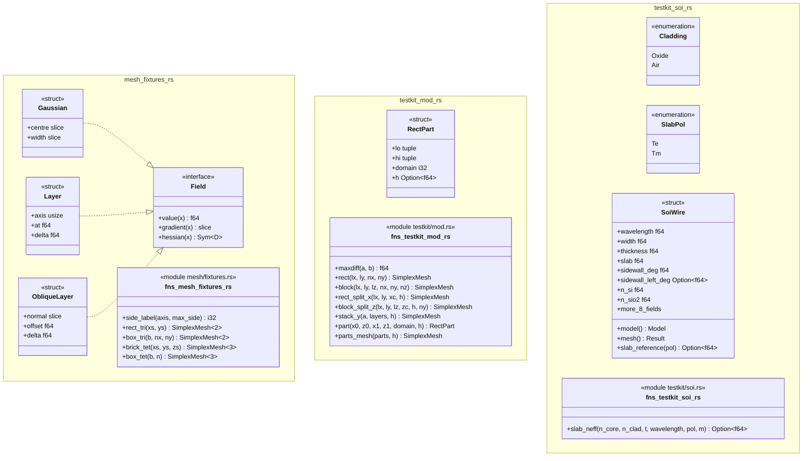

# Fixtures and test kit: code

C4 level 4 (code) of the component **Fixtures and test kit** (`femcore.fixtures`) in the container **femcore** (crate `femcore`). [Component view of the container](../../3-components/femcore.md) · [All code pages](../README.md)

> Test meshes and the SOI wire cross-section used by the tests of every physics crate.

**Decisions:** [ADR 41](../../../adr/0041-physics-crate-pattern-and-the-legacy-bridge.md), [ADR 10](../../../adr/0010-golden-files-are-the-numerical-oracle.md), [ADR 60](../../../adr/0060-examples-are-project-files-and-use-cases-are-gone.md)  
**Size:** 3 files, 582 lines.

## Files

| File | Lines | What it says about itself |
|---|---:|---|
| `crates/femcore/src/mesh/fixtures.rs` | 278 | Test fixtures: structured box meshes, labelled like the output of a CAD mesher, and analytic scalar fields with exact gradients and Hessians. |
| `crates/femcore/src/testkit/mod.rs` | 121 | Shared helpers for the tests of the physics crates and of femcore: small meshes made from geom models with the boundary numbers the tests have always used, and `maxdiff`. Public so that `nyx-dfs`, `nyx-sms` and `nyx-ems` use the same fix... |
| `crates/femcore/src/testkit/soi.rs` | 183 | Test fixture: the cross-section of a silicon wire on 300 nm silicon-on-insulator at 1550 nm (it was the SOI use case of the window until phase 7). |

## What it uses

| Target | Modules | Items |
|---|---|---|
| [container `geom` (geom)](../../3-components/geom.md) | model, select | FeatureId, Model, Selector |
| [Mesh](./mesh.md) | mesh, mesh::cells | SimplexMesh, split_quad |
| [Meshing facade](./meshing.md) | meshing, meshing::geomdrive, meshing::mesher | GeomMeshOpts, Layer, MeshPlan, MeshedGeom, block, evaluate, extrude_y, mesh_evaluated, mesh_geom_2d, plate +1 |
| [Metric fields](./metric.md) | adapt::metric, adapt::work | SimplexMesh, Sym |

## Used by

Nothing else in the workspace names this component (entry points are reached by the program or by tests).

## Class diagram

Public types with their public fields (or variants) and methods, free functions per file as a `module` box; arrows are field types and `impl Trait`. Capped at 36 types and a few members each; the table below is complete.

## Public items

| Kind | Item | File:line | Signature or summary |
|---|---|---|---|
| fn | `side_label` | `mesh/fixtures.rs:8` | `pub fn side_label(axis: usize, max_side: bool) -> i32` —  Label of the boundary facet on the minimum / maximum side of axis `a`: `1 + 2a + side`. |
| fn | `rect_tri` | `mesh/fixtures.rs:16` | `pub fn rect_tri(xs: &[f64], ys: &[f64]) -> SimplexMesh<2>` —  Tensor-product triangulation of the rectangle spanned by the coordinate lists `xs`, `ys` |
| fn | `box_tri` | `mesh/fixtures.rs:45` | `pub fn box_tri(b: [[f64; 2]; 2], nx: usize, ny: usize) -> SimplexMesh<2>` —  Uniform `nx x ny` cells over `[x0, x1] x [y0, y1]`. |
| fn | `brick_tet` | `mesh/fixtures.rs:53` | `pub fn brick_tet(xs: &[f64], ys: &[f64], zs: &[f64]) -> SimplexMesh<3>` —  Tensor-product tetrahedral mesh (Kuhn / Freudenthal split of every brick along its main |
| fn | `box_tet` | `mesh/fixtures.rs:123` | `pub fn box_tet(b: [[f64; 2]; 3], n: [usize; 3]) -> SimplexMesh<3>` —  Uniform `nx x ny x nz` bricks over the box `b`. |
| trait | `Field` | `mesh/fixtures.rs:129` | methods: `value`, `gradient`, `hessian` —  A scalar field with exact derivatives, for metric and interpolation-error tests. |
| struct | `Gaussian` | `mesh/fixtures.rs:136` | fields: `centre`, `width` —  `exp(-sum_a ((x_a - c_a) / w_a)^2)`: anisotropic Gaussian bump. |
| struct | `Layer` | `mesh/fixtures.rs:172` | fields: `axis`, `at`, `delta` —  `tanh((x_axis - at) / delta)`: a boundary or interior layer normal to one axis. |
| struct | `ObliqueLayer` | `mesh/fixtures.rs:197` | fields: `normal`, `offset`, `delta` —  `tanh((n . x - c) / delta)` with unit normal `n`: a layer in an arbitrary direction. |
| fn | `maxdiff` | `testkit/mod.rs:7` | `pub fn maxdiff(a: &[f64], b: &[f64]) -> f64` |
| fn | `rect` | `testkit/mod.rs:24` | `pub fn rect(lx: f64, ly: f64, nx: usize, ny: usize) -> SimplexMesh` —  A rectangle `[0, lx] x [0, ly]` made from a geom model (`geomdrive::plate`) with element size of the finer of `lx / nx` and `ly / ny`. Its mesh |
| fn | `block` | `testkit/mod.rs:33` | `pub fn block(lx: f64, ly: f64, lz: f64, nx: usize, ny: usize, nz: usize) -> SimplexMesh` —  A box `[0, lx] x [0, ly] x [0, lz]`: the x-z rectangle of `geomdrive::block` swept along y through `ny` layers. Boundary numbers: |
| fn | `rect_split_x` | `testkit/mod.rs:47` | `pub fn rect_split_x(lx: f64, ly: f64, xc: f64, h: f64) -> SimplexMesh` —  The rectangle `[0, lx] x [0, ly]` in two domains, 1 for `x < xc` and 2 for `x > xc`, meeting along the line `x = xc` (a model of two |
| fn | `block_split_z` | `testkit/mod.rs:61` | `pub fn block_split_z(lx: f64, ly: f64, lz: f64, zc: f64, h: f64, ny: usize) -> SimplexMesh` —  The box `[0, lx] x [0, ly] x [0, lz]` in two domains, 1 for `z < zc` and 2 for `z > zc`: the x-z section of two stacked rectangles swept |
| fn | `stack_y` | `testkit/mod.rs:77` | `pub fn stack_y(a: f64, layers: &[(f64, usize)], h: f64) -> SimplexMesh` —  A stack along y of `a x a` sections (x-z): layer `k` is `layers[k] = (thickness, number of element layers)` and domain `k + 1`. |
| struct | `RectPart` | `testkit/mod.rs:89` | fields: `lo`, `hi`, `domain`, `h` —  One axis-aligned rectangle of a section: `(x0, z0, x1, z1)`, the domain number it gets, and an element size of its own (else the |
| fn | `part` | `testkit/mod.rs:96` | `pub fn part(x0: f64, z0: f64, x1: f64, z1: f64, domain: i32, h: Option<f64>) -> RectPart` |
| fn | `parts_mesh` | `testkit/mod.rs:102` | `pub fn parts_mesh(parts: &[RectPart], h: f64) -> SimplexMesh` —  The rectangles laid over each other in order (later ones win), as a geom model meshed with element size `h`; the cells carry the |
| enum | `Cladding` | `testkit/soi.rs:25` | variants: `Oxide`, `Air` |
| enum | `SlabPol` | `testkit/soi.rs:34` | variants: `Te`, `Tm` —  Polarization of a slab mode. |
| fn | `slab_neff` | `testkit/soi.rs:43` | `pub fn slab_neff(n_core: f64, n_clad: f64, t: f64, wavelength: f64, pol: SlabPol, m: usize) -> Option<f64>` —  Effective index of mode `m` of a symmetric slab of index `n_core` and thickness `t` in a cladding `n_clad`: |
| struct | `SoiWire` | `testkit/soi.rs:72` | fields: `wavelength`, `width`, `thickness`, `slab`, `sidewall_deg`, `sidewall_left_deg`, `n_si`, `n_sio2`, `cladding`, `margin`, `box_thickness`, `n_modes`, ... —  The geometry, materials and study of the use case. |
| fn | `SoiWire::model` | `testkit/soi.rs:130` | `pub fn model(&self) -> Model` —  The cross-section as a geom model in the wafer frame: x lateral, z the surface normal, the silicon starts at z = 0. Regions are |
| fn | `SoiWire::mesh` | `testkit/soi.rs:173` | `pub fn mesh(&self) -> Result<MeshedGeom, String>` —  The cross-section meshed from the exact model: the mesh, the names of its domains and boundaries, and the evaluation. |
| fn | `SoiWire::slab_reference` | `testkit/soi.rs:179` | `pub fn slab_reference(&self, pol: SlabPol) -> Option<f64>` —  The same silicon thickness as an infinite slab: reference for very wide wires. |

Trait implementations in this component: `Gaussian: Field`, `Layer: Field`, `ObliqueLayer: Field`, `SoiWire: Default`
