# Matrices and vectors: code

C4 level 4 (code) of the component **Matrices and vectors** (`femcore.lacore`) in the container **femcore** (crate `femcore`). [Component view of the container](../../3-components/femcore.md) · [All code pages](../README.md)

> The one matrix type Csr over a generic scalar, block storage, multivector kernels, operator interfaces, dense helpers, Matrix Market, problem bundles and test-problem generators.

**Decisions:** [ADR 33](../../../adr/0033-one-linear-algebra-driver-facade.md), [ADR 8](../../../adr/0008-ported-solver-library-staged-not-wired.md), [ADR 11](../../../adr/0011-determinism-by-fixed-chunks.md)  
**Size:** 17 files, 4131 lines.

## Files

| File | Lines | What it says about itself |
|---|---:|---|
| `crates/femcore/src/linalg/basis.rs` | 368 | Column-major block of `n`-vectors with cache-blocked multi-vector kernels (the role of SLEPc's `BV` and PETSc's `VecMDot`/`VecMAXPY`), generic over the scalar and with *block* (several right-hand sides at once) variants for the block Kry... |
| `crates/femcore/src/linalg/bsr.rs` | 381 | Alternative sparse storage (port items M1 and M1b): |
| `crates/femcore/src/linalg/bundle.rs` | 117 | Problem bundles: a directory that holds everything needed to reproduce a solve elsewhere. |
| `crates/femcore/src/linalg/csr.rs` | 534 | Compressed sparse row matrix over a generic [`Scalar`], plus test-problem generators. |
| `crates/femcore/src/linalg/csr/assembly.rs` | 271 | The one matrix type of the finite-element code: assembly (`Triplets`), the operations the kernels use, and the aliases that keep kernel code readable (`RCsr` real, `CCsr` complex, `Coo`, `CCoo`). Before phase 3 the kernels had a real and... |
| `crates/femcore/src/linalg/dense/mod.rs` | 170 | Small dense linear algebra for the projected (Rayleigh–Ritz / Schur) problems of the Krylov methods, the role of SLEPc's `DS`. |
| `crates/femcore/src/linalg/dense/schur.rs` | 374 | Complex Schur decomposition `A = Z T Zᴴ` by Householder Hessenberg reduction and single-shift QR, plus the adjacent-swap reordering used by Krylov–Schur restarts. |
| `crates/femcore/src/linalg/faer_glue.rs` | 305 | Everything that touches `faer`'s dense API. |
| `crates/femcore/src/linalg/kernels.rs` | 253 | Chunk-level numerical kernels, written once and instantiated for `f64` and `Complex<f64>`. |
| `crates/femcore/src/linalg/linop.rs` | 133 | Operator and preconditioner interfaces. |
| `crates/femcore/src/linalg/maxwell.rs` | 376 | A small **Nédélec (edge element) test-problem generator**: lowest-order `H(curl)` elements on a structured tetrahedral mesh of the unit cube with perfect-electric-conductor walls. |
| `crates/femcore/src/linalg/mm.rs` | 292 | Matrix Market (`.mtx`) reading and writing: the export format of port item V1. |
| `crates/femcore/src/linalg/mod.rs` | 73 | # solvers |
| `crates/femcore/src/linalg/par.rs` | 120 | Deterministic chunk parallelism. |
| `crates/femcore/src/linalg/rng.rs` | 37 | Small deterministic generator for start vectors and tests (SplitMix64). |
| `crates/femcore/src/linalg/scalar.rs` | 158 | The scalar abstraction: every solver in this crate is written once for `f64` and `Complex<f64>`. |
| `crates/femcore/src/linalg/vecops.rs` | 169 | Level-1 operations on vectors of any [`Scalar`], with the fixed-chunk reduction order. |

## What it uses

| Target | Modules | Items |
|---|---|---|
| [Runtime services](./runtime.md) | par | threads |

## Used by

| Component | Modules | Items |
|---|---|---|
| [dfs: Electrostatics kernel](../dfs/electro.md) | linalg::csr::assembly | RCsr |
| [dfs: Heat kernel](../dfs/heat.md) | linalg::csr::assembly | RCsr |
| [ems: Axisymmetric kernel](../ems/axisym.md) | linalg::csr, linalg::csr::assembly | C, CCoo, CCsr, c |
| [ems: 3D cavity kernel](../ems/cavity.md) | linalg::csr, linalg::csr::assembly | C, CCoo, CCsr, Coo, RCsr, c |
| [ems: Mode kernel](../ems/modes.md) | linalg::csr, linalg::csr::assembly | Coo, RCsr |
| [ems: Complex-mode kernel](../ems/modescx.md) | linalg::csr, linalg::csr::assembly | C, CCoo, CCsr, c |
| [ems: Optical mode sets](../ems/optical.md) | linalg::csr::assembly | c |
| [Error estimators](./estimators.md) | linalg::csr::assembly | C |
| [Finite-element basics](./fem.md) | linalg::csr, linalg::csr::assembly | C, CCoo, CCsr, Coo, RCsr, c |
| [Direct solvers](./ladirect.md) | linalg::csr, linalg::faer_glue, linalg::linop, linalg::scalar, linalg::vecops | C64, Csr, FaerScalar, LinearOperator, Preconditioner, Scalar, axpy, clear_upper_vector_state +6 |
| [Linear algebra driver](./ladriver.md) | linalg::basis, linalg::csr, linalg::csr::assembly, linalg::faer_glue, linalg::linop, linalg::scalar +1 | Basis, C64, CCsr, Csr, FaerScalar, LinearOperator, Preconditioner, RCsr +3 |
| [Eigensolvers](./laeigen.md) | linalg::basis, linalg::csr, linalg::csr::assembly, linalg::dense, linalg::faer_glue, linalg::linop +3 | Basis, BasisView, C64, Csr, Dense, DenseError, FaerScalar, Identity +16 |
| [Krylov solvers](./laksp.md) | linalg::basis, linalg::dense, linalg::linop, linalg::rng, linalg::scalar, linalg::vecops | Basis, C64, Dense, LinearOperator, Preconditioner, Scalar, Scaling, axpy +5 |
| [Time, nonlinear, sweeps](./laother.md) | linalg::csr, linalg::dense, linalg::faer_glue, linalg::linop, linalg::par, linalg::scalar +1 | C64, Csr, Dense, FaerScalar, FnOperator, Identity, LinearOperator, Preconditioner +7 |
| [Preconditioners](./laprecond.md) | linalg::csr, linalg::csr::assembly, linalg::faer_glue, linalg::linop, linalg::scalar | C64, Csr, FaerScalar, Preconditioner, RCsr, Scalar |
| [Optical mode sets](./optical.md) | linalg::csr, linalg::csr::assembly | C, c |
| [sms: Axisymmetric kernel](../sms/axisym.md) | linalg::csr, linalg::csr::assembly | C, CCoo, CCsr, c |
| [sms: Axisymmetric study kernel](../sms/crosssection.md) | linalg::csr, linalg::csr::assembly | C, CCsr, RCsr, c |
| [sms: Floquet kernel](../sms/floquet.md) | linalg::csr, linalg::csr::assembly | C, CCsr, RCsr, c |
| [sms: Low-reflecting boundary](../sms/lrb.md) | linalg::csr, linalg::csr::assembly | C, CCoo, CCsr, Coo, RCsr, c |
| [sms: Absorbing-layer kernel](../sms/pml.md) | linalg::csr, linalg::csr::assembly | C, CCoo, CCsr, c |
| [sms: Solid kernel](../sms/solid.md) | linalg::csr, linalg::csr::assembly | C, RCsr, c |

## Class diagram

Public types with their public fields (or variants) and methods, free functions per file as a `module` box; arrows are field types and `impl Trait`. Capped at 36 types and a few members each; the table below is complete.

```mermaid
classDiagram
  namespace linalg_basis_rs {
    class Basis {
        <<struct>>
        +new(n, cap) Self
        +len() usize
        +is_empty() bool
        +capacity() usize
        +col(j) slice
        +col_mut(j) slice
        +cols(a, b) slice
        +cols_mut(a, b) slice
        +more_6_methods()
    }
    class BasisView {
        <<struct>>
        +len() usize
        +is_empty() bool
        +col(j) slice
        +cols(a, b) slice
        +dots_block(k, w, b, h, nrm2)
        +dots(k, w, h)
        +sub_block(k, h, w, b)
        +sub_combination(k, h, w)
        +more_2_methods()
    }
    class fns_linalg_basis_rs {
        <<module linalg/basis.rs>>
        +BCHUNK const
    }
  }
  namespace linalg_bsr_rs {
    class Bsr {
        <<struct>>
        +from_csr(a, b) Result
        +to_csr() Csr~T~
        +block_size() usize
        +nrows() usize
        +ncols() usize
        +nnz_blocks() usize
        +stored_values() usize
        +bytes() usize
        +more_1_methods()
    }
    class SymCsr {
        <<struct>>
        +from_csr(a, hermitian, tol) Result
        +to_csr() Csr~T~
        +dim() usize
        +stored_values() usize
        +bytes() usize
        +spmv(x, y)
    }
  }
  namespace linalg_bundle_rs {
    class Bundle {
        <<struct>>
        +a Csr~T~
        +b Option
        +v0 Option
        +meta BTreeMap
        +new(a, b) Self
        +set(key, value)
        +get_f64(key) Option~f64~
        +write(dir) Result
        +read(dir) Result
    }
    class fns_linalg_bundle_rs {
        <<module linalg/bundle.rs>>
        +read_meta(dir) Result
    }
  }
  namespace linalg_csr_rs {
    class CsrError {
        <<enumeration>>
        BadIndptr
        LengthMismatch
        ColumnOutOfRange
        DimensionTooLarge
    }
    class Csr {
        <<struct>>
        +try_new(nrows, ncols, indptr, indices, values) Result
        +from_triplets(nrows, ncols, triplets) Result
        +identity(n) Self
        +nrows() usize
        +ncols() usize
        +nnz() usize
        +indptr() slice
        +indices() slice
        +more_32_methods()
    }
    class fns_linalg_csr_rs {
        <<module linalg/csr.rs>>
        +laplacian_1d(n) Csr~f64~
        +laplacian_2d(nx, ny) Csr~f64~
        +laplacian_3d(n) Csr~f64~
        +mass_1d(n, h) Csr~f64~
    }
  }
  namespace linalg_csr_assembly_rs {
    class Triplets {
        <<struct>>
        +nrows usize
        +ncols usize
        +rows Vec~u32~
        +cols Vec~u32~
        +vals Vec~T~
        +new(nrows, ncols) Self
        +with_capacity(nrows, ncols, cap) Self
        +push(r, c, v)
        +push_block(rows, cols, local)
        +to_csr() Csr~T~
    }
    class fns_linalg_csr_assembly_rs {
        <<module linalg/csr/assembly.rs>>
        +c(re, im) C64
        +RCsr type
        +CCsr type
        +C type
        +Coo type
        +more_1_items
    }
  }
  namespace linalg_dense_mod_rs {
    class DenseError {
        <<enumeration>>
        NoConvergence
        NonFinite
    }
    class Dense {
        <<struct>>
        +zeros(rows, cols) Self
        +identity(n) Self
        +from_fn(rows, cols, f) Self
        +rows() usize
        +cols() usize
        +as_slice() slice
        +col(j) slice
        +col_mut(j) slice
        +more_4_methods()
    }
    class fns_linalg_dense_mod_rs {
        <<module linalg/dense/mod.rs>>
        +hermitian_eig(a) Result
        +solve_small(a, b) Option
    }
  }
  namespace linalg_dense_schur_rs {
    class Givens {
        <<struct>>
    }
    class fns_linalg_dense_schur_rs {
        <<module linalg/dense/schur.rs>>
        ~givens(a, b) Givens
        +schur(a) Result
        +reorder(t, z, m, key) Vec~usize~
        +triangular_eigenvector(t, m, i) Vec~C64~
    }
  }
  namespace linalg_faer_glue_rs {
    class FaerScalar {
        <<interface>>
        +to_faer() Elem
        +from_faer(x) Self
        +faer_slice(s) slice
        +faer_slice_mut(s) slice
    }
    class f64 {
        <<impl block>>
    }
    class C64 {
        <<impl block>>
    }
    class fns_linalg_faer_glue_rs {
        <<module linalg/faer_glue.rs>>
        ~hermitian_eig(a) Result
        ~tile_mult(src, len, nrows, q, ldq, ncols, out)
        ~clear_upper_vector_state()
        ~clear_upper_vector_state()
        ~thin_svd_c64(data, n, cols) Result
        ~thin_svd_uv_c64(data, n, cols) Result
        +generalized_eig_c64(a, b) Result
        ~dense_lu(a, n) Option
        ~solve_unit_lower(lu, n, b, k)
        ~solve_upper_right(lu, n, b, r)
        +more_1_functions()
        ~SvdUv type
    }
  }
  namespace linalg_kernels_rs {
    class Kernels {
        <<interface>>
        +k_dotc(x, y) Self
        +k_dotu(x, y) Self
        +k_axpy(a, x, y)
        +k_dots_cols(data, n, s, w, out)
        +k_sub_cols(data, n, s, h, w)
        +k_add_cols(data, n, s, c, y)
        +k_tile_mult(src, len, nrows, q, ldq, ncols, out)
    }
  }
  namespace linalg_linop_rs {
    class LinearOperator {
        <<interface>>
        +dim() usize
        +apply(x, y)
        +apply_block(x, y, nrhs)
        +apply_dotc(x, y) T
        +apply_dotu(x, y) T
        +apply_block_with_bx(x, _bx, y, nrhs)
    }
    class Scaling {
        <<enumeration>>
        Identity
        Diagonal
    }
    class Preconditioner {
        <<interface>>
        +apply(r, z)
        +apply_dots(r, z) tuple
        +scaling() Option
    }
    class Identity {
        <<struct>>
    }
    class FnOperator {
        <<struct>>
        +new(n, f) Self
    }
    class O {
        <<impl block>>
    }
  }
  namespace linalg_maxwell_rs {
    class EdgeElementCube {
        <<struct>>
        +stiffness Csr~f64~
        +mass Csr~f64~
        +gradient Csr~f64~
        +coords Vec
        +edge_vectors Vec
        +n usize
    }
    class CubeMesh {
        <<struct>>
        +tets Vec
        +edge_id HashMap
        +edges Vec
        +node_id HashMap
        +coords Vec
    }
    class FaceElementCube {
        <<struct>>
        +div_stiffness Csr~f64~
        +mass Csr~f64~
        +curl Csr~f64~
        +pi slice
        +n usize
    }
    class fns_linalg_maxwell_rs {
        <<module linalg/maxwell.rs>>
        ~cube_coord(n, g) slice
        ~cube_mesh(n) CubeMesh
        +nedelec_cube(n) EdgeElementCube
        +raviart_thomas_cube(n) FaceElementCube
    }
  }
  namespace linalg_mm_rs {
    class MmError {
        <<enumeration>>
        Io
        Parse
        ComplexIntoReal
    }
    class fns_linalg_mm_rs {
        <<module linalg/mm.rs>>
        +write_matrix(w, a) Result
        +write_vectors(w, data, n, ncols) Result
        +read_matrix(r) Result
        +read_vectors(r) Result
        +format_c64_list(v) String
    }
  }
  namespace linalg_par_rs {
    class RawCols {
        <<struct>>
        +new(data, n, ncols) Self
        +rows(c, s, e) slice
        +at(row, c) mutT
    }
    class fns_linalg_par_rs {
        <<module linalg/par.rs>>
        +chunk_map(nchunks, parallel, f) Vec~R~
        +for_chunks_mut(data, chunk, parallel, f)
        +for_each_mut(items, parallel, f)
        +worth_parallel(elems) bool
        +PAR_MIN_ELEMS const
    }
  }
  namespace linalg_rng_rs {
    class SplitMix64 {
        <<struct>>
        +new(seed) Self
        +next_u64() u64
        +next_signed() f64
    }
    class fns_linalg_rng_rs {
        <<module linalg/rng.rs>>
        +random_vector(n, seed) Vec~T~
    }
  }
  namespace linalg_scalar_rs {
    class Scalar {
        <<interface>>
        +from_f64(x) Self
        +from_parts(re, im) Self
        +re() f64
        +im() f64
        +conj() Self
        +modulus() f64
        +modulus_sq() f64
        +scale(r) Self
        +more_3_methods()
    }
    class fns_linalg_scalar_rs {
        <<module linalg/scalar.rs>>
        +C64 type
    }
  }
  namespace linalg_vecops_rs {
    class fns_linalg_vecops_rs {
        <<module linalg/vecops.rs>>
        +dotc(x, y) T
        +dotu(x, y) T
        +norm2_sq(x) f64
        +norm2(x) f64
        +axpy(a, x, y)
        +scale(a, y)
        +scale_real(r, y)
        +aypx(beta, x, y)
        +dot_and_norm_sq(x, y, conjugate) tuple
        +cg_update(alpha, p, x, w, r, z, diag, conjugate) tuple
        +CHUNK const
    }
  }
  Bsr ..|> LinearOperator
  SymCsr ..|> LinearOperator
  Bundle --> Csr
  Csr ..|> LinearOperator
  f64 ..|> FaerScalar
  f64 ..|> Scalar
  C64 ..|> FaerScalar
  C64 ..|> Scalar
  Identity ..|> Preconditioner
  FnOperator ..|> LinearOperator
  O ..|> LinearOperator
  EdgeElementCube --> Csr
  FaceElementCube --> Csr
```

## Public items

| Kind | Item | File:line | Signature or summary |
|---|---|---|---|
| const | `BCHUNK` | `linalg/basis.rs:13` | `usize` —  Rows per block in the multi-vector kernels (also the reduction chunk). |
| struct | `Basis` | `linalg/basis.rs:19` |  `cap` columns of length `n`, stored contiguously column after column. |
| struct | `BasisView` | `linalg/basis.rs:140` |  Borrowed leading columns of a [`Basis`] with the read-only multi-vector kernels. |
| fn | `Basis::new` | `linalg/basis.rs:26` | `pub fn new(n: usize, cap: usize) -> Self` |
| fn | `Basis::len` | `linalg/basis.rs:31` | `pub fn len(&self) -> usize` —  Vector length. |
| fn | `Basis::is_empty` | `linalg/basis.rs:34` | `pub fn is_empty(&self) -> bool` |
| fn | `Basis::capacity` | `linalg/basis.rs:38` | `pub fn capacity(&self) -> usize` —  Number of columns allocated. |
| fn | `Basis::col` | `linalg/basis.rs:43` | `pub fn col(&self, j: usize) -> &[T]` |
| fn | `Basis::col_mut` | `linalg/basis.rs:47` | `pub fn col_mut(&mut self, j: usize) -> &mut [T]` |
| fn | `Basis::cols` | `linalg/basis.rs:52` | `pub fn cols(&self, a: usize, b: usize) -> &[T]` —  Columns `a..b` as one contiguous column-major slice. |
| fn | `Basis::cols_mut` | `linalg/basis.rs:56` | `pub fn cols_mut(&mut self, a: usize, b: usize) -> &mut [T]` |
| fn | `Basis::view` | `linalg/basis.rs:60` | `pub fn view(&self) -> BasisView<'_, T>` |
| fn | `Basis::split_cols_mut` | `linalg/basis.rs:66` | `pub fn split_cols_mut(&mut self, j: usize) -> (BasisView<'_, T>, &mut [T])` —  Columns `0..j` read-only, plus all columns from `j` on as one mutable column-major slice |
| fn | `Basis::col_pair_mut` | `linalg/basis.rs:73` | `pub fn col_pair_mut(&mut self, a: usize, b: usize) -> (&[T], &mut [T])` —  Column `a` shared and column `b` mutable (`a != b`). |
| fn | `Basis::copy_col` | `linalg/basis.rs:86` | `pub fn copy_col(&mut self, from: usize, to: usize)` —  Copies column `from` over column `to`. |
| fn | `Basis::move_cols` | `linalg/basis.rs:94` | `pub fn move_cols(&mut self, from: usize, to: usize, count: usize)` —  Moves columns `from..from+count` to `to..to+count` (ranges may overlap). |
| fn | `Basis::mult_in_place` | `linalg/basis.rs:102` | `pub fn mult_in_place(&mut self, first: usize, nrows_q: usize, ncols_q: usize, q: &[T], ldq: usize)` —  `V[:, first..first+ncols_q] ← V[:, first..first+nrows_q] · Q` for a column-major `Q` |
| fn | `BasisView::len` | `linalg/basis.rs:147` | `pub fn len(&self) -> usize` —  Vector length. |
| fn | `BasisView::is_empty` | `linalg/basis.rs:150` | `pub fn is_empty(&self) -> bool` |
| fn | `BasisView::col` | `linalg/basis.rs:154` | `pub fn col(&self, j: usize) -> &[T]` |
| fn | `BasisView::cols` | `linalg/basis.rs:159` | `pub fn cols(&self, a: usize, b: usize) -> &[T]` —  Columns `a..b` as one contiguous column-major slice. |
| fn | `BasisView::dots_block` | `linalg/basis.rs:166` | `pub fn dots_block(&self, k: usize, w: &[T], b: usize, h: &mut [T], mut nrm2: Option<&mut [f64]>)` —  `h[j + c·k] = V[:, j]ᴴ w[:, c]` for `j < k`, `c < b` (`VecMDot`, block form), where `w` |
| fn | `BasisView::dots` | `linalg/basis.rs:201` | `pub fn dots(&self, k: usize, w: &[T], h: &mut [T])` —  Single-vector form of [`dots_block`] (Self::dots_block). |
| fn | `BasisView::sub_block` | `linalg/basis.rs:206` | `pub fn sub_block(&self, k: usize, h: &[T], w: &mut [T], b: usize)` —  `w[:, c] ← w[:, c] − V[:, :k]·h[:, c]` for `c < b` (`VecMAXPY`, block form). |
| fn | `BasisView::sub_combination` | `linalg/basis.rs:222` | `pub fn sub_combination(&self, k: usize, h: &[T], w: &mut [T])` —  Single-vector form of [`sub_block`] (Self::sub_block). |
| fn | `BasisView::sub_block_then_dots` | `linalg/basis.rs:233` | `pub fn sub_block_then_dots(&self, k: usize, h: &[T], w: &mut [T], b: usize, h2: &mut [T], nrm2: &mut [f64])` —  Fused second Gram–Schmidt pass: `w ← w − V h`, then (per row block, while the block of |
| fn | `BasisView::add_combination` | `linalg/basis.rs:266` | `pub fn add_combination(&self, k: usize, c: &[T], y: &mut [T])` —  `y ← y + V[:, :k]·c`. |
| struct | `Bsr` | `linalg/bsr.rs:21` |  |
| struct | `SymCsr` | `linalg/bsr.rs:183` |  Upper triangle (with the diagonal) of a symmetric (`Aᵀ = A`) or Hermitian (`Aᴴ = A`) matrix. |
| fn | `Bsr::from_csr` | `linalg/bsr.rs:34` | `pub fn from_csr(a: &Csr<T>, b: usize) -> Result<Self, CsrError>` —  Builds block CSR from CSR; dimensions must be multiples of `b`. Every block with at least one |
| fn | `Bsr::to_csr` | `linalg/bsr.rs:76` | `pub fn to_csr(&self) -> Csr<T>` —  Back to CSR, dropping exact zeros. |
| fn | `Bsr::block_size` | `linalg/bsr.rs:95` | `pub fn block_size(&self) -> usize` |
| fn | `Bsr::nrows` | `linalg/bsr.rs:98` | `pub fn nrows(&self) -> usize` |
| fn | `Bsr::ncols` | `linalg/bsr.rs:101` | `pub fn ncols(&self) -> usize` |
| fn | `Bsr::nnz_blocks` | `linalg/bsr.rs:104` | `pub fn nnz_blocks(&self) -> usize` |
| fn | `Bsr::stored_values` | `linalg/bsr.rs:108` | `pub fn stored_values(&self) -> usize` —  Stored scalars (including explicit zeros inside blocks). |
| fn | `Bsr::bytes` | `linalg/bsr.rs:112` | `pub fn bytes(&self) -> usize` —  Bytes of values + indices. |
| fn | `Bsr::spmv` | `linalg/bsr.rs:157` | `pub fn spmv(&self, x: &[T], y: &mut [T])` —  `y ← A x`. |
| fn | `SymCsr::from_csr` | `linalg/bsr.rs:195` | `pub fn from_csr(a: &Csr<T>, hermitian: bool, tol: f64) -> Result<Self, CsrError>` —  Keeps the entries with `col ≥ row`. `tol` is the relative asymmetry allowed (checked with |
| fn | `SymCsr::to_csr` | `linalg/bsr.rs:218` | `pub fn to_csr(&self) -> Csr<T>` |
| fn | `SymCsr::dim` | `linalg/bsr.rs:233` | `pub fn dim(&self) -> usize` |
| fn | `SymCsr::stored_values` | `linalg/bsr.rs:236` | `pub fn stored_values(&self) -> usize` |
| fn | `SymCsr::bytes` | `linalg/bsr.rs:239` | `pub fn bytes(&self) -> usize` |
| fn | `SymCsr::spmv` | `linalg/bsr.rs:246` | `pub fn spmv(&self, x: &[T], y: &mut [T])` —  `y ← A x` (sequential; each stored off-diagonal entry contributes to two rows). |
| struct | `Bundle` | `linalg/bundle.rs:23` | fields: `a`, `b`, `v0`, `meta` |
| fn | `read_meta` | `linalg/bundle.rs:83` | `pub fn read_meta(dir: &Path) -> Result<BTreeMap<String, String>, MmError>` —  Reads `meta.txt` alone (to learn the scalar type before reading the matrices). |
| fn | `Bundle::new` | `linalg/bundle.rs:31` | `pub fn new(a: Csr<T>, b: Option<Csr<T>>) -> Self` |
| fn | `Bundle::set` | `linalg/bundle.rs:43` | `pub fn set(&mut self, key: &str, value: impl ToString)` |
| fn | `Bundle::get_f64` | `linalg/bundle.rs:47` | `pub fn get_f64(&self, key: &str) -> Option<f64>` |
| fn | `Bundle::write` | `linalg/bundle.rs:51` | `pub fn write(&self, dir: &Path) -> Result<(), MmError>` |
| fn | `Bundle::read` | `linalg/bundle.rs:68` | `pub fn read(dir: &Path) -> Result<Self, MmError>` |
| enum | `CsrError` | `linalg/csr.rs:17` | variants: `BadIndptr`, `LengthMismatch`, `ColumnOutOfRange`, `DimensionTooLarge` |
| struct | `Csr` | `linalg/csr.rs:43` |  CSR matrix with `u32` column indices. |
| fn | `laplacian_1d` | `linalg/csr.rs:390` | `pub fn laplacian_1d(n: usize) -> Csr<f64>` —  1-D Laplacian `tridiag(-1, 2, -1)` of order `n`. |
| fn | `laplacian_2d` | `linalg/csr.rs:405` | `pub fn laplacian_2d(nx: usize, ny: usize) -> Csr<f64>` —  2-D 5-point Laplacian on an `nx × ny` grid (Dirichlet, natural ordering `i + nx·j`). |
| fn | `laplacian_3d` | `linalg/csr.rs:430` | `pub fn laplacian_3d(n: usize) -> Csr<f64>` —  3-D 7-point Laplacian on an `n³` grid. |
| fn | `mass_1d` | `linalg/csr.rs:464` | `pub fn mass_1d(n: usize, h: f64) -> Csr<f64>` —  Lumped-style SPD "mass" matrix `diag(2/3·h)` blended with off-diagonals `h/6` (1-D linear |
| fn | `Csr::try_new` | `linalg/csr.rs:52` | `pub fn try_new( nrows: usize, ncols: usize, indptr: Vec<usize>, indices: Vec<u32>, values: Vec<T>, ) -> Result<Self, CsrError>` |
| fn | `Csr::from_triplets` | `linalg/csr.rs:86` | `pub fn from_triplets(nrows: usize, ncols: usize, triplets: &[(usize, usize, T)]) -> Result<Self, CsrError>` —  Builds from `(row, col, value)` triplets; duplicates are summed, columns sorted. |
| fn | `Csr::identity` | `linalg/csr.rs:128` | `pub fn identity(n: usize) -> Self` |
| fn | `Csr::nrows` | `linalg/csr.rs:132` | `pub fn nrows(&self) -> usize` |
| fn | `Csr::ncols` | `linalg/csr.rs:135` | `pub fn ncols(&self) -> usize` |
| fn | `Csr::nnz` | `linalg/csr.rs:138` | `pub fn nnz(&self) -> usize` |
| fn | `Csr::indptr` | `linalg/csr.rs:141` | `pub fn indptr(&self) -> &[usize]` |
| fn | `Csr::indices` | `linalg/csr.rs:144` | `pub fn indices(&self) -> &[u32]` |
| fn | `Csr::values` | `linalg/csr.rs:147` | `pub fn values(&self) -> &[T]` |
| fn | `Csr::row` | `linalg/csr.rs:152` | `pub fn row(&self, i: usize) -> (&[u32], &[T])` —  `(columns, values)` of one row. |
| fn | `Csr::has_sorted_unique_rows` | `linalg/csr.rs:158` | `pub fn has_sorted_unique_rows(&self) -> bool` —  Columns are strictly increasing within every row. |
| fn | `Csr::diagonal` | `linalg/csr.rs:163` | `pub fn diagonal(&self) -> Vec<T>` —  Diagonal entries (zero where structurally absent). |
| fn | `Csr::transpose` | `linalg/csr.rs:173` | `pub fn transpose(&self) -> Csr<T>` —  Plain transpose `Aᵀ` (no conjugation). |
| fn | `Csr::is_symmetric` | `linalg/csr.rs:197` | `pub fn is_symmetric(&self, tol: f64) -> bool` —  `A = Aᵀ` (complex symmetric for complex scalars) up to `tol·max\|a\|`, pattern included. |
| fn | `Csr::is_hermitian` | `linalg/csr.rs:202` | `pub fn is_hermitian(&self, tol: f64) -> bool` —  `A = Aᴴ` up to `tol·max\|a\|`. |
| fn | `Csr::to_dense` | `linalg/csr.rs:219` | `pub fn to_dense(&self) -> Vec<T>` —  Dense row-major copy (tests and tiny problems only). |
| fn | `Csr::axpby` | `linalg/csr.rs:231` | `pub fn axpby(alpha: T, a: &Csr<T>, beta: T, b: &Csr<T>) -> Csr<T>` —  `α·A + β·B` on the union of the two patterns. |
| fn | `Csr::matmul` | `linalg/csr.rs:262` | `pub fn matmul(&self, other: &Csr<T>) -> Csr<T>` —  Sparse matrix product `self · other` (Gustavson's row-by-row algorithm); the result has |
| fn | `Csr::map` | `linalg/csr.rs:297` | `pub fn map<U: Scalar>(&self, f: impl Fn(T) -> U) -> Csr<U>` —  Entry-wise map to another scalar type (e.g. widening a real matrix to complex). |
| fn | `Csr::to_complex` | `linalg/csr.rs:307` | `pub fn to_complex(&self) -> Csr<C64>` |
| fn | `Csr::spmv` | `linalg/csr.rs:332` | `pub fn spmv(&self, x: &[T], y: &mut [T])` —  `y ← A x`. |
| fn | `Csr::spmv_acc` | `linalg/csr.rs:340` | `pub fn spmv_acc(&self, x: &[T], y: &mut [T])` —  `y ← y + A x`. |
| fn | `Csr::spmv_dotc` | `linalg/csr.rs:355` | `pub fn spmv_dotc(&self, x: &[T], y: &mut [T]) -> T` —  `y ← A x`, returning `xᴴ y` (square matrices) with the reduction fused into the product |
| type | `RCsr` | `linalg/csr/assembly.rs:8` |  Real matrix. |
| type | `CCsr` | `linalg/csr/assembly.rs:10` |  Complex matrix. |
| type | `C` | `linalg/csr/assembly.rs:12` |  Complex number as the kernels write it. |
| fn | `c` | `linalg/csr/assembly.rs:15` | `pub fn c(re: f64, im: f64) -> C64` —  `re + i im`. |
| struct | `Triplets` | `linalg/csr/assembly.rs:21` | fields: `nrows`, `ncols`, `rows`, `cols`, `vals` —  Coordinate-format builder; duplicate entries are summed when converted ([`Triplets::to_csr`]). |
| type | `Coo` | `linalg/csr/assembly.rs:29` |  |
| type | `CCoo` | `linalg/csr/assembly.rs:30` |  |
| fn | `Triplets::new` | `linalg/csr/assembly.rs:33` | `pub fn new(nrows: usize, ncols: usize) -> Self` |
| fn | `Triplets::with_capacity` | `linalg/csr/assembly.rs:36` | `pub fn with_capacity(nrows: usize, ncols: usize, cap: usize) -> Self` |
| fn | `Triplets::push` | `linalg/csr/assembly.rs:40` | `pub fn push(&mut self, r: usize, c: usize, v: T)` |
| fn | `Triplets::push_block` | `linalg/csr/assembly.rs:47` | `pub fn push_block(&mut self, rows: &[usize], cols: &[usize], local: &[T])` —  Adds the dense block `local[a*cols.len() + b]` at `(rows[a], cols[b])`; exact zeros are skipped. |
| fn | `Triplets::to_csr` | `linalg/csr/assembly.rs:59` | `pub fn to_csr(&self) -> Csr<T>` —  Counting sort by row, then each row sorted by column with duplicates summed. |
| fn | `Csr::zeros` | `linalg/csr/assembly.rs:105` | `pub fn zeros(nrows: usize, ncols: usize) -> Self` |
| fn | `Csr::from_diag` | `linalg/csr/assembly.rs:108` | `pub fn from_diag(d: &[T]) -> Self` |
| fn | `Csr::from_raw` | `linalg/csr/assembly.rs:113` | `pub fn from_raw(nrows: usize, ncols: usize, indptr: Vec<usize>, indices: Vec<usize>, values: Vec<T>) -> Self` —  From `usize` column indices (rows sorted by the caller); panics on an inconsistent matrix, which is a bug of the caller. |
| fn | `Csr::row_range` | `linalg/csr/assembly.rs:117` | `pub fn row_range(&self, r: usize) -> std::ops::Range<usize>` |
| fn | `Csr::get` | `linalg/csr/assembly.rs:121` | `pub fn get(&self, r: usize, c: usize) -> T` —  Entry `(r, c)` (zero where not stored); rows must be sorted. |
| fn | `Csr::matvec` | `linalg/csr/assembly.rs:129` | `pub fn matvec(&self, x: &[T]) -> Vec<T>` —  `A x` as a new vector. |
| fn | `Csr::matvec_into` | `linalg/csr/assembly.rs:134` | `pub fn matvec_into(&self, x: &[T], y: &mut [T])` |
| fn | `Csr::add_scaled` | `linalg/csr/assembly.rs:138` | `pub fn add_scaled(&self, other: &Csr<T>, alpha: T) -> Csr<T>` —  `self + alpha * other` (same shape). |
| fn | `Csr::scaled` | `linalg/csr/assembly.rs:141` | `pub fn scaled(&self, a: T) -> Csr<T>` |
| fn | `Csr::values_mut` | `linalg/csr/assembly.rs:147` | `pub fn values_mut(&mut self) -> &mut [T]` —  The stored values, mutable (same pattern): the row and column scaling of a generalised problem. |
| fn | `Csr::submatrix` | `linalg/csr/assembly.rs:151` | `pub fn submatrix(&self, rows: &[usize], cols: &[usize]) -> Csr<T>` —  Rows `rows` and columns `cols` (index lists in the given order); entries whose column is not in `cols` are dropped. |
| fn | `Csr::block_diag` | `linalg/csr/assembly.rs:178` | `pub fn block_diag(blocks: &[&Csr<T>]) -> Csr<T>` |
| fn | `Csr::sum_all` | `linalg/csr/assembly.rs:199` | `pub fn sum_all(mut parts: Vec<Csr<T>>) -> Csr<T>` —  Sum of matrices of one shape. Blocks of rows are merged on all cores; a row of the sum is a small merge of at most `parts.len()` |
| fn | `Csr::symmetrized` | `linalg/csr/assembly.rs:252` | `pub fn symmetrized(&self) -> Csr<T>` —  Symmetrised copy `(A + A^T)/2`. |
| fn | `Csr::conj` | `linalg/csr/assembly.rs:256` | `pub fn conj(&self) -> Csr<T>` —  Entrywise conjugate (identity for real matrices). |
| fn | `Csr::real_part` | `linalg/csr/assembly.rs:263` | `pub fn real_part(&self) -> Csr<f64>` —  The real part of every entry (same pattern). |
| fn | `Csr::is_real` | `linalg/csr/assembly.rs:267` | `pub fn is_real(&self) -> bool` —  All imaginary parts are exactly zero. |
| enum | `DenseError` | `linalg/dense/mod.rs:18` | variants: `NoConvergence`, `NonFinite` |
| struct | `Dense` | `linalg/dense/mod.rs:37` |  Column-major dense matrix with leading dimension equal to the row count. |
| fn | `hermitian_eig` | `linalg/dense/mod.rs:125` | `pub fn hermitian_eig<T: FaerScalar>(a: &Dense<T>) -> Result<(Vec<f64>, Dense<T>), DenseError>` —  Eigendecomposition `A = U diag(w) Uᴴ` of a Hermitian matrix (only the lower triangle is |
| fn | `solve_small` | `linalg/dense/mod.rs:132` | `pub fn solve_small(a: &Dense<crate::linalg::scalar::C64>, b: &[crate::linalg::scalar::C64]) -> Option<Vec<crate::linalg::scalar::C64>>` —  Solves the small dense complex system `A x = b` by Gaussian elimination with partial pivoting |
| fn | `Dense::zeros` | `linalg/dense/mod.rs:44` | `pub fn zeros(rows: usize, cols: usize) -> Self` |
| fn | `Dense::identity` | `linalg/dense/mod.rs:47` | `pub fn identity(n: usize) -> Self` |
| fn | `Dense::from_fn` | `linalg/dense/mod.rs:54` | `pub fn from_fn(rows: usize, cols: usize, mut f: impl FnMut(usize, usize) -> T) -> Self` |
| fn | `Dense::rows` | `linalg/dense/mod.rs:63` | `pub fn rows(&self) -> usize` |
| fn | `Dense::cols` | `linalg/dense/mod.rs:66` | `pub fn cols(&self) -> usize` |
| fn | `Dense::as_slice` | `linalg/dense/mod.rs:69` | `pub fn as_slice(&self) -> &[T]` |
| fn | `Dense::col` | `linalg/dense/mod.rs:72` | `pub fn col(&self, j: usize) -> &[T]` |
| fn | `Dense::col_mut` | `linalg/dense/mod.rs:75` | `pub fn col_mut(&mut self, j: usize) -> &mut [T]` |
| fn | `Dense::is_finite` | `linalg/dense/mod.rs:78` | `pub fn is_finite(&self) -> bool` |
| fn | `Dense::frobenius` | `linalg/dense/mod.rs:81` | `pub fn frobenius(&self) -> f64` |
| fn | `Dense::adjoint` | `linalg/dense/mod.rs:84` | `pub fn adjoint(&self) -> Self` |
| fn | `Dense::matmul` | `linalg/dense/mod.rs:88` | `pub fn matmul(&self, rhs: &Dense<T>) -> Dense<T>` —  Matrix product `self · rhs`. |
| struct | `Givens` | `linalg/dense/schur.rs:12` |  |
| fn | `givens` | `linalg/dense/schur.rs:18` | `pub(crate) fn givens(a: C64, b: C64) -> Givens` —  Rotation `G = [c s; −s̄ c]` with `G·[a; b] = [r; 0]`. |
| fn | `schur` | `linalg/dense/schur.rs:98` | `pub fn schur(a: &Dense<C64>) -> Result<(Dense<C64>, Dense<C64>), DenseError>` —  Schur decomposition `A = Z T Zᴴ` with `T` upper triangular and `Z` unitary. |
| fn | `reorder` | `linalg/dense/schur.rs:182` | `pub fn reorder(t: &mut Dense<C64>, z: &mut Dense<C64>, m: usize, key: impl Fn(C64) -> f64) -> Vec<usize>` —  Reorders the Schur form so the diagonal follows `key` (ascending: smaller key first). |
| fn | `triangular_eigenvector` | `linalg/dense/schur.rs:202` | `pub fn triangular_eigenvector(t: &Dense<C64>, m: usize, i: usize) -> Vec<C64>` —  Eigenvector `y` (length `m`, `y[i] = 1`, zero below `i`) of the upper triangular `t` for the |
| trait | `FaerScalar` | `linalg/faer_glue.rs:14` | methods: `to_faer`, `from_faer`, `faer_slice`, `faer_slice_mut` —  Scalars that `faer` can handle, with the conversions to its element type (identical |
| fn | `hermitian_eig` | `linalg/faer_glue.rs:63` | `pub(crate) fn hermitian_eig<T: FaerScalar>(a: &Dense<T>) -> Result<(Vec<f64>, Dense<T>), DenseError>` |
| fn | `tile_mult` | `linalg/faer_glue.rs:87` | `pub(crate) fn tile_mult<T: FaerScalar>( src: &[T], len: usize, nrows: usize, q: &[T], ldq: usize, ncols: usize, out: &mut [T], )` —  `out = src · q` on one row tile with `faer`'s matrix product, sequential (one tile is one |
| fn | `clear_upper_vector_state` | `linalg/faer_glue.rs:112` | `pub(crate) fn clear_upper_vector_state()` —  Executes `vzeroupper` where available. On the benchmark VM (Cascade Lake class), one small |
| fn | `clear_upper_vector_state` | `linalg/faer_glue.rs:125` | `pub(crate) fn clear_upper_vector_state()` |
| fn | `thin_svd_c64` | `linalg/faer_glue.rs:129` | `pub(crate) fn thin_svd_c64(data: &[C64], n: usize, cols: usize) -> Result<(Vec<f64>, Vec<C64>), DenseError>` —  Thin SVD of the `n × cols` complex matrix `data` (column-major, `n ≥ cols`): singular values in |
| type | `SvdUv` | `linalg/faer_glue.rs:150` |  `(singular values, U, V)` of [`thin_svd_uv_c64`], matrices column-major. |
| fn | `thin_svd_uv_c64` | `linalg/faer_glue.rs:154` | `pub(crate) fn thin_svd_uv_c64(data: &[C64], n: usize, cols: usize) -> Result<SvdUv, DenseError>` —  Thin SVD like [`thin_svd_c64`] but also returning the right singular vectors `V` |
| fn | `generalized_eig_c64` | `linalg/faer_glue.rs:180` | `pub fn generalized_eig_c64(a: &Dense<C64>, b: &Dense<C64>) -> Result<(Vec<C64>, Dense<C64>), DenseError>` —  Generalised eigendecomposition `A x = λ B x` of small dense complex matrices. Eigenvalues with |
| fn | `dense_lu` | `linalg/faer_glue.rs:219` | `pub(crate) fn dense_lu<T: FaerScalar>(a: &mut [T], n: usize) -> Option<Vec<usize>>` —  In-place LU with partial pivoting of the `n × n` column-major matrix `a` (unit lower `L` below the diagonal, `U` |
| fn | `solve_unit_lower` | `linalg/faer_glue.rs:240` | `pub(crate) fn solve_unit_lower<T: FaerScalar>(lu: &[T], n: usize, b: &mut [T], k: usize)` —  `B ← L⁻¹ B` with the unit lower triangle of the packed `n × n` matrix `lu`; `B` is `n × k` column-major. |
| fn | `solve_upper_right` | `linalg/faer_glue.rs:251` | `pub(crate) fn solve_upper_right<T: FaerScalar>(lu: &[T], n: usize, b: &mut [T], r: usize)` —  `B ← B U⁻¹` with the upper triangle of the packed `n × n` matrix `lu`; `B` is `r × n` column-major. |
| fn | `gemm_sub` | `linalg/faer_glue.rs:267` | `pub(crate) fn gemm_sub<T: FaerScalar>(c: &mut [T], a: &[T], b: &[T], m: usize, n: usize, k: usize)` —  `C -= A B` for column-major `A: m × k`, `B: k × n`, `C: m × n` (all contiguous). |
| trait | `Kernels` | `linalg/kernels.rs:18` | methods: `k_dotc`, `k_dotu`, `k_axpy`, `k_dots_cols`, `k_sub_cols`, `k_add_cols`, `k_tile_mult` —  The hot loops, overridable per scalar type. |
| trait | `LinearOperator` | `linalg/linop.rs:17` | methods: `dim`, `apply`, `apply_block`, `apply_dotc`, `apply_dotu`, `apply_block_with_bx` —  A square linear operator `y = A x`. |
| enum | `Scaling` | `linalg/linop.rs:76` | variants: `Identity`, `Diagonal` —  How a preconditioner acts element-wise, so solvers can fuse it into their vector updates. |
| trait | `Preconditioner` | `linalg/linop.rs:84` | methods: `apply`, `apply_dots`, `scaling` —  A preconditioner application `z ← M⁻¹ r`. |
| struct | `Identity` | `linalg/linop.rs:102` |  `M = I`. |
| struct | `FnOperator` | `linalg/linop.rs:114` |  Wraps a closure `(x, y)` as a [`LinearOperator`] (the analogue of PETSc `MatShell`). |
| fn | `FnOperator::new` | `linalg/linop.rs:120` | `pub fn new(n: usize, f: F) -> Self` |
| struct | `EdgeElementCube` | `linalg/maxwell.rs:25` | fields: `stiffness`, `mass`, `gradient`, `coords`, `edge_vectors`, `n` —  Matrices and geometry of the cube problem (all dimensions are the *interior* dof counts). |
| struct | `CubeMesh` | `linalg/maxwell.rs:61` | fields: `tets`, `edge_id`, `edges`, `node_id`, `coords` —  Conforming Kuhn tetrahedral mesh of the unit cube with the numbering shared by the edge-element and the |
| fn | `cube_coord` | `linalg/maxwell.rs:73` | `pub(crate) fn cube_coord(n: usize, g: usize) -> [f64` |
| fn | `cube_mesh` | `linalg/maxwell.rs:78` | `pub(crate) fn cube_mesh(n: usize) -> CubeMesh` |
| fn | `nedelec_cube` | `linalg/maxwell.rs:152` | `pub fn nedelec_cube(n: usize) -> EdgeElementCube` —  Generates the cube problem with `n ≥ 2` cells per side. |
| struct | `FaceElementCube` | `linalg/maxwell.rs:207` | fields: `div_stiffness`, `mass`, `curl`, `pi`, `n` —  Matrices of the lowest-order **Raviart–Thomas** (`H(div)`, face element) space on the same mesh, with the |
| fn | `raviart_thomas_cube` | `linalg/maxwell.rs:222` | `pub fn raviart_thomas_cube(n: usize) -> FaceElementCube` —  Generates the Raviart–Thomas test problem on the `n × n × n` Kuhn mesh (`n ≥ 2`). |
| enum | `MmError` | `linalg/mm.rs:18` | variants: `Io`, `Parse`, `ComplexIntoReal` |
| fn | `write_matrix` | `linalg/mm.rs:52` | `pub fn write_matrix<T: Scalar, W: Write>(mut w: W, a: &Csr<T>) -> Result<(), MmError>` —  Writes `a` in coordinate format, exploiting symmetry/Hermitian structure when exact. |
| fn | `write_vectors` | `linalg/mm.rs:83` | `pub fn write_vectors<T: Scalar, W: Write>(mut w: W, data: &[T], n: usize, ncols: usize) -> Result<(), MmError>` —  Writes column vectors (`n × ncols`, column-major) in dense array format. |
| fn | `read_matrix` | `linalg/mm.rs:139` | `pub fn read_matrix<T: Scalar, R: BufRead>(mut r: R) -> Result<Csr<T>, MmError>` —  Reads a coordinate-format matrix, expanding symmetric/skew/Hermitian storage. |
| fn | `read_vectors` | `linalg/mm.rs:180` | `pub fn read_vectors<T: Scalar, R: BufRead>(mut r: R) -> Result<(Vec<T>, usize, usize), MmError>` —  Reads dense `array` data; returns `(column-major values, rows, cols)`. |
| fn | `format_c64_list` | `linalg/mm.rs:208` | `pub fn format_c64_list(v: &[C64]) -> String` —  Convenience: complex eigenvalue lists as `re im` text lines (used by the bundle's |
| const | `PAR_MIN_ELEMS` | `linalg/par.rs:15` | `usize` —  Minimum number of scalar elements touched by one kernel call before it is run in parallel. |
| fn | `chunk_map` | `linalg/par.rs:24` | `pub fn chunk_map<R, F>(nchunks: usize, parallel: bool, f: F) -> Vec<R>` —  `f(0), f(1), …, f(nchunks-1)` collected in order, computed in parallel when `parallel`. |
| fn | `for_chunks_mut` | `linalg/par.rs:38` | `pub fn for_chunks_mut<T, F>(data: &mut [T], chunk: usize, parallel: bool, f: F)` —  Applies `f(chunk_index, chunk)` to consecutive `chunk`-sized pieces of `data`. |
| fn | `for_each_mut` | `linalg/par.rs:56` | `pub fn for_each_mut<X, F>(items: &mut [X], parallel: bool, f: F)` —  Applies `f` to every item, in parallel when `parallel`. The items are independent (typically disjoint |
| fn | `worth_parallel` | `linalg/par.rs:72` | `pub fn worth_parallel(elems: usize) -> bool` —  Whether a kernel touching `elems` scalars should run in parallel (never with `NYX_THREADS=1`). |
| struct | `RawCols` | `linalg/par.rs:82` |  Shared mutable access to disjoint row ranges of a column-major block (`ncols` columns of |
| fn | `RawCols::new` | `linalg/par.rs:94` | `pub fn new(data: &mut [T], n: usize, ncols: usize) -> Self` |
| fn | `RawCols::rows` | `linalg/par.rs:106` | `pub unsafe fn rows(&self, c: usize, s: usize, e: usize) -> &mut [T]` —  Mutable rows `s..e` of column `c`. |
| fn | `RawCols::at` | `linalg/par.rs:114` | `pub fn at(&self, row: usize, c: usize) -> *mut T` —  Raw pointer to element `(row, col)`, for gather/scatter copies. |
| struct | `SplitMix64` | `linalg/rng.rs:6` |  |
| fn | `random_vector` | `linalg/rng.rs:27` | `pub fn random_vector<T: Scalar>(n: usize, seed: u64) -> Vec<T>` —  Deterministic pseudo-random vector with entries in `[-1,1)` (real and imaginary parts for |
| fn | `SplitMix64::new` | `linalg/rng.rs:9` | `pub fn new(seed: u64) -> Self` |
| fn | `SplitMix64::next_u64` | `linalg/rng.rs:12` | `pub fn next_u64(&mut self) -> u64` |
| fn | `SplitMix64::next_signed` | `linalg/rng.rs:20` | `pub fn next_signed(&mut self) -> f64` —  Uniform in `[-1, 1)`. |
| type | `C64` | `linalg/scalar.rs:14` |  Complex double, the same type as `faer::c64`. |
| trait | `Scalar` | `linalg/scalar.rs:23` | methods: `from_f64`, `from_parts`, `re`, `im`, `conj`, `modulus`, `modulus_sq`, `scale`, `is_finite`, `sqrt_principal`, `to_c64` —  A real or complex double-precision number. |
| const | `CHUNK` | `linalg/vecops.rs:8` | `usize` —  Rows per reduction chunk. Part of the numerical contract: changing it changes the last bits |
| fn | `dotc` | `linalg/vecops.rs:11` | `pub fn dotc<T: Scalar>(x: &[T], y: &[T]) -> T` —  `Σ conj(xᵢ)·yᵢ`. |
| fn | `dotu` | `linalg/vecops.rs:22` | `pub fn dotu<T: Scalar>(x: &[T], y: &[T]) -> T` —  `Σ xᵢ·yᵢ` without conjugation. |
| fn | `norm2_sq` | `linalg/vecops.rs:33` | `pub fn norm2_sq<T: Scalar>(x: &[T]) -> f64` —  Squared 2-norm `Σ \|xᵢ\|²`. |
| fn | `norm2` | `linalg/vecops.rs:38` | `pub fn norm2<T: Scalar>(x: &[T]) -> f64` —  2-norm (no over/underflow protection beyond `f64` range). |
| fn | `axpy` | `linalg/vecops.rs:43` | `pub fn axpy<T: Scalar>(a: T, x: &[T], y: &mut [T])` —  `y ← y + a·x`. |
| fn | `scale` | `linalg/vecops.rs:53` | `pub fn scale<T: Scalar>(a: T, y: &mut [T])` —  `y ← a·y`. |
| fn | `scale_real` | `linalg/vecops.rs:63` | `pub fn scale_real<T: Scalar>(r: f64, y: &mut [T])` —  `y ← r·y` for a real `r`. |
| fn | `aypx` | `linalg/vecops.rs:77` | `pub fn aypx<T: Scalar>(beta: T, x: &[T], y: &mut [T])` —  `y ← x + β·y` (PETSc `VecAYPX`). |
| fn | `dot_and_norm_sq` | `linalg/vecops.rs:89` | `pub fn dot_and_norm_sq<T: Scalar>(x: &[T], y: &[T], conjugate: bool) -> (T, f64)` —  `(xᴴy or xᵀy, ‖x‖²)` in one pass. |
| fn | `cg_update` | `linalg/vecops.rs:103` | `pub fn cg_update<T: Scalar>( alpha: T, p: &[T], x: &mut [T], w: &[T], r: &mut [T], z: &mut [T], diag: Option<&[T]>, conjugate: bool, ) -> (T, f64, f64)` —  One fused pass of the (preconditioned) CG update, for the identity (`diag = None`, `z` |

Trait implementations in this component: `Bsr: LinearOperator`, `SymCsr: LinearOperator`, `CsrError: Display`, `CsrError: Error`, `Csr: LinearOperator`, `DenseError: Display`, `DenseError: Error`, `Dense: Index`, `Dense: IndexMut`, `f64: FaerScalar`, `C64: FaerScalar`, `O: LinearOperator`, `Identity: Preconditioner`, `FnOperator: LinearOperator`, `MmError: Display`, `MmError: Error`, `MmError: From`, `RawCols: Send`, `RawCols: Sync`, `f64: Scalar`, `C64: Scalar`
