# Direct solvers: code

C4 level 4 (code) of the component **Direct solvers** (`femcore.ladirect`) in the container **femcore** (crate `femcore`). [Component view of the container](../../3-components/femcore.md) · [All code pages](../README.md)

> Shifted sparse direct solves with symbolic reuse, `R31` pivot/inertia diagnostics & shift/Krylov recovery, LU with a user ordering, block low-rank factorisation, mixed precision, nested dissection.

**Decisions:** [ADR 33](../../../adr/0033-one-linear-algebra-driver-facade.md), [ADR 8](../../../adr/0008-ported-solver-library-staged-not-wired.md), [ADR 132](../../../adr/0132-vvuq-asme-six-pillar-code-verification.md)  
**Size:** 6 files, 6397 lines.

## Files

| File | Lines | What it says about itself |
|---|---:|---|
| `crates/femcore/src/linalg/blr.rs` | 947 | **Low-rank (block low-rank, BLR) multifrontal sparse LU** (port item S4, the sparse-solver half). |
| `crates/femcore/src/linalg/direct.rs` | 3790 | Shifted sparse direct solves `(A − σB)⁻¹` with symbolic-factorisation reuse (port item S1). |
| `crates/femcore/src/linalg/lowrank.rs` | 622 | **Low-rank (rank-structured) matrices and a fast direct solver** (port item S4): adaptive cross approximation, the HODLR format (hierarchically off-diagonal low-rank) and its `O(n log² n)` direct solve. |
| `crates/femcore/src/linalg/mixed.rs` | 304 | **Mixed-precision shifted factorisation** with iterative refinement (port item S3): the sparse LU of `A − σB` is computed in single precision (`f32` for real, `Complex<f32>` for complex matrices) — about half the factor memory and a... |
| `crates/femcore/src/linalg/ordering.rs` | 252 | Fill-reducing ordering by **graph nested dissection** (port item S2), for the sparse Cholesky of [`crate::linalg::direct::ShiftedFactorization`]. |
| `crates/femcore/src/linalg/sparse_lu.rs` | 482 | A sparse LU factorisation that **accepts a user fill-reducing ordering** (port item S2, LU half). |

## What it uses

| Target | Modules | Items |
|---|---|---|
| [Matrices and vectors](./lacore.md) | linalg::csr, linalg::faer_glue, linalg::linop, linalg::scalar, linalg::vecops | C64, Csr, FaerScalar, LinearOperator, Preconditioner, Scalar, axpy, clear_upper_vector_state, dense_lu, dotc +4 |
| [Linear algebra driver](./ladriver.md) | linalg::pc | Jacobi |
| [Krylov solvers](./laksp.md) | linalg::ksp, linalg::ksp::gmres | Gmres, GmresOptions, PcSide, Tolerances |
| [Preconditioners](./laprecond.md) | linalg::ilu | Ilu |
| [Runtime services](./runtime.md) | par | factor_threads |

## Used by

| Component | Modules | Items |
|---|---|---|
| [ems: Driven frequency-domain and PROM](../ems/driven.md) | linalg::direct | FactorBackend, FactorStats, Used |
| [Matrices and vectors](./lacore.md) | linalg::direct | deterministic_factor_env |
| [Linear algebra driver](./ladriver.md) | linalg::direct, linalg::ordering | Definiteness, FactorBackend, FactorDiagnostics, FactorStats, FillOrdering, ShiftInvertOperator, ShiftedFactorization, ShiftedSolver +3 |
| [Eigensolvers](./laeigen.md) | linalg::direct | Definiteness, ShiftedFactorization, ShiftedSolver, SolverError, Threads |
| [Time, nonlinear, sweeps](./laother.md) | linalg::blr, linalg::direct | BlrOptions, Definiteness, FactorBackend, FactorStats, ShiftedBlrLu, ShiftedFactorization, ShiftedSolver, SolverError |
| [Preconditioners](./laprecond.md) | linalg::direct | Definiteness, DirectSolve, ShiftedFactorization, ShiftedSolver, SolverError |
| [sms: Piezoelectric kernel](../sms/piezo.md) | linalg::direct | Definiteness, FactorBackend, ShiftedFactorization, ShiftedSolver |

## Class diagram

Public types with their public fields (or variants) and methods, free functions per file as a `module` box; arrows are field types and `impl Trait`. Capped at 36 types and a few members each; the table below is complete. **This component has 5 more types than the diagram shows.**

```mermaid
classDiagram
  namespace linalg_blr_rs {
    class BlrOptions {
        <<struct>>
        +tol f64
        +leaf usize
        +block usize
        +min_front usize
        +accept_ratio f64
    }
    class BlrStats {
        <<struct>>
        +exact_entries usize
        +stored_entries usize
        +fronts usize
        +largest_front tuple
        +blocks usize
        +low_rank_blocks usize
        +max_rank usize
        +analyse_secs f64
        +more_1_fields
        +compression() f64
    }
    class BlrSymbolic {
        <<struct>>
        +analyse(matrices, leaf) Result
        +dim() usize
        +num_fronts() usize
        +front_sizes() Vec
        +exact_entries() usize
    }
    class BlrFactors {
        <<struct>>
        +stats() BlrStats
    }
    class BlrLu {
        <<struct>>
        +factor(a, opts) Result
        +stats() BlrStats
        +symbolic() BlrSymbolic
        +dim() usize
        +solve_in_place(b)
        +solve_block_in_place(rhs, nrhs)
        +solve_refined(a, b, x, max_it, rtol) tuple
    }
    class ShiftedBlrLu {
        <<struct>>
        +new(a, b, opts) Result
        +replace_matrices(a, b) Result
        +blr_stats() Option
        +symbolic() BlrSymbolic
        +options() BlrOptions
        +solve_many(bs) Vec
        +solve_refined(a, b, x, max_it, rtol) tuple
    }
    class fns_linalg_blr_rs {
        <<module linalg/blr.rs>>
        +factor_numeric(sym, a, opts) Result
    }
  }
  namespace linalg_direct_rs {
    class SolverError {
        <<enumeration>>
        Singular
        NotPositiveDefinite
        NotFactored
        OutOfMemory
        TooLarge
        InvalidArgument
    }
    class Definiteness {
        <<enumeration>>
        General
        PositiveDefinite
    }
    class Used {
        <<enumeration>>
        None
        Cholesky
        Lu
    }
    class FactorBackend {
        <<enumeration>>
        None
        CholeskyAmd
        CholeskyNd
        LbltAmd
        LbltNd
        LuColamd
        LuAmd
        LuNd
        BlrNd
    }
    class Threads {
        <<enumeration>>
        Global
        Sequential
        Fixed
        ~par() Par
        ~par_for_factor(n) Par
    }
    class ThreadPolicy {
        <<struct>>
        +factor Threads
        +solve Threads
    }
    class SingularRecovery {
        <<enumeration>>
        Auto
        PerturbShift
        IterativeFallback
        Disabled
    }
    class FactorDiagnostics {
        <<struct>>
        +min_pivot_abs f64
        +max_pivot_abs f64
        +min_diag_abs f64
        +max_diag_abs f64
        +max_entry_abs f64
        +pivot_growth f64
        +pivot_ratio f64
        +has_factor_pivots bool
        +more_10_fields
        +shift_perturbation() T
        +has_shift_perturbation() bool
        +is_anomalous_pivot_growth() bool
    }
    class FactorStats {
        <<struct>>
        +analyse_secs f64
        +symbolic_count usize
        +numeric_secs_total f64
        +numeric_secs_last f64
        +numeric_count usize
        +assemble_secs_last f64
        +used Used
        +backend FactorBackend
        +more_4_fields
    }
    class ShiftedSolver {
        <<interface>>
        +dim() usize
        +set_shift(sigma) Result
        +solve_block_in_place(rhs, nrhs) Result
        +stats() FactorStats
    }
    class Assembled {
        <<struct>>
        +col_ptr Vec~u32~
        +row_idx Vec~u32~
        +a Vec~T~
        +b Vec~T~
    }
    class ShiftedFactorization {
        <<struct>>
        +threads ThreadPolicy
        +ordering FillOrdering
        +recovery SingularRecovery
        +accept_perturbed_shift bool
        +iterative_threshold Option~usize~
        +new(a, b, definiteness) Result
        +set_shift_invert_pencil(skip)
        +is_shift_invert_pencil() bool
        +factor_sigma() T
        +diagnostics() FactorDiagnostics
        +replace_matrices(a, b) Result
        +estimate_rcond_1norm() Option~f64~
    }
    class ShiftInvertOperator {
        <<struct>>
        +new(solver, b) Self
    }
    class ShiftedSolvePreconditioner {
        <<struct>>
        +new(solver) Self
    }
    class DirectSolve {
        <<struct>>
        +new(a, definiteness) Result
    }
    class KrylovPc {
        <<impl block>>
    }
    class ShiftedOpView {
        <<impl block>>
    }
    class PerturbedFactorPc {
        <<impl block>>
    }
    class fns_linalg_direct_rs {
        <<module linalg/direct.rs>>
        ~deterministic_factor_env() bool
        ~assemble(a, b, lower) Result
        ~assemble_lower_sorted(a, b) Result
        ~PAR_FACTOR_MIN_N const
    }
  }
  namespace linalg_lowrank_rs {
    class LowRank {
        <<struct>>
        +m usize
        +n usize
        +r usize
        +u Vec~T~
        +v Vec~T~
        +zero(m, n) Self
        +storage() usize
        +ucol(k) slice
        +vcol(k) slice
        +apply_acc(x, y)
        +vh_apply(x) Vec~T~
        +to_dense() Vec~T~
    }
    class HodlrOptions {
        <<struct>>
        +leaf usize
        +tol f64
        +max_rank usize
    }
    class Hodlr {
        <<struct>>
        +from_entries(n, entry, opts) Self
        +from_dense(a, n, opts) Self
        +from_csr(a, opts) Self
        +dim() usize
        +storage() usize
        +rank_profile() Vec~usize~
        +matvec(x, y)
        +factor() Option
    }
    class HodlrLu {
        <<struct>>
        +dim() usize
        +solve_in_place(b)
    }
    class fns_linalg_lowrank_rs {
        <<module linalg/lowrank.rs>>
        +aca_partial(m, n, entry, tol, max_rank) LowRank~T~
        +aca_full(a, m, n, tol, max_rank) LowRank~T~
    }
  }
  namespace linalg_mixed_rs {
    class LowPrecision {
        <<interface>>
        +to_low() Low
        +from_low(l) Self
    }
    class MixedStats {
        <<struct>>
        +refined_solves usize
        +fallback_solves usize
        +refinement_steps usize
        +low_factor_failures usize
        +low_factor_secs f64
    }
    class MixedPrecisionLu {
        <<struct>>
        +min_contraction f64
        +max_refine usize
        +tol f64
        +threads ThreadPolicy
        +new(a, b) Result
        +mixed_stats() MixedStats
    }
    class f64 {
        <<impl block>>
    }
    class C64 {
        <<impl block>>
    }
  }
  namespace linalg_ordering_rs {
    class FillOrdering {
        <<enumeration>>
        Amd
        NestedDissection
        Auto
    }
    class NdNode {
        <<struct>>
        +start usize
        +end usize
        +children Vec~usize~
    }
    class NdTree {
        <<struct>>
        +order Vec~usize~
        +nodes Vec~NdNode~
        +roots Vec~usize~
    }
    class fns_linalg_ordering_rs {
        <<module linalg/ordering.rs>>
        +nested_dissection(adj, leaf) Vec~usize~
        +nested_dissection_tree(adj, leaf) NdTree
        +adjacency_from_lower(n, col_ptr, row_idx) Vec
    }
  }
  namespace linalg_sparse_lu_rs {
    class fns_linalg_sparse_lu_rs {
        <<module linalg/sparse_lu.rs>>
        +symmetric_adjacency(n, col_ptr, row_idx) Vec
    }
  }
  ShiftedBlrLu ..|> ShiftedSolver
  ThreadPolicy --> Threads
  FactorStats --> Used
  FactorStats --> FactorBackend
  ShiftedFactorization --> ThreadPolicy
  ShiftedFactorization --> FillOrdering
  ShiftedFactorization --> SingularRecovery
  ShiftedFactorization ..|> ShiftedSolver
  MixedPrecisionLu --> ThreadPolicy
  MixedPrecisionLu ..|> ShiftedSolver
  f64 ..|> LowPrecision
  C64 ..|> LowPrecision
  NdTree --> NdNode
```

## Public items

| Kind | Item | File:line | Signature or summary |
|---|---|---|---|
| struct | `BlrOptions` | `linalg/blr.rs:56` | fields: `tol`, `leaf`, `block`, `min_front`, `accept_ratio` |
| struct | `BlrStats` | `linalg/blr.rs:77` | fields: `exact_entries`, `stored_entries`, `fronts`, `largest_front`, `blocks`, `low_rank_blocks`, `max_rank`, `analyse_secs`, `factor_secs` —  Memory and cost figures of a factorisation. |
| struct | `BlrSymbolic` | `linalg/blr.rs:110` |  Pattern-only data of the factorisation: ordering, tree and front structures. Reusable for every matrix with the |
| struct | `BlrFactors` | `linalg/blr.rs:454` |  The numeric factors of a [`BlrSymbolic`] for one matrix. |
| fn | `factor_numeric` | `linalg/blr.rs:477` | `pub fn factor_numeric<T: FaerScalar>( sym: &BlrSymbolic, a: &Csr<T>, opts: &BlrOptions, ) -> Result<BlrFactors<T>, SolverError>` —  Numeric factorisation of `a` on the structure `sym`. |
| struct | `BlrLu` | `linalg/blr.rs:607` |  A low-rank multifrontal LU factorisation of one sparse matrix. |
| struct | `ShiftedBlrLu` | `linalg/blr.rs:716` |  [`ShiftedSolver`] on top of the BLR factorisation: `(A − σB)⁻¹`, the ordering, tree and front structures computed |
| fn | `BlrStats::compression` | `linalg/blr.rs:95` | `pub fn compression(&self) -> f64` —  `stored_entries / exact_entries`. |
| fn | `BlrSymbolic::analyse` | `linalg/blr.rs:133` | `pub fn analyse<T: Scalar>(matrices: &[&Csr<T>], leaf: usize) -> Result<Self, SolverError>` —  Analyses the union of the patterns of `matrices` (all `n × n`). |
| fn | `BlrSymbolic::dim` | `linalg/blr.rs:187` | `pub fn dim(&self) -> usize` |
| fn | `BlrSymbolic::num_fronts` | `linalg/blr.rs:192` | `pub fn num_fronts(&self) -> usize` —  Number of fronts. |
| fn | `BlrSymbolic::front_sizes` | `linalg/blr.rs:197` | `pub fn front_sizes(&self) -> Vec<(usize, usize)>` —  `(pivot size, update size)` of every front. |
| fn | `BlrSymbolic::exact_entries` | `linalg/blr.rs:202` | `pub fn exact_entries(&self) -> usize` —  Entries of the exact multifrontal factor. |
| fn | `BlrFactors::stats` | `linalg/blr.rs:460` | `pub fn stats(&self) -> &BlrStats` |
| fn | `BlrLu::factor` | `linalg/blr.rs:614` | `pub fn factor(a: &Csr<T>, opts: &BlrOptions) -> Result<Self, SolverError>` —  Analyses and factorises `a` (structurally symmetric). |
| fn | `BlrLu::stats` | `linalg/blr.rs:623` | `pub fn stats(&self) -> &BlrStats` |
| fn | `BlrLu::symbolic` | `linalg/blr.rs:627` | `pub fn symbolic(&self) -> &BlrSymbolic` |
| fn | `BlrLu::dim` | `linalg/blr.rs:631` | `pub fn dim(&self) -> usize` |
| fn | `BlrLu::solve_in_place` | `linalg/blr.rs:636` | `pub fn solve_in_place(&self, b: &mut [T])` —  Solves `A x = b` in place. |
| fn | `BlrLu::solve_block_in_place` | `linalg/blr.rs:640` | `pub fn solve_block_in_place(&self, rhs: &mut [T], nrhs: usize)` |
| fn | `BlrLu::solve_refined` | `linalg/blr.rs:649` | `pub fn solve_refined(&self, a: &Csr<T>, b: &[T], x: &mut [T], max_it: usize, rtol: f64) -> (usize, f64)` —  Solves `A x = b` to `rtol` by iterative refinement with this (approximate) factorisation: `x += M⁻¹(b − A x)`. |
| fn | `ShiftedBlrLu::new` | `linalg/blr.rs:727` | `pub fn new(a: &Csr<T>, b: Option<&Csr<T>>, opts: &BlrOptions) -> Result<Self, SolverError>` |
| fn | `ShiftedBlrLu::replace_matrices` | `linalg/blr.rs:761` | `pub fn replace_matrices(&mut self, a: &Csr<T>, b: Option<&Csr<T>>) -> Result<(), SolverError>` —  Replaces the numeric matrices while reusing the cached symbolic nested-dissection tree |
| fn | `ShiftedBlrLu::blr_stats` | `linalg/blr.rs:776` | `pub fn blr_stats(&self) -> Option<&BlrStats>` —  Statistics of the current BLR factorisation (compression ratio, ranks, stored/exact entries). |
| fn | `ShiftedBlrLu::symbolic` | `linalg/blr.rs:780` | `pub fn symbolic(&self) -> &BlrSymbolic` |
| fn | `ShiftedBlrLu::options` | `linalg/blr.rs:784` | `pub fn options(&self) -> &BlrOptions` |
| fn | `ShiftedBlrLu::solve_many` | `linalg/blr.rs:789` | `pub fn solve_many(&self, bs: &[Vec<T>]) -> Vec<Vec<T>>` —  Solves multiple right-hand-side columns against the current BLR factorisation. |
| fn | `ShiftedBlrLu::solve_refined` | `linalg/blr.rs:804` | `pub fn solve_refined(&self, a: &Csr<T>, b: &[T], x: &mut [T], max_it: usize, rtol: f64) -> (usize, f64)` —  Solves `a x = b` to `rtol` by deterministic iterative refinement using the current BLR factor. |
| enum | `SolverError` | `linalg/direct.rs:43` | variants: `Singular`, `NotPositiveDefinite`, `NotFactored`, `OutOfMemory`, `TooLarge`, `InvalidArgument` |
| enum | `Definiteness` | `linalg/direct.rs:73` | variants: `General`, `PositiveDefinite` —  What the caller knows about `A − σB`, which decides the factorisation. |
| enum | `Used` | `linalg/direct.rs:83` | variants: `None`, `Cholesky`, `Lu` —  Which factorisation was used for the last shift. |
| enum | `FactorBackend` | `linalg/direct.rs:91` | variants: `None`, `CholeskyAmd`, `CholeskyNd`, `LbltAmd`, `LbltNd`, `LuColamd`, `LuAmd`, `LuNd`, `BlrNd` —  Specific sparse direct backend and ordering chosen by [`ShiftedFactorization`] (or another [`ShiftedSolver`]). |
| enum | `Threads` | `linalg/direct.rs:114` | variants: `Global`, `Sequential`, `Fixed` —  Thread policy for one phase of a sparse factorisation. |
| const | `PAR_FACTOR_MIN_N` | `linalg/direct.rs:124` | `usize` —  Dimension threshold above which [`Threads::Global`] may use multi-threaded `faer` sparse |
| fn | `deterministic_factor_env` | `linalg/direct.rs:129` | `pub(crate) fn deterministic_factor_env() -> bool` —  Returns `true` when `NYX_DETERMINISTIC_FACTOR` requests strictly sequential (`Par::Seq`) |
| struct | `ThreadPolicy` | `linalg/direct.rs:179` | fields: `factor`, `solve` —  Parallelism of numeric factorisation and of the triangular solves. |
| enum | `SingularRecovery` | `linalg/direct.rs:193` | variants: `Auto`, `PerturbShift`, `IterativeFallback`, `Disabled` —  Recovery strategy used by [`ShiftedFactorization`] when `(A - sigma B)` is singular, |
| struct | `FactorDiagnostics` | `linalg/direct.rs:208` | fields: `min_pivot_abs`, `max_pivot_abs`, `min_diag_abs`, `max_diag_abs`, `max_entry_abs`, `pivot_growth`, `pivot_ratio`, `has_factor_pivots`, `matrix_scale`, `small_pivots`, `first_bad_pivot_index`, `positive_inertia`, ... —  Pivot, Sylvester inertia, and singular-recovery diagnostics for [`ShiftedFactorization`] (R31). |
| struct | `FactorStats` | `linalg/direct.rs:277` | fields: `analyse_secs`, `symbolic_count`, `numeric_secs_total`, `numeric_secs_last`, `numeric_count`, `assemble_secs_last`, `used`, `backend`, `cholesky_fallbacks`, `solves`, `factor_nnz`, `solve_secs_total` —  Timings and counters of a [`ShiftedFactorization`] (seconds). |
| trait | `ShiftedSolver` | `linalg/direct.rs:304` | methods: `dim`, `set_shift`, `solve_block_in_place`, `stats` —  "Factorise at a shift, then solve": the interface the eigensolvers use. A backend other than |
| struct | `Assembled` | `linalg/direct.rs:315` | fields: `col_ptr`, `row_idx`, `a`, `b` —  Union pattern (CSC) of `A`, `B` (or the identity), optionally restricted to the lower |
| fn | `assemble` | `linalg/direct.rs:322` | `pub(crate) fn assemble<T: Scalar>(a: &Csr<T>, b: Option<&Csr<T>>, lower: bool) -> Result<Assembled<T>, SolverError>` |
| fn | `assemble_lower_sorted` | `linalg/direct.rs:389` | `pub(crate) fn assemble_lower_sorted<T: Scalar>(a: &Csr<T>, b: Option<&Csr<T>>) -> Result<Assembled<T>, SolverError>` —  The lower-triangle union pattern of symmetric `A` and `B` in O(nnz) without sorting: column `c` of the lower triangle is row `c` of |
| struct | `ShiftedFactorization` | `linalg/direct.rs:1890` | fields: `threads`, `ordering`, `recovery`, `accept_perturbed_shift`, `iterative_threshold` —  `faer`-backed [`ShiftedSolver`] with symbolic reuse and fill-reducing ordering on the |
| struct | `ShiftInvertOperator` | `linalg/direct.rs:3294` |  The spectral transformation `x ↦ (A − σB)⁻¹ B x` as a [`LinearOperator`], so that the |
| struct | `ShiftedSolvePreconditioner` | `linalg/direct.rs:3338` |  A [`Preconditioner`] (crate::linalg::linop::Preconditioner) from a factorisation of `A − τB`: `z = (A − τB)⁻¹ r`. |
| struct | `DirectSolve` | `linalg/direct.rs:3360` |  An owned exact solver as a [`Preconditioner`] (crate::linalg::linop::Preconditioner): factorises `A` once |
| fn | `Threads::par` | `linalg/direct.rs:137` | `pub(crate) fn par(self) -> Par` |
| fn | `Threads::par_for_factor` | `linalg/direct.rs:156` | `pub(crate) fn par_for_factor(self, n: usize) -> Par` —  Parallelism for factorising a sparse matrix of dimension `n`: under [`Threads::Global`], |
| fn | `FactorDiagnostics::shift_perturbation` | `linalg/direct.rs:251` | `pub fn shift_perturbation<T: Scalar>(&self) -> T` —  Returns the complex/real shift perturbation `delta = factor_sigma - requested_sigma`. |
| fn | `FactorDiagnostics::has_shift_perturbation` | `linalg/direct.rs:256` | `pub fn has_shift_perturbation(&self) -> bool` —  Returns `true` when automatic shift perturbation was applied. |
| fn | `FactorDiagnostics::is_anomalous_pivot_growth` | `linalg/direct.rs:262` | `pub fn is_anomalous_pivot_growth(&self) -> bool` —  Returns `true` when zero-cost factorization diagnostics indicate anomalous pivot/diagonal |
| fn | `ShiftedFactorization::new` | `linalg/direct.rs:1943` | `pub fn new(a: &Csr<T>, b: Option<&Csr<T>>, definiteness: Definiteness) -> Result<Self, SolverError>` —  Prepares the pattern for `A − σB` (`B = None` means the identity). With |
| fn | `ShiftedFactorization::set_shift_invert_pencil` | `linalg/direct.rs:2006` | `pub fn set_shift_invert_pencil(&mut self, skip: bool)` —  Marks whether this factorization is for a shift-and-invert spectral pencil `(A - sigma B)`, |
| fn | `ShiftedFactorization::is_shift_invert_pencil` | `linalg/direct.rs:2011` | `pub fn is_shift_invert_pencil(&self) -> bool` —  Returns `true` when dynamic `rcond` probing is skipped (shift-and-invert pencils). |
| fn | `ShiftedFactorization::factor_sigma` | `linalg/direct.rs:2017` | `pub fn factor_sigma(&self) -> T` —  Returns the shift actually factored by the latest `set_shift` (`sigma + delta` if shift |
| fn | `ShiftedFactorization::diagnostics` | `linalg/direct.rs:2022` | `pub fn diagnostics(&self) -> FactorDiagnostics` —  Returns a snapshot of pivot, Sylvester inertia, and singular/Krylov recovery diagnostics (R31). |
| fn | `ShiftedFactorization::replace_matrices` | `linalg/direct.rs:2051` | `pub fn replace_matrices(&mut self, a: &Csr<T>, b: Option<&Csr<T>>) -> Result<(), SolverError>` —  Replaces the *values* of `A` (and `B`) without redoing the symbolic analysis, for matrices |
| fn | `ShiftedFactorization::estimate_rcond_1norm` | `linalg/direct.rs:2968` | `pub fn estimate_rcond_1norm(&self) -> Option<f64>` —  2-step Hager-Higham 1-norm reciprocal condition number estimate (`1 / (\|\|M\|\|_1 \|\|M^{-1}\|\|_1)`). |
| fn | `ShiftInvertOperator::new` | `linalg/direct.rs:3300` | `pub fn new(solver: &'a S, b: Option<&'a Csr<T>>) -> Self` |
| fn | `ShiftedSolvePreconditioner::new` | `linalg/direct.rs:3344` | `pub fn new(solver: &'a S) -> Self` |
| fn | `DirectSolve::new` | `linalg/direct.rs:3365` | `pub fn new(a: &Csr<T>, definiteness: Definiteness) -> Result<Self, SolverError>` |
| struct | `LowRank` | `linalg/lowrank.rs:43` | fields: `m`, `n`, `r`, `u`, `v` —  `A ≈ U Vᴴ` with `U: m × r`, `V: n × r` (column-major). |
| fn | `aca_partial` | `linalg/lowrank.rs:103` | `pub fn aca_partial<T: Scalar>( m: usize, n: usize, entry: &dyn Fn(usize, usize) -> T, tol: f64, max_rank: usize, ) -> LowRank<T>` —  Adaptive cross approximation with **partial pivoting** (Bebendorf): the block `A[0..m, 0..n]` is given |
| fn | `aca_full` | `linalg/lowrank.rs:190` | `pub fn aca_full<T: Scalar>(a: &mut [T], m: usize, n: usize, tol: f64, max_rank: usize) -> LowRank<T>` —  ACA with **full pivoting** on an explicit column-major `m × n` block (destroyed; on return it holds the residual): |
| struct | `HodlrOptions` | `linalg/lowrank.rs:327` | fields: `leaf`, `tol`, `max_rank` —  Options of the HODLR construction. |
| struct | `Hodlr` | `linalg/lowrank.rs:343` |  A square matrix in HODLR format. |
| struct | `HodlrLu` | `linalg/lowrank.rs:601` |  Factorisation of a [`Hodlr`] matrix. |
| fn | `LowRank::zero` | `linalg/lowrank.rs:52` | `pub fn zero(m: usize, n: usize) -> Self` |
| fn | `LowRank::storage` | `linalg/lowrank.rs:61` | `pub fn storage(&self) -> usize` |
| fn | `LowRank::ucol` | `linalg/lowrank.rs:65` | `pub fn ucol(&self, k: usize) -> &[T]` |
| fn | `LowRank::vcol` | `linalg/lowrank.rs:68` | `pub fn vcol(&self, k: usize) -> &[T]` |
| fn | `LowRank::apply_acc` | `linalg/lowrank.rs:73` | `pub fn apply_acc(&self, x: &[T], y: &mut [T])` —  `y += U (Vᴴ x)`. |
| fn | `LowRank::vh_apply` | `linalg/lowrank.rs:81` | `pub fn vh_apply(&self, x: &[T]) -> Vec<T>` —  `Vᴴ x`. |
| fn | `LowRank::to_dense` | `linalg/lowrank.rs:86` | `pub fn to_dense(&self) -> Vec<T>` —  The block as a dense column-major array (testing and error measurement). |
| fn | `Hodlr::from_entries` | `linalg/lowrank.rs:351` | `pub fn from_entries(n: usize, entry: &dyn Fn(usize, usize) -> T, opts: HodlrOptions) -> Self` —  Builds the representation from `entry(i, j)` without forming the matrix (off-diagonal blocks by |
| fn | `Hodlr::from_dense` | `linalg/lowrank.rs:379` | `pub fn from_dense(a: &[T], n: usize, opts: HodlrOptions) -> Self` —  From a column-major dense matrix; off-diagonal blocks by [`aca_full`]. |
| fn | `Hodlr::from_csr` | `linalg/lowrank.rs:416` | `pub fn from_csr(a: &Csr<T>, opts: HodlrOptions) -> Self` —  From a sparse matrix (off-diagonal blocks are extracted densely, so memory is `O(n²/4)` transiently: |
| fn | `Hodlr::dim` | `linalg/lowrank.rs:429` | `pub fn dim(&self) -> usize` |
| fn | `Hodlr::storage` | `linalg/lowrank.rs:434` | `pub fn storage(&self) -> usize` —  Scalars stored (dense leaves + low-rank factors); compare with `n²`. |
| fn | `Hodlr::rank_profile` | `linalg/lowrank.rs:445` | `pub fn rank_profile(&self) -> Vec<usize>` —  Largest numerical rank of the off-diagonal blocks on each level (root first). |
| fn | `Hodlr::matvec` | `linalg/lowrank.rs:462` | `pub fn matvec(&self, x: &[T], y: &mut [T])` —  `y = A x`. |
| fn | `Hodlr::factor` | `linalg/lowrank.rs:488` | `pub fn factor(&self) -> Option<HodlrLu<T>>` —  Factorises the matrix (recursive Woodbury, see the module documentation). `None` if a leaf block or a |
| fn | `HodlrLu::dim` | `linalg/lowrank.rs:607` | `pub fn dim(&self) -> usize` |
| fn | `HodlrLu::solve_in_place` | `linalg/lowrank.rs:610` | `pub fn solve_in_place(&self, b: &mut [T])` |
| trait | `LowPrecision` | `linalg/mixed.rs:32` | methods: `to_low`, `from_low` —  Scalars with a single-precision counterpart usable by `faer`. |
| struct | `MixedStats` | `linalg/mixed.rs:59` | fields: `refined_solves`, `fallback_solves`, `refinement_steps`, `low_factor_failures`, `low_factor_secs` |
| struct | `MixedPrecisionLu` | `linalg/mixed.rs:70` | fields: `min_contraction`, `max_refine`, `tol`, `threads` |
| fn | `MixedPrecisionLu::new` | `linalg/mixed.rs:95` | `pub fn new(a: &Csr<T>, b: Option<&Csr<T>>) -> Result<Self, SolverError>` |
| fn | `MixedPrecisionLu::mixed_stats` | `linalg/mixed.rs:132` | `pub fn mixed_stats(&self) -> MixedStats` |
| enum | `FillOrdering` | `linalg/ordering.rs:16` | variants: `Amd`, `NestedDissection`, `Auto` —  Which fill-reducing ordering the Cholesky path uses. |
| struct | `NdNode` | `linalg/ordering.rs:62` | fields: `start`, `end`, `children` —  A node of the dissection (assembly) tree: the unknowns `order[start..end]` are eliminated together (a |
| struct | `NdTree` | `linalg/ordering.rs:72` | fields: `order`, `nodes`, `roots` —  Elimination order together with the dissection tree. Nodes are numbered children-first (a post-order), so |
| fn | `nested_dissection` | `linalg/ordering.rs:145` | `pub fn nested_dissection(adj: &[Vec<u32>], leaf: usize) -> Vec<usize>` —  Elimination order (`order[k]` = the node eliminated `k`-th) of the graph given by symmetric adjacency lists. |
| fn | `nested_dissection_tree` | `linalg/ordering.rs:150` | `pub fn nested_dissection_tree(adj: &[Vec<u32>], leaf: usize) -> NdTree` —  [`nested_dissection`] together with its assembly tree (for multifrontal factorisations, see [`crate::linalg::blr`]). |
| fn | `adjacency_from_lower` | `linalg/ordering.rs:161` | `pub fn adjacency_from_lower(n: usize, col_ptr: &[u32], row_idx: &[u32]) -> Vec<Vec<u32>>` —  Symmetric adjacency lists from a lower-triangular CSC pattern (diagonal ignored). |
| enum | `LuOrdering` | `linalg/sparse_lu.rs:45` | variants: `Natural`, `Amd`, `NestedDissection`, `Custom` —  Column ordering `Q` of `P A Q = L U`. |
| struct | `LuOptions` | `linalg/sparse_lu.rs:59` | fields: `ordering`, `pivot_tol` |
| struct | `LuStats` | `linalg/sparse_lu.rs:73` | fields: `nnz_l`, `nnz_u`, `flops`, `order_secs`, `factor_secs`, `off_diagonal_pivots` —  Sizes and cost of a factorisation. |
| struct | `SparseLu` | `linalg/sparse_lu.rs:86` |  `P A Q = L U` with unit lower `L` (strictly lower part stored) and upper `U` (diagonal stored last in each column). |
| fn | `symmetric_adjacency` | `linalg/sparse_lu.rs:102` | `pub fn symmetric_adjacency(n: usize, col_ptr: &[u32], row_idx: &[u32]) -> Vec<Vec<u32>>` —  Pattern of `A + Aᵀ` (without the diagonal) from CSC arrays, as adjacency lists. |
| struct | `ShiftedSparseLu` | `linalg/sparse_lu.rs:379` |  [`ShiftedSolver`] on top of [`SparseLu`]: `(A − σB)⁻¹` with the ordering computed once. |
| fn | `SparseLu::factor` | `linalg/sparse_lu.rs:156` | `pub fn factor(a: &Csr<T>, opts: &LuOptions) -> Result<Self, SolverError>` —  Factorises a square CSR matrix. |
| fn | `SparseLu::factor_csc` | `linalg/sparse_lu.rs:167` | `pub fn factor_csc( n: usize, col_ptr: &[u32], row_idx: &[u32], vals: &[T], opts: &LuOptions, ) -> Result<Self, SolverError>` —  Factorises a matrix given by its CSC arrays (`row_idx` need not be sorted). |
| fn | `SparseLu::dim` | `linalg/sparse_lu.rs:312` | `pub fn dim(&self) -> usize` |
| fn | `SparseLu::stats` | `linalg/sparse_lu.rs:316` | `pub fn stats(&self) -> &LuStats` |
| fn | `SparseLu::factor_nnz` | `linalg/sparse_lu.rs:321` | `pub fn factor_nnz(&self) -> usize` —  Entries of `L + U` (the unit diagonal of `L` not counted). |
| fn | `SparseLu::column_order` | `linalg/sparse_lu.rs:326` | `pub fn column_order(&self) -> &[usize]` —  The column ordering used. |
| fn | `SparseLu::solve_in_place` | `linalg/sparse_lu.rs:331` | `pub fn solve_in_place(&self, b: &mut [T])` —  Solves `A x = b` in place. |
| fn | `SparseLu::solve_block_in_place` | `linalg/sparse_lu.rs:364` | `pub fn solve_block_in_place(&self, rhs: &mut [T], nrhs: usize)` —  Solves for `nrhs` right-hand sides stored as consecutive columns. |
| fn | `ShiftedSparseLu::new` | `linalg/sparse_lu.rs:394` | `pub fn new(a: &Csr<T>, b: Option<&Csr<T>>, opts: &LuOptions) -> Result<Self, SolverError>` |
| fn | `ShiftedSparseLu::factorization` | `linalg/sparse_lu.rs:429` | `pub fn factorization(&self) -> Option<&SparseLu<T>>` —  The factorisation of the current shift. |

Trait implementations in this component: `BlrOptions: Default`, `BlrLu: Preconditioner`, `ShiftedBlrLu: ShiftedSolver`, `SolverError: Display`, `SolverError: Error`, `ThreadPolicy: Default`, `KrylovPc: Preconditioner`, `ShiftedOpView: LinearOperator`, `PerturbedFactorPc: Preconditioner`, `ShiftedFactorization: ShiftedSolver`, `ShiftInvertOperator: LinearOperator`, `ShiftedSolvePreconditioner: Preconditioner`, `DirectSolve: Preconditioner`, `HodlrOptions: Default`, `Hodlr: LinearOperator`, `HodlrLu: Preconditioner`, `f64: LowPrecision`, `C64: LowPrecision`, `MixedPrecisionLu: ShiftedSolver`, `LuOptions: Default`, `SparseLu: Preconditioner`, `ShiftedSparseLu: ShiftedSolver`
