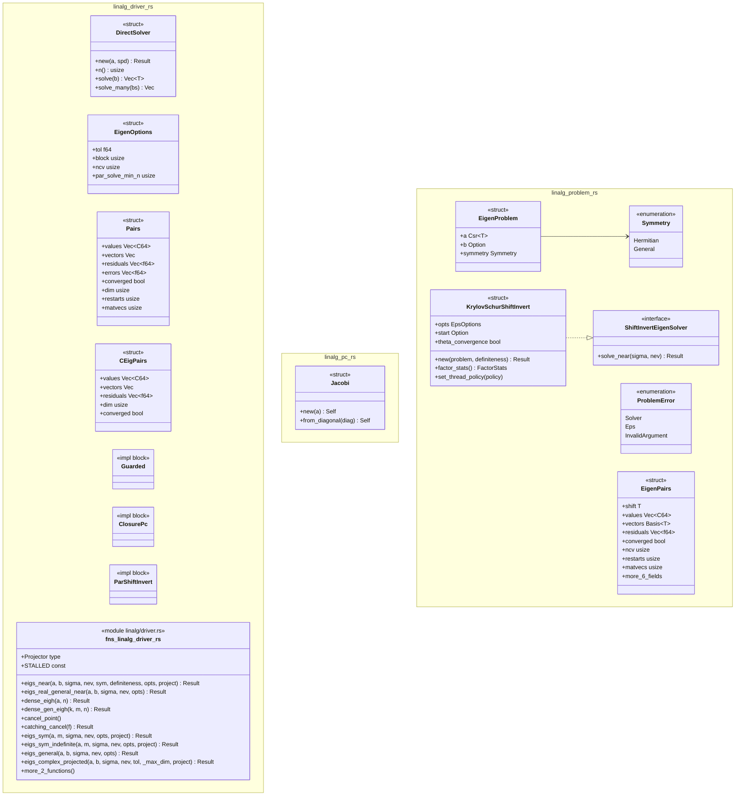

# Linear algebra driver: code

C4 level 4 (code) of the component **Linear algebra driver** (`femcore.ladriver`) in the container **femcore** (crate `femcore`). [Component view of the container](../../3-components/femcore.md) · [All code pages](../README.md)

> The door the physics kernels use: a direct solve, eigenpairs near a shift, and the solver interface for models.

**Decisions:** [ADR 33](../../../adr/0033-one-linear-algebra-driver-facade.md)  
**Size:** 3 files, 740 lines.

## Files

| File | Lines | What it says about itself |
|---|---:|---|
| `crates/femcore/src/linalg/driver.rs` | 504 | The entry points the physics kernels call: a direct solve of `A x = b`, eigenpairs of `A x = lambda B x` near a shift, and small dense eigenproblems. Everything else of `solvers` (Krylov methods, preconditioners, factorisation variants) ... |
| `crates/femcore/src/linalg/pc.rs` | 35 | Preconditioners (PETSc `PC`). More (ILU/IC, Schwarz, AMG) follow in later items. |
| `crates/femcore/src/linalg/problem.rs` | 201 | The solver interface used by models: "eigenpairs of `A x = λ B x` near a shift". |

## What it uses

| Target | Modules | Items |
|---|---|---|
| [Matrices and vectors](./lacore.md) | linalg::basis, linalg::csr, linalg::csr::assembly, linalg::faer_glue, linalg::linop, linalg::scalar, linalg::vecops | Basis, C64, CCsr, Csr, FaerScalar, LinearOperator, Preconditioner, RCsr, Scalar, Scaling +1 |
| [Direct solvers](./ladirect.md) | linalg::direct, linalg::ordering | Definiteness, FactorStats, FillOrdering, ShiftInvertOperator, ShiftedFactorization, ShiftedSolver, SolverError, ThreadPolicy |
| [Eigensolvers](./laeigen.md) | linalg::arnoldi_real, linalg::eps, linalg::lobpcg | EigOpts, EigPairs, EpsError, EpsOptions, EpsReason, HistoryEntry, Kind, LobpcgOptions, LobpcgReason, Timings +3 |
| [Runtime services](./runtime.md) | par, progress, warm | begin, on_factor_pool, threads |

## Used by

| Component | Modules | Items |
|---|---|---|
| [analysis: cQED quantization and TLS participation](../analysis/cqed.md) | linalg::driver | dense_eigh, dense_gen_eigh |
| [dfs: Electrostatics kernel](../dfs/electro.md) | linalg::driver | DirectSolver, dense_eigh |
| [dfs: Heat kernel](../dfs/heat.md) | linalg::driver | DirectSolver, dense_gen_eigh |
| [dfs: Magnetostatics kernel](../dfs/magneto.md) | linalg::driver | DirectSolver, dense_eigh |
| [ems: Axisymmetric kernel](../ems/axisym.md) | linalg::driver | eigs_complex |
| [ems: 3D cavity kernel](../ems/cavity.md) | linalg::driver | DirectSolver, eigs_complex_projected, eigs_sym_indefinite |
| [ems: Driven frequency-domain and PROM](../ems/driven.md) | linalg::driver | DirectSolver |
| [ems: Thin-film IBC and Josephson ROM](../ems/ibc.md) | linalg::driver | DirectSolver, dense_gen_eigh |
| [ems: Mode kernel](../ems/modes.md) | linalg::driver | eigs_general |
| [ems: Complex-mode kernel](../ems/modescx.md) | linalg::driver | eigs_complex |
| [Finite-element basics](./fem.md) | linalg::driver | DirectSolver |
| [Eigensolvers](./laeigen.md) | linalg::driver | DirectSolver |
| [Preconditioners](./laprecond.md) | linalg::driver | DirectSolver |
| [sms: Cross-section study kernel](../sms/crosssection.md) | linalg::driver | eigs_complex |
| [sms: Floquet kernel](../sms/floquet.md) | linalg::driver | eigs_complex |
| [sms: Low-reflecting boundary](../sms/lrb.md) | linalg::driver | eigs_complex |
| [sms: Absorbing-layer kernel](../sms/pml.md) | linalg::driver | eigs_complex |
| [sms: Solid kernel](../sms/solid.md) | linalg::driver | STALLED, eigs_sym, lobpcg_guarded |

## Class diagram

Public types with their public fields (or variants) and methods, free functions per file as a `module` box; arrows are field types and `impl Trait`. Capped at 36 types and a few members each; the table below is complete.

## Public items

| Kind | Item | File:line | Signature or summary |
|---|---|---|---|
| struct | `DirectSolver` | `linalg/driver.rs:33` |  A sparse matrix factorised once, then solved for any number of right-hand sides: Cholesky when the matrix is symmetric (Hermitian) |
| struct | `EigenOptions` | `linalg/driver.rs:81` | fields: `tol`, `block`, `ncv`, `par_solve_min_n` —  Options of the shift-and-invert eigensolvers. `tol` is the relative residual of the transformed problem |
| struct | `Pairs` | `linalg/driver.rs:102` | fields: `values`, `vectors`, `residuals`, `errors`, `converged`, `dim`, `restarts`, `matvecs` —  Eigenpairs of `A x = lambda B x` nearest the shift, nearest first. |
| type | `Projector` | `linalg/driver.rs:118` | `<'a, T>` —  A projection applied to every operator result (removes a known null space of `A`). It must be a `B`-orthogonal projection. |
| fn | `eigs_near` | `linalg/driver.rs:170` | `pub fn eigs_near<T: FaerScalar>(a: &Csr<T>, b: &Csr<T>, sigma: T, nev: usize, sym: Symmetry, definiteness: Definiteness, opts: &EigenOptions, project: Option<Projector<'_, T>>) -> Result<Pairs<T>, String>` —  The `nev` eigenpairs of `A x = lambda B x` nearest `sigma` (block Krylov-Schur on the shift-and-invert operator). `sym` says whether |
| fn | `eigs_real_general_near` | `linalg/driver.rs:238` | `pub fn eigs_real_general_near(a: &Csr<f64>, b: &Csr<f64>, sigma: f64, nev: usize, opts: &EigenOptions) -> Result<Pairs<f64>, String>` —  Real eigenpairs of a pencil with real, non-symmetric matrices (the 2D waveguide modes): the real eigenvalues nearest the real |
| fn | `dense_eigh` | `linalg/driver.rs:288` | `pub fn dense_eigh(a: &[f64], n: usize) -> Result<(Vec<f64>, Vec<Vec<f64>>), String>` —  Eigen decomposition of a symmetric dense matrix (row-major, only the lower triangle is read): ascending eigenvalues and the |
| fn | `dense_gen_eigh` | `linalg/driver.rs:299` | `pub fn dense_gen_eigh(k: &[f64], m: &[f64], n: usize) -> Result<(Vec<f64>, Vec<Vec<f64>>), String>` —  Generalised symmetric-definite problem `K x = lambda M x` (dense, row-major, `M` positive definite) through the Cholesky factor |
| fn | `cancel_point` | `linalg/driver.rs:323` | `pub fn cancel_point()` —  Call inside an operator or preconditioner application: leaves the library's loop with a cancel when the job was cancelled. |
| fn | `catching_cancel` | `linalg/driver.rs:330` | `pub fn catching_cancel<R>(f: impl FnOnce() -> R) -> Result<R, String>` —  Runs a library solve, turning a cancel raised by [`cancel_point`] into `Err("cancelled")`. |
| const | `STALLED` | `linalg/driver.rs:344` | `&str` —  Start of the error text returned when the LOBPCG stall guard gives up (the caller falls back to a factorisation). |
| fn | `eigs_sym` | `linalg/driver.rs:376` | `pub fn eigs_sym(a: &RCsr, m: &RCsr, sigma: f64, nev: usize, opts: &EigOpts, project: Option<Projector<f64>>) -> Result<EigPairs, String>` —  Real symmetric pencil `A x = lambda M x` with `M` positive definite, eigenvalues nearest `sigma`; a shift at or below zero is taken to |
| fn | `eigs_sym_indefinite` | `linalg/driver.rs:382` | `pub fn eigs_sym_indefinite(a: &RCsr, m: &RCsr, sigma: f64, nev: usize, opts: &EigOpts, project: Option<Projector<f64>>) -> Result<EigPairs, String>` —  Like [`eigs_sym`] for an indefinite `A - sigma M` (always LU). |
| fn | `eigs_general` | `linalg/driver.rs:389` | `pub fn eigs_general(a: &RCsr, b: &RCsr, sigma: f64, nev: usize, opts: &EigOpts) -> Result<EigPairs, String>` —  Real eigenvalues and real vectors of a real non-symmetric pencil (2D waveguide modes), in real arithmetic |
| struct | `CEigPairs` | `linalg/driver.rs:395` | fields: `values`, `vectors`, `residuals`, `dim`, `converged` —  Eigenpairs of a complex pencil. |
| fn | `eigs_complex_projected` | `linalg/driver.rs:405` | `pub fn eigs_complex_projected(a: &CCsr, b: &CCsr, sigma: C64, nev: usize, tol: f64, _max_dim: usize, project: Option<Projector<C64>>) -> Result<CEigPairs, String>` —  Complex pencil (PML, tilted crystals, Floquet phases), nearest the complex shift; `project` as in [`eigs_sym`]. |
| fn | `eigs_complex` | `linalg/driver.rs:411` | `pub fn eigs_complex(a: &CCsr, b: &CCsr, sigma: C64, nev: usize, tol: f64, max_dim: usize) -> Result<CEigPairs, String>` |
| fn | `lobpcg_guarded` | `linalg/driver.rs:429` | `pub fn lobpcg_guarded(k: &RCsr, m: &RCsr, nev: usize, extra: usize, precond: &dyn Fn(&[f64]) -> Vec<f64>, tol: f64, max_iter: usize, stall_guard: bool) -> Result<EigPairs, String>` —  The `nev` lowest eigenpairs of `K x = lambda M x` by LOBPCG with the given preconditioner. With `stall_guard` the run gives up (error |
| fn | `DirectSolver::new` | `linalg/driver.rs:39` | `pub fn new(a: &Csr<T>, spd: bool) -> Result<Self, String>` |
| fn | `DirectSolver::n` | `linalg/driver.rs:53` | `pub fn n(&self) -> usize` |
| fn | `DirectSolver::solve` | `linalg/driver.rs:57` | `pub fn solve(&self, b: &[T]) -> Vec<T>` |
| fn | `DirectSolver::solve_many` | `linalg/driver.rs:65` | `pub fn solve_many(&self, bs: &[Vec<T>]) -> Vec<Vec<T>>` —  Several right-hand sides; the independent triangular solves are spread over the threads of the shared pool. |
| struct | `Jacobi` | `linalg/pc.rs:10` |  Point Jacobi: `M⁻¹ = diag(A)⁻¹` (PETSc `PCJACOBI`). A zero diagonal entry is replaced by 1 |
| fn | `Jacobi::new` | `linalg/pc.rs:15` | `pub fn new(a: &Csr<T>) -> Self` |
| fn | `Jacobi::from_diagonal` | `linalg/pc.rs:20` | `pub fn from_diagonal(diag: Vec<T>) -> Self` —  From the diagonal alone, for operators that are never assembled (see [`crate::linalg::matfree`]). |
| enum | `Symmetry` | `linalg/problem.rs:20` | variants: `Hermitian`, `General` —  Structure of the pencil `(A, B)`, which selects the projected problem and inner product. |
| struct | `EigenProblem` | `linalg/problem.rs:30` | fields: `a`, `b`, `symmetry` —  The generalised eigenproblem `A x = λ B x` (`B = None` means the identity). |
| enum | `ProblemError` | `linalg/problem.rs:37` | variants: `Solver`, `Eps`, `InvalidArgument` |
| struct | `EigenPairs` | `linalg/problem.rs:68` | fields: `shift`, `values`, `vectors`, `residuals`, `converged`, `ncv`, `restarts`, `matvecs`, `breakdowns`, `orth_calls`, `orth_refinements`, `eps_timings`, ... —  Result of one `solve_near`. |
| trait | `ShiftInvertEigenSolver` | `linalg/problem.rs:92` | methods: `solve_near` —  "Eigenpairs near a shift" interface (see module docs). |
| struct | `KrylovSchurShiftInvert` | `linalg/problem.rs:101` | fields: `opts`, `start`, `theta_convergence` —  Krylov–Schur with shift-and-invert on a symbolic-reusing sparse factorisation. |
| fn | `KrylovSchurShiftInvert::new` | `linalg/problem.rs:116` | `pub fn new(problem: &'p EigenProblem<T>, definiteness: Definiteness) -> Result<Self, ProblemError>` —  `definiteness`: pass [`Definiteness::PositiveDefinite`] when `A − σB` is positive |
| fn | `KrylovSchurShiftInvert::factor_stats` | `linalg/problem.rs:137` | `pub fn factor_stats(&self) -> FactorStats` |
| fn | `KrylovSchurShiftInvert::set_thread_policy` | `linalg/problem.rs:143` | `pub fn set_thread_policy(&mut self, policy: crate::linalg::direct::ThreadPolicy)` —  Thread policy of the factorisation and the triangular solves (see |

Trait implementations in this component: `EigenOptions: Default`, `Guarded: LinearOperator`, `ClosurePc: Preconditioner`, `ParShiftInvert: LinearOperator`, `Jacobi: Preconditioner`, `ProblemError: Display`, `ProblemError: Error`, `ProblemError: From`, `ProblemError: From`, `KrylovSchurShiftInvert: ShiftInvertEigenSolver`
