# Eigensolvers: code

C4 level 4 (code) of the component **Eigensolvers** (`femcore.laeigen`) in the container **femcore** (crate `femcore`). [Component view of the container](../../3-components/femcore.md) · [All code pages](../README.md)

> Krylov-Schur, LOBPCG, Jacobi-Davidson, quadratic and nonlinear eigenproblems, contour integral, Chebyshev filtering, real Arnoldi for the 2D modes, sensitivities.

**Decisions:** [ADR 33](../../../adr/0033-one-linear-algebra-driver-facade.md), [ADR 8](../../../adr/0008-ported-solver-library-staged-not-wired.md), [ADR 11](../../../adr/0011-determinism-by-fixed-chunks.md)  
**Size:** 12 files, 4576 lines.

## Files

| File | Lines | What it says about itself |
|---|---:|---|
| `crates/femcore/src/linalg/arnoldi_real.rs` | 273 | Real block Arnoldi with shift-and-invert for the real, non-symmetric pencil of the 2D waveguide modes (`ems`): the eigenvalues of `A x = lambda B x` nearest a real shift, real vectors, complex Ritz values skipped. The library's Krylov-Sc... |
| `crates/femcore/src/linalg/chebfsi.rs` | 298 | Chebyshev-filtered subspace iteration for many lowest eigenpairs (port item E5; the idea of ChASE, Winkelmann et al. 2019): for `nev` in the tens to hundreds (photonic-crystal band structures) where a polynomial filter beats Krylov metho... |
| `crates/femcore/src/linalg/contour.rs` | 379 | Contour-integral eigensolver (port item E3): *all* eigenvalues of `A x = λ B x` inside an elliptical region of the complex plane, by block Sakurai–Sugiura moments with Rayleigh–Ritz extraction (the CIRR variant; SLEPc's `EPSCISS` is... |
| `crates/femcore/src/linalg/eps/krylov_schur.rs` | 415 |  |
| `crates/femcore/src/linalg/eps/mod.rs` | 236 | Eigenvalue solvers (the role of SLEPc `EPS`). |
| `crates/femcore/src/linalg/eps/orth.rs` | 259 | Block Gram–Schmidt for the Krylov bases, with an optional `B`-weighted inner product `⟨x, y⟩ = xᴴ B y` (generalised Hermitian problems). |
| `crates/femcore/src/linalg/jd.rs` | 690 | Jacobi–Davidson interior eigensolver (port item E2; SLEPc's `EPSJD`/`EPSGD` are the nearest references): eigenpairs near a *target* without factorising `A − τB`. |
| `crates/femcore/src/linalg/lobpcg.rs` | 379 | LOBPCG (Knyazev 2001) for the generalised Hermitian problem `A x = λ B x` (port item E4), real or complex, with the improvements the port list names: |
| `crates/femcore/src/linalg/nep.rs` | 418 | Nonlinear eigenvalue problems `T(λ) x = 0` in the split form `T(λ) = Σ_j f_j(λ) A_j` (port item N2): dispersive materials (Drude/Lorentz permittivity), frequency-dependent PML stretching, delay and radiation boundary conditions, and ... |
| `crates/femcore/src/linalg/nleigs.rs` | 505 | **NLEIGS** (Güttel, Van Beeumen, Meerbergen & Michiels 2014): a rational Krylov method for the nonlinear eigenproblem `T(λ) x = 0`, `T(λ) = Σ_t f_t(λ) A_t`, in a region `Σ` of the complex plane (port item N2, the robust method afte... |
| `crates/femcore/src/linalg/sens.rs` | 262 | Eigenvalue sensitivities and mode tracking (port item N3; groundwork for the optimisation of item O1). |
| `crates/femcore/src/linalg/toar.rs` | 462 | **TOAR** for the quadratic eigenproblem `(λ² M + λ C + K) x = 0` (port item N1): Arnoldi on the shift-and-invert operator of the linearisation, with the `2n`-dimensional Krylov basis stored in compressed form. |

## What it uses

| Target | Modules | Items |
|---|---|---|
| [Matrices and vectors](./lacore.md) | linalg::basis, linalg::csr, linalg::csr::assembly, linalg::dense, linalg::faer_glue, linalg::linop, linalg::rng, linalg::scalar +1 | Basis, BasisView, C64, Csr, Dense, DenseError, FaerScalar, Identity, LinearOperator, Preconditioner +14 |
| [Direct solvers](./ladirect.md) | linalg::direct | Definiteness, ShiftedFactorization, ShiftedSolver, SolverError, Threads |
| [Linear algebra driver](./ladriver.md) | linalg::driver | DirectSolver |
| [Krylov solvers](./laksp.md) | linalg::ksp, linalg::ksp::gmres | Gmres, GmresOptions, Tolerances |
| [Runtime services](./runtime.md) | par, progress, warm | begin, check, threads |

## Used by

| Component | Modules | Items |
|---|---|---|
| [ems: 3D cavity kernel](../ems/cavity.md) | linalg::arnoldi_real | EigOpts |
| [ems: Mode kernel](../ems/modes.md) | linalg::arnoldi_real | EigOpts |
| [Linear algebra driver](./ladriver.md) | linalg::arnoldi_real, linalg::eps, linalg::lobpcg | EigOpts, EigPairs, EpsError, EpsOptions, EpsReason, HistoryEntry, Kind, LobpcgOptions +5 |
| [Time, nonlinear, sweeps](./laother.md) | linalg::nep | NepError, NonlinearEigenProblem |
| [sms: Solid kernel](../sms/solid.md) | linalg::arnoldi_real | EigOpts, EigPairs |

## Class diagram

Public types with their public fields (or variants) and methods, free functions per file as a `module` box; arrows are field types and `impl Trait`. Capped at 36 types and a few members each; the table below is complete. **This component has 11 more types than the diagram shows.**

```mermaid
classDiagram
  namespace linalg_arnoldi_real_rs {
    class EigOpts {
        <<struct>>
        +tol f64
        +max_dim usize
        +block usize
    }
    class EigPairs {
        <<struct>>
        +values Vec~f64~
        +vectors Vec
        +dim usize
        +converged bool
        +complex_found bool
    }
    class fns_linalg_arnoldi_real_rs {
        <<module linalg/arnoldi_real.rs>>
        +eigs_general(a, b, sigma, nev, opts) Result
    }
  }
  namespace linalg_chebfsi_rs {
    class ChebOptions {
        <<struct>>
        +nev usize
        +nex usize
        +degree usize
        +tol f64
        +max_it usize
        +lanczos_steps usize
        +seed u64
        +new(nev) Self
    }
    class ChebResult {
        <<struct>>
        +values Vec~f64~
        +vectors Vec
        +residuals Vec~f64~
        +iterations usize
        +matvecs usize
        +converged bool
        +locked_history Vec~usize~
    }
    class ChebError {
        <<enumeration>>
        InvalidArgument
        Dense
    }
    class fns_linalg_chebfsi_rs {
        <<module linalg/chebfsi.rs>>
        +chebyshev_subspace(a, opts) Result
    }
  }
  namespace linalg_contour_rs {
    class Ellipse {
        <<struct>>
        +center C64
        +a f64
        +b f64
        +circle(center, radius) Self
        +real_interval(lo, hi, aspect) Self
        +contains(z) bool
        +node(j, n) tuple
    }
    class ContourOptions {
        <<struct>>
        +region Ellipse
        +nodes usize
        +block usize
        +moments usize
        +rank_tol f64
        +residual_tol f64
        +seed u64
        +workers usize
        +new(region) Self
    }
    class ContourError {
        <<enumeration>>
        Solver
        Dense
        InvalidArgument
    }
    class ContourTimings {
        <<struct>>
        +factor f64
        +solve f64
        +moments f64
        +svd f64
        +project f64
        +total f64
    }
    class ContourResult {
        <<struct>>
        +values Vec~C64~
        +vectors Basis~C64~
        +residuals Vec~f64~
        +estimated_count f64
        +count_stderr f64
        +rank usize
        +saturated bool
        +rejected usize
        +more_1_fields
    }
    class fns_linalg_contour_rs {
        <<module linalg/contour.rs>>
        +contour_eigs(a, b, opts) Result
    }
  }
  namespace linalg_eps_krylov_schur_rs {
    class fns_linalg_eps_krylov_schur_rs {
        <<module linalg/eps/krylov_schur.rs>>
        +krylov_schur(op, weight, start, opts) Result
    }
  }
  namespace linalg_eps_mod_rs {
    class Which {
        <<enumeration>>
        LargestMagnitude
        SmallestMagnitude
        LargestReal
        SmallestReal
        LargestImag
        SmallestImag
        TargetMagnitude
        TargetReal
        +key(lambda) f64
    }
    class Kind {
        <<enumeration>>
        Hermitian
        General
    }
    class EpsOptions {
        <<struct>>
        +nev usize
        +ncv Option~usize~
        +tol f64
        +max_it Option~usize~
        +which Which
        +keep f64
        +block_size usize
        +kind Kind
        +more_4_fields
        +hermitian(nev) Self
        +general(nev) Self
    }
    class EpsReason {
        <<enumeration>>
        Converged
        DivergedIts
    }
    class EpsError {
        <<enumeration>>
        InvalidArgument
        Unsupported
        Dense
    }
    class Timings {
        <<struct>>
        +operator f64
        +weight f64
        +orthogonalize f64
        +dense f64
        +restart f64
        +total f64
    }
    class HistoryEntry {
        <<struct>>
        +cycle usize
        +nconv usize
        +nv usize
        +matvecs usize
        +errors Vec~f64~
        +ritz Vec~C64~
    }
    class EigenResult {
        <<struct>>
        +reason EpsReason
        +values Vec~C64~
        +errors Vec~f64~
        +vectors Basis~T~
        +nconv usize
        +ncv usize
        +iterations usize
        +matvecs usize
        +more_6_fields
        +vector(i) slice
    }
  }
  namespace linalg_eps_orth_rs {
    class OrthWork {
        <<struct>>
        +u Vec~T~
        +bx Vec~T~
        +h Vec~T~
        +r Vec~T~
        +breakdowns usize
        +b_products usize
        +calls usize
        +refinements usize
        +more_1_fields
        +new(n, max_k, b, weighted, seed) Self
    }
    class fns_linalg_eps_orth_rs {
        <<module linalg/eps/orth.rs>>
        ~orthogonalize(head, k, w, b, weight, wk)
    }
  }
  namespace linalg_jd_rs {
    class JdOptions {
        <<struct>>
        +nev usize
        +target C64
        +tol f64
        +m_min usize
        +m_max usize
        +max_it usize
        +inner_its usize
        +inner_tol f64
        +more_3_fields
        +new(nev, target, hermitian) Self
    }
    class JdError {
        <<enumeration>>
        Dense
        InvalidArgument
        Unsupported
    }
    class JdHistoryEntry {
        <<struct>>
        +iteration usize
        +nconv usize
        +dim usize
        +residual f64
    }
    class JdResult {
        <<struct>>
        +converged bool
        +values Vec~C64~
        +vectors Basis~C64~
        +residuals Vec~f64~
        +iterations usize
        +matvecs usize
        +pc_applies usize
        +inner_iterations usize
        +more_2_fields
    }
    class ProjectedOp {
        <<impl block>>
    }
    class ProjectedPc {
        <<impl block>>
    }
    class fns_linalg_jd_rs {
        <<module linalg/jd.rs>>
        +jacobi_davidson(a, b, pc, start, opts) Result
    }
  }
  namespace linalg_lobpcg_rs {
    class LobpcgWhich {
        <<enumeration>>
        Lowest
        Highest
    }
    class LobpcgOptions {
        <<struct>>
        +nev usize
        +block usize
        +tol f64
        +max_it usize
        +which LobpcgWhich
        +stall_window usize
        +stall_gain f64
        +seed u64
        +new(nev) Self
    }
    class LobpcgReason {
        <<enumeration>>
        Converged
        MaxIterations
        Stalled
    }
    class LobpcgResult {
        <<struct>>
        +values Vec~f64~
        +vectors Vec
        +residuals Vec~f64~
        +iterations usize
        +reason LobpcgReason
        +matvecs usize
        +active_history Vec~usize~
    }
    class LobpcgError {
        <<enumeration>>
        InvalidArgument
        Dense
    }
    class fns_linalg_lobpcg_rs {
        <<module linalg/lobpcg.rs>>
        +lobpcg(a, b, pc, x0, constraints, opts) Result
    }
  }
  namespace linalg_nep_rs {
    class NepTerm {
        <<struct>>
        +matrix Csr~C64~
        +f Box
    }
    class NonlinearEigenProblem {
        <<struct>>
        +terms Vec~NepTerm~
        +new(terms) Result
        +polynomial(coefficients) Result
        +dim() usize
        +assemble(z) Csr~C64~
        +apply(lambda, x, y)
        +relative_residual(lambda, x) f64
    }
    class NepError {
        <<enumeration>>
        Solver
        Dense
        InvalidArgument
    }
    class RiiOptions {
        <<struct>>
        +tol f64
        +max_it usize
        +lambda0 Option~C64~
        +seed u64
    }
    class RiiResult {
        <<struct>>
        +value C64
        +vector Vec~C64~
        +residual f64
        +iterations usize
        +converged bool
    }
    class BeynOptions {
        <<struct>>
        +region Ellipse
        +nodes usize
        +block usize
        +moments usize
        +rank_tol f64
        +residual_tol f64
        +seed u64
        +new(region) Self
    }
    class fns_linalg_nep_rs {
        <<module linalg/nep.rs>>
        +residual_inverse_iteration(p, sigma, start, opts) Result
        +beyn_contour(p, opts) Result
    }
  }
  namespace linalg_nleigs_rs {
    class fns_linalg_nleigs_rs {
        <<module linalg/nleigs.rs>>
        +ray_samples(from, direction, r_min, r_max, count) Vec~C64~
        +build_interpolant(p, region, singularities, tol, max_degree, boundary_samples) Result
        +nleigs(p, opts) Result
    }
  }
  namespace linalg_sens_rs {
    class fns_linalg_sens_rs {
        <<module linalg/sens.rs>>
        +left_eigenvector(a, b, lambda, start, iterations) Result
        +eigenvalue_derivative(lambda, x, y, b, da, db) C64
        +nonlinear_eigenvalue_derivative(p, dt, lambda, x, y) C64
        +match_modes(old, new, b, min_overlap, ambiguity) ModeMatch
    }
  }
  namespace linalg_toar_rs {
    class fns_linalg_toar_rs {
        <<module linalg/toar.rs>>
        +toar_shift_invert(p, opts) Result
    }
  }
  ContourOptions --> Ellipse
  EpsOptions --> Which
  EpsOptions --> Kind
  EigenResult --> EpsReason
  LobpcgOptions --> LobpcgWhich
  LobpcgResult --> LobpcgReason
  NonlinearEigenProblem --> NepTerm
  BeynOptions --> Ellipse
```

## Public items

| Kind | Item | File:line | Signature or summary |
|---|---|---|---|
| struct | `EigOpts` | `linalg/arnoldi_real.rs:17` | fields: `tol`, `max_dim`, `block` |
| struct | `EigPairs` | `linalg/arnoldi_real.rs:33` | fields: `values`, `vectors`, `dim`, `converged`, `complex_found` |
| fn | `eigs_general` | `linalg/arnoldi_real.rs:119` | `pub fn eigs_general(a: &Csr, b: &Csr, sigma: f64, nev: usize, opts: &EigOpts) -> Result<EigPairs, String>` —  General real pencil `A x = lambda B x` with real eigenvalues wanted (A - sigma B must be |
| struct | `ChebOptions` | `linalg/chebfsi.rs:21` | fields: `nev`, `nex`, `degree`, `tol`, `max_it`, `lanczos_steps`, `seed` |
| struct | `ChebResult` | `linalg/chebfsi.rs:41` | fields: `values`, `vectors`, `residuals`, `iterations`, `matvecs`, `converged`, `locked_history` |
| enum | `ChebError` | `linalg/chebfsi.rs:54` | variants: `InvalidArgument`, `Dense` |
| fn | `chebyshev_subspace` | `linalg/chebfsi.rs:140` | `pub fn chebyshev_subspace<T: FaerScalar>(a: &Csr<T>, opts: &ChebOptions) -> Result<ChebResult<T>, ChebError>` |
| fn | `ChebOptions::new` | `linalg/chebfsi.rs:35` | `pub fn new(nev: usize) -> Self` |
| struct | `Ellipse` | `linalg/contour.rs:36` | fields: `center`, `a`, `b` —  The region `{ z : ((Re z − c_re)/a)² + ((Im z − c_im)/b)² ≤ 1 }`. |
| struct | `ContourOptions` | `linalg/contour.rs:72` | fields: `region`, `nodes`, `block`, `moments`, `rank_tol`, `residual_tol`, `seed`, `workers` |
| enum | `ContourError` | `linalg/contour.rs:108` | variants: `Solver`, `Dense`, `InvalidArgument` |
| struct | `ContourTimings` | `linalg/contour.rs:141` | fields: `factor`, `solve`, `moments`, `svd`, `project`, `total` |
| struct | `ContourResult` | `linalg/contour.rs:151` | fields: `values`, `vectors`, `residuals`, `estimated_count`, `count_stderr`, `rank`, `saturated`, `rejected`, `timings` |
| fn | `contour_eigs` | `linalg/contour.rs:183` | `pub fn contour_eigs<T: FaerScalar>( a: &Csr<T>, b: Option<&Csr<T>>, opts: &ContourOptions, ) -> Result<ContourResult, ContourError>` —  All eigenvalues of `A x = λ B x` (`B = None`: identity) inside `opts.region`. |
| fn | `Ellipse::circle` | `linalg/contour.rs:45` | `pub fn circle(center: C64, radius: f64) -> Self` |
| fn | `Ellipse::real_interval` | `linalg/contour.rs:51` | `pub fn real_interval(lo: f64, hi: f64, aspect: f64) -> Self` —  An interval `[lo, hi]` of the real axis, widened into an ellipse with imaginary semi-axis |
| fn | `Ellipse::contains` | `linalg/contour.rs:56` | `pub fn contains(&self, z: C64) -> bool` |
| fn | `Ellipse::node` | `linalg/contour.rs:63` | `pub fn node(&self, j: usize, n: usize) -> (C64, C64)` —  Node `j` of `n` (trapezoid rule on the boundary, offset by half a step) and its weight |
| fn | `ContourOptions::new` | `linalg/contour.rs:93` | `pub fn new(region: Ellipse) -> Self` |
| fn | `krylov_schur` | `linalg/eps/krylov_schur.rs:40` | `pub fn krylov_schur<T, A>( op: &A, weight: Option<&dyn LinearOperator<T>>, start: Option<&[T]>, opts: &EpsOptions, ) -> Result<EigenResult<T>, EpsError>` —  Thick-restart Krylov–Schur with locking for `op·x = λ x`. |
| enum | `Which` | `linalg/eps/mod.rs:27` | variants: `LargestMagnitude`, `SmallestMagnitude`, `LargestReal`, `SmallestReal`, `LargestImag`, `SmallestImag`, `TargetMagnitude`, `TargetReal` —  Which eigenvalues of the operator handed to the solver to compute (SLEPc `EPSWhich`). |
| enum | `Kind` | `linalg/eps/mod.rs:61` | variants: `Hermitian`, `General` —  How the projected problem is solved. |
| struct | `EpsOptions` | `linalg/eps/mod.rs:67` | fields: `nev`, `ncv`, `tol`, `max_it`, `which`, `keep`, `block_size`, `kind`, `original_shift`, `start_in_range`, `seed`, `record_history` |
| enum | `EpsReason` | `linalg/eps/mod.rs:134` | variants: `Converged`, `DivergedIts` |
| enum | `EpsError` | `linalg/eps/mod.rs:142` | variants: `InvalidArgument`, `Unsupported`, `Dense` |
| struct | `Timings` | `linalg/eps/mod.rs:169` | fields: `operator`, `weight`, `orthogonalize`, `dense`, `restart`, `total` —  Seconds spent in each phase (the per-phase timers every solver here carries, so that a |
| struct | `HistoryEntry` | `linalg/eps/mod.rs:186` | fields: `cycle`, `nconv`, `nv`, `matvecs`, `errors`, `ritz` —  One entry per restart cycle when `record_history` is set (residual-history log, the |
| struct | `EigenResult` | `linalg/eps/mod.rs:201` | fields: `reason`, `values`, `errors`, `vectors`, `nconv`, `ncv`, `iterations`, `matvecs`, `b_products`, `breakdowns`, `orth_calls`, `orth_refinements`, ... —  Converged eigenpairs, ordered from most to least wanted. |
| fn | `Which::key` | `linalg/eps/mod.rs:45` | `pub fn key(self, lambda: C64) -> f64` —  Sort key: smaller means "more wanted". |
| fn | `EpsOptions::hermitian` | `linalg/eps/mod.rs:124` | `pub fn hermitian(nev: usize) -> Self` —  Options for a Hermitian (self-adjoint) operator. |
| fn | `EpsOptions::general` | `linalg/eps/mod.rs:128` | `pub fn general(nev: usize) -> Self` —  Options for a general complex operator. |
| fn | `EigenResult::vector` | `linalg/eps/mod.rs:232` | `pub fn vector(&self, i: usize) -> &[T]` |
| struct | `OrthWork` | `linalg/eps/orth.rs:25` | fields: `u`, `bx`, `h`, `r`, `breakdowns`, `b_products`, `calls`, `refinements`, `b_time` |
| fn | `orthogonalize` | `linalg/eps/orth.rs:92` | `pub(crate) fn orthogonalize<T: Scalar>( head: BasisView<'_, T>, k: usize, w: &mut [T], b: usize, weight: Option<&dyn LinearOperator<T>>, wk: &mut OrthWork<T>, )` —  Orthogonalises the `b` columns of `w` against `head[:, :k]` and among themselves. On return |
| fn | `OrthWork::new` | `linalg/eps/orth.rs:50` | `pub fn new(n: usize, max_k: usize, b: usize, weighted: bool, seed: u64) -> Self` |
| struct | `JdOptions` | `linalg/jd.rs:35` | fields: `nev`, `target`, `tol`, `m_min`, `m_max`, `max_it`, `inner_its`, `inner_tol`, `harmonic`, `hermitian`, `seed` |
| enum | `JdError` | `linalg/jd.rs:75` | variants: `Dense`, `InvalidArgument`, `Unsupported` |
| struct | `JdHistoryEntry` | `linalg/jd.rs:100` | fields: `iteration`, `nconv`, `dim`, `residual` |
| struct | `JdResult` | `linalg/jd.rs:109` | fields: `converged`, `values`, `vectors`, `residuals`, `iterations`, `matvecs`, `pc_applies`, `inner_iterations`, `history`, `seconds` |
| fn | `jacobi_davidson` | `linalg/jd.rs:207` | `pub fn jacobi_davidson( a: &Csr<C64>, b: Option<&Csr<C64>>, pc: &dyn Preconditioner<C64>, start: Option<&[C64]>, opts: &JdOptions, ) -> Result<JdResult, JdError>` |
| fn | `JdOptions::new` | `linalg/jd.rs:57` | `pub fn new(nev: usize, target: C64, hermitian: bool) -> Self` |
| enum | `LobpcgWhich` | `linalg/lobpcg.rs:27` | variants: `Lowest`, `Highest` |
| struct | `LobpcgOptions` | `linalg/lobpcg.rs:33` | fields: `nev`, `block`, `tol`, `max_it`, `which`, `stall_window`, `stall_gain`, `seed` |
| enum | `LobpcgReason` | `linalg/lobpcg.rs:63` | variants: `Converged`, `MaxIterations`, `Stalled` |
| struct | `LobpcgResult` | `linalg/lobpcg.rs:70` | fields: `values`, `vectors`, `residuals`, `iterations`, `reason`, `matvecs`, `active_history` |
| enum | `LobpcgError` | `linalg/lobpcg.rs:85` | variants: `InvalidArgument`, `Dense` |
| fn | `lobpcg` | `linalg/lobpcg.rs:149` | `pub fn lobpcg<T: FaerScalar>( a: &Csr<T>, b: Option<&Csr<T>>, pc: Option<&dyn Preconditioner<T>>, x0: Option<&[Vec<T>]>, constraints: &[Vec<T>], opts: &LobpcgOptions, ) -> Result<LobpcgResult<T>, LobpcgError>` —  LOBPCG. `x0`: optional starting block (`n`-vectors; random if absent). `constraints`: vectors (not |
| fn | `LobpcgOptions::new` | `linalg/lobpcg.rs:48` | `pub fn new(nev: usize) -> Self` |
| struct | `NepTerm` | `linalg/nep.rs:32` | fields: `matrix`, `f` —  One term `f(λ)·A` of the split form. |
| struct | `NonlinearEigenProblem` | `linalg/nep.rs:38` | fields: `terms` —  `T(λ) = Σ f_j(λ) A_j`; all matrices must have the same dimensions. |
| enum | `NepError` | `linalg/nep.rs:44` | variants: `Solver`, `Dense`, `InvalidArgument` |
| struct | `RiiOptions` | `linalg/nep.rs:139` | fields: `tol`, `max_it`, `lambda0`, `seed` |
| struct | `RiiResult` | `linalg/nep.rs:155` | fields: `value`, `vector`, `residual`, `iterations`, `converged` |
| fn | `residual_inverse_iteration` | `linalg/nep.rs:164` | `pub fn residual_inverse_iteration( p: &NonlinearEigenProblem, sigma: C64, start: Option<&[C64]>, opts: &RiiOptions, ) -> Result<RiiResult, NepError>` —  One eigenpair near `sigma` by residual inverse iteration with a *fixed* factorisation of `T(σ)`. |
| struct | `BeynOptions` | `linalg/nep.rs:252` | fields: `region`, `nodes`, `block`, `moments`, `rank_tol`, `residual_tol`, `seed` |
| struct | `BeynResult` | `linalg/nep.rs:275` | fields: `values`, `vectors`, `residuals`, `rank`, `saturated`, `rejected` |
| fn | `beyn_contour` | `linalg/nep.rs:288` | `pub fn beyn_contour(p: &NonlinearEigenProblem, opts: &BeynOptions) -> Result<BeynResult, NepError>` |
| fn | `NonlinearEigenProblem::new` | `linalg/nep.rs:74` | `pub fn new(terms: Vec<NepTerm>) -> Result<Self, NepError>` |
| fn | `NonlinearEigenProblem::polynomial` | `linalg/nep.rs:84` | `pub fn polynomial(coefficients: Vec<Csr<C64>>) -> Result<Self, NepError>` —  The polynomial problem `Σ_j λ^j A_j`. |
| fn | `NonlinearEigenProblem::dim` | `linalg/nep.rs:93` | `pub fn dim(&self) -> usize` |
| fn | `NonlinearEigenProblem::assemble` | `linalg/nep.rs:99` | `pub fn assemble(&self, z: C64) -> Csr<C64>` —  `T(z)` on the union pattern of the terms (explicit zeros are kept, so the pattern does not |
| fn | `NonlinearEigenProblem::apply` | `linalg/nep.rs:108` | `pub fn apply(&self, lambda: C64, x: &[C64], y: &mut [C64])` —  `T(λ) x` without assembling. |
| fn | `NonlinearEigenProblem::relative_residual` | `linalg/nep.rs:121` | `pub fn relative_residual(&self, lambda: C64, x: &[C64]) -> f64` —  `‖T(λ)x‖ / Σ_j \|f_j(λ)\|‖A_j x‖`: a backward-error-type relative residual in `[0, 1]`. |
| fn | `BeynOptions::new` | `linalg/nep.rs:269` | `pub fn new(region: Ellipse) -> Self` |
| fn | `ray_samples` | `linalg/nleigs.rs:47` | `pub fn ray_samples(from: C64, direction: C64, r_min: f64, r_max: f64, count: usize) -> Vec<C64>` —  Points `from + direction·r_k` with `r_k` growing geometrically from `r_min` to `r_max` (and `from` itself): |
| struct | `NleigsOptions` | `linalg/nleigs.rs:58` | fields: `region`, `singularities`, `nev`, `shift`, `interpolation_tol`, `max_degree`, `tol`, `ncv`, `max_restarts`, `boundary_samples`, `polish`, `seed` |
| struct | `NleigsResult` | `linalg/nleigs.rs:103` | fields: `values`, `vectors`, `residuals`, `degree`, `interpolation_error`, `converged_total`, `matvecs`, `restarts` |
| struct | `RationalInterpolant` | `linalg/nleigs.rs:121` | fields: `center`, `sigma`, `inv_xi`, `beta`, `coef` —  The rational Newton interpolants of the scalar functions of a [`NonlinearEigenProblem`]. |
| fn | `build_interpolant` | `linalg/nleigs.rs:233` | `pub fn build_interpolant( p: &NonlinearEigenProblem, region: &Ellipse, singularities: &[C64], tol: f64, max_degree: usize, boundary_samples: usize, ) -> Result<(RationalInterpolant, f64), NepError>` —  Builds the interpolant, raising the degree until the test error is below `tol`; returns it with that error. |
| struct | `NleigsOperator` | `linalg/nleigs.rs:287` |  The operator `(𝐁 − s𝐀)⁻¹ 𝐀` of the NLEIGS linearisation, applied through one factorisation of `T̃(s)`. |
| fn | `nleigs` | `linalg/nleigs.rs:435` | `pub fn nleigs(p: &NonlinearEigenProblem, opts: &NleigsOptions) -> Result<NleigsResult, NepError>` —  Eigenvalues of `p` inside `opts.region` (see the module documentation). |
| fn | `NleigsOptions::new` | `linalg/nleigs.rs:84` | `pub fn new(region: Ellipse, nev: usize) -> Self` |
| fn | `RationalInterpolant::degree` | `linalg/nleigs.rs:136` | `pub fn degree(&self) -> usize` |
| fn | `RationalInterpolant::basis` | `linalg/nleigs.rs:141` | `pub fn basis(&self, z: C64) -> Vec<C64>` —  `b_0(z), …, b_d(z)`. |
| fn | `RationalInterpolant::eval` | `linalg/nleigs.rs:155` | `pub fn eval(&self, t: usize, z: C64) -> C64` —  The interpolant of term `t` at `z`. |
| fn | `NleigsOperator::new` | `linalg/nleigs.rs:300` | `pub fn new(p: &'a NonlinearEigenProblem, it: RationalInterpolant, s: C64) -> Result<Self, NepError>` |
| fn | `NleigsOperator::interpolant` | `linalg/nleigs.rs:322` | `pub fn interpolant(&self) -> &RationalInterpolant` |
| fn | `NleigsOperator::dense_pencil` | `linalg/nleigs.rs:327` | `pub fn dense_pencil(&self) -> (Dense<C64>, Dense<C64>)` —  The dense pencil `(𝐀, 𝐁)` of size `d·n` — for tests and small problems only. |
| fn | `left_eigenvector` | `linalg/sens.rs:37` | `pub fn left_eigenvector( a: &Csr<C64>, b: Option<&Csr<C64>>, lambda: C64, start: &[C64], iterations: usize, ) -> Result<Vec<C64>, SolverError>` —  Left eigenvector of `A x = λ B x`: `Aᴴ y = λ̄ Bᴴ y`, by inverse iteration with the |
| fn | `eigenvalue_derivative` | `linalg/sens.rs:69` | `pub fn eigenvalue_derivative( lambda: C64, x: &[C64], y: &[C64], b: Option<&Csr<C64>>, da: &Csr<C64>, db: Option<&Csr<C64>>, ) -> C64` —  `dλ/dp` for the generalised linear problem, given `dA/dp` and optionally `dB/dp`. |
| fn | `nonlinear_eigenvalue_derivative` | `linalg/sens.rs:102` | `pub fn nonlinear_eigenvalue_derivative( p: &NonlinearEigenProblem, dt: &NonlinearEigenProblem, lambda: C64, x: &[C64], y: &[C64], ) -> C64` —  `dλ/dp = −yᴴ (∂T/∂p) x / (yᴴ T'(λ) x)` for `T(λ;p) = Σ f_j(λ) A_j(p)`; `dt` holds the split form of `∂T/∂p` |
| struct | `ModeMatch` | `linalg/sens.rs:122` | fields: `assignment`, `overlap`, `uncertain` —  Result of matching new modes to previous ones. |
| fn | `match_modes` | `linalg/sens.rs:188` | `pub fn match_modes( old: &[Vec<C64>], new: &[Vec<C64>], b: Option<&Csr<C64>>, min_overlap: f64, ambiguity: f64, ) -> ModeMatch` —  Matches `new` modes (columns of length `n`) to `old` modes by `B`-overlap (`b = None`: Euclidean). |
| struct | `Tracker` | `linalg/sens.rs:232` | fields: `min_overlap`, `ambiguity`, `uncertain_steps` —  Follows modes along a parameter sweep. Feed the modes (values and vectors) at each parameter step to |
| fn | `Tracker::new` | `linalg/sens.rs:242` | `pub fn new(initial: Vec<Vec<C64>>) -> Self` |
| fn | `Tracker::step` | `linalg/sens.rs:247` | `pub fn step(&mut self, values: &mut [C64], vectors: &mut [Vec<C64>], b: Option<&Csr<C64>>) -> ModeMatch` —  Reorders `values`/`vectors` of the new step to follow the tracked modes; returns the match. |
| struct | `QuadraticProblem` | `linalg/toar.rs:37` | fields: `m`, `c`, `k` —  `λ² M + λ C + K`. |
| struct | `ToarOptions` | `linalg/toar.rs:86` | fields: `nev`, `ncv`, `sigma`, `tol`, `seed`, `max_restarts`, `keep` |
| struct | `ToarResult` | `linalg/toar.rs:107` | fields: `values`, `vectors`, `estimates`, `residuals`, `converged`, `steps`, `restarts`, `operator_applications`, `q_columns`, `basis_scalars`, `basis_scalars_linearised` |
| enum | `ToarError` | `linalg/toar.rs:131` | variants: `Solver`, `Dense`, `InvalidArgument` |
| fn | `toar_shift_invert` | `linalg/toar.rs:210` | `pub fn toar_shift_invert(p: &QuadraticProblem, opts: &ToarOptions) -> Result<ToarResult, ToarError>` |
| fn | `QuadraticProblem::dim` | `linalg/toar.rs:44` | `pub fn dim(&self) -> usize` |
| fn | `QuadraticProblem::relative_residual` | `linalg/toar.rs:49` | `pub fn relative_residual(&self, lambda: C64, x: &[C64]) -> f64` —  `‖P(λ)x‖ / (\|λ\|²‖Mx‖ + \|λ\|‖Cx‖ + ‖Kx‖)`. |
| fn | `QuadraticProblem::linearisation` | `linalg/toar.rs:61` | `pub fn linearisation(&self) -> (Csr<C64>, Csr<C64>)` —  The `2n × 2n` pencil `(A, B)` of the linearisation (for reference solvers and tests). |
| fn | `ToarOptions::new` | `linalg/toar.rs:101` | `pub fn new(nev: usize, ncv: usize, sigma: C64) -> Self` |

Trait implementations in this component: `EigOpts: Default`, `ChebError: Display`, `ChebError: Error`, `ChebError: From`, `ContourError: Display`, `ContourError: Error`, `ContourError: From`, `ContourError: From`, `EpsError: Display`, `EpsError: Error`, `EpsError: From`, `JdError: Display`, `JdError: Error`, `JdError: From`, `ProjectedOp: LinearOperator`, `ProjectedPc: Preconditioner`, `LobpcgError: Display`, `LobpcgError: Error`, `LobpcgError: From`, `NepError: Display`, `NepError: Error`, `NepError: From`, `NepError: From`, `RiiOptions: Default`, `NleigsOperator: LinearOperator`, `ToarError: Display`, `ToarError: Error`, `ToarError: From`, `ToarError: From`
