# Krylov solvers: code

C4 level 4 (code) of the component **Krylov solvers** (`femcore.laksp`) in the container **femcore** (crate `femcore`). [Component view of the container](../../3-components/femcore.md) · [All code pages](../README.md)

> CG, MINRES, GMRES, BiCGStab, COCR, QMR, IDR(s), GCRO-DR for real and complex systems.

**Decisions:** [ADR 33](../../../adr/0033-one-linear-algebra-driver-facade.md), [ADR 8](../../../adr/0008-ported-solver-library-staged-not-wired.md)  
**Size:** 9 files, 2131 lines.

## Files

| File | Lines | What it says about itself |
|---|---:|---|
| `crates/femcore/src/linalg/ksp/bicgstab.rs` | 115 | BiCGStab (van der Vorst 1992), right-preconditioned: it monitors the *true* residual `‖b − Ax‖` and the preconditioner may be any (also nonsymmetric) approximation of `A⁻¹`. Real and complex. For complex symmetric systems the co... |
| `crates/femcore/src/linalg/ksp/cg.rs` | 225 |  |
| `crates/femcore/src/linalg/ksp/cocr.rs` | 112 | COCR (Sogabe & Zhang 2007): the conjugate *residual* method with the bilinear form `xᵀy`, for complex symmetric systems. The literature reports smoother residual histories than COCG's on indefinite complex symmetric problems (not verif... |
| `crates/femcore/src/linalg/ksp/gcrodr.rs` | 636 | **GCRO-DR** (Parks, de Sturler, Mackey, Johnson & Maiti 2006): restarted GMRES that *recycles* an approximate invariant subspace, for the `A x_i = b_i` sequences that a frequency sweep, a Newton iteration or a time stepper produces. |
| `crates/femcore/src/linalg/ksp/gmres.rs` | 344 |  |
| `crates/femcore/src/linalg/ksp/idrs.rs` | 193 | IDR(s) (Sonneveld & van Gijzen 2008; the biorthogonal variant of van Gijzen & Sonneveld, ACM TOMS 38, 2011): a short-recurrence method for general (also complex) systems that needs only `s + 1` matrix products per `s + 1` dimension reduc... |
| `crates/femcore/src/linalg/ksp/minres.rs` | 135 | MINRES (Paige & Saunders 1975) for real symmetric or complex Hermitian *indefinite* systems with an SPD preconditioner, in the formulation of Choi & Saunders. The monitored norm is the preconditioned residual norm `√(rᴴM⁻¹r)` obta... |
| `crates/femcore/src/linalg/ksp/mod.rs` | 133 | Krylov linear solvers (the role of PETSc `KSP`) for real and complex systems. |
| `crates/femcore/src/linalg/ksp/qmr.rs` | 238 | QMR (Freund & Nachtigal 1991): the quasi-minimal residual method built on the two-sided (unsymmetric) Lanczos process, for general real or complex systems, plus the **complex-symmetric** variant (Freund 1992) that needs only *one* produc... |

## What it uses

| Target | Modules | Items |
|---|---|---|
| [Matrices and vectors](./lacore.md) | linalg::basis, linalg::dense, linalg::linop, linalg::rng, linalg::scalar, linalg::vecops | Basis, C64, Dense, LinearOperator, Preconditioner, Scalar, Scaling, axpy, dotc, dotu +3 |

## Used by

| Component | Modules | Items |
|---|---|---|
| [ems: Native mixed-cell EM](../ems/mixed.md) | linalg::ksp, linalg::ksp::gmres | Gmres, GmresOptions, Orthogonalization, PcSide, Tolerances |
| [Linear algebra driver](./ladriver.md) | linalg::ksp, linalg::ksp::gmres | Gmres, GmresOptions, Orthogonalization, PcSide, Tolerances |
| [Eigensolvers](./laeigen.md) | linalg::ksp, linalg::ksp::gmres | Gmres, GmresOptions, Tolerances |
| [Time, nonlinear, sweeps](./laother.md) | linalg::ksp, linalg::ksp::gmres | ConvergedReason, Gmres, GmresOptions, PcSide, Tolerances |
| [Preconditioners](./laprecond.md) | linalg::ksp, linalg::ksp::gmres | Gmres, GmresOptions, Orthogonalization, PcSide, Tolerances |
| [sms: Piezoelectric kernel](../sms/piezo.md) | linalg::ksp, linalg::ksp::gmres | Gmres, GmresOptions, Orthogonalization, PcSide, Tolerances |

## Class diagram

Public types with their public fields (or variants) and methods, free functions per file as a `module` box; arrows are field types and `impl Trait`. Capped at 36 types and a few members each; the table below is complete.

```mermaid
classDiagram
  namespace linalg_ksp_bicgstab_rs {
    class BicgstabOptions {
        <<struct>>
        +tol Tolerances
        +record_history bool
    }
    class Bicgstab {
        <<struct>>
        +opts BicgstabOptions
        +new(opts) Self
        +solve(a, m, b, x) SolveInfo
    }
  }
  namespace linalg_ksp_cg_rs {
    class CgKind {
        <<enumeration>>
        Hermitian
        Symmetric
    }
    class CgNorm {
        <<enumeration>>
        Preconditioned
        Unpreconditioned
        Natural
    }
    class CgOptions {
        <<struct>>
        +tol Tolerances
        +kind CgKind
        +norm CgNorm
        +initial_guess_nonzero bool
        +record_history bool
        +petsc_sign_test bool
    }
    class Cg {
        <<struct>>
        +opts CgOptions
        +new(opts) Self
        +solve(a, m, b, x) SolveInfo
    }
  }
  namespace linalg_ksp_cocr_rs {
    class CocrOptions {
        <<struct>>
        +tol Tolerances
        +record_history bool
    }
    class Cocr {
        <<struct>>
        +opts CocrOptions
        +new(opts) Self
        +solve(a, m, b, x) SolveInfo
    }
  }
  namespace linalg_ksp_gcrodr_rs {
    class GcroDrOptions {
        <<struct>>
        +tol Tolerances
        +m usize
        +k usize
        +initial_guess_nonzero bool
        +record_history bool
    }
    class GcroDrStats {
        <<struct>>
        +cycles usize
        +recycled_at_start usize
        +recycled_at_end usize
    }
    class GcroDr {
        <<struct>>
        +opts GcroDrOptions
        +new(opts) Self
        +recycled_dim() usize
        +stats() GcroDrStats
        +matrix_changed()
        +recycle_defects(a, m) tuple
        +reset()
        +solve(a, m, b, x) SolveInfo
    }
  }
  namespace linalg_ksp_gmres_rs {
    class PcSide {
        <<enumeration>>
        Left
        Right
    }
    class Orthogonalization {
        <<enumeration>>
        ClassicalGramSchmidt
        ClassicalGramSchmidtIfNeeded
        ModifiedGramSchmidt
    }
    class GmresOptions {
        <<struct>>
        +tol Tolerances
        +restart usize
        +side PcSide
        +orthog Orthogonalization
        +flexible bool
        +initial_guess_nonzero bool
        +record_history bool
    }
    class Gmres {
        <<struct>>
        +opts GmresOptions
        +new(opts) Self
        +solve(a, m, b, x) SolveInfo
    }
  }
  namespace linalg_ksp_idrs_rs {
    class IdrsOptions {
        <<struct>>
        +tol Tolerances
        +s usize
        +angle f64
        +seed u64
        +record_history bool
    }
    class Idrs {
        <<struct>>
        +opts IdrsOptions
        +new(opts) Self
        +solve(a, m, b, x) SolveInfo
    }
  }
  namespace linalg_ksp_minres_rs {
    class MinresOptions {
        <<struct>>
        +tol Tolerances
        +record_history bool
    }
    class Minres {
        <<struct>>
        +opts MinresOptions
        +new(opts) Self
        +solve(a, m, b, x) SolveInfo
    }
  }
  namespace linalg_ksp_mod_rs {
    class ConvergedReason {
        <<enumeration>>
        Rtol
        Atol
        DivergedIts
        DivergedDtol
        DivergedBreakdown
        DivergedIndefiniteMat
        DivergedIndefinitePc
        DivergedNanOrInf
        +is_converged() bool
    }
    class SolveInfo {
        <<struct>>
        +iterations usize
        +reason ConvergedReason
        +residual_norm f64
        +history Vec~f64~
        +matvecs usize
        +pc_applies usize
    }
    class Tolerances {
        <<struct>>
        +rtol f64
        +atol f64
        +dtol f64
        +max_it usize
    }
    class ConvTest {
        <<struct>>
        ~new(tol) Self
        ~set_reference(rnorm0)
        ~rnorm0() f64
        ~check(rnorm) Option~ConvergedReason~
    }
    class fns_linalg_ksp_mod_rs {
        <<module linalg/ksp/mod.rs>>
        ~ensure_len(v, n)
    }
  }
  namespace linalg_ksp_qmr_rs {
    class QmrOptions {
        <<struct>>
        +tol Tolerances
        +record_history bool
    }
    class Qmr {
        <<struct>>
        +opts QmrOptions
        +new(opts) Self
        +solve(a, at, m, mt, b, x) SolveInfo
        +solve_symmetric(a, m, b, x) SolveInfo
    }
  }
  BicgstabOptions --> Tolerances
  Bicgstab --> BicgstabOptions
  CgOptions --> Tolerances
  CgOptions --> CgKind
  CgOptions --> CgNorm
  Cg --> CgOptions
  CocrOptions --> Tolerances
  Cocr --> CocrOptions
  GcroDrOptions --> Tolerances
  GcroDr --> GcroDrOptions
  GmresOptions --> Tolerances
  GmresOptions --> PcSide
  GmresOptions --> Orthogonalization
  Gmres --> GmresOptions
  IdrsOptions --> Tolerances
  Idrs --> IdrsOptions
  MinresOptions --> Tolerances
  Minres --> MinresOptions
  SolveInfo --> ConvergedReason
  QmrOptions --> Tolerances
  Qmr --> QmrOptions
```

## Public items

| Kind | Item | File:line | Signature or summary |
|---|---|---|---|
| struct | `BicgstabOptions` | `linalg/ksp/bicgstab.rs:12` | fields: `tol`, `record_history` |
| struct | `Bicgstab` | `linalg/ksp/bicgstab.rs:17` | fields: `opts` |
| fn | `Bicgstab::new` | `linalg/ksp/bicgstab.rs:23` | `pub fn new(opts: BicgstabOptions) -> Self` |
| fn | `Bicgstab::solve` | `linalg/ksp/bicgstab.rs:27` | `pub fn solve<A: LinearOperator<T> + ?Sized, M: Preconditioner<T> + ?Sized>( &mut self, a: &A, m: &M, b: &[T], x: &mut [T], ) -> SolveInfo` |
| enum | `CgKind` | `linalg/ksp/cg.rs:8` | variants: `Hermitian`, `Symmetric` —  Which inner product CG uses. |
| enum | `CgNorm` | `linalg/ksp/cg.rs:20` | variants: `Preconditioned`, `Unpreconditioned`, `Natural` —  Which residual norm CG monitors (PETSc `KSPSetNormType`). |
| struct | `CgOptions` | `linalg/ksp/cg.rs:31` | fields: `tol`, `kind`, `norm`, `initial_guess_nonzero`, `record_history`, `petsc_sign_test` |
| struct | `Cg` | `linalg/ksp/cg.rs:47` | fields: `opts` —  Preconditioned CG / COCG, reusing its work vectors across solves. |
| fn | `Cg::new` | `linalg/ksp/cg.rs:56` | `pub fn new(opts: CgOptions) -> Self` |
| fn | `Cg::solve` | `linalg/ksp/cg.rs:62` | `pub fn solve<A: LinearOperator<T> + ?Sized, M: Preconditioner<T> + ?Sized>( &mut self, a: &A, m: &M, b: &[T], x: &mut [T], ) -> SolveInfo` —  Solves `A x = b`. `x` is the initial guess if `opts.initial_guess_nonzero`, and is |
| struct | `CocrOptions` | `linalg/ksp/cocr.rs:22` | fields: `tol`, `record_history` |
| struct | `Cocr` | `linalg/ksp/cocr.rs:27` | fields: `opts` |
| fn | `Cocr::new` | `linalg/ksp/cocr.rs:33` | `pub fn new(opts: CocrOptions) -> Self` |
| fn | `Cocr::solve` | `linalg/ksp/cocr.rs:37` | `pub fn solve<A: LinearOperator<T> + ?Sized, M: Preconditioner<T> + ?Sized>( &mut self, a: &A, m: &M, b: &[T], x: &mut [T], ) -> SolveInfo` |
| struct | `GcroDrOptions` | `linalg/ksp/gcrodr.rs:40` | fields: `tol`, `m`, `k`, `initial_guess_nonzero`, `record_history` |
| struct | `GcroDrStats` | `linalg/ksp/gcrodr.rs:58` | fields: `cycles`, `recycled_at_start`, `recycled_at_end` —  Counters of one solve beyond [`SolveInfo`]. |
| struct | `GcroDr` | `linalg/ksp/gcrodr.rs:67` | fields: `opts` |
| fn | `GcroDr::new` | `linalg/ksp/gcrodr.rs:99` | `pub fn new(opts: GcroDrOptions) -> Self` |
| fn | `GcroDr::recycled_dim` | `linalg/ksp/gcrodr.rs:106` | `pub fn recycled_dim(&self) -> usize` —  Dimension of the subspace currently kept for the next solve. |
| fn | `GcroDr::stats` | `linalg/ksp/gcrodr.rs:110` | `pub fn stats(&self) -> &GcroDrStats` |
| fn | `GcroDr::matrix_changed` | `linalg/ksp/gcrodr.rs:117` | `pub fn matrix_changed(&mut self)` —  Tells the solver that the matrix (or the preconditioner) changed since the last solve: `C = A U` |
| fn | `GcroDr::recycle_defects` | `linalg/ksp/gcrodr.rs:123` | `pub fn recycle_defects<A: LinearOperator<T> + ?Sized, M: Preconditioner<T> + ?Sized>( &self, a: &A, m: &M, ) -> (f64, f64)` —  Diagnostics for tests: `(max \|CᴴC − I\|, max_i ‖Â u_i − c_i‖ / ‖c_i‖)` with `Â = A M⁻¹`. Both are rounding |
| fn | `GcroDr::reset` | `linalg/ksp/gcrodr.rs:146` | `pub fn reset(&mut self)` —  Forgets the recycled space. |
| fn | `GcroDr::solve` | `linalg/ksp/gcrodr.rs:202` | `pub fn solve<A: LinearOperator<T> + ?Sized, M: Preconditioner<T> + ?Sized>( &mut self, a: &A, m: &M, b: &[T], x: &mut [T], ) -> SolveInfo` |
| enum | `PcSide` | `linalg/ksp/gmres.rs:9` | variants: `Left`, `Right` —  Which side the preconditioner is applied on. |
| enum | `Orthogonalization` | `linalg/ksp/gmres.rs:19` | variants: `ClassicalGramSchmidt`, `ClassicalGramSchmidtIfNeeded`, `ModifiedGramSchmidt` —  Gram–Schmidt variant used to orthogonalise each new Krylov vector. |
| struct | `GmresOptions` | `linalg/ksp/gmres.rs:29` | fields: `tol`, `restart`, `side`, `orthog`, `flexible`, `initial_guess_nonzero`, `record_history` |
| struct | `Gmres` | `linalg/ksp/gmres.rs:59` | fields: `opts` —  Restarted GMRES(m) / FGMRES with complex Givens-rotation least-squares updates, for real or |
| fn | `Gmres::new` | `linalg/ksp/gmres.rs:85` | `pub fn new(opts: GmresOptions) -> Self` |
| fn | `Gmres::solve` | `linalg/ksp/gmres.rs:89` | `pub fn solve<A: LinearOperator<T> + ?Sized, M: Preconditioner<T> + ?Sized>( &mut self, a: &A, m: &M, b: &[T], x: &mut [T], ) -> SolveInfo` |
| struct | `IdrsOptions` | `linalg/ksp/idrs.rs:13` | fields: `tol`, `s`, `angle`, `seed`, `record_history` |
| struct | `Idrs` | `linalg/ksp/idrs.rs:29` | fields: `opts` |
| fn | `Idrs::new` | `linalg/ksp/idrs.rs:35` | `pub fn new(opts: IdrsOptions) -> Self` |
| fn | `Idrs::solve` | `linalg/ksp/idrs.rs:39` | `pub fn solve<A: LinearOperator<T> + ?Sized, M: Preconditioner<T> + ?Sized>( &mut self, a: &A, m: &M, b: &[T], x: &mut [T], ) -> SolveInfo` |
| struct | `MinresOptions` | `linalg/ksp/minres.rs:12` | fields: `tol`, `record_history` |
| struct | `Minres` | `linalg/ksp/minres.rs:17` | fields: `opts` |
| fn | `Minres::new` | `linalg/ksp/minres.rs:23` | `pub fn new(opts: MinresOptions) -> Self` |
| fn | `Minres::solve` | `linalg/ksp/minres.rs:28` | `pub fn solve<A: LinearOperator<T> + ?Sized, M: Preconditioner<T> + ?Sized>( &mut self, a: &A, m: &M, b: &[T], x: &mut [T], ) -> SolveInfo` —  Solves `A x = b` from `x = 0`. `A` Hermitian (possibly indefinite), `M` Hermitian positive definite. |
| enum | `ConvergedReason` | `linalg/ksp/mod.rs:43` | variants: `Rtol`, `Atol`, `DivergedIts`, `DivergedDtol`, `DivergedBreakdown`, `DivergedIndefiniteMat`, `DivergedIndefinitePc`, `DivergedNanOrInf` —  Why a solve stopped (PETSc `KSPConvergedReason`, the cases that can occur here). |
| struct | `SolveInfo` | `linalg/ksp/mod.rs:68` | fields: `iterations`, `reason`, `residual_norm`, `history`, `matvecs`, `pc_applies` —  Result of a linear solve. |
| struct | `Tolerances` | `linalg/ksp/mod.rs:82` | fields: `rtol`, `atol`, `dtol`, `max_it` —  Convergence tolerances (PETSc `KSPSetTolerances`). |
| struct | `ConvTest` | `linalg/ksp/mod.rs:97` |  PETSc `KSPConvergedDefault`. |
| fn | `ensure_len` | `linalg/ksp/mod.rs:127` | `pub(crate) fn ensure_len<T: Scalar>(v: &mut Vec<T>, n: usize)` |
| fn | `ConvergedReason::is_converged` | `linalg/ksp/mod.rs:61` | `pub fn is_converged(self) -> bool` |
| fn | `ConvTest::new` | `linalg/ksp/mod.rs:104` | `pub(crate) fn new(tol: Tolerances) -> Self` |
| fn | `ConvTest::set_reference` | `linalg/ksp/mod.rs:107` | `pub(crate) fn set_reference(&mut self, rnorm0: f64)` |
| fn | `ConvTest::rnorm0` | `linalg/ksp/mod.rs:111` | `pub(crate) fn rnorm0(&self) -> f64` |
| fn | `ConvTest::check` | `linalg/ksp/mod.rs:114` | `pub(crate) fn check(&self, rnorm: f64) -> Option<ConvergedReason>` |
| struct | `QmrOptions` | `linalg/ksp/qmr.rs:44` | fields: `tol`, `record_history` |
| struct | `Qmr` | `linalg/ksp/qmr.rs:49` | fields: `opts` |
| fn | `Qmr::new` | `linalg/ksp/qmr.rs:62` | `pub fn new(opts: QmrOptions) -> Self` |
| fn | `Qmr::solve` | `linalg/ksp/qmr.rs:69` | `pub fn solve<A, At, M, Mt>(&mut self, a: &A, at: &At, m: &M, mt: &Mt, b: &[T], x: &mut [T]) -> SolveInfo` —  General systems. `at` must apply `Aᵀ` and `mt` must apply `M⁻ᵀ` (transposes, not adjoints; for a |
| fn | `Qmr::solve_symmetric` | `linalg/ksp/qmr.rs:81` | `pub fn solve_symmetric<A, M>(&mut self, a: &A, m: &M, b: &[T], x: &mut [T]) -> SolveInfo` —  Complex-symmetric (or real symmetric) `A = Aᵀ` with a symmetric preconditioner `M⁻¹ = M⁻ᵀ`: |

Trait implementations in this component: `GcroDrOptions: Default`, `GmresOptions: Default`, `IdrsOptions: Default`, `Tolerances: Default`
