# Time, nonlinear, sweeps: code

C4 level 4 (code) of the component **Time, nonlinear, sweeps** (`femcore.laother`) in the container **femcore** (crate `femcore`). [Component view of the container](../../3-components/femcore.md) · [All code pages](../README.md)

> Time integration, Newton and optimisation, matrix exponential action, reduced-order frequency sweeps, multi-port Hermite PROM, and matrix-free high-order operators.

**Decisions:** [ADR 33](../../../adr/0033-one-linear-algebra-driver-facade.md), [ADR 8](../../../adr/0008-ported-solver-library-staged-not-wired.md), [ADR 106](../../../adr/0106-driven-frequency-domain-waveports-and-hermite-prom.md), [ADR 129](../../../adr/0129-coupled-piezoelectric-fem-in-nyx-sms.md)  
**Size:** 11 files, 4859 lines.

## Files

| File | Lines | What it says about itself |
|---|---:|---|
| `crates/femcore/src/linalg/expm.rs` | 245 | Action of the matrix exponential (port item X1; the role of SLEPc `MFN`): `w = exp(tA) v` for a large sparse or matrix-free `A`, by Krylov projection with adaptive sub-stepping (Sidje's EXPOKIT `expv` strategy), and the dense building bl... |
| `crates/femcore/src/linalg/matfree.rs` | 782 | **Matrix-free high-order operators** by sum factorisation (port item M2): the spectral-element (Gauss–Lobatto, "SEM") stiffness and mass operators on a structured box mesh, applied without ever assembling a matrix. |
| `crates/femcore/src/linalg/opt.rs` | 577 | Optimisation (port item O1; the role of PETSc `TAO`): **L-BFGS**, **nonlinear conjugate gradients** (Polak–Ribière⁺) with a strong-Wolfe line search for smooth unconstrained problems, and the **method of moving asymptotes** (MMA, Sv... |
| `crates/femcore/src/linalg/prom.rs` | 1223 |  |
| `crates/femcore/src/linalg/snes.rs` | 577 | Nonlinear solvers for `F(x) = 0` (port item L1; the role of PETSc `SNES`): Newton with a backtracking line search and an optional Jacobian lag, Jacobian-free Newton–Krylov (JFNK) with Eisenstat–Walker forcing, Picard iteration and An... |
| `crates/femcore/src/linalg/sweep.rs` | 412 | Frequency sweeps by **reduced-order modelling** (port item W1): the response `x(ω)` of `T(ω) x = b`, `T(ω) = Σ_j f_j(ω) A_j` (the split form of [`crate::linalg::nep`]: `K − ω²M + iωC`, dispersive materials, frequency-dependent ... |
| `crates/femcore/src/linalg/ts/bdf.rs` | 511 | Variable-step, variable-order BDF (orders 1–5) for `M y' + K y = f(t)`. |
| `crates/femcore/src/linalg/ts/mod.rs` | 100 | Time integration of linear semi-discrete systems (port item T1). |
| `crates/femcore/src/linalg/ts/newmark.rs` | 164 | Newmark-β and generalised-α (Chung–Hulbert 1993) for `M u'' + C u' + K u = f(t)`, fixed step. |
| `crates/femcore/src/linalg/ts/rosenbrock.rs` | 198 | Rosenbrock (ROS2, Verwer–Spee–Blom–Hundsdorfer 1999) for the stiff nonlinear autonomous problem `M y' = F(y)` with a user-supplied Jacobian `J = ∂F/∂y` (sparse), e.g. heat conduction with temperature-dependent conductivity. Tim... |
| `crates/femcore/src/linalg/ts/theta.rs` | 70 | The θ-method for `M y' + K y = f(t)`, fixed step: `θ = 1` backward Euler (L-stable, first order), `θ = ½` Crank–Nicolson, which for a linear problem is the **implicit midpoint rule** (A-stable, second order, no damping of stiff mod... |

## What it uses

| Target | Modules | Items |
|---|---|---|
| [Matrices and vectors](./lacore.md) | linalg::csr, linalg::csr::assembly, linalg::dense, linalg::faer_glue, linalg::linop, linalg::par, linalg::scalar, linalg::vecops | C, C64, CCoo, CCsr, Csr, Dense, FaerScalar, FnOperator, Identity, LinearOperator +9 |
| [Direct solvers](./ladirect.md) | linalg::blr, linalg::direct | BlrOptions, Definiteness, FactorBackend, FactorStats, ShiftedBlrLu, ShiftedFactorization, ShiftedSolver, SolverError |
| [Linear algebra driver](./ladriver.md) | linalg::driver | DirectSolver, thin_svd_c64 |
| [Eigensolvers](./laeigen.md) | linalg::nep | NepError, NonlinearEigenProblem |
| [Krylov solvers](./laksp.md) | linalg::ksp, linalg::ksp::gmres | ConvergedReason, Gmres, GmresOptions, PcSide, Tolerances |
| [Runtime services](./runtime.md) | par, progress | check, map_chunks, on_factor_pool |

## Used by

| Component | Modules | Items |
|---|---|---|
| [analysis: cQED quantization and TLS participation](../analysis/cqed.md) | linalg::expm | expm |
| [ems: Driven frequency-domain and PROM](../ems/driven.md) | linalg::prom | ImageProm, PromLinearSolver, PromOperator, SparseDrivenSolver, run_greedy_prom_sweep, s_to_z_and_y |
| [sms: Piezoelectric kernel](../sms/piezo.md) | linalg::prom | ImageProm, PromLinearSolver, PromOperator, SparseDrivenSolver, run_greedy_prom_sweep, y_to_z_and_s |

## Class diagram

Public types with their public fields (or variants) and methods, free functions per file as a `module` box; arrows are field types and `impl Trait`. Capped at 36 types and a few members each; the table below is complete.

```mermaid
classDiagram
  namespace linalg_expm_rs {
    class ExpvOptions {
        <<struct>>
        +m usize
        +tol f64
        +max_steps usize
    }
    class ExpvResult {
        <<struct>>
        +w Vec~T~
        +steps usize
        +matvecs usize
        +error_estimate f64
        +converged bool
    }
    class fns_linalg_expm_rs {
        <<module linalg/expm.rs>>
        +expm(a) Dense~C64~
        +expv(a, t, v, opts) ExpvResult~T~
    }
  }
  namespace linalg_matfree_rs {
    class Gll {
        <<struct>>
        +p usize
        +nodes Vec~f64~
        +weights Vec~f64~
        +d Vec~f64~
        +new(p) Self
        +len() usize
        +is_empty() bool
        +stiffness_1d() Vec~f64~
    }
    class Boundary {
        <<enumeration>>
        Dirichlet
        Natural
    }
    class SpectralBox {
        <<struct>>
        +new(p, widths, kappa, mu, boundary) Self
        +mapped(p, n_el, coords, kappa, mu, boundary) Self
        +uniform(p, n_el, h, kappa, mu, boundary) Self
        +degree() usize
        +spatial_dim() usize
        +num_elements() usize
        +nodes_per_axis() slice
        +len() usize
        +more_7_methods()
    }
  }
  namespace linalg_opt_rs {
    class StopReason {
        <<enumeration>>
        GradientTolerance
        FunctionTolerance
        StepTolerance
        MaxIterations
        LineSearchFailed
        KktTolerance
        +is_converged() bool
    }
    class MinResult {
        <<struct>>
        +x Vec~f64~
        +f f64
        +grad_norm f64
        +iterations usize
        +evaluations usize
        +reason StopReason
        +history Vec~f64~
    }
    class MinOptions {
        <<struct>>
        +gtol f64
        +ftol f64
        +max_it usize
        +memory usize
        +c1 f64
        +c2 f64
    }
    class MmaEval {
        <<struct>>
        +f0 f64
        +g0 Vec~f64~
        +c Vec~f64~
        +gc Vec
    }
    class MmaOptions {
        <<struct>>
        +xmin Vec~f64~
        +xmax Vec~f64~
        +move_limit f64
        +max_it usize
        +xtol f64
        +penalty f64
        +asymptote_init f64
        +asymptote_increase f64
        +more_1_fields
        +new(xmin, xmax) Self
    }
    class MmaResult {
        <<struct>>
        +x Vec~f64~
        +f0 f64
        +constraints Vec~f64~
        +iterations usize
        +history Vec~f64~
        +reason StopReason
    }
    class fns_linalg_opt_rs {
        <<module linalg/opt.rs>>
        +lbfgs(fg, x0, opts) MinResult
        +nonlinear_cg(fg, x0, opts) MinResult
        +adjoint_gradient(k_mat, f, g, n_params, dk_u, df, definiteness) Result
        +mma(eval, x0, opts) MmaResult
    }
  }
  namespace linalg_prom_rs {
    class PromLinearSolver {
        <<interface>>
        +update_and_solve(omega, a_mat, rhs_cols) Result
        +solve_same_factor(rhs_cols) Result
    }
    class SparseDrivenSolver {
        <<enumeration>>
        Direct
        Blr
        +new(requested, blr_tol) Self
        +update_matrix(a_mat) Result
        +solve_many(rhs_cols) Result
        +symbolic_count() usize
        +backend_name() String
    }
    class PromOperator {
        <<interface>>
        +n_dofs() usize
        +n_ports() usize
        +terms_hat() slice
        +term_coeffs(omega) Vec
        +d_ruiz() slice
        +port_b_hat(port) Vec~C~
        +port_b_recv_hat(_port) Option
        +port_gamma(port, omega) tuple
        +more_4_methods()
    }
    class ImageProm {
        <<struct>>
        +op O
        +q_cols Vec
        +a_r Vec
        +b_r_drive Vec
        +b_r_recv Vec
        +has_distinct_recv bool
        +u_cols Vec
        +u_b Vec
        +more_2_fields
        +new(op) Self
        +dim() usize
        +b_r_recv() slice
        +add_real_vector(cand) bool
        +add_complex_snapshot(z)
        +add_hermite_anchor(omega_a, solver) Result
        +solve_reduced_and_residual(omega) Option
        +reconstruct_unscaled(xr) Vec~C~
    }
    class PromSweepSummary {
        <<struct>>
        +hdm_solves usize
        +rom_dim usize
        +anchor_freqs_hz Vec~f64~
        +max_residual f64
        +rom_sweep_seconds f64
    }
    class fns_linalg_prom_rs {
        <<module linalg/prom.rs>>
        +dot_real(a, b) f64
        +dot_real_complex(a, b) C
        +format_factor_backend(b) str
        +append_l2_orthonormal(basis, cand) bool
        +solve_dense_complex_multi(a_mat, b_cols, r) Option
        +s_to_z_and_y(s_mat, z0_ports) tuple
        +y_to_z_and_s(y_mat, z0_ports) tuple
        +partition_prom_subbands(freqs_hz) Vec
        +run_greedy_prom_sweep(op, solver, freqs_hz, prom_tol, max_hdm_solves, strict_prom_tol, seed_freqs_hz, on_band) Result
        +PortMatrixPairs type
    }
  }
  namespace linalg_snes_rs {
    class Reason {
        <<enumeration>>
        ConvergedRtol
        ConvergedAtol
        ConvergedStep
        DivergedMaxIt
        DivergedLineSearch
        DivergedStagnation
        DivergedFunctionNorm
        DivergedLinearSolve
        +is_converged() bool
    }
    class NonlinearResult {
        <<struct>>
        +x Vec~T~
        +reason Reason
        +iterations usize
        +residual_norms Vec~f64~
        +function_evals usize
        +jacobian_evals usize
        +factorizations usize
        +symbolic_analyses usize
        +more_2_fields
        +converged() bool
    }
    class LineSearch {
        <<enumeration>>
        None
        Backtracking
    }
    class NewtonOptions {
        <<struct>>
        +rtol f64
        +atol f64
        +stol f64
        +max_it usize
        +line_search LineSearch
        +jacobian_lag usize
        +definiteness Definiteness
    }
    class Forcing {
        <<enumeration>>
        Fixed
        EisenstatWalker2
    }
    class JfnkOptions {
        <<struct>>
        +rtol f64
        +atol f64
        +max_it usize
        +line_search LineSearch
        +forcing Forcing
        +restart usize
        +max_linear_it usize
    }
    class FixedPointOptions {
        <<struct>>
        +rtol f64
        +atol f64
        +max_it usize
        +beta f64
        +depth usize
    }
    class fns_linalg_snes_rs {
        <<module linalg/snes.rs>>
        +newton(f, jac, x0, opts) Result
        +jfnk(f, x0, pc, opts) NonlinearResult~T~
        +picard(g, x0, opts) NonlinearResult~T~
        +anderson(g, x0, opts) NonlinearResult~T~
    }
  }
  namespace linalg_sweep_rs {
    class SweepOptions {
        <<struct>>
        +tol f64
        +initial_points usize
        +max_solves usize
        +definiteness Definiteness
        +new(tol) Self
    }
    class SweepResult {
        <<struct>>
        +omegas Vec~f64~
        +outputs Vec
        +residuals Vec~f64~
        +expansion Vec~f64~
        +basis_dim usize
        +converged bool
        +factorizations usize
        +symbolic_analyses usize
        +more_2_fields
    }
    class Rom {
        <<struct>>
        +new(p, b) Self
        +dim() usize
        +extend(x) bool
        +solve_reduced(omega) Option
        +field(xr) Vec~C64~
        +residual(omega, xr) f64
        +residual_indicator(omega, xr) f64
    }
    class fns_linalg_sweep_rs {
        <<module linalg/sweep.rs>>
        +direct_sweep(p, b, omegas, outputs, definiteness) Result
        +rom_sweep(p, b, omegas, outputs, opts) Result
    }
  }
  namespace linalg_ts_bdf_rs {
    class BdfOptions {
        <<struct>>
        +rtol f64
        +atol f64
        +max_order usize
        +first_step Option~f64~
        +max_step f64
        +min_step_rel f64
        +fixed_step Option~f64~
        +max_steps usize
        +more_2_fields
        +new(rtol, atol) Self
    }
    class fns_linalg_ts_bdf_rs {
        <<module linalg/ts/bdf.rs>>
        +bdf_solve(m, k, force, t0, t_end, y0, t_eval, opts) Result
    }
  }
  namespace linalg_ts_mod_rs {
    class TsError {
        <<enumeration>>
        Solver
        InvalidArgument
        StepTooSmall
        TooManySteps
    }
    class TsStats {
        <<struct>>
        +steps usize
        +rejected usize
        +factorizations usize
        +symbolic_analyses usize
        +solves usize
        +forcing_evals usize
        +steps_per_order slice
        +seconds f64
        +more_2_fields
        ~absorb(f)
    }
    class Solution {
        <<struct>>
        +t Vec~f64~
        +y Vec
        +stats TsStats
    }
    class fns_linalg_ts_mod_rs {
        <<module linalg/ts/mod.rs>>
        ~scaled_rms(e, y, rtol, atol) f64
    }
  }
  namespace linalg_ts_newmark_rs {
    class NewmarkParams {
        <<struct>>
        +alpha_m f64
        +alpha_f f64
        +beta f64
        +gamma f64
        +newmark(beta, gamma) Self
        +average_acceleration() Self
        +generalized_alpha(rho_inf) Self
    }
    class SecondOrderSolution {
        <<struct>>
        +t Vec~f64~
        +u Vec
        +v Vec
        +stats TsStats
    }
    class fns_linalg_ts_newmark_rs {
        <<module linalg/ts/newmark.rs>>
        +newmark_solve(m, c, k, force, t0, t_end, steps, u0, v0, params, output_every, definiteness) Result
    }
  }
  namespace linalg_ts_rosenbrock_rs {
    class RosenbrockOptions {
        <<struct>>
        +rtol f64
        +atol f64
        +first_step f64
        +max_step f64
        +fixed_step bool
        +max_steps usize
        +definiteness Definiteness
        +new(rtol, atol, first_step) Self
    }
    class fns_linalg_ts_rosenbrock_rs {
        <<module linalg/ts/rosenbrock.rs>>
        +rosenbrock_solve(m, f, jac, t0, t_end, y0, t_eval, opts) Result
    }
  }
  namespace linalg_ts_theta_rs {
    class fns_linalg_ts_theta_rs {
        <<module linalg/ts/theta.rs>>
        +theta_solve(m, k, force, t0, t_end, steps, y0, theta, output_every, definiteness) Result
    }
  }
  MinResult --> StopReason
  MmaResult --> StopReason
  SparseDrivenSolver ..|> PromLinearSolver
  NonlinearResult --> Reason
  NewtonOptions --> LineSearch
  JfnkOptions --> LineSearch
  JfnkOptions --> Forcing
  Solution --> TsStats
  SecondOrderSolution --> TsStats
```

## Public items

| Kind | Item | File:line | Signature or summary |
|---|---|---|---|
| fn | `expm` | `linalg/expm.rs:73` | `pub fn expm(a: &Dense<C64>) -> Dense<C64>` —  Dense matrix exponential (scaling and squaring, Padé degree 13). |
| struct | `ExpvOptions` | `linalg/expm.rs:118` | fields: `m`, `tol`, `max_steps` |
| struct | `ExpvResult` | `linalg/expm.rs:133` | fields: `w`, `steps`, `matvecs`, `error_estimate`, `converged` |
| fn | `expv` | `linalg/expm.rs:143` | `pub fn expv<T: Scalar, A: LinearOperator<T> + ?Sized>(a: &A, t: f64, v: &[T], opts: &ExpvOptions) -> ExpvResult<T>` —  `w = exp(t A) v` (`t` real, may be negative). |
| struct | `Gll` | `linalg/matfree.rs:50` | fields: `p`, `nodes`, `weights`, `d` —  Gauss–Lobatto–Legendre rule of degree `p` (`p + 1` nodes on `[−1, 1]`). |
| enum | `Boundary` | `linalg/matfree.rs:145` | variants: `Dirichlet`, `Natural` —  Homogeneous Dirichlet conditions on the whole boundary, or natural (none). |
| struct | `SpectralBox` | `linalg/matfree.rs:152` |  The operator `Σ_e (κ_e K_e + μ_e M_e)` on a structured box mesh (see the module documentation). |
| fn | `Gll::new` | `linalg/matfree.rs:81` | `pub fn new(p: usize) -> Self` |
| fn | `Gll::len` | `linalg/matfree.rs:122` | `pub fn len(&self) -> usize` |
| fn | `Gll::is_empty` | `linalg/matfree.rs:126` | `pub fn is_empty(&self) -> bool` |
| fn | `Gll::stiffness_1d` | `linalg/matfree.rs:131` | `pub fn stiffness_1d(&self) -> Vec<f64>` —  The 1-D stiffness matrix `DᵀWD` on the reference interval (row-major). |
| fn | `SpectralBox::new` | `linalg/matfree.rs:174` | `pub fn new(p: usize, widths: &[Vec<f64>], kappa: Vec<T>, mu: Vec<T>, boundary: Boundary) -> Self` —  `widths[d]` for `d < dim` lists the element widths along axis `d`; `kappa` and `mu` have one entry per |
| fn | `SpectralBox::mapped` | `linalg/matfree.rs:204` | `pub fn mapped( p: usize, n_el: &[usize], coords: &[Vec<f64>], kappa: Vec<T>, mu: Vec<T>, boundary: Boundary, ) -> Self` —  Non-affine (curved, skewed) elements: the same structured topology of `n_el[d]` elements per axis, but the |
| fn | `SpectralBox::uniform` | `linalg/matfree.rs:278` | `pub fn uniform(p: usize, n_el: &[usize], h: &[f64], kappa: T, mu: T, boundary: Boundary) -> Self` —  Uniform mesh of `n_el[d]` elements of width `h[d]` with constant coefficients. |
| fn | `SpectralBox::degree` | `linalg/matfree.rs:284` | `pub fn degree(&self) -> usize` |
| fn | `SpectralBox::spatial_dim` | `linalg/matfree.rs:287` | `pub fn spatial_dim(&self) -> usize` |
| fn | `SpectralBox::num_elements` | `linalg/matfree.rs:290` | `pub fn num_elements(&self) -> usize` |
| fn | `SpectralBox::nodes_per_axis` | `linalg/matfree.rs:294` | `pub fn nodes_per_axis(&self) -> &[usize]` —  Global nodes per direction (the dofs are laid out x-fastest). |
| fn | `SpectralBox::len` | `linalg/matfree.rs:297` | `pub fn len(&self) -> usize` |
| fn | `SpectralBox::is_empty` | `linalg/matfree.rs:300` | `pub fn is_empty(&self) -> bool` |
| fn | `SpectralBox::coord` | `linalg/matfree.rs:305` | `pub fn coord(&self, d: usize, i: usize) -> f64` —  Physical coordinates of node `(i, j, k)` along each axis: `coord(d, i)`. |
| fn | `SpectralBox::on_boundary` | `linalg/matfree.rs:313` | `pub fn on_boundary(&self, g: usize) -> bool` —  Whether global node `g` lies on the boundary (and so is constrained under [`Boundary::Dirichlet`]). |
| fn | `SpectralBox::flops_per_apply` | `linalg/matfree.rs:326` | `pub fn flops_per_apply(&self) -> f64` —  Multiply–add operations of one operator application. |
| fn | `SpectralBox::apply_into` | `linalg/matfree.rs:507` | `pub fn apply_into(&self, x: &[T], y: &mut [T])` —  `y = A x` (constrained nodes: identity rows, so the operator stays symmetric). |
| fn | `SpectralBox::diagonal` | `linalg/matfree.rs:550` | `pub fn diagonal(&self) -> Vec<T>` —  The exact diagonal of the operator (constrained nodes: 1), `O(#elements · (p+1)^dim)`. |
| fn | `SpectralBox::assemble` | `linalg/matfree.rs:676` | `pub fn assemble(&self) -> Csr<T>` —  Assembles the operator as a CSR matrix from the Kronecker structure of the element matrices |
| enum | `StopReason` | `linalg/opt.rs:26` | variants: `GradientTolerance`, `FunctionTolerance`, `StepTolerance`, `MaxIterations`, `LineSearchFailed`, `KktTolerance` |
| struct | `MinResult` | `linalg/opt.rs:48` | fields: `x`, `f`, `grad_norm`, `iterations`, `evaluations`, `reason`, `history` |
| struct | `MinOptions` | `linalg/opt.rs:60` | fields: `gtol`, `ftol`, `max_it`, `memory`, `c1`, `c2` |
| fn | `lbfgs` | `linalg/opt.rs:197` | `pub fn lbfgs(fg: Fg, x0: &[f64], opts: &MinOptions) -> MinResult` —  L-BFGS. `fg(x, g)` writes the gradient and returns the objective. |
| fn | `nonlinear_cg` | `linalg/opt.rs:202` | `pub fn nonlinear_cg(fg: Fg, x0: &[f64], opts: &MinOptions) -> MinResult` —  Nonlinear conjugate gradients, Polak–Ribière⁺ with restarts (use `opts.c2 = 0.1`). |
| fn | `adjoint_gradient` | `linalg/opt.rs:354` | `pub fn adjoint_gradient( k_mat: &Csr<f64>, f: &[f64], g: &[f64], n_params: usize, mut dk_u: impl FnMut(usize, &[f64]) -> Vec<f64>, mut df: impl FnMut(usize) -> Option<Vec<f64>>, definiteness: Definiteness, ) -> Result<(f64, Vec<f64>, Vec<f64>), SolverError>` —  Adjoint gradient of `J(p) = gᵀ u` with `K(p) u = f` for real `K`: |
| struct | `MmaEval` | `linalg/opt.rs:386` | fields: `f0`, `g0`, `c`, `gc` —  Function values and gradients for MMA: objective `f0`, constraints `c_i(x) ≤ 0`. |
| struct | `MmaOptions` | `linalg/opt.rs:394` | fields: `xmin`, `xmax`, `move_limit`, `max_it`, `xtol`, `penalty`, `asymptote_init`, `asymptote_increase`, `asymptote_decrease` |
| struct | `MmaResult` | `linalg/opt.rs:426` | fields: `x`, `f0`, `constraints`, `iterations`, `history`, `reason` |
| fn | `mma` | `linalg/opt.rs:470` | `pub fn mma(eval: &mut dyn FnMut(&[f64]) -> MmaEval, x0: &[f64], opts: &MmaOptions) -> MmaResult` —  Method of moving asymptotes. `eval(x)` returns the objective, constraints and gradients. |
| fn | `StopReason::is_converged` | `linalg/opt.rs:36` | `pub fn is_converged(self) -> bool` |
| fn | `MmaOptions::new` | `linalg/opt.rs:410` | `pub fn new(xmin: Vec<f64>, xmax: Vec<f64>) -> Self` |
| type | `PortMatrixPairs` | `linalg/prom.rs:23` |  `[re, im]` dense port matrix table (`P x P`). |
| fn | `dot_real` | `linalg/prom.rs:27` | `pub fn dot_real(a: &[f64], b: &[f64]) -> f64` —  Euclidean inner product of two equal-length real slices. |
| fn | `dot_real_complex` | `linalg/prom.rs:33` | `pub fn dot_real_complex(a: &[f64], b: &[C]) -> C` —  Non-conjugate dot product $\mathbf{a}^T \mathbf{b}$ of a real slice and a complex slice. |
| fn | `format_factor_backend` | `linalg/prom.rs:42` | `pub fn format_factor_backend(b: FactorBackend) -> &'static str` —  Maps `FactorBackend` to a concise canonical label matching driven solver logs. |
| fn | `append_l2_orthonormal` | `linalg/prom.rs:57` | `pub fn append_l2_orthonormal(basis: &mut Vec<Vec<f64>>, cand: &[f64]) -> bool` —  Two-pass Modified Gram-Schmidt $l_2$-orthonormalization of `cand` into `basis`. |
| fn | `solve_dense_complex_multi` | `linalg/prom.rs:85` | `pub fn solve_dense_complex_multi(a_mat: &[C], b_cols: &[Vec<C>], r: usize) -> Option<Vec<Vec<C>>>` —  Solves an $r \times r$ complex dense linear system $A X = B$ for $P$ right-hand sides (`b_cols[q]` of length $r$) |
| fn | `s_to_z_and_y` | `linalg/prom.rs:154` | `pub fn s_to_z_and_y( s_mat: &[Vec<C>], z0_ports: &[f64], ) -> (PortMatrixPairs, PortMatrixPairs, PortMatrixPairs)` —  Converts a $P \times P$ scattering matrix $\mathbf{S}$ and reference impedances $Z_{0,p}$ into |
| fn | `y_to_z_and_s` | `linalg/prom.rs:210` | `pub fn y_to_z_and_s( y_mat: &[Vec<C>], z0_ports: &[f64], ) -> (PortMatrixPairs, PortMatrixPairs, PortMatrixPairs)` —  Converts a $P \times P$ admittance matrix $\mathbf{Y}$ and positive reference impedances $Z_{0,p}$ |
| fn | `partition_prom_subbands` | `linalg/prom.rs:267` | `pub fn partition_prom_subbands(freqs_hz: &[f64]) -> Vec<Range<usize>>` —  Partitions `freqs_hz` into `[start..end)` sub-bands with `f_end / f_start <= 3.0` (`~2.5x` per band when `f_max / f_min > 3.0`). |
| trait | `PromLinearSolver` | `linalg/prom.rs:294` | methods: `update_and_solve`, `solve_same_factor` —  Linear solver backend reusable across Hermite anchor derivatives (`Y`, `Y'`, `Y''`) and symbolic patterns. |
| enum | `SparseDrivenSolver` | `linalg/prom.rs:306` | variants: `Direct`, `Blr` —  Shared sparse direct / LBLT / BLR LU solver wrapper for both `nyx-ems` and `nyx-sms` driven solves. |
| trait | `PromOperator` | `linalg/prom.rs:429` | methods: `n_dofs`, `n_ports`, `terms_hat`, `term_coeffs`, `d_ruiz`, `port_b_hat`, `port_b_recv_hat`, `port_gamma`, `is_symmetric`, `block_splits`, `assemble_matrix_at`, `apply_matrix_deriv` —  Affine frequency-domain operator $\hat{\mathbf{A}}(\omega) = \sum_m \alpha_m(\omega) \hat{\mathbf{A}}_m$ |
| struct | `ImageProm` | `linalg/prom.rs:496` | fields: `op`, `q_cols`, `a_r`, `b_r_drive`, `b_r_recv`, `has_distinct_recv`, `u_cols`, `u_b`, `b_norm2`, `u_aq` —  Real Hermite Tangential Galerkin PROM with isometric QR image-space basis $\mathbf{U}$ for exact |
| struct | `PromSweepSummary` | `linalg/prom.rs:846` | fields: `hdm_solves`, `rom_dim`, `anchor_freqs_hz`, `max_residual`, `rom_sweep_seconds` —  Summary metrics produced by [`run_greedy_prom_sweep`]. |
| fn | `run_greedy_prom_sweep` | `linalg/prom.rs:858` | `pub fn run_greedy_prom_sweep<O, S, F>( op: &O, solver: &mut S, freqs_hz: &[f64], prom_tol: f64, max_hdm_solves: usize, strict_prom_tol: bool, seed_freqs_hz: &[f64], mut on_band: F, ) -> Result<PromSweepSummary, String>` —  Runs a multi-band adaptive Hermite/Galerkin PROM sweep across `freqs_hz`, certifying the full-space |
| fn | `SparseDrivenSolver::new` | `linalg/prom.rs:319` | `pub fn new(requested: &str, blr_tol: f64) -> Self` |
| fn | `SparseDrivenSolver::update_matrix` | `linalg/prom.rs:327` | `pub fn update_matrix(&mut self, a_mat: &CCsr) -> Result<(), String>` |
| fn | `SparseDrivenSolver::solve_many` | `linalg/prom.rs:359` | `pub fn solve_many(&self, rhs_cols: &[Vec<C>]) -> Result<Vec<Vec<C>>, String>` |
| fn | `SparseDrivenSolver::symbolic_count` | `linalg/prom.rs:382` | `pub fn symbolic_count(&self) -> usize` |
| fn | `SparseDrivenSolver::backend_name` | `linalg/prom.rs:389` | `pub fn backend_name(&self) -> String` |
| fn | `ImageProm::new` | `linalg/prom.rs:513` | `pub fn new(op: &'a O) -> Self` |
| fn | `ImageProm::dim` | `linalg/prom.rs:566` | `pub fn dim(&self) -> usize` |
| fn | `ImageProm::b_r_recv` | `linalg/prom.rs:572` | `pub fn b_r_recv(&self) -> &[Vec<C>]` —  Returns projected port vectors `b_r_recv[q_basis][port]` used for port recovery ($\mathbf{b}_p^T \hat{\mathbf{x}}_q$). |
| fn | `ImageProm::add_real_vector` | `linalg/prom.rs:582` | `pub fn add_real_vector(&mut self, cand: &[f64]) -> bool` —  Appends a real candidate vector to $\mathbf{Q}$ (if not already in the span) and updates |
| fn | `ImageProm::add_complex_snapshot` | `linalg/prom.rs:657` | `pub fn add_complex_snapshot(&mut self, z: &[C])` —  Splits a complex snapshot vector `z` into phase-aligned `Re(z)` and `Im(z)` and appends both to $\mathbf{Q}$. |
| fn | `ImageProm::add_hermite_anchor` | `linalg/prom.rs:707` | `pub fn add_hermite_anchor<S: PromLinearSolver>(&mut self, omega_a: f64, solver: &mut S) -> Result<(), String>` —  Performs one full HDM numeric factorization at angular frequency `omega_a` (rad/s), |
| fn | `ImageProm::solve_reduced_and_residual` | `linalg/prom.rs:761` | `pub fn solve_reduced_and_residual(&self, omega: f64) -> Option<(Vec<Vec<C>>, f64)>` —  Solves the $r \times r$ reduced system at `omega` (rad/s) for all $P$ ports and returns |
| fn | `ImageProm::reconstruct_unscaled` | `linalg/prom.rs:829` | `pub fn reconstruct_unscaled(&self, xr: &[C]) -> Vec<C>` —  Reconstructs the unscaled reduced-DOF physical solution vector $\mathbf{x} = \mathbf{D} \mathbf{Q} \mathbf{x}_r$. |
| enum | `Reason` | `linalg/snes.rs:32` | variants: `ConvergedRtol`, `ConvergedAtol`, `ConvergedStep`, `DivergedMaxIt`, `DivergedLineSearch`, `DivergedStagnation`, `DivergedFunctionNorm`, `DivergedLinearSolve` |
| struct | `NonlinearResult` | `linalg/snes.rs:56` | fields: `x`, `reason`, `iterations`, `residual_norms`, `function_evals`, `jacobian_evals`, `factorizations`, `symbolic_analyses`, `linear_iterations`, `backtracks` |
| enum | `LineSearch` | `linalg/snes.rs:80` | variants: `None`, `Backtracking` |
| struct | `NewtonOptions` | `linalg/snes.rs:94` | fields: `rtol`, `atol`, `stol`, `max_it`, `line_search`, `jacobian_lag`, `definiteness` |
| fn | `newton` | `linalg/snes.rs:189` | `pub fn newton<T: FaerScalar>( f: &mut dyn FnMut(&[T], &mut [T]), jac: &mut dyn FnMut(&[T]) -> Csr<T>, x0: &[T], opts: &NewtonOptions, ) -> Result<NonlinearResult<T>, SolverError>` —  Newton's method with a sparse direct linear solve (see the module docs). |
| enum | `Forcing` | `linalg/snes.rs:286` | variants: `Fixed`, `EisenstatWalker2` |
| struct | `JfnkOptions` | `linalg/snes.rs:294` | fields: `rtol`, `atol`, `max_it`, `line_search`, `forcing`, `restart`, `max_linear_it` |
| fn | `jfnk` | `linalg/snes.rs:321` | `pub fn jfnk<T: Scalar>( f: &mut dyn FnMut(&[T], &mut [T]), x0: &[T], pc: Option<&dyn Preconditioner<T>>, opts: &JfnkOptions, ) -> NonlinearResult<T>` —  Jacobian-free Newton–Krylov. `pc` approximates `J⁻¹` (identity if `None`), is applied from the *right* (so the |
| struct | `FixedPointOptions` | `linalg/snes.rs:449` | fields: `rtol`, `atol`, `max_it`, `beta`, `depth` |
| fn | `picard` | `linalg/snes.rs:466` | `pub fn picard<T: Scalar>(g: &mut dyn FnMut(&[T], &mut [T]), x0: &[T], opts: &FixedPointOptions) -> NonlinearResult<T>` —  Picard iteration `x ← x + β (G(x) − x)`. |
| fn | `anderson` | `linalg/snes.rs:472` | `pub fn anderson<T: Scalar>( g: &mut dyn FnMut(&[T], &mut [T]), x0: &[T], opts: &FixedPointOptions, ) -> NonlinearResult<T>` —  Anderson acceleration of `x ← G(x)` (type II, depth `opts.depth`); depth 0 is Picard. The residual |
| fn | `Reason::is_converged` | `linalg/snes.rs:50` | `pub fn is_converged(self) -> bool` |
| fn | `NonlinearResult::converged` | `linalg/snes.rs:74` | `pub fn converged(&self) -> bool` |
| struct | `SweepOptions` | `linalg/sweep.rs:33` | fields: `tol`, `initial_points`, `max_solves`, `definiteness` |
| struct | `SweepResult` | `linalg/sweep.rs:50` | fields: `omegas`, `outputs`, `residuals`, `expansion`, `basis_dim`, `converged`, `factorizations`, `symbolic_analyses`, `residual_passes`, `seconds` |
| struct | `Rom` | `linalg/sweep.rs:74` |  A reduced model: basis `V`, projected term matrices and the Gram matrices of the images `A_j V`, |
| fn | `direct_sweep` | `linalg/sweep.rs:283` | `pub fn direct_sweep( p: &NonlinearEigenProblem, b: &[C64], omegas: &[f64], outputs: &[Vec<C64>], definiteness: Definiteness, ) -> Result<SweepResult, NepError>` —  Baseline: one full factorisation and solve per frequency. |
| fn | `rom_sweep` | `linalg/sweep.rs:319` | `pub fn rom_sweep( p: &NonlinearEigenProblem, b: &[C64], omegas: &[f64], outputs: &[Vec<C64>], opts: &SweepOptions, ) -> Result<SweepResult, NepError>` —  Greedy reduced-order sweep (see the module docs). `omegas` is the grid on which the residual is |
| fn | `SweepOptions::new` | `linalg/sweep.rs:44` | `pub fn new(tol: f64) -> Self` |
| fn | `Rom::new` | `linalg/sweep.rs:92` | `pub fn new(p: &'a NonlinearEigenProblem, b: &'a [C64]) -> Self` |
| fn | `Rom::dim` | `linalg/sweep.rs:107` | `pub fn dim(&self) -> usize` |
| fn | `Rom::extend` | `linalg/sweep.rs:112` | `pub fn extend(&mut self, x: &[C64]) -> bool` —  Orthonormalises `x` against the basis and appends it (returns `false` if it was already in the span). |
| fn | `Rom::solve_reduced` | `linalg/sweep.rs:184` | `pub fn solve_reduced(&self, omega: f64) -> Option<Vec<C64>>` —  Reduced coordinates `x_r(ω)`; `None` if the reduced matrix is singular at `ω`. |
| fn | `Rom::field` | `linalg/sweep.rs:192` | `pub fn field(&self, xr: &[C64]) -> Vec<C64>` —  `V x_r` (the approximate field). |
| fn | `Rom::residual` | `linalg/sweep.rs:204` | `pub fn residual(&self, omega: f64, xr: &[C64]) -> f64` —  Exact full-space `‖T(ω)x − b‖ / ‖b‖` for the field of the reduced solution. |
| fn | `Rom::residual_indicator` | `linalg/sweep.rs:213` | `pub fn residual_indicator(&self, omega: f64, xr: &[C64]) -> f64` —  The same residual from the Gram matrices (cheap, accurate to about `1e-7` relative). |
| struct | `BdfOptions` | `linalg/ts/bdf.rs:40` | fields: `rtol`, `atol`, `max_order`, `first_step`, `max_step`, `min_step_rel`, `fixed_step`, `max_steps`, `definiteness`, `reuse_tolerance` |
| fn | `bdf_solve` | `linalg/ts/bdf.rs:210` | `pub fn bdf_solve<T: FaerScalar>( m: &Csr<T>, k: &Csr<T>, force: &mut dyn FnMut(f64, &mut [T]), t0: f64, t_end: f64, y0: &[T], t_eval: &[f64], opts: &BdfOptions, ) -> Result<Solution<T>, TsError>` —  Integrates `M y' + K y = f(t)` from `t0` to `t_end`, returning `y` at `t_eval` (sorted, inside |
| fn | `BdfOptions::new` | `linalg/ts/bdf.rs:67` | `pub fn new(rtol: f64, atol: f64) -> Self` |
| enum | `TsError` | `linalg/ts/mod.rs:30` | variants: `Solver`, `InvalidArgument`, `StepTooSmall`, `TooManySteps` |
| struct | `TsStats` | `linalg/ts/mod.rs:60` | fields: `steps`, `rejected`, `factorizations`, `symbolic_analyses`, `solves`, `forcing_evals`, `steps_per_order`, `seconds`, `factor_seconds`, `solve_seconds` —  Counters of one integration. |
| struct | `Solution` | `linalg/ts/mod.rs:88` | fields: `t`, `y`, `stats` —  Output of an integration: the state at the requested times. |
| fn | `scaled_rms` | `linalg/ts/mod.rs:96` | `pub(crate) fn scaled_rms<T: Scalar>(e: &[T], y: &[T], rtol: f64, atol: f64) -> f64` —  Root-mean-square norm of `e_i / (atol + rtol·\|y_i\|)`. |
| fn | `TsStats::absorb` | `linalg/ts/mod.rs:77` | `pub(crate) fn absorb(&mut self, f: FactorStats)` —  Adds the counters of one factorisation object (call once per object at the end of a run). |
| struct | `NewmarkParams` | `linalg/ts/newmark.rs:24` | fields: `alpha_m`, `alpha_f`, `beta`, `gamma` |
| struct | `SecondOrderSolution` | `linalg/ts/newmark.rs:52` | fields: `t`, `u`, `v`, `stats` —  States at the output times. |
| fn | `newmark_solve` | `linalg/ts/newmark.rs:62` | `pub fn newmark_solve<T: FaerScalar>( m: &Csr<T>, c: Option<&Csr<T>>, k: &Csr<T>, force: &mut dyn FnMut(f64, &mut [T]), t0: f64, t_end: f64, steps: usize, u0: &[T], v0: &[T], params: NewmarkParams, output_every: usize, definiteness: Definiteness, ) -> Result<SecondOrderSolution<T>, TsError>` —  Takes `steps` steps of size `(t_end − t0)/steps`, storing the state every `output_every` steps |
| fn | `NewmarkParams::newmark` | `linalg/ts/newmark.rs:33` | `pub fn newmark(beta: f64, gamma: f64) -> Self` —  Newmark-β (`α_m = α_f = 0`). |
| fn | `NewmarkParams::average_acceleration` | `linalg/ts/newmark.rs:37` | `pub fn average_acceleration() -> Self` —  `β = 1/4, γ = 1/2`: second order, energy conserving for the undamped homogeneous problem. |
| fn | `NewmarkParams::generalized_alpha` | `linalg/ts/newmark.rs:41` | `pub fn generalized_alpha(rho_inf: f64) -> Self` —  Generalised-α with high-frequency spectral radius `ρ∞ ∈ [0, 1]`. |
| struct | `RosenbrockOptions` | `linalg/ts/rosenbrock.rs:28` | fields: `rtol`, `atol`, `first_step`, `max_step`, `fixed_step`, `max_steps`, `definiteness` |
| fn | `rosenbrock_solve` | `linalg/ts/rosenbrock.rs:101` | `pub fn rosenbrock_solve<T: FaerScalar>( m: &Csr<T>, f: &mut dyn FnMut(&[T], &mut [T]), jac: &mut dyn FnMut(&[T]) -> Csr<T>, t0: f64, t_end: f64, y0: &[T], t_eval: &[f64], opts: &RosenbrockOptions, ) -> Result<Solution<T>, TsError>` —  Integrates `M y' = F(y)` from `t0` to `t_end`; output at `t_eval` by linear interpolation of the |
| fn | `RosenbrockOptions::new` | `linalg/ts/rosenbrock.rs:40` | `pub fn new(rtol: f64, atol: f64, first_step: f64) -> Self` |
| fn | `theta_solve` | `linalg/ts/theta.rs:15` | `pub fn theta_solve<T: FaerScalar>( m: &Csr<T>, k: &Csr<T>, force: &mut dyn FnMut(f64, &mut [T]), t0: f64, t_end: f64, steps: usize, y0: &[T], theta: f64, output_every: usize, definiteness: Definiteness, ) -> Result<Solution<T>, TsError>` |

Trait implementations in this component: `ExpvOptions: Default`, `SpectralBox: LinearOperator`, `MinOptions: Default`, `SparseDrivenSolver: PromLinearSolver`, `LineSearch: Default`, `NewtonOptions: Default`, `JfnkOptions: Default`, `FixedPointOptions: Default`, `TsError: Display`, `TsError: Error`, `TsError: From`
