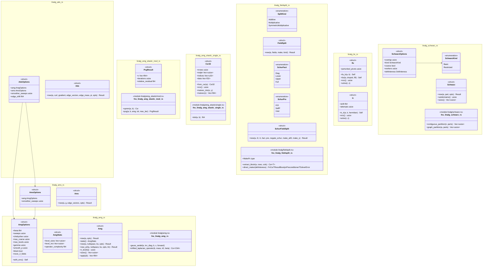

# Preconditioners: code

C4 level 4 (code) of the component **Preconditioners** (`femcore.laprecond`) in the container **femcore** (crate `femcore`). [Component view of the container](../../3-components/femcore.md) · [All code pages](../README.md)

> Smoothed-aggregation multigrid (scalar and elastic), auxiliary-space Maxwell and divergence solvers, Schwarz, field-split and incomplete factorisations.

**Decisions:** [ADR 33](../../../adr/0033-one-linear-algebra-driver-facade.md), [ADR 8](../../../adr/0008-ported-solver-library-staged-not-wired.md)  
**Size:** 8 files, 2516 lines.

## Files

| File | Lines | What it says about itself |
|---|---:|---|
| `crates/femcore/src/linalg/ads.rs` | 196 | **Auxiliary-space divergence solver** (ADS, Hiptmair–Xu 2007; Kolev–Vassilevski 2012 for the practical variant) for lowest-order `H(div)` (Raviart–Thomas, face element) matrices `A = Dᵀ W D + β M_f` (port item P1, the `H(div)` c... |
| `crates/femcore/src/linalg/amg.rs` | 327 | Smoothed-aggregation algebraic multigrid for real and **complex symmetric** matrices (port items "AMG for complex symmetric matrices" and the multigrid half of the shifted-Laplacian preconditioner, P2). |
| `crates/femcore/src/linalg/amg_elastic/mod.rs` | 675 | Smoothed-aggregation algebraic multigrid and a preconditioned conjugate gradient solver for large symmetric positive definite systems (3D elasticity and diffusion with millions of unknowns, where a sparse direct factorisation needs too m... |
| `crates/femcore/src/linalg/amg_elastic/single.rs` | 68 | The single-precision matrix copy used by the multigrid cycles, and a dot product. |
| `crates/femcore/src/linalg/ams.rs` | 171 | **Auxiliary-space Maxwell solver** (AMS, Hiptmair–Xu) for lowest-order `H(curl)` matrices (port item P1), for the curl-curl-plus-mass operator `A = K + βM` (also complex symmetric). |
| `crates/femcore/src/linalg/fieldsplit.rs` | 280 | Field-split and Schur-complement preconditioners (port item P5; the role of PETSc `PCFIELDSPLIT`) for coupled problems: saddle points, piezoelectric `(u, φ)`, thermo-mechanical or opto-mechanical couplings. |
| `crates/femcore/src/linalg/ilu.rs` | 445 | Incomplete factorisations as preconditioners (port item P3): **ILU(k)**, **ILUT** and **incomplete Cholesky** (IC(k); Hermitian `LLᴴ` or complex-symmetric `LLᵀ`), for real and complex matrices. Sequential and deterministic; natural o... |
| `crates/femcore/src/linalg/schwarz.rs` | 354 | Overlapping **additive and restricted additive Schwarz** preconditioners (port item P4; the role of PETSc `PCASM`) with exact local solves by sparse factorisation and an optional Nicolaides coarse space (one constant per subdomain), for ... |

## What it uses

| Target | Modules | Items |
|---|---|---|
| [Matrices and vectors](./lacore.md) | linalg::csr, linalg::csr::assembly, linalg::faer_glue, linalg::linop, linalg::scalar | C64, Csr, FaerScalar, Preconditioner, RCsr, Scalar |
| [Direct solvers](./ladirect.md) | linalg::direct | Definiteness, DirectSolve, ShiftedFactorization, ShiftedSolver, SolverError |
| [Linear algebra driver](./ladriver.md) | linalg::driver | DirectSolver |
| [Runtime services](./runtime.md) | par, progress | check, lap_since, note, stage, threads |

## Used by

| Component | Modules | Items |
|---|---|---|
| [ems: 3D cavity kernel](../ems/cavity.md) | linalg::amg_elastic | spmm |
| [Finite-element basics](./fem.md) | linalg::amg_elastic | Amg, AmgOptions, pcg |

## Class diagram

Public types with their public fields (or variants) and methods, free functions per file as a `module` box; arrows are field types and `impl Trait`. Capped at 36 types and a few members each; the table below is complete.

## Public items

| Kind | Item | File:line | Signature or summary |
|---|---|---|---|
| struct | `AdsOptions` | `linalg/ads.rs:35` | fields: `amg`, `ams`, `smoother_sweeps`, `edge_shift` |
| struct | `Ads` | `linalg/ads.rs:63` |  |
| fn | `Ads::new` | `linalg/ads.rs:82` | `pub fn new( a: &Csr<T>, curl: &Csr<f64>, gradient: &Csr<f64>, edge_vectors: &[[f64; 3]], edge_mass: &Csr<f64>, pi: &[Csr<f64>; 3], opts: &AdsOptions, ) -> Result<Self, SolverError>` —  * `a`: the face matrix; |
| struct | `AmgOptions` | `linalg/amg.rs:29` | fields: `theta`, `max_coarse`, `max_levels`, `smooth_prolongator`, `sweeps`, `hermitian` |
| struct | `AmgStats` | `linalg/amg.rs:66` | fields: `level_sizes`, `level_nnz`, `operator_complexity` —  Summary of the hierarchy, for logs and tests. |
| struct | `Amg` | `linalg/amg.rs:73` |  |
| fn | `gauss_seidel` | `linalg/amg.rs:172` | `pub(crate) fn gauss_seidel<T: Scalar>(a: &Csr<T>, inv_diag: &[T], b: &[T], x: &mut [T], forward: bool)` —  One Gauss–Seidel sweep (`forward` or backward) for `A x = b`, in place on `x`. |
| fn | `shifted_laplacian_operator` | `linalg/amg.rs:314` | `pub fn shifted_laplacian_operator<T: Scalar>( k: &Csr<T>, mass: Option<&Csr<T>>, k2: f64, beta: crate::linalg::scalar::C64, ) -> Csr<crate::linalg::scalar::C64>` —  Builds the shifted-Laplacian operator `K − (β₁ + iβ₂)·k²·M` (Erlangga et al.): the matrix that |
| fn | `Amg::new` | `linalg/amg.rs:81` | `pub fn new(a: &Csr<T>, opts: AmgOptions) -> Result<Self, crate::linalg::direct::SolverError>` |
| fn | `Amg::stats` | `linalg/amg.rs:125` | `pub fn stats(&self) -> AmgStats` |
| struct | `AmgOptions` | `linalg/amg_elastic/mod.rs:19` | fields: `theta`, `sweeps`, `chebyshev`, `max_coarse`, `max_levels`, `gamma`, `smooth_p`, `block`, `no_p1_coarse`, `smooth_lin` |
| struct | `Amg` | `linalg/amg_elastic/mod.rs:91` |  |
| fn | `spmm` | `linalg/amg_elastic/mod.rs:103` | `pub fn spmm(a: &Csr, b: &Csr) -> Csr` —  Sparse matrix product, on all cores by blocks of rows of `a` for large matrices. |
| struct | `PcgResult` | `linalg/amg_elastic/mod.rs:626` | fields: `x`, `iterations`, `relative_residual` |
| fn | `pcg` | `linalg/amg_elastic/mod.rs:633` | `pub fn pcg(a: &Csr, b: &[f64], amg: &Amg, tol: f64, max_iter: usize) -> PcgResult` —  Conjugate gradients preconditioned by one AMG V-cycle. |
| fn | `AmgOptions::with_env` | `linalg/amg_elastic/mod.rs:49` | `pub fn with_env(mut self) -> Self` —  Overrides from the environment (NYX_AMG_THETA, NYX_AMG_SWEEPS), for experiments. |
| fn | `Amg::new` | `linalg/amg_elastic/mod.rs:434` | `pub fn new(a: &Csr, nullspace: Vec<Vec<f64>>, bs: usize, opts: &AmgOptions) -> Result<Amg, String>` —  `nullspace`: the near-nullspace vectors in dof order (node-major, block size `bs`). |
| fn | `Amg::new_p2` | `linalg/amg_elastic/mod.rs:442` | `pub fn new_p2(a: &Csr, nullspace: Vec<Vec<f64>>, bs: usize, opts: &AmgOptions, lin: &Csr) -> Result<Amg, String>` —  Like `new` for a quadratic (P2) discretisation: the first coarse space is the linear (P1) |
| fn | `Amg::n_levels` | `linalg/amg_elastic/mod.rs:528` | `pub fn n_levels(&self) -> usize` |
| fn | `Amg::sizes` | `linalg/amg_elastic/mod.rs:533` | `pub fn sizes(&self) -> Vec<usize>` —  Sizes of the matrices on each level, finest first. |
| fn | `Amg::apply` | `linalg/amg_elastic/mod.rs:619` | `pub fn apply(&self, b: &[f64]) -> Vec<f64>` —  One V-cycle applied to `b` from a zero guess. |
| struct | `Csr32` | `linalg/amg_elastic/single.rs:18` | fields: `nrows`, `indptr`, `indices`, `data` —  Compressed rows with 32-bit column indices and single-precision values, for matrix-vector |
| fn | `dot` | `linalg/amg_elastic/single.rs:65` | `pub fn dot(a: &[f64], b: &[f64]) -> f64` —  Dot product. |
| fn | `Csr32::from_csr` | `linalg/amg_elastic/single.rs:27` | `pub fn from_csr(a: &RCsr) -> Csr32` |
| fn | `Csr32::nnz` | `linalg/amg_elastic/single.rs:30` | `pub fn nnz(&self) -> usize` |
| fn | `Csr32::matvec_into` | `linalg/amg_elastic/single.rs:41` | `pub fn matvec_into(&self, x: &[f64], y: &mut [f64])` |
| fn | `Csr32::matvec` | `linalg/amg_elastic/single.rs:55` | `pub fn matvec(&self, x: &[f64]) -> Vec<f64>` |
| struct | `AmsOptions` | `linalg/ams.rs:34` | fields: `amg`, `smoother_sweeps` |
| struct | `Ams` | `linalg/ams.rs:55` |  |
| fn | `Ams::new` | `linalg/ams.rs:75` | `pub fn new(a: &Csr<T>, g: &Csr<f64>, edge_vectors: &[[f64; 3]], opts: &AmsOptions) -> Result<Self, SolverError>` —  `a`: the edge matrix (SPD, or complex symmetric); `g`: discrete gradient (edges × interior |
| type | `MakePc` | `linalg/fieldsplit.rs:26` | `<'a, T>` —  Builds a sub-preconditioner from a diagonal block. |
| fn | `extract_block` | `linalg/fieldsplit.rs:29` | `pub fn extract_block<T: Scalar>(a: &Csr<T>, rows: &[usize], cols: &[usize]) -> Csr<T>` —  Extracts `A[rows, cols]` (rows/cols are global indices; the result is renumbered locally). |
| enum | `SplitKind` | `linalg/fieldsplit.rs:48` | variants: `Additive`, `Multiplicative`, `SymmetricMultiplicative` |
| struct | `FieldSplit` | `linalg/fieldsplit.rs:59` |  |
| enum | `SchurFact` | `linalg/fieldsplit.rs:157` | variants: `Diag`, `Lower`, `Upper`, `Full` |
| enum | `SchurPre` | `linalg/fieldsplit.rs:164` | variants: `A11`, `SelfP`, `User` |
| struct | `SchurFieldSplit` | `linalg/fieldsplit.rs:173` |  |
| fn | `direct_maker` | `linalg/fieldsplit.rs:275` | `pub fn direct_maker<T: crate::linalg::faer_glue::FaerScalar>( definiteness: crate::linalg::direct::Definiteness, ) -> impl Fn(&Csr<T>) -> Result<Box<dyn Preconditioner<T>>, SolverError>` —  Convenience builder for the common case: an exact (sparse direct) solver for a block. |
| fn | `FieldSplit::new` | `linalg/fieldsplit.rs:68` | `pub fn new(a: &Csr<T>, fields: Vec<Vec<usize>>, make: MakePc<'_, T>, kind: SplitKind) -> Result<Self, SolverError>` |
| fn | `SchurFieldSplit::new` | `linalg/fieldsplit.rs:188` | `pub fn new( a: &Csr<T>, i0: Vec<usize>, i1: Vec<usize>, fact: SchurFact, pre: SchurPre<T>, negate_schur: bool, make_a00: MakePc<'_, T>, make_s: MakePc<'_, T>, ) -> Result<Self, SolverError>` —  `i0`, `i1`: the two fields (disjoint, covering all unknowns). `make_a00` / `make_s` build the solvers for |
| struct | `Ilu` | `linalg/ilu.rs:27` | fields: `perturbed_pivots` —  Row-wise sparse triangular storage used by both factorisations: strictly-lower part, diagonal, strictly-upper part. |
| struct | `Ic` | `linalg/ilu.rs:307` | fields: `shift`, `attempts` —  Incomplete Cholesky `A ≈ L Lᴴ` (Hermitian) or `L Lᵀ` (complex symmetric / real symmetric). |
| fn | `Ilu::ilu_k` | `linalg/ilu.rs:103` | `pub fn ilu_k(a: &Csr<T>, k: u32) -> Self` —  ILU(`k`): `k = 0` is ILU(0). |
| fn | `Ilu::ilut` | `linalg/ilu.rs:145` | `pub fn ilut(a: &Csr<T>, droptol: f64, lfil: usize) -> Self` —  ILUT with drop tolerance `droptol` (relative to the 2-norm of the row of `A`) and at most `lfil` kept |
| fn | `Ilu::nnz` | `linalg/ilu.rs:269` | `pub fn nnz(&self) -> usize` |
| fn | `Ilu::solve` | `linalg/ilu.rs:274` | `pub fn solve(&self, r: &[T], z: &mut [T])` —  `z ← (LU)⁻¹ r`. |
| fn | `Ic::ic_k` | `linalg/ilu.rs:321` | `pub fn ic_k(a: &Csr<T>, k: u32, hermitian: bool) -> Self` —  IC(`k`) of the lower triangle of `a` (assumed Hermitian if `hermitian`, else symmetric). |
| fn | `Ic::nnz` | `linalg/ilu.rs:412` | `pub fn nnz(&self) -> usize` |
| fn | `Ic::solve` | `linalg/ilu.rs:417` | `pub fn solve(&self, r: &[T], z: &mut [T])` —  `z ← (L Lᴴ)⁻¹ r` (or `(L Lᵀ)⁻¹ r`). |
| enum | `SchwarzKind` | `linalg/schwarz.rs:33` | variants: `Basic`, `Restricted` |
| struct | `SchwarzOptions` | `linalg/schwarz.rs:39` | fields: `overlap`, `kind`, `coarse`, `workers`, `definiteness` |
| fn | `contiguous_partition` | `linalg/schwarz.rs:63` | `pub fn contiguous_partition(n: usize, parts: usize) -> Vec<usize>` —  `part[i] = i·parts/n`: contiguous index ranges of (almost) equal size. |
| fn | `graph_partition` | `linalg/schwarz.rs:69` | `pub fn graph_partition<T: Scalar>(a: &Csr<T>, parts: usize) -> Vec<usize>` —  Breadth-first region growing on the (symmetrised) graph of `a`: seeds are spread by repeated |
| struct | `Schwarz` | `linalg/schwarz.rs:168` |  |
| fn | `Schwarz::new` | `linalg/schwarz.rs:180` | `pub fn new(a: &Csr<T>, part: &[usize], opts: &SchwarzOptions) -> Result<Self, SolverError>` —  `part[i]` assigns dof `i` to a subdomain (`0..nparts`). |
| fn | `Schwarz::subdomains` | `linalg/schwarz.rs:289` | `pub fn subdomains(&self) -> usize` |
| fn | `Schwarz::sizes` | `linalg/schwarz.rs:294` | `pub fn sizes(&self) -> Vec<usize>` —  Sizes of the (overlapping) subdomains. |

Trait implementations in this component: `AdsOptions: Default`, `Ads: Preconditioner`, `AmgOptions: Default`, `Amg: Preconditioner`, `AmgOptions: Default`, `AmsOptions: Default`, `Ams: Preconditioner`, `FieldSplit: Preconditioner`, `SchurFieldSplit: Preconditioner`, `Ilu: Preconditioner`, `Ic: Preconditioner`, `SchwarzOptions: Default`, `Schwarz: Preconditioner`
