# Material specification: code

C4 level 4 (code) of the component **Material specification** (`femcore.material`) in the container **femcore** (crate `femcore`). [Component view of the container](../../3-components/femcore.md) · [All code pages](../README.md)

> TOML material files with explicit units, tensors, dispersion models evaluated at the wavelength, Zimmermann BCS superconducting conductivity, provenance and the library loader.

**Decisions:** [ADR 29](../../../adr/0029-material-files-are-toml-with-explicit-units.md), [ADR 30](../../../adr/0030-optical-dispersion-models-evaluated-at-the-study-wavelength.md), [ADR 34](../../../adr/0034-a-material-may-extend-another-and-replaces-whole-tables.md), [ADR 35](../../../adr/0035-material-provenance-oscillator-models-and-the-checked-library.md), [ADR 101](../../../adr/0101-sms-waveguide-modes-and-floquet-pml.md), [ADR 104](../../../adr/0104-bcs-surface-impedance-and-lumped-josephson-ports.md)  
**Size:** 13 files, 10051 lines.

## Files

| File | Lines | What it says about itself |
|---|---:|---|
| `crates/femcore/src/material/bcs.rs` | 1027 |  |
| `crates/femcore/src/material/coupled.rs` | 1787 |  |
| `crates/femcore/src/material/elastic.rs` | 784 |  |
| `crates/femcore/src/material/import.rs` | 1406 |  |
| `crates/femcore/src/material/mod.rs` | 427 |  |
| `crates/femcore/src/material/optics.rs` | 1264 |  |
| `crates/femcore/src/material/reader.rs` | 277 |  |
| `crates/femcore/src/material/schema.rs` | 489 |  |
| `crates/femcore/src/material/source.rs` | 136 |  |
| `crates/femcore/src/material/spec.rs` | 1241 |  |
| `crates/femcore/src/material/state_t.rs` | 747 |  |
| `crates/femcore/src/material/tensor.rs` | 171 |  |
| `crates/femcore/src/material/units.rs` | 295 |  |

## What it uses

Nothing outside the component (the standard library and external crates are not listed).

## Used by

| Component | Modules | Items |
|---|---|---|
| [dfs: Physics adapter](../dfs/adapter.md) | material::spec | Library |
| [dfs: Shared helpers](../dfs/common.md) | material | M3 |
| [dfs: Electrostatics kernel](../dfs/electro.md) | material | M3 |
| [dfs: Heat kernel](../dfs/heat.md) | material | M3 |
| [dfs: Typed problem](../dfs/problem.md) | material, material::bcs | FilmModel, bcs_surface_impedance |
| [ems: Physics adapter](../ems/adapter.md) | material, material::spec | Library, tensor_global |
| [ems: Thin-film IBC and Josephson ROM](../ems/ibc.md) | material | tensor_global |
| [ems: Typed problem](../ems/problem.md) | material, material::bcs | FilmModel, bcs_surface_impedance, rotate_tensor, rotation |
| [engine: Commands](../engine/commands.md) | material, material::spec | Anisotropy, Library |
| [engine: Job runner and queue](../engine/jobs.md) | material::spec | Library |
| [engine: Materials](../engine/materials.md) | material, material::bcs, material::coupled, material::import, material::spec | EV_TO_J, FilmModel, ImportFormat, ImportOptions, Library, MaterialSpec, REMOTE_CATALOG, Superconducting +6 |
| [engine: Meshing seam](../engine/meshing.md) | material::spec | Library |
| [engine: Results files](../engine/resultsIO.md) | material::spec | Library |
| [Error estimators](./estimators.md) | material | M3 |
| [Finite-element basics](./fem.md) | material | Anisotropy, M3, M6 |
| [Meshing facade](./meshing.md) | material | M6 |
| [Frame and sections](./section.md) | material | M3, M6 |
| [physics: Problem envelope](../physics/envelope.md) | material, material::coupled, material::elastic, material::spec, material::tensor | Class, InterfaceLayer, Library, M3, Requirement, Tensor, TensorProp, iso_tensor +1 |
| [physics: Physics trait and registry](../physics/trait.md) | material::spec | Library |
| [sms: Physics adapter](../sms/adapter.md) | material, material::spec | Library, isotropic_stiffness, stiffness_global |
| [sms: Axisymmetric kernel](../sms/axisym.md) | material | M6 |
| [sms: Cross-section study kernel](../sms/crosssection.md) | material | M6 |
| [sms: Low-reflecting boundary](../sms/lrb.md) | material | M6 |
| [sms: Solid kernel](../sms/solid.md) | material | M3, M6 |
| [sms: Waveguide kernel](../sms/waveguide.md) | material | M6 |

## Class diagram

Public types with their public fields (or variants) and methods, free functions per file as a `module` box; arrows are field types and `impl Trait`. Capped at 36 types and a few members each; the table below is complete. **This component has 8 more types than the diagram shows.**

```mermaid
classDiagram
  namespace material_bcs_rs {
    class FilmModel {
        <<enumeration>>
        TwoSided
        Kerr
        ThinLimit
        +parse(s) Option~FilmModel~
        +as_str() str
    }
    class Superconducting {
        <<struct>>
        +source Vec~Source~
        +tc f64
        +gap_0 Option~f64~
        +lambda_l Option~f64~
        +xi_0 Option~f64~
        +mean_free_path Option~f64~
        +sigma_n Option~f64~
        +dynes_gamma Option~f64~
        +more_4_fields
        +effective_gap_0() f64
        +read(s) Result
        +write(tbl)
    }
    class BcsEval {
        <<struct>>
        +sigma Complex64
        +sigma_n f64
        +delta_j f64
        +lambda_eff f64
        +z_s Complex64
        +r_s f64
        +l_k_sq f64
        +l_eff f64
        +more_1_fields
    }
    class fns_material_bcs_rs {
        <<module material/bcs.rs>>
        +bcs_gap(tc, gap_0_j, temperature) Result
        +surface_impedance_from_params(tc, gap_0_j, lambda_l, xi_0, mean_free_path, sigma_n, freq_hz, temperature, thickness, film_model) Result
        +bcs_surface_impedance(sc, freq_hz, temperature, thickness, film_model) Result
        +K_B const
        +HBAR const
        +EV_TO_J const
        +MU0 const
        +more_2_items
    }
  }
  namespace material_coupled_rs {
    class Dielectric {
        <<struct>>
        +source Vec~Source~
        +eps_r Option~TensorProp~
        +eps_clamped Option~TensorProp~
        +eps_free Option~TensorProp~
        +eps_inf Option~TensorProp~
        +eps_t Option~TempTensor~
        +loss_tangent Option~TensorProp~
        +loss_ref_freq Option~f64~
        +more_2_fields
        +read(s) Result
        +write(tbl)
        +complex_permittivity(freq_hz, temperature_k, e_field_v_per_m, prefer_free) Option
    }
    class InterfaceLayer {
        <<struct>>
        +source Vec~Source~
        +oxide Option~String~
        +thickness f64
        +eps_r f64
        +tan_delta_tls_0 f64
        +e_crit Option~f64~
        +read(s) Result
        +write(tbl)
        +effective_tan_delta(freq_hz, temperature_k, e_field_v_per_m) f64
    }
    class Interfaces {
        <<struct>>
        +ma Option~InterfaceLayer~
        +ms Option~InterfaceLayer~
        +sa Option~InterfaceLayer~
        +is_empty() bool
        +read(s) Result
        +write(tbl)
    }
    class PiezoForm {
        <<enumeration>>
        StressCharge
        StrainCharge
    }
    class Piezoelectric {
        <<struct>>
        +source Vec~Source~
        +form PiezoForm
        +matrix slice
        +to_rank3() slice
        +from_rank3(form, t) slice
        +rotate(r) slice
        +stress_charge(stiffness_voigt) Resultf64
        +strain_charge(stiffness_voigt) Resultf64
        +read(s, pg) Result
        +write(tbl)
    }
    class Photoelastic {
        <<struct>>
        +source Vec~Source~
        +wavelength Option~f64~
        +matrix M6
        +to_rank4() slice
        +rotate_voigt(r) M6
        +rotate_solver(r) M6
        +read(s, pg) Result
        +write(tbl)
    }
    class ElectroOptic {
        <<struct>>
        +source Vec~Source~
        +wavelength Option~f64~
        +clamped Option
        +free Option
        +resolved_free(pe, d_strain_charge) Optionf64
        +resolved_clamped(pe, d_strain_charge) Optionf64
        +read(s, pg) Result
        +write(tbl)
    }
    class Viscoelastic {
        <<struct>>
        +source Vec~Source~
        +matrix M6
        +cryo_qm_floor Option~f64~
        +to_solver_voigt() M6
        +read(s, pg) Result
        +write(tbl)
    }
    class fns_material_coupled_rs {
        <<module material/coupled.rs>>
        +solver_to_voigt_m6(m) M6
        +voigt_to_solver_m6(m) M6
        +inv3(a) Result
        +inv6(a) Result
        +tls_saturation_factor(tan_delta_tls_0, e_crit, freq_hz, temperature_k, e_field_v_per_m) f64
        +resolve_piezo_legendre_duals(ce_voigt, piezo, eps_clamped_r, eps_free_r) Result
        +stiffness_to_textbook_voigt(s) M6
        +rotate_m3(m, r) M3
        +rot_z_deg(angle_deg) M3
        +EPSILON_0 const
        +DIELECTRIC_KEYS const
        +IFACE_KEYS const
        +INTERFACES_KEYS const
        +more_4_items
    }
  }
  namespace material_elastic_rs {
    class Unique {
        <<enumeration>>
        Y
        Z
    }
    class Class {
        <<enumeration>>
        Isotropic
        Cubic
        Hexagonal
        Trigonal
        Tetragonal
        Orthotropic
        Monoclinic
        Triclinic
        +name() str
        +parse(s, unique) Option~Class~
        +constants() Vec
    }
    class Elastic {
        <<struct>>
        +c M6
        +class Option~Class~
        +exact_constants bool
        +source Vec~Source~
        +from_matrix(c) Result
        +from_constants(class, constants) Result
        +isotropic(e, nu) Result
        +compliance() M6
        +detect_class() Class
        +global(euler_deg) M6
        +eigenvalue_range() tuple
        +read(s) Result
        +more_1_methods()
    }
    class fns_material_elastic_rs {
        <<module material/elastic.rs>>
        ~sym_eigenvalues(a) slice
        +invert6(m) Option~M6~
        ~NAMES const
    }
  }
  namespace material_import_rs {
    class ImportFormat {
        <<enumeration>>
        RefractiveIndexInfo
        Aflow
        MaterialsProject
        Numbat
        +parse(s) Result
        +id() str
        +label() str
    }
    class ImportOptions {
        <<struct>>
        +name str
        +description Option
        +extends Option
        +source_url Option
    }
    class CatalogEntry {
        <<struct>>
        +id str
        +domain str
        +format ImportFormat
        +target str
        +extends Option
        +summary str
    }
    class fns_material_import_rs {
        <<module material/import.rs>>
        +catalog_entry(id) Option
        +resolve_url(format, target) Result
        +import_to_toml(format, raw, opts) Result
        +validate_against_library(lib, name, toml_text) Result
        +strip_jsonc_comments(s) String
        +REMOTE_CATALOG const
    }
  }
  namespace material_mod_rs {
    class Stiffness {
        <<enumeration>>
        Cubic
        Hexagonal
        Trigonal
        Orthotropic
        General
        +name() str
        +constants_mut() Vec
    }
    class Tensor {
        <<enumeration>>
        Uniaxial
        Diagonal
        Symmetric
        +name() str
        +matrix() M3
        +constants_mut() Vec
    }
    class Anisotropy {
        <<struct>>
        +stiffness Option~Stiffness~
        +conductivity Option~Tensor~
        +permittivity Option~Tensor~
        +expansion Option~Tensor~
        +euler_deg slice
        +permittivity_im Option~Tensor~
        +viscosity Option~M6~
        +piezo_e Option
        +more_1_fields
    }
    class fns_material_mod_rs {
        <<module material/mod.rs>>
        +rotation(euler_deg) M3
        +euler_from_rotation(m) slice
        +rotate_tensor(t, r) M3
        +stiffness_global(s, euler_deg) M6
        +rotate_m6_global(m, euler_deg) M6
        +isotropic_stiffness(e, nu) M6
        +tensor_global(t, euler_deg) M3
        +iso_tensor(v) M3
        +is_positive_definite(c) bool
        +sapphire() tuple
        +more_1_functions()
        +M3 type
        +M6 type
    }
  }
  namespace material_optics_rs {
    class Interp {
        <<enumeration>>
        Pchip
        Linear
    }
    class Extrapolate {
        <<enumeration>>
        Error
        Linear
    }
    class Dispersion {
        <<enumeration>>
        Constant
        Sellmeier
        Cauchy
        Tabulated
        Schott
        Herzberger
        RiiFormula4
        RiiFormula5
        RiiFormula6
        Oscillators
        +name() str
    }
    class AxisModel {
        <<struct>>
        +dispersion Dispersion
        +source Vec~Source~
        +dn_dt f64
        +k_data Option
        +dn_dt_einstein_theta Option~f64~
        +dn_dt_range Option
    }
    class Axes {
        <<enumeration>>
        Isotropic
        Uniaxial
        Biaxial
        +model(axis) AxisModel
        +models() Vec
    }
    class Optical {
        <<struct>>
        +source Vec~Source~
        +wavelength_unit String
        +unit_m f64
        +range Option
        +reference_temperature f64
        +axes Axes
        +is_anisotropic() bool
        +range_m() Option
        +nk(axis, lambda_m, temp_k) Result
        +index(axis, lambda_m, temp_k) Result
        +d_index_d_lambda(axis, lambda_m, temp_k) Result
        +group_index(axis, lambda_m, temp_k) Result
        +permittivity_diag(lambda_m, temp_k) ResultComplex64
        +permittivity_global(lambda_m, temp_k, euler_deg) ResultComplex64
        +more_3_methods()
    }
    class OpticsError {
        <<enumeration>>
        OutOfRange
        NotFinite
        BadWavelength
    }
    class fns_material_optics_rs {
        <<module material/optics.rs>>
        +MODEL_KEYS const
        +OPTICAL_KEYS const
    }
  }
  namespace material_reader_rs {
    class MaterialError {
        <<struct>>
        +material String
        +path String
        +message String
    }
    class Tree {
        <<enumeration>>
        Num
        List
        Uniaxial
    }
    class Section {
        <<struct>>
        +material String
        +path String
        +new(material, path, table) Self
        +err(key, message) MaterialError
        +has(key) bool
        +keys() Vec~String~
        +value(key) Option
        +string(key) Result
        +bool(key) Result
        +number(key) Result
        +more_6_methods()
    }
    class fns_material_reader_rs {
        <<module material/reader.rs>>
        ~edit_distance(a, b) usize
    }
  }
  namespace material_schema_rs {
    class fns_material_schema_rs {
        <<module material/schema.rs>>
        +material_schema_v1() Value
        +material_schema() Value
        +SCHEMA_VERSION const
        +SCHEMA_VERSION_V1 const
    }
  }
  namespace material_source_rs {
    class Source {
        <<struct>>
        +cite String
        +url Option~String~
        +doi Option~String~
        +verified Option~String~
        +text(cite) Source
        +is_verified() bool
        +flags_uncertainty() bool
    }
    class fns_material_source_rs {
        <<module material/source.rs>>
        +read_sources(s, key) Result
        +write_sources(v) Option~Value~
    }
  }
  namespace material_spec_rs {
    class Thermal {
        <<struct>>
        +source Vec~Source~
        +conductivity Option~TensorProp~
        +specific_heat Option~f64~
        +expansion Option~TensorProp~
        +conductivity_t Option~TempTensor~
        +specific_heat_t Option~TempCurve~
        +expansion_t Option~TempTensor~
        +contraction Option~TempTensor~
    }
    class Electrical {
        <<struct>>
        +source Vec~Source~
        +permittivity Option~TensorProp~
        +permeability Option~f64~
        +conductivity Option~TensorProp~
        +loss_tangent Option~TensorProp~
    }
    class MaterialSpec {
        <<struct>>
        +format i64
        +name String
        +description Option~String~
        +source Vec~Source~
        +notes Option~String~
        +density Option~f64~
        +kind Option~MaterialKind~
        +point_group Option~PointGroup~
        +more_14_fields
        +from_toml_named(text, fallback_name) Result
        +from_table(table, fallback_name) Result
        +from_toml(text) Result
        +load(path) Result
        +to_toml() String
        +permittivity_clamped() Option~M3~
        +permittivity_free() Option~M3~
        +stiffness_constant_e() Option~M6~
        +more_9_methods()
    }
    class Library {
        <<struct>>
        +load_dir(dir) Result
        +read(text, fallback_name) Result
        +with_texts(texts) Result
        +read_table(text, fallback_name) Result
        +get(name) Option
        +require(name) Result
        +names() Vec~String~
        +len() usize
        +more_1_methods()
    }
    class Keys {
        <<struct>>
        +top slice
        +top_v1 slice
        +elastic slice
        +thermal slice
        +electrical slice
        +dielectric slice
        +superconducting slice
        +piezoelectric slice
        +more_7_fields
    }
    class fns_material_spec_rs {
        <<module material/spec.rs>>
        +merge_over(base, over) Table
        +keys() Keys
        +FORMAT const
        +FORMAT_V1 const
        +TOP_KEYS const
        +TOP_KEYS_V1 const
        +more_3_items
    }
  }
  namespace material_state_t_rs {
    class fns_material_state_t_rs {
        <<module material/state_t.rs>>
        +einstein_thermal_coordinate(temperature_k, theta_e_k) f64
    }
  }
  namespace material_units_rs {
    class fns_material_units_rs {
        <<module material/units.rs>>
        +lookup(unit) Option
        +to_si(value, unit, expect) Result
        +split_quantity(s) Result
    }
  }
  Superconducting --> Source
  Dielectric --> Source
  InterfaceLayer --> Source
  Interfaces --> InterfaceLayer
  Piezoelectric --> Source
  Piezoelectric --> PiezoForm
  Photoelastic --> Source
  ElectroOptic --> Source
  Viscoelastic --> Source
  Class --> Unique
  Elastic --> Class
  Elastic --> Source
  CatalogEntry --> ImportFormat
  Anisotropy --> Stiffness
  Anisotropy --> Tensor
  Dispersion --> Interp
  Dispersion --> Extrapolate
  AxisModel --> Dispersion
  AxisModel --> Source
  Axes --> AxisModel
  Optical --> Source
  Optical --> Axes
  Thermal --> Source
  Electrical --> Source
  MaterialSpec --> Source
```

## Public items

| Kind | Item | File:line | Signature or summary |
|---|---|---|---|
| const | `K_B` | `material/bcs.rs:21` | `f64` —  Boltzmann constant `k_B` in J/K (SI exact). |
| const | `HBAR` | `material/bcs.rs:23` | `f64` —  Reduced Planck constant `hbar` in J*s. |
| const | `EV_TO_J` | `material/bcs.rs:25` | `f64` —  Elementary charge / eV-to-Joule conversion factor in J/eV (SI exact). |
| const | `MU0` | `material/bcs.rs:27` | `f64` —  Vacuum magnetic permeability `mu_0` in H/m. |
| const | `BCS_GAP_RATIO` | `material/bcs.rs:29` | `f64` —  Default weak-coupling BCS zero-temperature gap ratio `Delta(0) / (k_B T_c)`. |
| enum | `FilmModel` | `material/bcs.rs:78` | variants: `TwoSided`, `Kerr`, `ThinLimit` —  Thin-film boundary model mapping bulk complex conductivity `sigma` and film thickness `d` |
| struct | `Superconducting` | `material/bcs.rs:109` | fields: `source`, `tc`, `gap_0`, `lambda_l`, `xi_0`, `mean_free_path`, `sigma_n`, `dynes_gamma`, `r_res`, `x_qp_floor`, `nominal_thickness`, `film_model` —  Superconducting normal-state, gap, mean-free-path, and sub-gap mK loss parameters (`[superconducting]`). |
| const | `SC_KEYS` | `material/bcs.rs:146` | `&[&str]` |
| struct | `BcsEval` | `material/bcs.rs:282` | fields: `sigma`, `sigma_n`, `delta_j`, `lambda_eff`, `z_s`, `r_s`, `l_k_sq`, `l_eff`, `g_eff` —  Result of a BCS complex conductivity and thin-film surface impedance evaluation. |
| fn | `bcs_gap` | `material/bcs.rs:349` | `pub fn bcs_gap(tc: f64, gap_0_j: Option<f64>, temperature: f64) -> Result<f64, String>` —  Solves the exact self-consistent BCS gap equation for `Delta(T)` in Joules. |
| fn | `surface_impedance_from_params` | `material/bcs.rs:720` | `pub fn surface_impedance_from_params( tc: f64, gap_0_j: Option<f64>, lambda_l: Option<f64>, xi_0: Option<f64>, mean_free_path: Option<f64>, sigma_n: Option<f64>, freq_hz: f64, temperature: f64, thickness: f64, film_model: FilmModel, ) -> Result<BcsEval, String>` —  Evaluates arbitrary-purity BCS complex conductivity and thin-film surface impedance from explicit parameters. |
| fn | `bcs_surface_impedance` | `material/bcs.rs:886` | `pub fn bcs_surface_impedance( sc: &Superconducting, freq_hz: f64, temperature: f64, thickness: f64, film_model: FilmModel, ) -> Result<BcsEval, String>` —  Evaluates arbitrary-purity BCS complex conductivity and thin-film surface impedance for a `[superconducting]` block, |
| fn | `FilmModel::parse` | `material/bcs.rs:89` | `pub fn parse(s: &str) -> Option<FilmModel>` |
| fn | `FilmModel::as_str` | `material/bcs.rs:98` | `pub fn as_str(self) -> &'static str` |
| fn | `Superconducting::effective_gap_0` | `material/bcs.rs:186` | `pub fn effective_gap_0(&self) -> f64` —  Zero-temperature gap `Delta(0)` in Joules, defaulting to weak-coupling `1.7638 k_B T_c`. |
| fn | `Superconducting::read` | `material/bcs.rs:190` | `pub fn read(s: &mut Section) -> Result<Self, MaterialError>` |
| fn | `Superconducting::write` | `material/bcs.rs:242` | `pub fn write(&self, tbl: &mut toml::Table)` |
| const | `EPSILON_0` | `material/coupled.rs:28` | `f64` —  Vacuum electric permittivity `epsilon_0` in F/m (CODATA 2022). |
| fn | `solver_to_voigt_m6` | `material/coupled.rs:37` | `pub fn solver_to_voigt_m6(m: &M6) -> M6` —  Converts a `6x6` matrix from solver Voigt `(xx, yy, zz, xy, yz, xz)` to textbook Voigt `(xx, yy, zz, yz, xz, xy)`. |
| fn | `voigt_to_solver_m6` | `material/coupled.rs:49` | `pub fn voigt_to_solver_m6(m: &M6) -> M6` —  Converts a `6x6` matrix from textbook Voigt `(xx, yy, zz, yz, xz, xy)` to solver Voigt `(xx, yy, zz, xy, yz, xz)`. |
| fn | `inv3` | `material/coupled.rs:61` | `pub fn inv3(a: &M3) -> Result<M3, String>` —  Exact `3x3` matrix inverse. |
| fn | `inv6` | `material/coupled.rs:79` | `pub fn inv6(a: &M6) -> Result<M6, String>` —  Partial-pivoted Gauss-Jordan `6x6` matrix inverse. |
| fn | `tls_saturation_factor` | `material/coupled.rs:146` | `pub fn tls_saturation_factor( tan_delta_tls_0: f64, e_crit: Option<f64>, freq_hz: Option<f64>, temperature_k: Option<f64>, e_field_v_per_m: Option<f64>, ) -> f64` —  TLS loss tangent factor `tan_delta_tls_0 * tanh(h f / (2 k_B T)) / sqrt(1 + (E / E_c)^2)`. |
| struct | `Dielectric` | `material/coupled.rs:169` | fields: `source`, `eps_r`, `eps_clamped`, `eps_free`, `eps_inf`, `eps_t`, `loss_tangent`, `loss_ref_freq`, `tls_tan_delta_0`, `tls_e_crit` —  Microwave/RF dielectric permittivity and bulk + TLS dielectric loss (`[dielectric]`). |
| const | `DIELECTRIC_KEYS` | `material/coupled.rs:201` | `&[&str]` |
| struct | `InterfaceLayer` | `material/coupled.rs:349` | fields: `source`, `oxide`, `thickness`, `eps_r`, `tan_delta_tls_0`, `e_crit` —  Native oxide or interface Two-Level System loss layer (`[interfaces.{ma,ms,sa}]`). |
| const | `IFACE_KEYS` | `material/coupled.rs:365` | `&[&str]` |
| struct | `Interfaces` | `material/coupled.rs:437` | fields: `ma`, `ms`, `sa` —  Superconducting / dielectric surface oxide interfaces (`[interfaces]`). |
| const | `INTERFACES_KEYS` | `material/coupled.rs:470` | `&[&str]` |
| const | `PIEZOELECTRIC_KEYS` | `material/coupled.rs:471` | `&[&str]` |
| const | `PHOTOELASTIC_KEYS` | `material/coupled.rs:472` | `&[&str]` |
| const | `ELECTRO_OPTIC_KEYS` | `material/coupled.rs:473` | `&[&str]` |
| const | `VISCOELASTIC_KEYS` | `material/coupled.rs:474` | `&[&str]` |
| enum | `PiezoForm` | `material/coupled.rs:478` | variants: `StressCharge`, `StrainCharge` |
| struct | `Piezoelectric` | `material/coupled.rs:485` | fields: `source`, `form`, `matrix` —  Piezoelectric coupling tensor (`[piezoelectric]`), stored in textbook Voigt `(xx, yy, zz, yz, xz, xy)`. |
| struct | `Photoelastic` | `material/coupled.rs:772` | fields: `source`, `wavelength`, `matrix` —  Photoelastic Pockels tensor `p_IJ` (`[photoelastic]`) in textbook Voigt `(xx, yy, zz, yz, xz, xy)`. |
| struct | `ElectroOptic` | `material/coupled.rs:1016` | fields: `source`, `wavelength`, `clamped`, `free` —  Linear electro-optic (Pockels) tensor `r_Ij` (`[electro_optic]`) in m/V and textbook Voigt order. |
| struct | `Viscoelastic` | `material/coupled.rs:1254` | fields: `source`, `matrix`, `cryo_qm_floor` —  Phononic / viscoelastic damping tensor `eta_IJ` (`[viscoelastic]`) in `Pa*s` and textbook Voigt order. |
| fn | `resolve_piezo_legendre_duals` | `material/coupled.rs:1404` | `pub fn resolve_piezo_legendre_duals( ce_voigt: &M6, piezo: &Piezoelectric, eps_clamped_r: Option<&M3>, eps_free_r: Option<&M3>, ) -> Result<(M3, M3, M6, M6), String>` —  Exact piezoelectric Legendre duals in textbook Voigt order `(xx, yy, zz, yz, xz, xy)`. |
| fn | `stiffness_to_textbook_voigt` | `material/coupled.rs:1479` | `pub fn stiffness_to_textbook_voigt(s: &Stiffness) -> M6` —  Rotates a stiffness `Stiffness` enum into textbook Voigt `(xx, yy, zz, yz, xz, xy)` without shear conversion. |
| fn | `rotate_m3` | `material/coupled.rs:1547` | `pub fn rotate_m3(m: &M3, r: &M3) -> M3` —  Rotates a `3x3` permittivity/conductivity/loss tensor by `R`. |
| fn | `rot_z_deg` | `material/coupled.rs:1552` | `pub fn rot_z_deg(angle_deg: f64) -> M3` —  Computes `R_z(angle_deg)` for crystallographic rotation checks. |
| fn | `Dielectric::read` | `material/coupled.rs:217` | `pub fn read(s: &mut Section) -> Result<Self, MaterialError>` |
| fn | `Dielectric::write` | `material/coupled.rs:282` | `pub fn write(&self, tbl: &mut toml::Table)` |
| fn | `Dielectric::complex_permittivity` | `material/coupled.rs:317` | `pub fn complex_permittivity( &self, freq_hz: Option<f64>, temperature_k: Option<f64>, e_field_v_per_m: Option<f64>, prefer_free: bool, ) -> Option<(M3, M3)>` —  Evaluates `(eps_re, eps_im_loss)` in the crystal frame where passive loss corresponds to |
| fn | `InterfaceLayer::read` | `material/coupled.rs:377` | `pub fn read(s: &mut Section) -> Result<Self, MaterialError>` |
| fn | `InterfaceLayer::write` | `material/coupled.rs:415` | `pub fn write(&self, tbl: &mut toml::Table)` |
| fn | `InterfaceLayer::effective_tan_delta` | `material/coupled.rs:430` | `pub fn effective_tan_delta(&self, freq_hz: Option<f64>, temperature_k: Option<f64>, e_field_v_per_m: Option<f64>) -> f64` |
| fn | `Interfaces::is_empty` | `material/coupled.rs:447` | `pub fn is_empty(&self) -> bool` |
| fn | `Interfaces::read` | `material/coupled.rs:451` | `pub fn read(s: &mut Section) -> Result<Self, MaterialError>` |
| fn | `Interfaces::write` | `material/coupled.rs:459` | `pub fn write(&self, tbl: &mut toml::Table)` |
| fn | `Piezoelectric::to_rank3` | `material/coupled.rs:570` | `pub fn to_rank3(&self) -> [[[f64` —  Expands `[piezoelectric]` textbook Voigt `3x6` matrix to a full rank-3 tensor `t[i][j][k]`. |
| fn | `Piezoelectric::from_rank3` | `material/coupled.rs:588` | `pub fn from_rank3(form: PiezoForm, t: &[[[f64; 3]; 3]; 3]) -> [[f64` —  Reconstructs a `3x6` textbook Voigt matrix from a rank-3 tensor `t[i][j][k]` (`t[i][j][k] == t[i][k][j]`). |
| fn | `Piezoelectric::rotate` | `material/coupled.rs:604` | `pub fn rotate(&self, r: &M3) -> [[f64` —  Rotates the `3x6` piezoelectric coupling matrix from crystal frame into global frame via `R`. |
| fn | `Piezoelectric::stress_charge` | `material/coupled.rs:626` | `pub fn stress_charge(&self, stiffness_voigt: Option<&M6>) -> Result<[[f64` —  Converts to stress-charge `e_iJ` (`C/m^2`) in textbook Voigt, multiplying `d * C^E` if stored as strain-charge. |
| fn | `Piezoelectric::strain_charge` | `material/coupled.rs:649` | `pub fn strain_charge(&self, stiffness_voigt: Option<&M6>) -> Result<[[f64` —  Converts to strain-charge `d_iJ` (`C/N = m/V`) in textbook Voigt, multiplying `e * (C^E)^-1` if stored as stress-charge. |
| fn | `Piezoelectric::read` | `material/coupled.rs:672` | `pub fn read(s: &mut Section, pg: Option<PointGroup>) -> Result<Self, MaterialError>` |
| fn | `Piezoelectric::write` | `material/coupled.rs:750` | `pub fn write(&self, tbl: &mut toml::Table)` |
| fn | `Photoelastic::to_rank4` | `material/coupled.rs:784` | `pub fn to_rank4(&self) -> [[[[f64` —  Expands textbook Voigt `6x6` matrix `p_IJ` directly into full rank-4 tensor `p_{abcd}` (`p_{abcd} = p_{IJ}` without factor 2). |
| fn | `Photoelastic::rotate_voigt` | `material/coupled.rs:800` | `pub fn rotate_voigt(&self, r: &M3) -> M6` —  Rotates photoelastic tensor `p_{IJ}` into the global frame using `R`, returning textbook Voigt `6x6`. |
| fn | `Photoelastic::rotate_solver` | `material/coupled.rs:832` | `pub fn rotate_solver(&self, r: &M3) -> M6` —  Rotates photoelastic tensor `p_{IJ}` into solver Voigt order `(xx, yy, zz, xy, yz, xz)`. |
| fn | `Photoelastic::read` | `material/coupled.rs:836` | `pub fn read(s: &mut Section, pg: Option<PointGroup>) -> Result<Self, MaterialError>` |
| fn | `Photoelastic::write` | `material/coupled.rs:884` | `pub fn write(&self, tbl: &mut toml::Table)` |
| fn | `ElectroOptic::resolved_free` | `material/coupled.rs:1079` | `pub fn resolved_free(&self, pe: Option<&Photoelastic>, d_strain_charge: Option<&[[f64; 6]; 3]>) -> Option<[[f64` —  Derives free `r^T` from clamped `r^S` (`r^T = r^S + p * d^T`), or returns explicit `free`. |
| fn | `ElectroOptic::resolved_clamped` | `material/coupled.rs:1101` | `pub fn resolved_clamped(&self, pe: Option<&Photoelastic>, d_strain_charge: Option<&[[f64; 6]; 3]>) -> Option<[[f64` —  Derives clamped `r^S` from free `r^T` (`r^S = r^T - p * d^T`), or returns explicit `clamped`. |
| fn | `ElectroOptic::read` | `material/coupled.rs:1122` | `pub fn read(s: &mut Section, pg: Option<PointGroup>) -> Result<Self, MaterialError>` |
| fn | `ElectroOptic::write` | `material/coupled.rs:1230` | `pub fn write(&self, tbl: &mut toml::Table)` |
| fn | `Viscoelastic::to_solver_voigt` | `material/coupled.rs:1265` | `pub fn to_solver_voigt(&self) -> M6` |
| fn | `Viscoelastic::read` | `material/coupled.rs:1269` | `pub fn read(s: &mut Section, pg: Option<PointGroup>) -> Result<Self, MaterialError>` |
| fn | `Viscoelastic::write` | `material/coupled.rs:1332` | `pub fn write(&self, tbl: &mut toml::Table)` |
| enum | `Unique` | `material/elastic.rs:14` | variants: `Y`, `Z` |
| enum | `Class` | `material/elastic.rs:21` | variants: `Isotropic`, `Cubic`, `Hexagonal`, `Trigonal`, `Tetragonal`, `Orthotropic`, `Monoclinic`, `Triclinic` —  Crystal class of the stiffness (the elastic symmetry group, not the full point group). |
| const | `NAMES` | `material/elastic.rs:54` | `[[&str` |
| fn | `sym_eigenvalues` | `material/elastic.rs:230` | `pub(super) fn sym_eigenvalues<const N: usize>(mut a: [[f64; N]; N]) -> [f64` —  Eigenvalues of a symmetric matrix by cyclic Jacobi rotations, ascending. |
| fn | `invert6` | `material/elastic.rs:276` | `pub fn invert6(m: &M6) -> Option<M6>` —  Inverse of a 6x6 matrix by Gauss-Jordan elimination with partial pivoting; `None` if singular. |
| struct | `Elastic` | `material/elastic.rs:329` | fields: `c`, `class`, `exact_constants`, `source` |
| fn | `Class::name` | `material/elastic.rs:85` | `pub fn name(self) -> &'static str` |
| fn | `Class::parse` | `material/elastic.rs:98` | `pub fn parse(s: &str, unique: Unique) -> Option<Class>` |
| fn | `Class::constants` | `material/elastic.rs:180` | `pub fn constants(self) -> Vec<&'static str>` —  Names of the independent constants, in the order of the class definition. |
| fn | `Elastic::from_matrix` | `material/elastic.rs:342` | `pub fn from_matrix(c: M6) -> Result<Elastic, String>` |
| fn | `Elastic::from_constants` | `material/elastic.rs:348` | `pub fn from_constants(class: Class, constants: &[(&str, f64)]) -> Result<Elastic, String>` —  Class and independent constants in Pa, for example `(Class::Cubic, [("c11", 165.7e9), ...])`. |
| fn | `Elastic::isotropic` | `material/elastic.rs:361` | `pub fn isotropic(e: f64, nu: f64) -> Result<Elastic, String>` —  Isotropic from Young's modulus and Poisson's ratio. |
| fn | `Elastic::compliance` | `material/elastic.rs:373` | `pub fn compliance(&self) -> M6` |
| fn | `Elastic::detect_class` | `material/elastic.rs:378` | `pub fn detect_class(&self) -> Class` —  The highest-symmetry class whose constants reproduce the matrix (to 1e-6 of its largest entry). |
| fn | `Elastic::global` | `material/elastic.rs:392` | `pub fn global(&self, euler_deg: [f64; 3]) -> M6` —  Stiffness in the solver's Voigt order (xx, yy, zz, xy, yz, xz) after rotating the crystal with Bunge angles (degrees). |
| fn | `Elastic::eigenvalue_range` | `material/elastic.rs:397` | `pub fn eigenvalue_range(&self) -> (f64, f64)` —  Smallest and largest eigenvalue of the stiffness in the normalised (Mandel) form, Pa. |
| fn | `Elastic::read` | `material/elastic.rs:403` | `pub fn read(s: &mut Section) -> Result<Elastic, MaterialError>` —  Reads the `[elastic]` table. |
| fn | `Elastic::write` | `material/elastic.rs:566` | `pub fn write(&self) -> toml::Table` —  The `[elastic]` table written from this value: constants if the file gave them, otherwise the matrix (upper triangle), in GPa. |
| enum | `ImportFormat` | `material/import.rs:20` | variants: `RefractiveIndexInfo`, `Aflow`, `MaterialsProject`, `Numbat` |
| struct | `ImportOptions` | `material/import.rs:57` | fields: `name`, `description`, `extends`, `source_url` |
| struct | `CatalogEntry` | `material/import.rs:65` | fields: `id`, `domain`, `format`, `target`, `extends`, `summary` |
| const | `REMOTE_CATALOG` | `material/import.rs:75` | `&[CatalogEntry]` —  Curated remote presets across photonics, phononics and superconducting/cryogenic metals that are not shipped directly in `materials/*.toml`. |
| fn | `catalog_entry` | `material/import.rs:270` | `pub fn catalog_entry(id: &str) -> Option<&'static CatalogEntry>` |
| fn | `resolve_url` | `material/import.rs:293` | `pub fn resolve_url(format: ImportFormat, target: &str) -> Result<String, MaterialError>` —  Resolves a curated identifier, database coordinate or raw URL into an HTTPS download URL. |
| fn | `import_to_toml` | `material/import.rs:353` | `pub fn import_to_toml(format: ImportFormat, raw: &str, opts: &ImportOptions<'_>) -> Result<String, MaterialError>` —  Converts raw text from an external database format into validated `format = 1` material TOML text. |
| fn | `validate_against_library` | `material/import.rs:379` | `pub fn validate_against_library(lib: &Library, name: &str, toml_text: &str) -> Result<MaterialSpec, MaterialError>` —  Validates converted TOML together with an optional base `Library` (for `extends` checks in `nyx-engine`). |
| fn | `strip_jsonc_comments` | `material/import.rs:1216` | `pub fn strip_jsonc_comments(s: &str) -> String` —  Strips `//` line comments outside string literals so NumBAT `.json` files parse with standard `serde_json`. |
| fn | `ImportFormat::parse` | `material/import.rs:28` | `pub fn parse(s: &str) -> Result<Self, MaterialError>` |
| fn | `ImportFormat::id` | `material/import.rs:38` | `pub fn id(self) -> &'static str` |
| fn | `ImportFormat::label` | `material/import.rs:47` | `pub fn label(self) -> &'static str` |
| type | `M3` | `material/mod.rs:42` |  |
| type | `M6` | `material/mod.rs:43` |  |
| enum | `Stiffness` | `material/mod.rs:47` | variants: `Cubic`, `Hexagonal`, `Trigonal`, `Orthotropic`, `General` |
| enum | `Tensor` | `material/mod.rs:158` | variants: `Uniaxial`, `Diagonal`, `Symmetric` —  A symmetric second-rank tensor property in the crystal frame. |
| struct | `Anisotropy` | `material/mod.rs:190` | fields: `stiffness`, `conductivity`, `permittivity`, `expansion`, `euler_deg`, `permittivity_im`, `viscosity`, `piezo_e`, `photoelastic` |
| fn | `rotation` | `material/mod.rs:211` | `pub fn rotation(euler_deg: [f64; 3]) -> M3` |
| fn | `euler_from_rotation` | `material/mod.rs:226` | `pub fn euler_from_rotation(m: &M3) -> [f64` —  Bunge angles (degrees) of a rotation matrix whose columns are the crystal axes in the global |
| fn | `rotate_tensor` | `material/mod.rs:250` | `pub fn rotate_tensor(t: &M3, r: &M3) -> M3` |
| fn | `stiffness_global` | `material/mod.rs:303` | `pub fn stiffness_global(s: &Stiffness, euler_deg: [f64; 3]) -> M6` —  Stiffness in the global frame (solver Voigt order). |
| fn | `rotate_m6_global` | `material/mod.rs:309` | `pub fn rotate_m6_global(m: &M6, euler_deg: [f64; 3]) -> M6` —  Rotates a symmetric `6x6` fourth-order tensor in solver Voigt order `(xx, yy, zz, xy, yz, xz)` |
| fn | `isotropic_stiffness` | `material/mod.rs:314` | `pub fn isotropic_stiffness(e: f64, nu: f64) -> M6` —  Isotropic stiffness (solver Voigt order). |
| fn | `tensor_global` | `material/mod.rs:328` | `pub fn tensor_global(t: &Tensor, euler_deg: [f64; 3]) -> M3` |
| fn | `iso_tensor` | `material/mod.rs:332` | `pub fn iso_tensor(v: f64) -> M3` |
| fn | `is_positive_definite` | `material/mod.rs:337` | `pub fn is_positive_definite(c: &M6) -> bool` —  Positive definiteness check by Cholesky on the 6x6 matrix. |
| fn | `sapphire` | `material/mod.rs:359` | `pub fn sapphire() -> (Stiffness, Tensor, Tensor, Tensor, f64)` —  Typical room-temperature crystal data for the material library (GPa converted to Pa). |
| fn | `silicon` | `material/mod.rs:369` | `pub fn silicon() -> Stiffness` |
| fn | `Stiffness::name` | `material/mod.rs:59` | `pub fn name(&self) -> &'static str` |
| fn | `Stiffness::constants_mut` | `material/mod.rs:133` | `pub fn constants_mut(&mut self) -> Vec<(&'static str, &mut f64)>` —  The constants as `(label, value)` for editing. |
| fn | `Tensor::name` | `material/mod.rs:166` | `pub fn name(&self) -> &'static str` |
| fn | `Tensor::matrix` | `material/mod.rs:173` | `pub fn matrix(&self) -> M3` |
| fn | `Tensor::constants_mut` | `material/mod.rs:180` | `pub fn constants_mut(&mut self) -> Vec<(&'static str, &mut f64)>` |
| enum | `Interp` | `material/optics.rs:17` | variants: `Pchip`, `Linear` |
| enum | `Extrapolate` | `material/optics.rs:23` | variants: `Error`, `Linear` |
| enum | `Dispersion` | `material/optics.rs:32` | variants: `Constant`, `Sellmeier`, `Cauchy`, `Tabulated`, `Schott`, `Herzberger`, `RiiFormula4`, `RiiFormula5`, `RiiFormula6`, `Oscillators` —  One dispersion model. Parameters are in the file's wavelength unit (`x` below is the wavelength in that unit). |
| struct | `AxisModel` | `material/optics.rs:76` | fields: `dispersion`, `source`, `dn_dt`, `k_data`, `dn_dt_einstein_theta`, `dn_dt_range` |
| enum | `Axes` | `material/optics.rs:96` | variants: `Isotropic`, `Uniaxial`, `Biaxial` |
| struct | `Optical` | `material/optics.rs:104` | fields: `source`, `wavelength_unit`, `unit_m`, `range`, `reference_temperature`, `axes` |
| enum | `OpticsError` | `material/optics.rs:120` | variants: `OutOfRange`, `NotFinite`, `BadWavelength` |
| const | `MODEL_KEYS` | `material/optics.rs:722` | `&[&str]` |
| const | `OPTICAL_KEYS` | `material/optics.rs:1118` | `&[&str]` —  Keys of the `[optical]` table itself (the model keys of an isotropic material live there too). |
| fn | `Dispersion::name` | `material/optics.rs:55` | `pub fn name(&self) -> &'static str` |
| fn | `Axes::model` | `material/optics.rs:401` | `pub fn model(&self, axis: usize) -> &AxisModel` |
| fn | `Axes::models` | `material/optics.rs:414` | `pub fn models(&self) -> Vec<&AxisModel>` |
| fn | `Optical::is_anisotropic` | `material/optics.rs:424` | `pub fn is_anisotropic(&self) -> bool` |
| fn | `Optical::range_m` | `material/optics.rs:429` | `pub fn range_m(&self) -> Option<(f64, f64)>` —  The validity range in metres. |
| fn | `Optical::nk` | `material/optics.rs:434` | `pub fn nk(&self, axis: usize, lambda_m: f64, temp_k: Option<f64>) -> Result<(f64, f64, f64, f64), OpticsError>` —  `(n, k, dn/dlambda, dk/dlambda)` for crystal axis 0, 1 or 2 (derivatives per metre). |
| fn | `Optical::index` | `material/optics.rs:485` | `pub fn index(&self, axis: usize, lambda_m: f64, temp_k: Option<f64>) -> Result<Complex64, OpticsError>` —  Complex index `n - j k`. |
| fn | `Optical::d_index_d_lambda` | `material/optics.rs:491` | `pub fn d_index_d_lambda(&self, axis: usize, lambda_m: f64, temp_k: Option<f64>) -> Result<Complex64, OpticsError>` —  `d(n - j k)/d lambda` per metre. |
| fn | `Optical::group_index` | `material/optics.rs:497` | `pub fn group_index(&self, axis: usize, lambda_m: f64, temp_k: Option<f64>) -> Result<f64, OpticsError>` —  Group index `n - lambda dn/dlambda` (real part). |
| fn | `Optical::permittivity_diag` | `material/optics.rs:503` | `pub fn permittivity_diag(&self, lambda_m: f64, temp_k: Option<f64>) -> Result<[Complex64` —  Relative permittivity along the three crystal axes, `(n - j k)^2`. |
| fn | `Optical::permittivity_global` | `material/optics.rs:513` | `pub fn permittivity_global(&self, lambda_m: f64, temp_k: Option<f64>, euler_deg: [f64; 3]) -> Result<[[Complex64` —  Relative permittivity tensor in the global frame for a crystal rotated by the Bunge angles (degrees). |
| fn | `Optical::read` | `material/optics.rs:529` | `pub fn read(s: &mut Section) -> Result<Optical, MaterialError>` |
| fn | `Optical::validate` | `material/optics.rs:603` | `pub fn validate(&self) -> Result<(), (String, String)>` —  Checks that every model is usable over the declared range. |
| fn | `Optical::write` | `material/optics.rs:676` | `pub fn write(&self) -> toml::Table` |
| struct | `MaterialError` | `material/reader.rs:12` | fields: `material`, `path`, `message` —  A problem found in a material file or description, in plain words. |
| enum | `Tree` | `material/reader.rs:33` | variants: `Num`, `List`, `Uniaxial` —  A quantity tree after unit conversion: numbers in SI, lists, or the uniaxial pair. |
| struct | `Section` | `material/reader.rs:39` | fields: `material`, `path` |
| fn | `edit_distance` | `material/reader.rs:46` | `pub(crate) fn edit_distance(a: &str, b: &str) -> usize` |
| fn | `Section::new` | `material/reader.rs:61` | `pub fn new(material: &str, path: &str, table: &'a toml::Table) -> Self` |
| fn | `Section::err` | `material/reader.rs:65` | `pub fn err(&self, key: &str, message: impl Into<String>) -> MaterialError` |
| fn | `Section::has` | `material/reader.rs:76` | `pub fn has(&self, key: &str) -> bool` |
| fn | `Section::keys` | `material/reader.rs:80` | `pub fn keys(&self) -> Vec<String>` |
| fn | `Section::value` | `material/reader.rs:84` | `pub fn value(&mut self, key: &str) -> Option<&'a toml::Value>` |
| fn | `Section::string` | `material/reader.rs:92` | `pub fn string(&mut self, key: &str) -> Result<Option<String>, MaterialError>` |
| fn | `Section::bool` | `material/reader.rs:100` | `pub fn bool(&mut self, key: &str) -> Result<Option<bool>, MaterialError>` |
| fn | `Section::number` | `material/reader.rs:117` | `pub fn number(&mut self, key: &str) -> Result<Option<f64>, MaterialError>` —  A plain number (no unit); a string such as "0.17" is accepted too. |
| fn | `Section::number_of` | `material/reader.rs:124` | `pub fn number_of(&self, key: &str, v: &toml::Value) -> Result<f64, MaterialError>` |
| fn | `Section::numbers` | `material/reader.rs:135` | `pub fn numbers(&mut self, key: &str) -> Result<Option<Vec<f64>>, MaterialError>` |
| fn | `Section::quantities` | `material/reader.rs:209` | `pub fn quantities(&mut self, key: &str, dim: Dim, default_unit: Option<&str>) -> Result<Option<Tree>, MaterialError>` —  A quantity tree (number, list, or uniaxial pair) converted to SI. |
| fn | `Section::quantity` | `material/reader.rs:216` | `pub fn quantity(&mut self, key: &str, dim: Dim, default_unit: Option<&str>) -> Result<Option<f64>, MaterialError>` —  One quantity in SI. |
| fn | `Section::sub` | `material/reader.rs:224` | `pub fn sub(&mut self, key: &str) -> Result<Option<Section<'a>>, MaterialError>` |
| fn | `Section::finish` | `material/reader.rs:236` | `pub fn finish(&self, known: &[&str]) -> Result<(), MaterialError>` —  Reports the first key nobody read, with the closest known key as a suggestion. |
| const | `SCHEMA_VERSION` | `material/schema.rs:10` | `&str` |
| const | `SCHEMA_VERSION_V1` | `material/schema.rs:11` | `&str` |
| fn | `material_schema_v1` | `material/schema.rs:153` | `pub fn material_schema_v1() -> Value` —  The JSON Schema (draft 2020-12) of legacy format 1 (retained verbatim for v1 contract tests). |
| fn | `material_schema` | `material/schema.rs:329` | `pub fn material_schema() -> Value` —  The JSON Schema (draft 2020-12) of format 2 (`SCHEMA_VERSION = "2.0"`). |
| struct | `Source` | `material/source.rs:11` | fields: `cite`, `url`, `doi`, `verified` |
| fn | `read_sources` | `material/source.rs:93` | `pub fn read_sources(s: &mut Section, key: &str) -> Result<Vec<Source>, MaterialError>` —  Reads `key` of the section as a list of sources (empty if the key is absent). |
| fn | `write_sources` | `material/source.rs:102` | `pub fn write_sources(v: &[Source]) -> Option<toml::Value>` —  The TOML value for a list of sources, or `None` if it is empty. |
| fn | `Source::text` | `material/source.rs:20` | `pub fn text(cite: &str) -> Source` |
| fn | `Source::is_verified` | `material/source.rs:25` | `pub fn is_verified(&self) -> bool` —  True if the entry has a verification date. |
| fn | `Source::flags_uncertainty` | `material/source.rs:30` | `pub fn flags_uncertainty(&self) -> bool` —  True if the citation text itself flags the data as unchecked. |
| const | `FORMAT` | `material/spec.rs:28` | `i64` —  Current primary version of the material file format (`format = 2`). |
| const | `FORMAT_V1` | `material/spec.rs:30` | `i64` —  Legacy v1 file format version still supported read-only via dual reader. |
| struct | `Thermal` | `material/spec.rs:37` | fields: `source`, `conductivity`, `specific_heat`, `expansion`, `conductivity_t`, `specific_heat_t`, `expansion_t`, `contraction` |
| struct | `Electrical` | `material/spec.rs:61` | fields: `source`, `permittivity`, `permeability`, `conductivity`, `loss_tangent` |
| struct | `MaterialSpec` | `material/spec.rs:76` | fields: `format`, `name`, `description`, `source`, `notes`, `density`, `kind`, `point_group`, `crystal_setting`, `reference_temperature`, `residual_stress`, `elastic`, ... |
| const | `TOP_KEYS` | `material/spec.rs:145` | `&[&str]` |
| const | `TOP_KEYS_V1` | `material/spec.rs:174` | `&[&str]` |
| const | `ELASTIC_KEYS` | `material/spec.rs:189` | `&[&str]` |
| const | `THERMAL_KEYS` | `material/spec.rs:190` | `&[&str]` |
| const | `ELECTRICAL_KEYS` | `material/spec.rs:207` | `&[&str]` |
| struct | `Library` | `material/spec.rs:893` |  A folder of material files, loaded at run time. Materials are found by file name (without `.toml`), ignoring case. |
| fn | `merge_over` | `material/spec.rs:1164` | `pub fn merge_over(base: &toml::Table, over: &toml::Table) -> toml::Table` —  `over` laid over `base`: |
| struct | `Keys` | `material/spec.rs:1204` | fields: `top`, `top_v1`, `elastic`, `thermal`, `electrical`, `dielectric`, `superconducting`, `piezoelectric`, `photoelastic`, `electro_optic`, `viscoelastic`, `interfaces`, ... —  The keys each table of a material file accepts (the contract test compares them with the JSON Schema). |
| fn | `keys` | `material/spec.rs:1222` | `pub fn keys() -> Keys` |
| fn | `MaterialSpec::from_toml_named` | `material/spec.rs:254` | `pub fn from_toml_named(text: &str, fallback_name: &str) -> Result<MaterialSpec, MaterialError>` —  Reads a material from TOML text. `fallback_name` is used when the file has no `name`. |
| fn | `MaterialSpec::from_table` | `material/spec.rs:265` | `pub fn from_table(table: &toml::Table, fallback_name: &str) -> Result<MaterialSpec, MaterialError>` —  Reads a material from a parsed table (already merged with its base if it had `extends`). |
| fn | `MaterialSpec::from_toml` | `material/spec.rs:485` | `pub fn from_toml(text: &str) -> Result<MaterialSpec, MaterialError>` |
| fn | `MaterialSpec::load` | `material/spec.rs:490` | `pub fn load(path: &Path) -> Result<MaterialSpec, MaterialError>` —  Reads a file; the file name (without `.toml`) is the name if the file has none. |
| fn | `MaterialSpec::to_toml` | `material/spec.rs:502` | `pub fn to_toml(&self) -> String` —  The material as TOML text in `format = 2` (comments of an original file are not kept). |
| fn | `MaterialSpec::permittivity_clamped` | `material/spec.rs:617` | `pub fn permittivity_clamped(&self) -> Option<M3>` —  Clamped (constant-strain) static/microwave relative permittivity `eps^S` in the crystal frame. |
| fn | `MaterialSpec::permittivity_free` | `material/spec.rs:637` | `pub fn permittivity_free(&self) -> Option<M3>` —  Free (constant-stress) static/microwave relative permittivity `eps^T` in the crystal frame. |
| fn | `MaterialSpec::stiffness_constant_e` | `material/spec.rs:658` | `pub fn stiffness_constant_e(&self) -> Option<M6>` —  Short-circuit (constant-electric-field) stiffness `C^E` in solver Voigt order (`Pa`). |
| fn | `MaterialSpec::stiffness_constant_d` | `material/spec.rs:663` | `pub fn stiffness_constant_d(&self) -> Option<M6>` —  Open-circuit (constant-displacement) stiffness `C^D = C^E + e^T (eps^S)^-1 e` in solver Voigt order (`Pa`). |
| fn | `MaterialSpec::complex_microwave_permittivity` | `material/spec.rs:683` | `pub fn complex_microwave_permittivity( &self, freq_hz: Option<f64>, temp_k: Option<f64>, e_field_v_per_m: Option<f64>, prefer_free: bool, euler_deg: [f64; 3], ) -> Option<(M3, M3)>` —  Evaluates global-frame microwave complex permittivity `(eps_re, eps_im_loss)` where |
| fn | `MaterialSpec::thermal_conductivity_at` | `material/spec.rs:728` | `pub fn thermal_conductivity_at(&self, temp_k: Option<f64>) -> Option<TensorProp>` —  Evaluates thermal conductivity `k(T)` (W/(m*K)) at `temp_k`, defaulting to reference temperature. |
| fn | `MaterialSpec::specific_heat_at` | `material/spec.rs:736` | `pub fn specific_heat_at(&self, temp_k: Option<f64>) -> Option<f64>` —  Evaluates specific heat `c_p(T)` (J/(kg*K)) at `temp_k`, defaulting to reference temperature. |
| fn | `MaterialSpec::thermal_expansion_at` | `material/spec.rs:744` | `pub fn thermal_expansion_at(&self, temp_k: Option<f64>) -> Option<TensorProp>` —  Evaluates thermal expansion `alpha(T)` (1/K) at `temp_k`, defaulting to reference temperature. |
| fn | `MaterialSpec::surface_impedance_at` | `material/spec.rs:752` | `pub fn surface_impedance_at( &self, freq_hz: f64, temp_k: f64, thickness: Option<f64>, film_model: Option<FilmModel>, ) -> Result<BcsEval, MaterialError>` —  Convenience BCS surface impedance evaluator using `[superconducting]` defaults when omitted. |
| fn | `MaterialSpec::anisotropy` | `material/spec.rs:774` | `pub fn anisotropy(&self, euler_deg: [f64; 3]) -> Anisotropy` —  The material in the `Anisotropy` form placed with Bunge angles in degrees. |
| fn | `MaterialSpec::legacy_scalars` | `material/spec.rs:823` | `pub fn legacy_scalars(&self) -> BTreeMap<String, f64>` —  Scalar properties under the older names (`rho`, `Cp`, `mu_r`, and `eps_r`, `k`, `alpha`, `E`, `nu` where the data are isotropic). |
| fn | `MaterialSpec::optical_permittivity` | `material/spec.rs:871` | `pub fn optical_permittivity(&self, lambda_m: f64, temp_k: Option<f64>, euler_deg: [f64; 3]) -> Result<[[Complex64` —  Relative permittivity tensor at a wavelength (m) and temperature (K) in the frame of a crystal rotated by Bunge angles. |
| fn | `Library::load_dir` | `material/spec.rs:911` | `pub fn load_dir(dir: &Path) -> Result<Library, Vec<MaterialError>>` —  Loads every `*.toml` file of the folder (not its subfolders). All files with problems are reported together. |
| fn | `Library::read` | `material/spec.rs:967` | `pub fn read(&self, text: &str, fallback_name: &str) -> Result<MaterialSpec, MaterialError>` —  Reads material text that may use `extends`, looking the base up in this library (for a file outside the library folder, |
| fn | `Library::with_texts` | `material/spec.rs:973` | `pub fn with_texts(&self, texts: &BTreeMap<String, String>) -> Result<Library, Vec<MaterialError>>` —  A copy of the library with more materials given as TOML text by name (the materials a project carries). A text may extend a material |
| fn | `Library::read_table` | `material/spec.rs:994` | `pub fn read_table(&self, text: &str, fallback_name: &str) -> Result<(MaterialSpec, toml::Table), MaterialError>` —  `read`, with the table after `extends` was resolved. |
| fn | `Library::get` | `material/spec.rs:1013` | `pub fn get(&self, name: &str) -> Option<&MaterialSpec>` |
| fn | `Library::require` | `material/spec.rs:1018` | `pub fn require(&self, name: &str) -> Result<&MaterialSpec, MaterialError>` —  Like `get`, with an error that lists the available names. |
| fn | `Library::names` | `material/spec.rs:1026` | `pub fn names(&self) -> Vec<String>` |
| fn | `Library::len` | `material/spec.rs:1030` | `pub fn len(&self) -> usize` |
| fn | `Library::is_empty` | `material/spec.rs:1034` | `pub fn is_empty(&self) -> bool` |
| enum | `MaterialKind` | `material/state_t.rs:15` | variants: `Crystalline`, `Polycrystalline`, `Amorphous`, `Superconductor`, `Semiconductor`, `Dielectric`, `Metal`, `Polymer`, `Fluid` —  Macroscopic structural classification of a material. |
| enum | `CrystalSetting` | `material/state_t.rs:60` | variants: `Ieee1987`, `Ire1949` —  Crystal axis frame convention for trigonal/orthorhombic/piezoelectric tensors. |
| enum | `PointGroup` | `material/state_t.rs:87` | variants: `C1`, `Ci`, `C2`, `Cs`, `C2h`, `D2`, `C2v`, `D2h`, `C4`, `S4`, `C4h`, `D4`, ... —  All 32 Hermann–Mauguin crystallographic point groups plus isotropic and transverse-isotropic continuous groups. |
| fn | `einstein_thermal_coordinate` | `material/state_t.rs:297` | `pub fn einstein_thermal_coordinate(temperature_k: f64, theta_e_k: f64) -> f64` —  Einstein oscillator thermal shift helper `g(T) = theta_e / (exp(theta_e / T) - 1)`, |
| enum | `TempCurve` | `material/state_t.rs:315` | variants: `Constant`, `Tabulated`, `Log10Poly`, `EinsteinShift` —  A temperature-dependent scalar property curve in SI units. |
| enum | `TempTensor` | `material/state_t.rs:638` | variants: `Scalar`, `Uniaxial` —  Temperature-dependent scalar or uniaxial (perp/par) property in SI units. |
| fn | `MaterialKind::parse` | `material/state_t.rs:28` | `pub fn parse(s: &str) -> Option<Self>` |
| fn | `MaterialKind::as_str` | `material/state_t.rs:43` | `pub fn as_str(self) -> &'static str` |
| fn | `CrystalSetting::parse` | `material/state_t.rs:69` | `pub fn parse(s: &str) -> Option<Self>` |
| fn | `CrystalSetting::as_str` | `material/state_t.rs:77` | `pub fn as_str(self) -> &'static str` |
| fn | `PointGroup::parse` | `material/state_t.rs:170` | `pub fn parse(s: &str) -> Option<Self>` |
| fn | `PointGroup::as_str` | `material/state_t.rs:212` | `pub fn as_str(self) -> &'static str` |
| fn | `PointGroup::is_centrosymmetric` | `material/state_t.rs:252` | `pub fn is_centrosymmetric(self) -> bool` —  True for the 11 centrosymmetric Laue point groups and continuous isotropic/transverse-isotropic media. |
| fn | `PointGroup::forbids_piezo_and_pockels` | `material/state_t.rs:273` | `pub fn forbids_piezo_and_pockels(self) -> bool` —  True if Neumann's principle forces all linear piezoelectric and Pockels (rank-3 polar) components to zero. |
| fn | `TempCurve::eval` | `material/state_t.rs:351` | `pub fn eval(&self, temperature_k: f64) -> f64` —  Evaluate the scalar quantity (in SI units) at `temperature_k` [K]. |
| fn | `TempCurve::at_ref` | `material/state_t.rs:403` | `pub fn at_ref(&self) -> f64` |
| fn | `TempCurve::read` | `material/state_t.rs:412` | `pub fn read(s: &mut Section, key: &str, dim: Dim, default_unit: Option<&str>) -> Result<Option<Self>, MaterialError>` |
| fn | `TempCurve::to_toml` | `material/state_t.rs:571` | `pub fn to_toml(&self, unit: Option<&str>) -> toml::Value` |
| fn | `TempTensor::eval_tensor` | `material/state_t.rs:644` | `pub fn eval_tensor(&self, temperature_k: f64) -> TensorProp` |
| fn | `TempTensor::eval_scalar` | `material/state_t.rs:654` | `pub fn eval_scalar(&self, temperature_k: f64) -> f64` |
| fn | `TempTensor::read` | `material/state_t.rs:661` | `pub fn read(s: &mut Section, key: &str, dim: Dim, default_unit: Option<&str>) -> Result<Option<Self>, MaterialError>` |
| fn | `TempTensor::to_toml` | `material/state_t.rs:681` | `pub fn to_toml(&self, unit: Option<&str>) -> toml::Value` |
| enum | `TensorProp` | `material/tensor.rs:15` | variants: `Scalar`, `Diagonal`, `Uniaxial`, `Symmetric` |
| enum | `Requirement` | `material/tensor.rs:26` | variants: `PositiveDefinite`, `NonNegative`, `SymmetricOnly` —  What a physical tensor must satisfy. |
| fn | `TensorProp::matrix` | `material/tensor.rs:36` | `pub fn matrix(&self) -> M3` |
| fn | `TensorProp::principal_values` | `material/tensor.rs:45` | `pub fn principal_values(&self) -> [f64` |
| fn | `TensorProp::as_scalar` | `material/tensor.rs:50` | `pub fn as_scalar(&self) -> Option<f64>` —  The scalar if the tensor is isotropic. |
| fn | `TensorProp::to_legacy` | `material/tensor.rs:58` | `pub fn to_legacy(&self) -> super::Tensor` —  The tensor in the older `Anisotropy` form. |
| fn | `TensorProp::check` | `material/tensor.rs:68` | `pub fn check(&self, req: Requirement, label: &str) -> Result<(), String>` —  Checks the requirement; `label` names the property in the message. |
| fn | `TensorProp::from_tree` | `material/tensor.rs:85` | `pub fn from_tree(s: &Section, key: &str, tree: &Tree) -> Result<TensorProp, MaterialError>` |
| fn | `TensorProp::read` | `material/tensor.rs:126` | `pub fn read(s: &mut Section, key: &str, dim: Dim, req: Requirement, label: &str) -> Result<Option<TensorProp>, MaterialError>` —  Reads `key` of the section, converts to SI, checks the requirement. |
| fn | `TensorProp::write` | `material/tensor.rs:134` | `pub fn write(&self, unit: f64) -> toml::Value` —  The value as TOML, numbers divided by `unit` (SI factor of the unit written next to it). |
| enum | `Dim` | `material/units.rs:9` | variants: `Dimensionless`, `Pressure`, `Density`, `Length`, `Temperature`, `ThermalConductivity`, `SpecificHeat`, `PerKelvin`, `Compliance`, `ElectricalConductivity`, `Frequency`, `FrequencyHz`, ... —  The kind of quantity an entry holds; a unit of another kind is refused. |
| fn | `lookup` | `material/units.rs:111` | `pub fn lookup(unit: &str) -> Option<(Dim, f64)>` —  Dimension and factor to SI of a unit name. `None` if the unit is unknown. |
| fn | `to_si` | `material/units.rs:197` | `pub fn to_si(value: f64, unit: &str, expect: Dim) -> Result<f64, String>` —  `value` in `unit` converted to SI, if `unit` is a unit of dimension `expect`. |
| fn | `split_quantity` | `material/units.rs:232` | `pub fn split_quantity(s: &str) -> Result<(f64, String), String>` —  Splits `"496.8 GPa"` (or `"496.8GPa"`) into the number and the unit text. |
| fn | `Dim::describe` | `material/units.rs:46` | `pub fn describe(self) -> &'static str` |

Trait implementations in this component: `OpticsError: Display`, `OpticsError: Error`, `MaterialError: Display`, `MaterialError: Error`, `MaterialSpec: Default`, `PointGroup: Serialize`, `PointGroup: Deserialize`
