# Material specification: code

C4 level 4 (code) of the component **Material specification** (`femcore.material`) in the container **femcore** (crate `femcore`). [Component view of the container](../../3-components/femcore.md) · [All code pages](../README.md)

> TOML material files with explicit units, tensors, dispersion models evaluated at the wavelength, provenance and the library loader.

**Decisions:** [ADR 29](../../../adr/0029-material-files-are-toml-with-explicit-units.md), [ADR 30](../../../adr/0030-optical-dispersion-models-evaluated-at-the-study-wavelength.md), [ADR 34](../../../adr/0034-a-material-may-extend-another-and-replaces-whole-tables.md), [ADR 35](../../../adr/0035-material-provenance-oscillator-models-and-the-checked-library.md)  
**Size:** 9 files, 3519 lines.

## Files

| File | Lines | What it says about itself |
|---|---:|---|
| `crates/femcore/src/material/elastic.rs` | 781 | Elastic stiffness of a material: the full 6x6 matrix in the textbook Voigt order (1=xx, 2=yy, 3=zz, 4=yz, 5=xz, 6=xy, engineering shear strain) in the crystal frame, in Pa. It is read from a crystal class with its independent constants, ... |
| `crates/femcore/src/material/mod.rs` | 395 | Anisotropic material data: crystal stiffness (cubic, hexagonal, trigonal, orthotropic), symmetric tensors for conductivity, permittivity and thermal expansion, and rotation of the crystal axes into the global frame. |
| `crates/femcore/src/material/optics.rs` | 914 | Wavelength-dependent optical properties. A material holds dispersion models (constant, Sellmeier, Cauchy, tabulated n and k) per principal axis, evaluated at the study wavelength and temperature: complex index `n - j k` (time convention ... |
| `crates/femcore/src/material/reader.rs` | 266 | Reading a TOML material file: a `Section` wraps one table, remembers which keys were read, converts quantities with their units to SI and reports every key nobody read ("unknown key", with a suggestion). Errors name the material and the ... |
| `crates/femcore/src/material/schema.rs` | 168 | The versioned JSON Schema of a material file (a TOML file read as JSON data). `SCHEMA_VERSION` is the schema's own version and changes with the contract exemplar `material_schema.v1.json`; the file format number `format = 1` is `spec::FO... |
| `crates/femcore/src/material/source.rs` | 134 | Provenance of material data: a `source` key at the top of a file and in each table says where the numbers come from. It is a citation text, or a table `{ cite, url, doi, verified }` (`verified` is the date `YYYY-MM-DD` on which someone c... |
| `crates/femcore/src/material/spec.rs` | 494 | A material as a human-written TOML file: `MaterialSpec` (density, elastic stiffness, thermal and electrical tensors, optical dispersion), reading with plain-language errors, writing back, and `Library`, a folder of such files loaded at r... |
| `crates/femcore/src/material/tensor.rs` | 169 | Second-rank tensor properties of a material (relative permittivity, thermal and electrical conductivity, thermal expansion) in the crystal frame. A file gives one value (isotropic), three (diagonal), six (xx, yy, zz, yz, xz, xy as for th... |
| `crates/femcore/src/material/units.rs` | 198 | Units of material files: a quantity is written as `"496.8 GPa"`, as `{ value = 496.8, unit = "GPa" }`, or as a bare number next to a declared unit. This module turns a unit name into a dimension and a factor to SI and refuses a unit of t... |

## What it uses

Nothing outside the component (the standard library and external crates are not listed).

## Used by

| Component | Modules | Items |
|---|---|---|
| [dfs: Physics adapter](../dfs/adapter.md) | material::spec | Library |
| [dfs: Shared helpers](../dfs/common.md) | material | M3 |
| [dfs: Heat kernel](../dfs/heat.md) | material | M3 |
| [ems: Physics adapter](../ems/adapter.md) | material, material::spec | Library, tensor_global |
| [engine: Commands](../engine/commands.md) | material::spec | Library |
| [engine: Job runner and queue](../engine/jobs.md) | material::spec | Library |
| [engine: Materials](../engine/materials.md) | material, material::spec | Library, MaterialSpec |
| [engine: Results files](../engine/resultsIO.md) | material::spec | Library |
| [Finite-element basics](./fem.md) | material | Anisotropy, M3, M6 |
| [Meshing facade](./meshing.md) | material | M6 |
| [Frame and sections](./section.md) | material | M3, M6 |
| [physics: Problem envelope](../physics/envelope.md) | material, material::elastic, material::spec | Class, Library, Tensor |
| [physics: Physics trait and registry](../physics/trait.md) | material::spec | Library |
| [sms: Physics adapter](../sms/adapter.md) | material, material::spec | Library, isotropic_stiffness, stiffness_global |
| [sms: Axisymmetric kernel](../sms/axisym.md) | material | M6 |
| [sms: Cross-section kernel](../sms/crosssection.md) | material | M6 |
| [sms: Low-reflecting boundary](../sms/lrb.md) | material | M6 |
| [sms: Solid kernel](../sms/solid.md) | material | M3, M6 |

## Class diagram

Public types with their public fields (or variants) and methods, free functions per file as a `module` box; arrows are field types and `impl Trait`. Capped at 36 types and a few members each; the table below is complete.

```mermaid
classDiagram
  namespace material_elastic_rs {
    class Unique {
        <<enumeration>>
        Y
        Z
    }
    class Class {
        <<enumeration>>
        Isotropic
        Cubic
        Hexagonal
        Trigonal
        Tetragonal
        Orthotropic
        Monoclinic
        Triclinic
        +name() str
        +parse(s, unique) Option~Class~
        +constants() Vec
    }
    class Elastic {
        <<struct>>
        +c M6
        +class Option~Class~
        +exact_constants bool
        +source Vec~Source~
        +from_matrix(c) Result
        +from_constants(class, constants) Result
        +isotropic(e, nu) Result
        +compliance() M6
        +detect_class() Class
        +global(euler_deg) M6
        +eigenvalue_range() tuple
        +read(s) Result
        +more_1_methods()
    }
    class fns_material_elastic_rs {
        <<module material/elastic.rs>>
        ~sym_eigenvalues(a) slice
        +invert6(m) Option~M6~
        ~NAMES const
    }
  }
  namespace material_mod_rs {
    class Stiffness {
        <<enumeration>>
        Cubic
        Hexagonal
        Trigonal
        Orthotropic
        General
        +name() str
        +constants_mut() Vec
    }
    class Tensor {
        <<enumeration>>
        Uniaxial
        Diagonal
        Symmetric
        +name() str
        +matrix() M3
        +constants_mut() Vec
    }
    class Anisotropy {
        <<struct>>
        +stiffness Option~Stiffness~
        +conductivity Option~Tensor~
        +permittivity Option~Tensor~
        +expansion Option~Tensor~
        +euler_deg slice
    }
    class fns_material_mod_rs {
        <<module material/mod.rs>>
        +rotation(euler_deg) M3
        +euler_from_rotation(m) slice
        +rotate_tensor(t, r) M3
        +stiffness_global(s, euler_deg) M6
        +isotropic_stiffness(e, nu) M6
        +tensor_global(t, euler_deg) M3
        +iso_tensor(v) M3
        +is_positive_definite(c) bool
        +sapphire() tuple
        +silicon() Stiffness
        +M3 type
        +M6 type
    }
  }
  namespace material_optics_rs {
    class Interp {
        <<enumeration>>
        Pchip
        Linear
    }
    class Extrapolate {
        <<enumeration>>
        Error
        Linear
    }
    class Dispersion {
        <<enumeration>>
        Constant
        Sellmeier
        Cauchy
        Tabulated
        Schott
        Herzberger
        Oscillators
        +name() str
    }
    class AxisModel {
        <<struct>>
        +dispersion Dispersion
        +source Vec~Source~
        +dn_dt f64
    }
    class Axes {
        <<enumeration>>
        Isotropic
        Uniaxial
        Biaxial
        +model(axis) AxisModel
        +models() Vec
    }
    class Optical {
        <<struct>>
        +source Vec~Source~
        +wavelength_unit String
        +unit_m f64
        +range Option
        +reference_temperature f64
        +axes Axes
        +is_anisotropic() bool
        +range_m() Option
        +nk(axis, lambda_m, temp_k) Result
        +index(axis, lambda_m, temp_k) Result
        +d_index_d_lambda(axis, lambda_m, temp_k) Result
        +group_index(axis, lambda_m, temp_k) Result
        +permittivity_diag(lambda_m, temp_k) ResultComplex64
        +permittivity_global(lambda_m, temp_k, euler_deg) ResultComplex64
        +more_3_methods()
    }
    class OpticsError {
        <<enumeration>>
        OutOfRange
        NotFinite
        BadWavelength
    }
    class fns_material_optics_rs {
        <<module material/optics.rs>>
        +MODEL_KEYS const
        +OPTICAL_KEYS const
    }
  }
  namespace material_reader_rs {
    class MaterialError {
        <<struct>>
        +material String
        +path String
        +message String
    }
    class Tree {
        <<enumeration>>
        Num
        List
        Uniaxial
    }
    class Section {
        <<struct>>
        +material String
        +path String
        +new(material, path, table) Self
        +err(key, message) MaterialError
        +has(key) bool
        +keys() Vec~String~
        +value(key) Option
        +string(key) Result
        +bool(key) Result
        +number(key) Result
        +more_6_methods()
    }
    class fns_material_reader_rs {
        <<module material/reader.rs>>
        ~edit_distance(a, b) usize
    }
  }
  namespace material_schema_rs {
    class fns_material_schema_rs {
        <<module material/schema.rs>>
        +material_schema() Value
        +SCHEMA_VERSION const
    }
  }
  namespace material_source_rs {
    class Source {
        <<struct>>
        +cite String
        +url Option~String~
        +doi Option~String~
        +verified Option~String~
        +text(cite) Source
        +is_verified() bool
        +flags_uncertainty() bool
    }
    class fns_material_source_rs {
        <<module material/source.rs>>
        +read_sources(s, key) Result
        +write_sources(v) Option~Value~
    }
  }
  namespace material_spec_rs {
    class Thermal {
        <<struct>>
        +source Vec~Source~
        +conductivity Option~TensorProp~
        +specific_heat Option~f64~
        +expansion Option~TensorProp~
    }
    class Electrical {
        <<struct>>
        +source Vec~Source~
        +permittivity Option~TensorProp~
        +permeability Option~f64~
        +conductivity Option~TensorProp~
    }
    class MaterialSpec {
        <<struct>>
        +name String
        +description Option~String~
        +source Vec~Source~
        +notes Option~String~
        +density Option~f64~
        +elastic Option~Elastic~
        +thermal Thermal
        +electrical Electrical
        +more_1_fields
        +from_toml_named(text, fallback_name) Result
        +from_table(table, fallback_name) Result
        +from_toml(text) Result
        +load(path) Result
        +to_toml() String
        +anisotropy(euler_deg) Anisotropy
        +legacy_scalars() BTreeMap
        +optical_permittivity(lambda_m, temp_k, euler_deg) ResultComplex64
    }
    class Library {
        <<struct>>
        +load_dir(dir) Result
        +read(text, fallback_name) Result
        +with_texts(texts) Result
        +read_table(text, fallback_name) Result
        +get(name) Option
        +require(name) Result
        +names() Vec~String~
        +len() usize
        +more_1_methods()
    }
    class Keys {
        <<struct>>
        +top slice
        +elastic slice
        +thermal slice
        +electrical slice
        +optical slice
        +model slice
    }
    class fns_material_spec_rs {
        <<module material/spec.rs>>
        +merge_over(base, over) Table
        +keys() Keys
        +FORMAT const
    }
  }
  namespace material_tensor_rs {
    class TensorProp {
        <<enumeration>>
        Scalar
        Diagonal
        Uniaxial
        Symmetric
        +matrix() M3
        +principal_values() slice
        +as_scalar() Option~f64~
        +to_legacy() Tensor
        +check(req, label) Result
        +from_tree(s, key, tree) Result
        +read(s, key, dim, req, label) Result
        +write(unit) Value
    }
    class Requirement {
        <<enumeration>>
        PositiveDefinite
        NonNegative
        SymmetricOnly
    }
  }
  namespace material_units_rs {
    class Dim {
        <<enumeration>>
        Dimensionless
        Pressure
        Density
        Length
        Temperature
        ThermalConductivity
        SpecificHeat
        PerKelvin
        Compliance
        ElectricalConductivity
        Frequency
        +describe() str
    }
    class fns_material_units_rs {
        <<module material/units.rs>>
        +lookup(unit) Option
        +to_si(value, unit, expect) Result
        +split_quantity(s) Result
    }
  }
  Class --> Unique
  Elastic --> Class
  Elastic --> Source
  Anisotropy --> Stiffness
  Anisotropy --> Tensor
  Dispersion --> Interp
  Dispersion --> Extrapolate
  AxisModel --> Dispersion
  AxisModel --> Source
  Axes --> AxisModel
  Optical --> Source
  Optical --> Axes
  Thermal --> Source
  Thermal --> TensorProp
  Electrical --> Source
  Electrical --> TensorProp
  MaterialSpec --> Source
  MaterialSpec --> Elastic
  MaterialSpec --> Thermal
  MaterialSpec --> Electrical
```

## Public items

| Kind | Item | File:line | Signature or summary |
|---|---|---|---|
| enum | `Unique` | `material/elastic.rs:12` | variants: `Y`, `Z` |
| enum | `Class` | `material/elastic.rs:19` | variants: `Isotropic`, `Cubic`, `Hexagonal`, `Trigonal`, `Tetragonal`, `Orthotropic`, `Monoclinic`, `Triclinic` —  Crystal class of the stiffness (the elastic symmetry group, not the full point group). |
| const | `NAMES` | `material/elastic.rs:52` | `[[&str` |
| fn | `sym_eigenvalues` | `material/elastic.rs:228` | `pub(super) fn sym_eigenvalues<const N: usize>(mut a: [[f64; N]; N]) -> [f64` —  Eigenvalues of a symmetric matrix by cyclic Jacobi rotations, ascending. |
| fn | `invert6` | `material/elastic.rs:274` | `pub fn invert6(m: &M6) -> Option<M6>` —  Inverse of a 6x6 matrix by Gauss-Jordan elimination with partial pivoting; `None` if singular. |
| struct | `Elastic` | `material/elastic.rs:327` | fields: `c`, `class`, `exact_constants`, `source` |
| fn | `Class::name` | `material/elastic.rs:83` | `pub fn name(self) -> &'static str` |
| fn | `Class::parse` | `material/elastic.rs:96` | `pub fn parse(s: &str, unique: Unique) -> Option<Class>` |
| fn | `Class::constants` | `material/elastic.rs:178` | `pub fn constants(self) -> Vec<&'static str>` —  Names of the independent constants, in the order of the class definition. |
| fn | `Elastic::from_matrix` | `material/elastic.rs:340` | `pub fn from_matrix(c: M6) -> Result<Elastic, String>` |
| fn | `Elastic::from_constants` | `material/elastic.rs:346` | `pub fn from_constants(class: Class, constants: &[(&str, f64)]) -> Result<Elastic, String>` —  Class and independent constants in Pa, for example `(Class::Cubic, [("c11", 165.7e9), ...])`. |
| fn | `Elastic::isotropic` | `material/elastic.rs:359` | `pub fn isotropic(e: f64, nu: f64) -> Result<Elastic, String>` —  Isotropic from Young's modulus and Poisson's ratio. |
| fn | `Elastic::compliance` | `material/elastic.rs:371` | `pub fn compliance(&self) -> M6` |
| fn | `Elastic::detect_class` | `material/elastic.rs:376` | `pub fn detect_class(&self) -> Class` —  The highest-symmetry class whose constants reproduce the matrix (to 1e-6 of its largest entry). |
| fn | `Elastic::global` | `material/elastic.rs:390` | `pub fn global(&self, euler_deg: [f64; 3]) -> M6` —  Stiffness in the solver's Voigt order (xx, yy, zz, xy, yz, xz) after rotating the crystal with Bunge angles (degrees). |
| fn | `Elastic::eigenvalue_range` | `material/elastic.rs:395` | `pub fn eigenvalue_range(&self) -> (f64, f64)` —  Smallest and largest eigenvalue of the stiffness in the normalised (Mandel) form, Pa. |
| fn | `Elastic::read` | `material/elastic.rs:401` | `pub fn read(s: &mut Section) -> Result<Elastic, MaterialError>` —  Reads the `[elastic]` table. |
| fn | `Elastic::write` | `material/elastic.rs:563` | `pub fn write(&self) -> toml::Table` —  The `[elastic]` table written from this value: constants if the file gave them, otherwise the matrix (upper triangle), in GPa. |
| type | `M3` | `material/mod.rs:28` |  |
| type | `M6` | `material/mod.rs:29` |  |
| enum | `Stiffness` | `material/mod.rs:33` | variants: `Cubic`, `Hexagonal`, `Trigonal`, `Orthotropic`, `General` |
| enum | `Tensor` | `material/mod.rs:144` | variants: `Uniaxial`, `Diagonal`, `Symmetric` —  A symmetric second-rank tensor property in the crystal frame. |
| struct | `Anisotropy` | `material/mod.rs:176` | fields: `stiffness`, `conductivity`, `permittivity`, `expansion`, `euler_deg` |
| fn | `rotation` | `material/mod.rs:185` | `pub fn rotation(euler_deg: [f64; 3]) -> M3` |
| fn | `euler_from_rotation` | `material/mod.rs:200` | `pub fn euler_from_rotation(m: &M3) -> [f64` —  Bunge angles (degrees) of a rotation matrix whose columns are the crystal axes in the global |
| fn | `rotate_tensor` | `material/mod.rs:224` | `pub fn rotate_tensor(t: &M3, r: &M3) -> M3` |
| fn | `stiffness_global` | `material/mod.rs:277` | `pub fn stiffness_global(s: &Stiffness, euler_deg: [f64; 3]) -> M6` —  Stiffness in the global frame (solver Voigt order). |
| fn | `isotropic_stiffness` | `material/mod.rs:282` | `pub fn isotropic_stiffness(e: f64, nu: f64) -> M6` —  Isotropic stiffness (solver Voigt order). |
| fn | `tensor_global` | `material/mod.rs:296` | `pub fn tensor_global(t: &Tensor, euler_deg: [f64; 3]) -> M3` |
| fn | `iso_tensor` | `material/mod.rs:300` | `pub fn iso_tensor(v: f64) -> M3` |
| fn | `is_positive_definite` | `material/mod.rs:305` | `pub fn is_positive_definite(c: &M6) -> bool` —  Positive definiteness check by Cholesky on the 6x6 matrix. |
| fn | `sapphire` | `material/mod.rs:327` | `pub fn sapphire() -> (Stiffness, Tensor, Tensor, Tensor, f64)` —  Typical room-temperature crystal data for the material library (GPa converted to Pa). |
| fn | `silicon` | `material/mod.rs:337` | `pub fn silicon() -> Stiffness` |
| fn | `Stiffness::name` | `material/mod.rs:45` | `pub fn name(&self) -> &'static str` |
| fn | `Stiffness::constants_mut` | `material/mod.rs:119` | `pub fn constants_mut(&mut self) -> Vec<(&'static str, &mut f64)>` —  The constants as `(label, value)` for editing. |
| fn | `Tensor::name` | `material/mod.rs:152` | `pub fn name(&self) -> &'static str` |
| fn | `Tensor::matrix` | `material/mod.rs:159` | `pub fn matrix(&self) -> M3` |
| fn | `Tensor::constants_mut` | `material/mod.rs:166` | `pub fn constants_mut(&mut self) -> Vec<(&'static str, &mut f64)>` |
| enum | `Interp` | `material/optics.rs:15` | variants: `Pchip`, `Linear` |
| enum | `Extrapolate` | `material/optics.rs:21` | variants: `Error`, `Linear` |
| enum | `Dispersion` | `material/optics.rs:30` | variants: `Constant`, `Sellmeier`, `Cauchy`, `Tabulated`, `Schott`, `Herzberger`, `Oscillators` —  One dispersion model. Parameters are in the file's wavelength unit (`x` below is the wavelength in that unit). |
| struct | `AxisModel` | `material/optics.rs:65` | fields: `dispersion`, `source`, `dn_dt` |
| enum | `Axes` | `material/optics.rs:75` | variants: `Isotropic`, `Uniaxial`, `Biaxial` |
| struct | `Optical` | `material/optics.rs:83` | fields: `source`, `wavelength_unit`, `unit_m`, `range`, `reference_temperature`, `axes` |
| enum | `OpticsError` | `material/optics.rs:99` | variants: `OutOfRange`, `NotFinite`, `BadWavelength` |
| const | `MODEL_KEYS` | `material/optics.rs:588` | `&[&str]` |
| const | `OPTICAL_KEYS` | `material/optics.rs:845` | `&[&str]` —  Keys of the `[optical]` table itself (the model keys of an isotropic material live there too). |
| fn | `Dispersion::name` | `material/optics.rs:47` | `pub fn name(&self) -> &'static str` |
| fn | `Axes::model` | `material/optics.rs:295` | `pub fn model(&self, axis: usize) -> &AxisModel` |
| fn | `Axes::models` | `material/optics.rs:308` | `pub fn models(&self) -> Vec<&AxisModel>` |
| fn | `Optical::is_anisotropic` | `material/optics.rs:318` | `pub fn is_anisotropic(&self) -> bool` |
| fn | `Optical::range_m` | `material/optics.rs:323` | `pub fn range_m(&self) -> Option<(f64, f64)>` —  The validity range in metres. |
| fn | `Optical::nk` | `material/optics.rs:328` | `pub fn nk(&self, axis: usize, lambda_m: f64, temp_k: Option<f64>) -> Result<(f64, f64, f64, f64), OpticsError>` —  `(n, k, dn/dlambda, dk/dlambda)` for crystal axis 0, 1 or 2 (derivatives per metre). |
| fn | `Optical::index` | `material/optics.rs:357` | `pub fn index(&self, axis: usize, lambda_m: f64, temp_k: Option<f64>) -> Result<Complex64, OpticsError>` —  Complex index `n - j k`. |
| fn | `Optical::d_index_d_lambda` | `material/optics.rs:363` | `pub fn d_index_d_lambda(&self, axis: usize, lambda_m: f64, temp_k: Option<f64>) -> Result<Complex64, OpticsError>` —  `d(n - j k)/d lambda` per metre. |
| fn | `Optical::group_index` | `material/optics.rs:369` | `pub fn group_index(&self, axis: usize, lambda_m: f64, temp_k: Option<f64>) -> Result<f64, OpticsError>` —  Group index `n - lambda dn/dlambda` (real part). |
| fn | `Optical::permittivity_diag` | `material/optics.rs:375` | `pub fn permittivity_diag(&self, lambda_m: f64, temp_k: Option<f64>) -> Result<[Complex64` —  Relative permittivity along the three crystal axes, `(n - j k)^2`. |
| fn | `Optical::permittivity_global` | `material/optics.rs:385` | `pub fn permittivity_global(&self, lambda_m: f64, temp_k: Option<f64>, euler_deg: [f64; 3]) -> Result<[[Complex64` —  Relative permittivity tensor in the global frame for a crystal rotated by the Bunge angles (degrees). |
| fn | `Optical::read` | `material/optics.rs:401` | `pub fn read(s: &mut Section) -> Result<Optical, MaterialError>` |
| fn | `Optical::validate` | `material/optics.rs:475` | `pub fn validate(&self) -> Result<(), (String, String)>` —  Checks that every model is usable over the declared range. |
| fn | `Optical::write` | `material/optics.rs:542` | `pub fn write(&self) -> toml::Table` |
| struct | `MaterialError` | `material/reader.rs:10` | fields: `material`, `path`, `message` —  A problem found in a material file or description, in plain words. |
| enum | `Tree` | `material/reader.rs:31` | variants: `Num`, `List`, `Uniaxial` —  A quantity tree after unit conversion: numbers in SI, lists, or the uniaxial pair. |
| struct | `Section` | `material/reader.rs:37` | fields: `material`, `path` |
| fn | `edit_distance` | `material/reader.rs:44` | `pub(crate) fn edit_distance(a: &str, b: &str) -> usize` |
| fn | `Section::new` | `material/reader.rs:59` | `pub fn new(material: &str, path: &str, table: &'a toml::Table) -> Self` |
| fn | `Section::err` | `material/reader.rs:63` | `pub fn err(&self, key: &str, message: impl Into<String>) -> MaterialError` |
| fn | `Section::has` | `material/reader.rs:74` | `pub fn has(&self, key: &str) -> bool` |
| fn | `Section::keys` | `material/reader.rs:78` | `pub fn keys(&self) -> Vec<String>` |
| fn | `Section::value` | `material/reader.rs:82` | `pub fn value(&mut self, key: &str) -> Option<&'a toml::Value>` |
| fn | `Section::string` | `material/reader.rs:90` | `pub fn string(&mut self, key: &str) -> Result<Option<String>, MaterialError>` |
| fn | `Section::bool` | `material/reader.rs:98` | `pub fn bool(&mut self, key: &str) -> Result<Option<bool>, MaterialError>` |
| fn | `Section::number` | `material/reader.rs:115` | `pub fn number(&mut self, key: &str) -> Result<Option<f64>, MaterialError>` —  A plain number (no unit); a string such as "0.17" is accepted too. |
| fn | `Section::number_of` | `material/reader.rs:122` | `pub fn number_of(&self, key: &str, v: &toml::Value) -> Result<f64, MaterialError>` |
| fn | `Section::numbers` | `material/reader.rs:133` | `pub fn numbers(&mut self, key: &str) -> Result<Option<Vec<f64>>, MaterialError>` |
| fn | `Section::quantities` | `material/reader.rs:207` | `pub fn quantities(&mut self, key: &str, dim: Dim, default_unit: Option<&str>) -> Result<Option<Tree>, MaterialError>` —  A quantity tree (number, list, or uniaxial pair) converted to SI. |
| fn | `Section::quantity` | `material/reader.rs:214` | `pub fn quantity(&mut self, key: &str, dim: Dim, default_unit: Option<&str>) -> Result<Option<f64>, MaterialError>` —  One quantity in SI. |
| fn | `Section::sub` | `material/reader.rs:222` | `pub fn sub(&mut self, key: &str) -> Result<Option<Section<'a>>, MaterialError>` |
| fn | `Section::finish` | `material/reader.rs:234` | `pub fn finish(&self, known: &[&str]) -> Result<(), MaterialError>` —  Reports the first key nobody read, with the closest known key as a suggestion. |
| const | `SCHEMA_VERSION` | `material/schema.rs:7` | `&str` |
| fn | `material_schema` | `material/schema.rs:66` | `pub fn material_schema() -> Value` —  The JSON Schema (draft 2020-12) of format 1. |
| struct | `Source` | `material/source.rs:9` | fields: `cite`, `url`, `doi`, `verified` |
| fn | `read_sources` | `material/source.rs:91` | `pub fn read_sources(s: &mut Section, key: &str) -> Result<Vec<Source>, MaterialError>` —  Reads `key` of the section as a list of sources (empty if the key is absent). |
| fn | `write_sources` | `material/source.rs:100` | `pub fn write_sources(v: &[Source]) -> Option<toml::Value>` —  The TOML value for a list of sources, or `None` if it is empty. |
| fn | `Source::text` | `material/source.rs:18` | `pub fn text(cite: &str) -> Source` |
| fn | `Source::is_verified` | `material/source.rs:23` | `pub fn is_verified(&self) -> bool` —  True if the entry has a verification date. |
| fn | `Source::flags_uncertainty` | `material/source.rs:28` | `pub fn flags_uncertainty(&self) -> bool` —  True if the citation text itself flags the data as unchecked. |
| const | `FORMAT` | `material/spec.rs:18` | `i64` —  The version of the material file format this code reads and writes. |
| struct | `Thermal` | `material/spec.rs:21` | fields: `source`, `conductivity`, `specific_heat`, `expansion` |
| struct | `Electrical` | `material/spec.rs:33` | fields: `source`, `permittivity`, `permeability`, `conductivity` |
| struct | `MaterialSpec` | `material/spec.rs:45` | fields: `name`, `description`, `source`, `notes`, `density`, `elastic`, `thermal`, `electrical`, `optical` |
| struct | `Library` | `material/spec.rs:276` |  A folder of material files, loaded at run time. Materials are found by file name (without `.toml`), ignoring case. |
| fn | `merge_over` | `material/spec.rs:465` | `pub fn merge_over(base: &toml::Table, over: &toml::Table) -> toml::Table` —  `over` laid over `base`: every top-level key of `over` replaces the one of `base`, and a table (`elastic`, `thermal`, `electrical`, |
| struct | `Keys` | `material/spec.rs:482` | fields: `top`, `elastic`, `thermal`, `electrical`, `optical`, `model` —  The keys each table of a material file accepts (the contract test compares them with the JSON Schema). |
| fn | `keys` | `material/spec.rs:491` | `pub fn keys() -> Keys` |
| fn | `MaterialSpec::from_toml_named` | `material/spec.rs:73` | `pub fn from_toml_named(text: &str, fallback_name: &str) -> Result<MaterialSpec, MaterialError>` —  Reads a material from TOML text. `fallback_name` is used when the file has no `name`. |
| fn | `MaterialSpec::from_table` | `material/spec.rs:83` | `pub fn from_table(table: &toml::Table, fallback_name: &str) -> Result<MaterialSpec, MaterialError>` —  Reads a material from a parsed table (already merged with its base if it had `extends`). |
| fn | `MaterialSpec::from_toml` | `material/spec.rs:150` | `pub fn from_toml(text: &str) -> Result<MaterialSpec, MaterialError>` |
| fn | `MaterialSpec::load` | `material/spec.rs:155` | `pub fn load(path: &Path) -> Result<MaterialSpec, MaterialError>` —  Reads a file; the file name (without `.toml`) is the name if the file has none. |
| fn | `MaterialSpec::to_toml` | `material/spec.rs:167` | `pub fn to_toml(&self) -> String` —  The material as TOML text, in the same format (comments of an original file are not kept). |
| fn | `MaterialSpec::anisotropy` | `material/spec.rs:219` | `pub fn anisotropy(&self, euler_deg: [f64; 3]) -> Anisotropy` —  The material in the older `Anisotropy` form (stiffness as a general matrix, tensors), placed with Bunge angles in degrees. |
| fn | `MaterialSpec::legacy_scalars` | `material/spec.rs:230` | `pub fn legacy_scalars(&self) -> BTreeMap<String, f64>` —  Scalar properties under the older names (`rho`, `Cp`, `mu_r`, and `eps_r`, `k`, `alpha`, `E`, `nu` where the data are isotropic). |
| fn | `MaterialSpec::optical_permittivity` | `material/spec.rs:254` | `pub fn optical_permittivity(&self, lambda_m: f64, temp_k: Option<f64>, euler_deg: [f64; 3]) -> Result<[[Complex64` —  Relative permittivity tensor at a wavelength (m) and temperature (K) in the frame of a crystal rotated by Bunge angles. |
| fn | `Library::load_dir` | `material/spec.rs:294` | `pub fn load_dir(dir: &Path) -> Result<Library, Vec<MaterialError>>` —  Loads every `*.toml` file of the folder (not its subfolders). All files with problems are reported together. |
| fn | `Library::read` | `material/spec.rs:349` | `pub fn read(&self, text: &str, fallback_name: &str) -> Result<MaterialSpec, MaterialError>` —  Reads material text that may use `extends`, looking the base up in this library (for a file outside the library folder, |
| fn | `Library::with_texts` | `material/spec.rs:355` | `pub fn with_texts(&self, texts: &BTreeMap<String, String>) -> Result<Library, Vec<MaterialError>>` —  A copy of the library with more materials given as TOML text by name (the materials a project carries). A text may extend a material |
| fn | `Library::read_table` | `material/spec.rs:376` | `pub fn read_table(&self, text: &str, fallback_name: &str) -> Result<(MaterialSpec, toml::Table), MaterialError>` —  `read`, with the table after `extends` was resolved. |
| fn | `Library::get` | `material/spec.rs:394` | `pub fn get(&self, name: &str) -> Option<&MaterialSpec>` |
| fn | `Library::require` | `material/spec.rs:399` | `pub fn require(&self, name: &str) -> Result<&MaterialSpec, MaterialError>` —  Like `get`, with an error that lists the available names. |
| fn | `Library::names` | `material/spec.rs:407` | `pub fn names(&self) -> Vec<String>` |
| fn | `Library::len` | `material/spec.rs:411` | `pub fn len(&self) -> usize` |
| fn | `Library::is_empty` | `material/spec.rs:415` | `pub fn is_empty(&self) -> bool` |
| enum | `TensorProp` | `material/tensor.rs:13` | variants: `Scalar`, `Diagonal`, `Uniaxial`, `Symmetric` |
| enum | `Requirement` | `material/tensor.rs:24` | variants: `PositiveDefinite`, `NonNegative`, `SymmetricOnly` —  What a physical tensor must satisfy. |
| fn | `TensorProp::matrix` | `material/tensor.rs:34` | `pub fn matrix(&self) -> M3` |
| fn | `TensorProp::principal_values` | `material/tensor.rs:43` | `pub fn principal_values(&self) -> [f64` |
| fn | `TensorProp::as_scalar` | `material/tensor.rs:48` | `pub fn as_scalar(&self) -> Option<f64>` —  The scalar if the tensor is isotropic. |
| fn | `TensorProp::to_legacy` | `material/tensor.rs:56` | `pub fn to_legacy(&self) -> super::Tensor` —  The tensor in the older `Anisotropy` form. |
| fn | `TensorProp::check` | `material/tensor.rs:66` | `pub fn check(&self, req: Requirement, label: &str) -> Result<(), String>` —  Checks the requirement; `label` names the property in the message. |
| fn | `TensorProp::from_tree` | `material/tensor.rs:83` | `pub fn from_tree(s: &Section, key: &str, tree: &Tree) -> Result<TensorProp, MaterialError>` |
| fn | `TensorProp::read` | `material/tensor.rs:124` | `pub fn read(s: &mut Section, key: &str, dim: Dim, req: Requirement, label: &str) -> Result<Option<TensorProp>, MaterialError>` —  Reads `key` of the section, converts to SI, checks the requirement. |
| fn | `TensorProp::write` | `material/tensor.rs:132` | `pub fn write(&self, unit: f64) -> toml::Value` —  The value as TOML, numbers divided by `unit` (SI factor of the unit written next to it). |
| enum | `Dim` | `material/units.rs:7` | variants: `Dimensionless`, `Pressure`, `Density`, `Length`, `Temperature`, `ThermalConductivity`, `SpecificHeat`, `PerKelvin`, `Compliance`, `ElectricalConductivity`, `Frequency` —  The kind of quantity an entry holds; a unit of another kind is refused. |
| fn | `lookup` | `material/units.rs:80` | `pub fn lookup(unit: &str) -> Option<(Dim, f64)>` —  Dimension and factor to SI of a unit name. `None` if the unit is unknown. |
| fn | `to_si` | `material/units.rs:132` | `pub fn to_si(value: f64, unit: &str, expect: Dim) -> Result<f64, String>` —  `value` in `unit` converted to SI, if `unit` is a unit of dimension `expect`. |
| fn | `split_quantity` | `material/units.rs:145` | `pub fn split_quantity(s: &str) -> Result<(f64, String), String>` —  Splits `"496.8 GPa"` (or `"496.8GPa"`) into the number and the unit text. |
| fn | `Dim::describe` | `material/units.rs:26` | `pub fn describe(self) -> &'static str` |

Trait implementations in this component: `OpticsError: Display`, `OpticsError: Error`, `MaterialError: Display`, `MaterialError: Error`
