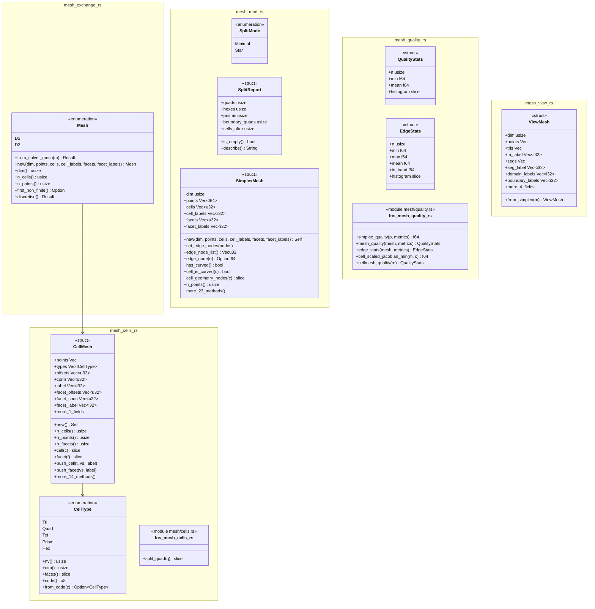

# Mesh: code

C4 level 4 (code) of the component **Mesh** (`femcore.mesh`) in the container **femcore** (crate `femcore`). [Component view of the container](../../3-components/femcore.md) · [All code pages](../README.md)

> The native mixed-cell mesh, the exchange mesh the physics take, simplex meshes with their numbering of unknowns, draw-only meshes and quality statistics.

**Decisions:** [ADR 4](../../../adr/0004-simplexmesh-is-the-solver-contract.md), [ADR 5](../../../adr/0005-native-mixed-cell-mesh.md), [ADR 32](../../../adr/0032-one-native-mesh-simplexmesh-as-a-view.md)  
**Size:** 5 files, 1707 lines.

## Files

| File | Lines | What it says about itself |
|---|---:|---|
| `crates/femcore/src/mesh/cells.rs` | 559 | Mixed-cell meshes: triangles and quads in 2D; tetrahedra, prisms and hexahedra in 3D. |
| `crates/femcore/src/mesh/exchange.rs` | 116 | The mesh a physics is given (`Physics::solve`): the one native cell mesh (`cells::CellMesh`) in 2D or in 3D, as plain data. It replaces `SimplexMesh` as the exchange type of the physics interface (ADR 32 phase 4 deliverable, ADR 41). Eac... |
| `crates/femcore/src/mesh/mod.rs` | 651 | Simplex meshes (triangles in 2D, tetrahedra in 3D) with their boundary facets, the numbering of P1/P2 unknowns, and structured generators with numbered boundaries. |
| `crates/femcore/src/mesh/quality.rs` | 297 | Element-quality and edge-length statistics, Euclidean or measured in a metric field. |
| `crates/femcore/src/mesh/view.rs` | 84 | Draw-only mesh for display: works for simplex meshes and for meshes the solvers cannot use (quadrilaterals, hexahedra, prisms...), of which only the surface is kept. |

## What it uses

| Target | Modules | Items |
|---|---|---|
| [Metric fields](./metric.md) | adapt::metric, adapt::work | FacetKey, SimplexMesh, Sym, det, edge_length, facet_key, identity, length, simplex_signed_measure |
| [Runtime services](./runtime.md) | par | threads |

## Used by

| Component | Modules | Items |
|---|---|---|
| [engine: Meshing seam](../engine/meshing.md) | mesh | SimplexMesh |
| [engine: Registry and facade](../engine/registry.md) | mesh, mesh::view | SimplexMesh, ViewMesh |
| [engine: Results files](../engine/resultsIO.md) | mesh | SimplexMesh |
| [engine: Store link](../engine/storeLink.md) | mesh | SimplexMesh |
| [Adaptation operators](./adaptops.md) | mesh::quality | simplex_quality |
| [Error estimators](./estimators.md) | mesh | SimplexMesh |
| [Finite-element basics](./fem.md) | mesh | SimplexMesh |
| [Fixtures and test kit](./fixtures.md) | mesh, mesh::cells | SimplexMesh, split_quad |
| [Meshing validation harness](./meshcheck.md) | mesh::cells | CellMesh, CellType |
| [Meshing facade](./meshing.md) | mesh | SimplexMesh |
| [3D meshing](./meshing3d.md) | mesh, mesh::cells | CellMesh, CellType, SimplexMesh |
| [Mesh files](./meshio.md) | mesh::cells | CellMesh, CellType |
| [Metric fields](./metric.md) | mesh | SimplexMesh |
| [Optical mode sets](./optical.md) | mesh | SimplexMesh |
| [Frame and sections](./section.md) | mesh | SimplexMesh |
| [Structured absorbing layers](./structpml.md) | mesh, mesh::cells, mesh::quality | CellMesh, CellType, SimplexMesh, SplitReport, cell_scaled_jacobian_min |
| [physics: Physics trait and registry](../physics/trait.md) | mesh, mesh::exchange | Mesh, SimplexMesh |

## Class diagram

Public types with their public fields (or variants) and methods, free functions per file as a `module` box; arrows are field types and `impl Trait`. Capped at 36 types and a few members each; the table below is complete.

## Public items

| Kind | Item | File:line | Signature or summary |
|---|---|---|---|
| enum | `CellType` | `mesh/cells.rs:22` | variants: `Tri`, `Quad`, `Tet`, `Prism`, `Hex` —  Cell shapes. |
| struct | `CellMesh` | `mesh/cells.rs:86` | fields: `points`, `types`, `offsets`, `conn`, `label`, `facet_offsets`, `facet_conn`, `facet_label`, `edge_nodes` —  Mixed-cell mesh in `D` dimensions. |
| fn | `split_quad` | `mesh/cells.rs:401` | `pub fn split_quad(q: &[u32; 4]) -> [[u32` —  Split a quad `[a, b, c, d]` (cyclic order) into two triangles along the diagonal through its |
| fn | `CellType::nv` | `mesh/cells.rs:38` | `pub fn nv(self) -> usize` —  Number of nodes. |
| fn | `CellType::dim` | `mesh/cells.rs:48` | `pub fn dim(self) -> usize` —  Spatial dimension of the shape. |
| fn | `CellType::faces` | `mesh/cells.rs:56` | `pub fn faces(self) -> &'static [&'static [u8]]` —  Local node lists of the faces (edges for 2D shapes). |
| fn | `CellType::code` | `mesh/cells.rs:67` | `pub fn code(self) -> u8` —  Code used by the binary format. |
| fn | `CellType::from_code` | `mesh/cells.rs:72` | `pub fn from_code(c: u8) -> Option<CellType>` —  Inverse of [`CellType::code`]. |
| fn | `CellMesh::new` | `mesh/cells.rs:111` | `pub fn new() -> Self` —  Empty mesh with the offset arrays primed. |
| fn | `CellMesh::n_cells` | `mesh/cells.rs:116` | `pub fn n_cells(&self) -> usize` —  Number of cells. |
| fn | `CellMesh::n_points` | `mesh/cells.rs:121` | `pub fn n_points(&self) -> usize` —  Number of vertices. |
| fn | `CellMesh::n_facets` | `mesh/cells.rs:126` | `pub fn n_facets(&self) -> usize` —  Number of labelled boundary facets. |
| fn | `CellMesh::cell` | `mesh/cells.rs:131` | `pub fn cell(&self, c: usize) -> &[u32]` —  Node ids of cell `c`. |
| fn | `CellMesh::facet` | `mesh/cells.rs:136` | `pub fn facet(&self, f: usize) -> &[u32]` —  Node ids of boundary facet `f`. |
| fn | `CellMesh::push_cell` | `mesh/cells.rs:141` | `pub fn push_cell(&mut self, t: CellType, vs: &[u32], label: i32)` —  Append a cell. |
| fn | `CellMesh::push_facet` | `mesh/cells.rs:154` | `pub fn push_facet(&mut self, vs: &[u32], label: i32)` —  Append a boundary facet. |
| fn | `CellMesh::set_edge_nodes` | `mesh/cells.rs:165` | `pub fn set_edge_nodes(&mut self, nodes: impl IntoIterator<Item = ([u32; 2], [f64; D])>)` —  Sets the curved edges: pairs are put in ascending vertex order, the list is sorted by pair, and when an edge is given twice |
| fn | `CellMesh::edge_node` | `mesh/cells.rs:179` | `pub fn edge_node(&self, a: u32, b: u32) -> Option<[f64` —  Position of the mid-edge node of the edge `a`-`b`, `None` when the edge is straight. |
| fn | `CellMesh::retain_existing_edge_nodes` | `mesh/cells.rs:185` | `pub fn retain_existing_edge_nodes(&mut self)` —  Drops the curved edges that are not an edge of any cell (after the connectivity changed). Never adds one. |
| fn | `CellMesh::counts` | `mesh/cells.rs:202` | `pub fn counts(&self) -> HashMap<CellType, usize>` —  Number of cells of each shape. |
| fn | `CellMesh::cell_face_keys` | `mesh/cells.rs:211` | `pub fn cell_face_keys(&self, c: usize) -> Vec<FacetKey>` —  Keys and vertex counts of the faces of cell `c`. |
| fn | `CellMesh::face_cells` | `mesh/cells.rs:225` | `pub fn face_cells(&self) -> HashMap<FacetKey, Vec<u32>>` —  Face key to the cells that contain it. |
| fn | `CellMesh::boundary_keys` | `mesh/cells.rs:236` | `pub fn boundary_keys(&self) -> Vec<FacetKey>` —  Faces that belong to exactly one cell, sorted. |
| fn | `CellMesh::boundary_faces_ordered` | `mesh/cells.rs:245` | `pub fn boundary_faces_ordered(&self) -> Vec<Vec<u32>>` —  Boundary faces (belonging to exactly one cell) with their nodes in the cyclic order of the |
| fn | `CellMesh::measure` | `mesh/cells.rs:261` | `pub fn measure(&self, c: usize) -> f64` —  Positive measure of cell `c` (area or volume); negative if the cell is inverted. |
| fn | `CellMesh::total_measure` | `mesh/cells.rs:280` | `pub fn total_measure(&self) -> f64` —  Sum of all cell measures. |
| fn | `CellMesh::check` | `mesh/cells.rs:286` | `pub fn check(&self) -> Result<(), String>` —  Validity check: positive measure of every cell (and of every sub-simplex of a split cell), |
| fn | `CellMesh::from_simplex` | `mesh/cells.rs:330` | `pub fn from_simplex(m: &SimplexMesh<D>) -> Self` —  Convert a simplex mesh without changing anything. |
| fn | `CellMesh::as_simplex` | `mesh/cells.rs:345` | `pub fn as_simplex(&self) -> Option<SimplexMesh<D>>` —  `Some` simplex mesh when every cell is a triangle / tetrahedron and every facet an |
| fn | `CellMesh::split_to_simplices` | `mesh/cells.rs:360` | `pub fn split_to_simplices(&self) -> Result<SimplexMesh<D>, String>` —  Split into a pure simplex mesh (triangles / tetrahedra), preserving cell and facet labels. |
| enum | `Mesh` | `mesh/exchange.rs:11` | variants: `D2`, `D3` —  A mesh in 2D (a cross-section, the x-z plane of the wafer frame) or in 3D. |
| fn | `Mesh::from_solver_mesh` | `mesh/exchange.rs:46` | `pub fn from_solver_mesh(m: &SimplexMesh) -> Result<Mesh, String>` —  The exchange form of a solver mesh: same vertices, cells, facets and numbers, in the same order. |
| fn | `Mesh::new` | `mesh/exchange.rs:56` | `pub fn new(dim: usize, points: Vec<f64>, cells: Vec<u32>, cell_labels: Vec<i32>, facets: Vec<u32>, facet_labels: Vec<i32>) -> Mesh` —  A simplex mesh from flat arrays (as `SimplexMesh::new`: coordinates `dim` per vertex, `dim + 1` vertices per cell, `dim` per facet, one |
| fn | `Mesh::dim` | `mesh/exchange.rs:61` | `pub fn dim(&self) -> usize` —  2 or 3. |
| fn | `Mesh::n_cells` | `mesh/exchange.rs:68` | `pub fn n_cells(&self) -> usize` |
| fn | `Mesh::n_points` | `mesh/exchange.rs:75` | `pub fn n_points(&self) -> usize` |
| fn | `Mesh::first_non_finite` | `mesh/exchange.rs:83` | `pub fn first_non_finite(&self) -> Option<(usize, usize)>` —  The first vertex and axis whose coordinate is NaN or infinite. |
| fn | `Mesh::discretise` | `mesh/exchange.rs:94` | `pub fn discretise(&self) -> Result<SimplexMesh, String>` —  The numbering of unknowns a kernel assembles on. Cells that are not simplices are cut (`SimplexMesh::from_cells_split`). |
| enum | `SplitMode` | `mesh/mod.rs:26` | variants: `Minimal`, `Star` —  How hexahedra, prisms and boundary quadrilaterals are cut into simplices in 3D. |
| struct | `SplitReport` | `mesh/mod.rs:49` | fields: `quads`, `hexes`, `prisms`, `boundary_quads`, `cells_after` —  What `from_cells` had to do to make a mesh usable by the simplex solvers. |
| struct | `SimplexMesh` | `mesh/mod.rs:80` | fields: `dim`, `points`, `cells`, `cell_labels`, `facets`, `facet_labels` |
| fn | `SplitReport::is_empty` | `mesh/mod.rs:58` | `pub fn is_empty(&self) -> bool` |
| fn | `SplitReport::describe` | `mesh/mod.rs:61` | `pub fn describe(&self) -> String` |
| fn | `SimplexMesh::new` | `mesh/mod.rs:216` | `pub fn new(dim: usize, points: Vec<f64>, cells: Vec<u32>, cell_labels: Vec<i32>, facets: Vec<u32>, facet_labels: Vec<i32>) -> Self` |
| fn | `SimplexMesh::set_edge_nodes` | `mesh/mod.rs:225` | `pub fn set_edge_nodes(&mut self, nodes: &[([u32; 2], [f64; 3])])` —  Sets the curved edges of a 3D mesh: `(vertex pair, node position)`; pairs that are not an edge of the mesh are ignored (the |
| fn | `SimplexMesh::edge_node_list` | `mesh/mod.rs:239` | `pub fn edge_node_list(&self) -> Vec<([u32` —  The curved edges as `(sorted vertex pair, node position)`, sorted by pair (the exchange form of `CellMesh::edge_nodes`). |
| fn | `SimplexMesh::edge_node` | `mesh/mod.rs:245` | `pub fn edge_node(&self, e: usize) -> Option<[f64` —  Position of the mid-edge geometry node of edge `e` (index into `edges()`); `None` when the edge is straight. |
| fn | `SimplexMesh::has_curved` | `mesh/mod.rs:249` | `pub fn has_curved(&self) -> bool` —  Whether the mesh has any curved edge. |
| fn | `SimplexMesh::cell_is_curved` | `mesh/mod.rs:253` | `pub fn cell_is_curved(&self, c: usize) -> bool` —  Whether one of the edges of cell `c` is curved (3D only). |
| fn | `SimplexMesh::cell_geometry_nodes` | `mesh/mod.rs:258` | `pub fn cell_geometry_nodes(&self, c: usize) -> [[f64` —  The ten geometry nodes of tetrahedron `c`: its four vertices, then the nodes of its six edges in the order of the local vertex |
| fn | `SimplexMesh::n_points` | `mesh/mod.rs:278` | `pub fn n_points(&self) -> usize` |
| fn | `SimplexMesh::n_cells` | `mesh/mod.rs:281` | `pub fn n_cells(&self) -> usize` |
| fn | `SimplexMesh::n_facets` | `mesh/mod.rs:284` | `pub fn n_facets(&self) -> usize` |
| fn | `SimplexMesh::exterior_facets` | `mesh/mod.rs:290` | `pub fn exterior_facets(&self) -> Vec<bool>` —  Which boundary facets lie on the outside of the mesh (used by exactly one cell). Meshes |
| fn | `SimplexMesh::n_edges` | `mesh/mod.rs:312` | `pub fn n_edges(&self) -> usize` |
| fn | `SimplexMesh::edges` | `mesh/mod.rs:315` | `pub fn edges(&self) -> &[(u32, u32)]` |
| fn | `SimplexMesh::point` | `mesh/mod.rs:318` | `pub fn point(&self, i: usize) -> &[f64]` |
| fn | `SimplexMesh::cell` | `mesh/mod.rs:321` | `pub fn cell(&self, c: usize) -> &[u32]` |
| fn | `SimplexMesh::facet` | `mesh/mod.rs:324` | `pub fn facet(&self, f: usize) -> &[u32]` |
| fn | `SimplexMesh::cell_edge_ids` | `mesh/mod.rs:328` | `pub fn cell_edge_ids(&self, c: usize) -> &[u32]` —  Local pair edges of cell `c` (index into `edges()`), pairs (0,1),(0,2),... |
| fn | `SimplexMesh::edge_index` | `mesh/mod.rs:332` | `pub fn edge_index(&self, a: u32, b: u32) -> usize` |
| fn | `SimplexMesh::n_dofs` | `mesh/mod.rs:335` | `pub fn n_dofs(&self, order: usize) -> usize` |
| fn | `SimplexMesh::nloc` | `mesh/mod.rs:338` | `pub fn nloc(&self, order: usize) -> usize` |
| fn | `SimplexMesh::cell_dofs` | `mesh/mod.rs:344` | `pub fn cell_dofs(&self, c: usize, order: usize, out: &mut Vec<usize>)` —  Dof indices of cell `c` (P1: vertices; P2: vertices then edge midpoints in the order of |
| fn | `SimplexMesh::all_cell_dofs` | `mesh/mod.rs:353` | `pub fn all_cell_dofs(&self, order: usize) -> Vec<usize>` —  All cell dofs, flat with stride `nloc(order)`. |
| fn | `SimplexMesh::facet_dofs` | `mesh/mod.rs:364` | `pub fn facet_dofs(&self, f: usize, order: usize, out: &mut Vec<usize>)` —  Dofs of boundary facet `f` (same local order as for cells). |
| fn | `SimplexMesh::dof_coordinates` | `mesh/mod.rs:378` | `pub fn dof_coordinates(&self, order: usize) -> Vec<f64>` —  Coordinates of every dof (vertices, then edge midpoints). |
| fn | `SimplexMesh::domain_labels` | `mesh/mod.rs:390` | `pub fn domain_labels(&self) -> Vec<i32>` |
| fn | `SimplexMesh::boundary_labels` | `mesh/mod.rs:393` | `pub fn boundary_labels(&self) -> Vec<i32>` |
| fn | `SimplexMesh::bbox` | `mesh/mod.rs:396` | `pub fn bbox(&self) -> ([f64` |
| fn | `SimplexMesh::relabel` | `mesh/mod.rs:414` | `pub fn relabel(&mut self, domains: &[(Vec<f64>, i32)], boundaries: &[(Vec<f64>, i32)]) -> Result<(), String>` —  Relabels cells whose centroid lies in a box and boundary facets whose midpoint lies in a |
| fn | `SimplexMesh::from_cells` | `mesh/mod.rs:460` | `pub fn from_cells<const D: usize>(nm: &NativeCells<D>) -> Result<Self, String>` —  Mesh from a mixed-cell mesh (`mesh::cells::CellMesh`). Domain and boundary numbers are 1-based in both and stay as they are. |
| fn | `SimplexMesh::from_cells_split` | `mesh/mod.rs:464` | `pub fn from_cells_split<const D: usize>(nm: &NativeCells<D>) -> Result<(Self, SplitReport), String>` |
| fn | `SimplexMesh::from_cells_split_with` | `mesh/mod.rs:468` | `pub fn from_cells_split_with<const D: usize>(nm: &NativeCells<D>, mode: SplitMode) -> Result<(Self, SplitReport), String>` |
| fn | `simplex_quality` | `mesh/quality.rs:15` | `pub fn simplex_quality<const D: usize>(p: &[[f64; D]], metrics: Option<&[Sym<D>]>) -> f64` —  Mean-ratio quality of a simplex with vertices `p` (`D + 1` points), optionally in the metric |
| struct | `QualityStats` | `mesh/quality.rs:54` | fields: `n`, `min`, `mean`, `histogram` —  Summary of a set of scalar samples in `[0, 1]` (quality) with a 10-bin histogram. |
| fn | `mesh_quality` | `mesh/quality.rs:79` | `pub fn mesh_quality<const D: usize>(mesh: &SimplexMesh<D>, metrics: Option<&[Sym<D>]>) -> QualityStats` —  Mean-ratio statistics of a simplex mesh, with an optional vertex metric field. |
| struct | `EdgeStats` | `mesh/quality.rs:101` | fields: `n`, `min`, `max`, `mean`, `in_band`, `histogram` —  Statistics of edge lengths measured in a metric (or Euclidean when `None`). |
| fn | `edge_stats` | `mesh/quality.rs:115` | `pub fn edge_stats<const D: usize>(mesh: &SimplexMesh<D>, metrics: Option<&[Sym<D>]>) -> EdgeStats` —  Edge-length statistics of `mesh`; lengths use [`crate::adapt::metric::edge_length`]. |
| fn | `cell_scaled_jacobian_min` | `mesh/quality.rs:191` | `pub fn cell_scaled_jacobian_min<const D: usize>(m: &CellMesh<D>, c: usize) -> f64` —  Smallest corner scaled Jacobian of a mixed cell (1 for a perfect square, cube or right prism |
| fn | `cellmesh_quality` | `mesh/quality.rs:229` | `pub fn cellmesh_quality<const D: usize>(m: &CellMesh<D>) -> QualityStats` —  Quality statistics over all cells of a mixed mesh (scaled Jacobian / mean ratio). |
| struct | `ViewMesh` | `mesh/view.rs:7` | fields: `dim`, `points`, `tris`, `tri_label`, `segs`, `seg_label`, `domain_labels`, `boundary_labels`, `n_cells`, `bbox`, `types`, `view_only` |
| fn | `ViewMesh::from_simplex` | `mesh/view.rs:45` | `pub fn from_simplex(m: &SimplexMesh) -> ViewMesh` |
