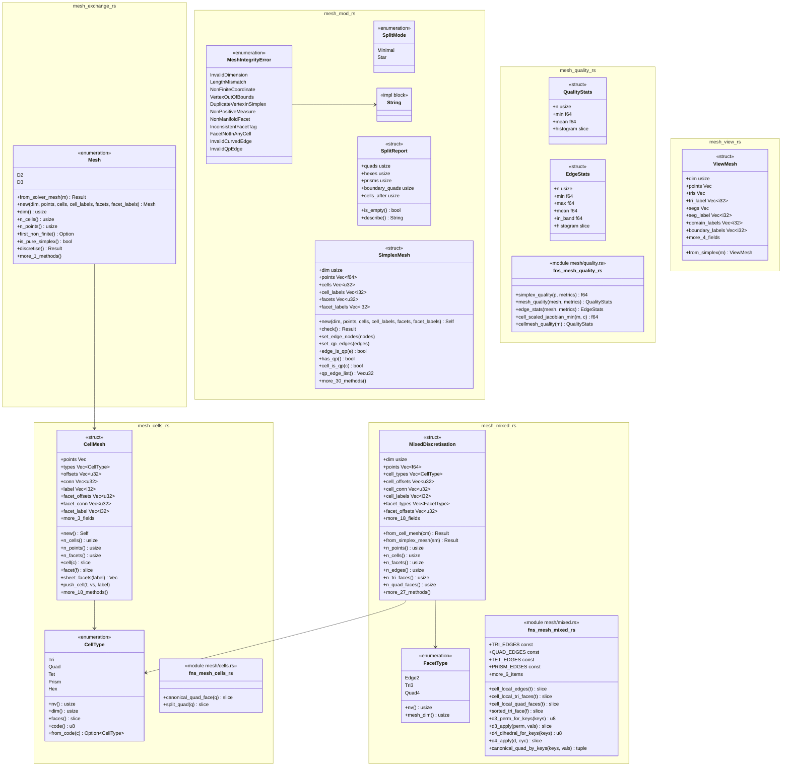

# Mesh: code

C4 level 4 (code) of the component **Mesh** (`femcore.mesh`) in the container **femcore** (crate `femcore`). [Component view of the container](../../3-components/femcore.md) · [All code pages](../README.md)

> The native mixed-cell mesh, MixedDiscretisation, the exchange mesh the physics take, simplex meshes with their numbering of unknowns, draw-only meshes and quality statistics.

**Decisions:** [ADR 4](../../../adr/0004-simplexmesh-is-the-solver-contract.md), [ADR 5](../../../adr/0005-native-mixed-cell-mesh.md), [ADR 32](../../../adr/0032-one-native-mesh-simplexmesh-as-a-view.md), [ADR 128](../../../adr/0128-structured-curvilinear-pml-and-open-boundaries.md)  
**Size:** 6 files, 3364 lines.

## Files

| File | Lines | What it says about itself |
|---|---:|---|
| `crates/femcore/src/mesh/cells.rs` | 637 | Mixed-cell meshes: triangles and quads in 2D; tetrahedra, prisms and hexahedra in 3D. |
| `crates/femcore/src/mesh/exchange.rs` | 134 | The mesh a physics is given (`Physics::solve`): the one native cell mesh (`cells::CellMesh`) in 2D or in 3D, as plain data. It replaces `SimplexMesh` as the exchange type of the physics interface (ADR 32 phase 4 deliverable, ADR 41). Eac... |
| `crates/femcore/src/mesh/mixed.rs` | 1069 |  |
| `crates/femcore/src/mesh/mod.rs` | 1143 | Simplex meshes (triangles in 2D, tetrahedra in 3D) with their boundary facets, the numbering of P1/P2 unknowns, and structured generators with numbered boundaries. |
| `crates/femcore/src/mesh/quality.rs` | 297 | Element-quality and edge-length statistics, Euclidean or measured in a metric field. |
| `crates/femcore/src/mesh/view.rs` | 84 | Draw-only mesh for display: works for simplex meshes and for meshes the solvers cannot use (quadrilaterals, hexahedra, prisms...), of which only the surface is kept. |

## What it uses

| Target | Modules | Items |
|---|---|---|
| [Metric fields](./metric.md) | adapt::metric, adapt::work | FacetKey, SimplexMesh, Sym, det, edge_length, facet_key, identity, length, simplex_signed_measure |
| [Runtime services](./runtime.md) | par | threads |

## Used by

| Component | Modules | Items |
|---|---|---|
| [analysis: Mode figures](../analysis/figures.md) | mesh | SimplexMesh |
| [dfs: Shared helpers](../dfs/common.md) | mesh::mixed | FacetType, MixedDiscretisation, QUAD_EDGES |
| [dfs: Electrostatics kernel](../dfs/electro.md) | mesh::mixed | MixedDiscretisation |
| [dfs: Heat kernel](../dfs/heat.md) | mesh::mixed | MixedDiscretisation |
| [dfs: Magnetostatics kernel](../dfs/magneto.md) | mesh::mixed | MixedDiscretisation |
| [ems: Axisymmetric kernel](../ems/axisym.md) | mesh::mixed | MixedDiscretisation |
| [ems: 3D cavity kernel](../ems/cavity.md) | mesh::mixed | FacetType, MixedDiscretisation, QUAD_EDGES, TRI_EDGES |
| [ems: Driven frequency-domain and PROM](../ems/driven.md) | mesh, mesh::mixed | FacetType, MixedDiscretisation, QUAD_EDGES, SimplexMesh, TRI_EDGES |
| [ems: Thin-film IBC and Josephson ROM](../ems/ibc.md) | mesh::cells, mesh::mixed | CellType, FacetType, MixedDiscretisation, PRISM_TRI_FACES, QUAD_EDGES, TET_TRI_FACES, TRI_EDGES |
| [ems: Native mixed-cell EM](../ems/mixed.md) | mesh, mesh::cells, mesh::mixed | CellType, FacetType, HEX_QUAD_FACES, MixedDiscretisation, PRISM_QUAD_FACES, PRISM_TRI_FACES, QUAD_EDGES, SimplexMesh +2 |
| [ems: Mode kernel](../ems/modes.md) | mesh::mixed | MixedDiscretisation |
| [ems: Complex-mode kernel](../ems/modescx.md) | mesh::mixed | MixedDiscretisation |
| [engine: Analyses](../engine/analyse.md) | mesh | SimplexMesh |
| [engine: Commands](../engine/commands.md) | mesh | SimplexMesh |
| [engine: Job runner and queue](../engine/jobs.md) | mesh | SimplexMesh |
| [engine: Meshing seam](../engine/meshing.md) | mesh, mesh::cells | CellType, SimplexMesh |
| [engine: Registry and facade](../engine/registry.md) | mesh, mesh::view | SimplexMesh, ViewMesh |
| [engine: Results files](../engine/resultsIO.md) | mesh | SimplexMesh |
| [engine: Store link](../engine/storeLink.md) | mesh | SimplexMesh |
| [Adaptation operators](./adaptops.md) | mesh::quality | simplex_quality |
| [Error estimators](./estimators.md) | mesh | SimplexMesh |
| [Finite-element basics](./fem.md) | mesh, mesh::cells, mesh::mixed | CellType, FacetType, HEX_EDGES, HEX_QUAD_FACES, MixedDiscretisation, PRISM_QUAD_FACES, PRISM_TRI_FACES, QUAD_EDGES +10 |
| [Fixtures and test kit](./fixtures.md) | mesh, mesh::cells | SimplexMesh, split_quad |
| [Meshing validation harness](./meshcheck.md) | mesh::cells | CellMesh, CellType |
| [Meshing facade](./meshing.md) | mesh, mesh::cells, mesh::exchange, mesh::mixed | CellType, Mesh, MixedDiscretisation, SimplexMesh |
| [3D meshing](./meshing3d.md) | mesh, mesh::cells, mesh::exchange | CellMesh, CellType, Mesh, SimplexMesh |
| [Mesh files](./meshio.md) | mesh::cells | CellMesh, CellType |
| [Metric fields](./metric.md) | mesh | SimplexMesh |
| [Optical mode sets](./optical.md) | mesh | SimplexMesh |
| [Frame and sections](./section.md) | mesh | SimplexMesh |
| [Structured absorbing layers](./structpml.md) | mesh, mesh::cells, mesh::exchange, mesh::mixed, mesh::quality | CellMesh, CellType, Mesh, MixedDiscretisation, SimplexMesh, SplitReport, canonical_quad_face, cell_scaled_jacobian_min |
| [physics: Result and frame](../physics/result.md) | mesh, mesh::cells, mesh::mixed | CellType, MixedDiscretisation, SimplexMesh, cell_local_quad_faces |
| [physics: Physics trait and registry](../physics/trait.md) | mesh, mesh::exchange, mesh::mixed | FacetType, Mesh, MixedDiscretisation, SimplexMesh |
| [sms: Axisymmetric kernel](../sms/axisym.md) | mesh::mixed | MixedDiscretisation |
| [sms: Cross-section study kernel](../sms/crosssection.md) | mesh::mixed | MixedDiscretisation |
| [sms: Floquet kernel](../sms/floquet.md) | mesh::mixed | FacetType, MixedDiscretisation, QUAD_EDGES, TRI_EDGES |
| [sms: Low-reflecting boundary](../sms/lrb.md) | mesh::cells, mesh::mixed | FacetType, MixedDiscretisation, canonical_quad_face, cell_local_edges, cell_local_quad_faces, cell_local_tri_faces, sorted_tri_face |
| [sms: Piezoelectric kernel](../sms/piezo.md) | mesh, mesh::mixed | MixedDiscretisation, SimplexMesh |
| [sms: Absorbing-layer kernel](../sms/pml.md) | mesh::cells, mesh::mixed | FacetType, MixedDiscretisation, QUAD_EDGES, TRI_EDGES, canonical_quad_face, cell_local_edges, cell_local_quad_faces, cell_local_tri_faces +1 |
| [sms: Solid kernel](../sms/solid.md) | mesh::cells, mesh::mixed | FacetType, MixedDiscretisation, QUAD_EDGES, TRI_EDGES, canonical_quad_face, cell_local_edges, cell_local_quad_faces, cell_local_tri_faces +1 |
| [sms: Waveguide kernel](../sms/waveguide.md) | mesh::mixed | MixedDiscretisation |

## Class diagram

Public types with their public fields (or variants) and methods, free functions per file as a `module` box; arrows are field types and `impl Trait`. Capped at 36 types and a few members each; the table below is complete.

## Public items

| Kind | Item | File:line | Signature or summary |
|---|---|---|---|
| enum | `CellType` | `mesh/cells.rs:22` | variants: `Tri`, `Quad`, `Tet`, `Prism`, `Hex` —  Cell shapes. |
| struct | `CellMesh` | `mesh/cells.rs:86` | fields: `points`, `types`, `offsets`, `conn`, `label`, `facet_offsets`, `facet_conn`, `facet_label`, `edge_nodes`, `quad_face_nodes`, `qp_edges` —  Mixed-cell mesh in `D` dimensions. |
| fn | `canonical_quad_face` | `mesh/cells.rs:117` | `pub fn canonical_quad_face(q: [u32; 4]) -> [u32` —  Canonical cyclic key of a quadrilateral `[q0, q1, q2, q3]`: starts at the smallest vertex id |
| fn | `split_quad` | `mesh/cells.rs:479` | `pub fn split_quad(q: &[u32; 4]) -> [[u32` —  Split a quad `[a, b, c, d]` (cyclic order) into two triangles along the diagonal through its |
| fn | `CellType::nv` | `mesh/cells.rs:38` | `pub fn nv(self) -> usize` —  Number of nodes. |
| fn | `CellType::dim` | `mesh/cells.rs:48` | `pub fn dim(self) -> usize` —  Spatial dimension of the shape. |
| fn | `CellType::faces` | `mesh/cells.rs:56` | `pub fn faces(self) -> &'static [&'static [u8]]` —  Local node lists of the faces (edges for 2D shapes). |
| fn | `CellType::code` | `mesh/cells.rs:67` | `pub fn code(self) -> u8` —  Code used by the binary format. |
| fn | `CellType::from_code` | `mesh/cells.rs:72` | `pub fn from_code(c: u8) -> Option<CellType>` —  Inverse of [`CellType::code`]. |
| fn | `CellMesh::new` | `mesh/cells.rs:130` | `pub fn new() -> Self` —  Empty mesh with the offset arrays primed. |
| fn | `CellMesh::n_cells` | `mesh/cells.rs:135` | `pub fn n_cells(&self) -> usize` —  Number of cells. |
| fn | `CellMesh::n_points` | `mesh/cells.rs:140` | `pub fn n_points(&self) -> usize` —  Number of vertices. |
| fn | `CellMesh::n_facets` | `mesh/cells.rs:145` | `pub fn n_facets(&self) -> usize` —  Number of labelled boundary facets. |
| fn | `CellMesh::cell` | `mesh/cells.rs:150` | `pub fn cell(&self, c: usize) -> &[u32]` —  Node ids of cell `c`. |
| fn | `CellMesh::facet` | `mesh/cells.rs:155` | `pub fn facet(&self, f: usize) -> &[u32]` —  Node ids of boundary facet `f`. |
| fn | `CellMesh::sheet_facets` | `mesh/cells.rs:164` | `pub fn sheet_facets(&self, label: i32) -> Vec<&[u32]>` —  Facets carrying the given 1-based boundary label from `LabelMap`. |
| fn | `CellMesh::push_cell` | `mesh/cells.rs:169` | `pub fn push_cell(&mut self, t: CellType, vs: &[u32], label: i32)` —  Append a cell. |
| fn | `CellMesh::push_facet` | `mesh/cells.rs:182` | `pub fn push_facet(&mut self, vs: &[u32], label: i32)` —  Append a boundary facet. |
| fn | `CellMesh::set_edge_nodes` | `mesh/cells.rs:193` | `pub fn set_edge_nodes(&mut self, nodes: impl IntoIterator<Item = ([u32; 2], [f64; D])>)` —  Sets the curved edges: pairs are put in ascending vertex order, the list is sorted by pair, and when an edge is given twice |
| fn | `CellMesh::edge_node` | `mesh/cells.rs:207` | `pub fn edge_node(&self, a: u32, b: u32) -> Option<[f64` —  Position of the mid-edge node of the edge `a`-`b`, `None` when the edge is straight. |
| fn | `CellMesh::set_quad_face_nodes` | `mesh/cells.rs:214` | `pub fn set_quad_face_nodes(&mut self, nodes: impl IntoIterator<Item = ([u32; 4], [f64; D])>)` —  Sets the curved quad-face center nodes: cyclic quadruples are canonicalised with [`canonical_quad_face`], sorted, and when a face |
| fn | `CellMesh::quad_face_node` | `mesh/cells.rs:228` | `pub fn quad_face_node(&self, q: [u32; 4]) -> Option<[f64` —  Position of the curved center node of the quad `q` (given in cyclic order), `None` when not listed. |
| fn | `CellMesh::retain_existing_edge_nodes` | `mesh/cells.rs:234` | `pub fn retain_existing_edge_nodes(&mut self)` —  Drops the curved edges and quad-face centers that do not belong to any cell (after the connectivity changed). Never adds one. |
| fn | `CellMesh::counts` | `mesh/cells.rs:275` | `pub fn counts(&self) -> HashMap<CellType, usize>` —  Number of cells of each shape. |
| fn | `CellMesh::cell_face_keys` | `mesh/cells.rs:284` | `pub fn cell_face_keys(&self, c: usize) -> Vec<FacetKey>` —  Keys and vertex counts of the faces of cell `c`. |
| fn | `CellMesh::face_cells` | `mesh/cells.rs:298` | `pub fn face_cells(&self) -> HashMap<FacetKey, Vec<u32>>` —  Face key to the cells that contain it. |
| fn | `CellMesh::boundary_keys` | `mesh/cells.rs:309` | `pub fn boundary_keys(&self) -> Vec<FacetKey>` —  Faces that belong to exactly one cell, sorted. |
| fn | `CellMesh::boundary_faces_ordered` | `mesh/cells.rs:318` | `pub fn boundary_faces_ordered(&self) -> Vec<Vec<u32>>` —  Boundary faces (belonging to exactly one cell) with their nodes in the cyclic order of the |
| fn | `CellMesh::measure` | `mesh/cells.rs:334` | `pub fn measure(&self, c: usize) -> f64` —  Positive measure of cell `c` (area or volume); negative if the cell is inverted. |
| fn | `CellMesh::total_measure` | `mesh/cells.rs:353` | `pub fn total_measure(&self) -> f64` —  Sum of all cell measures. |
| fn | `CellMesh::check` | `mesh/cells.rs:359` | `pub fn check(&self) -> Result<(), String>` —  Validity check: positive measure of every cell (and of every sub-simplex of a split cell), |
| fn | `CellMesh::from_simplex` | `mesh/cells.rs:403` | `pub fn from_simplex(m: &SimplexMesh<D>) -> Self` —  Convert a simplex mesh without changing anything. |
| fn | `CellMesh::is_pure_simplex` | `mesh/cells.rs:417` | `pub fn is_pure_simplex(&self) -> bool` —  Whether every cell is a triangle (2D) or tetrahedron (3D) and every facet has `D` vertices. |
| fn | `CellMesh::as_simplex` | `mesh/cells.rs:424` | `pub fn as_simplex(&self) -> Option<SimplexMesh<D>>` —  `Some` simplex mesh when every cell is a triangle / tetrahedron and every facet an |
| fn | `CellMesh::split_to_simplices` | `mesh/cells.rs:438` | `pub fn split_to_simplices(&self) -> Result<SimplexMesh<D>, String>` —  Split into a pure simplex mesh (triangles / tetrahedra), preserving cell and facet labels. |
| enum | `Mesh` | `mesh/exchange.rs:12` | variants: `D2`, `D3` —  A mesh in 2D (a cross-section, the x-z plane of the wafer frame) or in 3D. |
| fn | `Mesh::from_solver_mesh` | `mesh/exchange.rs:48` | `pub fn from_solver_mesh(m: &SimplexMesh) -> Result<Mesh, String>` —  The exchange form of a solver mesh: same vertices, cells, facets and numbers, in the same order. |
| fn | `Mesh::new` | `mesh/exchange.rs:58` | `pub fn new(dim: usize, points: Vec<f64>, cells: Vec<u32>, cell_labels: Vec<i32>, facets: Vec<u32>, facet_labels: Vec<i32>) -> Mesh` —  A simplex mesh from flat arrays (as `SimplexMesh::new`: coordinates `dim` per vertex, `dim + 1` vertices per cell, `dim` per facet, one |
| fn | `Mesh::dim` | `mesh/exchange.rs:63` | `pub fn dim(&self) -> usize` —  2 or 3. |
| fn | `Mesh::n_cells` | `mesh/exchange.rs:70` | `pub fn n_cells(&self) -> usize` |
| fn | `Mesh::n_points` | `mesh/exchange.rs:77` | `pub fn n_points(&self) -> usize` |
| fn | `Mesh::first_non_finite` | `mesh/exchange.rs:85` | `pub fn first_non_finite(&self) -> Option<(usize, usize)>` —  The first vertex and axis whose coordinate is NaN or infinite. |
| fn | `Mesh::is_pure_simplex` | `mesh/exchange.rs:96` | `pub fn is_pure_simplex(&self) -> bool` —  Whether every cell is a simplex (`Tri` in 2D, `Tet` in 3D) and every facet has `dim` vertices. |
| fn | `Mesh::discretise` | `mesh/exchange.rs:104` | `pub fn discretise(&self) -> Result<SimplexMesh, String>` —  The numbering of unknowns a kernel assembles on. Cells that are not simplices are cut (`SimplexMesh::from_cells_split`). |
| fn | `Mesh::discretise_mixed` | `mesh/exchange.rs:112` | `pub fn discretise_mixed(&self) -> Result<MixedDiscretisation, String>` —  Native mixed-cell discretisation (`Tri`+`Quad` in 2D, `Tet`+`Prism`+`Hex` in 3D) without splitting structured cells. |
| enum | `FacetType` | `mesh/mixed.rs:16` | variants: `Edge2`, `Tri3`, `Quad4` —  Boundary or interior sheet facet shapes supported in mixed meshes. |
| const | `TRI_EDGES` | `mesh/mixed.rs:45` | `[(usize, usize)` —  Canonical local edges of `CellType::Tri` (matches `SimplexMesh` / `fem.rs` / `edge.rs`). |
| const | `QUAD_EDGES` | `mesh/mixed.rs:48` | `[(usize, usize)` —  Canonical local edges of `CellType::Quad` in counter-clockwise boundary order. |
| const | `TET_EDGES` | `mesh/mixed.rs:51` | `[(usize, usize)` —  Canonical local edges of `CellType::Tet` (matches `fem::TET_EDGES` and `nyx_ems::cavity`). |
| const | `PRISM_EDGES` | `mesh/mixed.rs:54` | `[(usize, usize)` —  Canonical local edges of `CellType::Prism`: 3 base-tri edges, 3 top-tri edges, 3 vertical edges. |
| const | `HEX_EDGES` | `mesh/mixed.rs:67` | `[(usize, usize)` —  Canonical local edges of `CellType::Hex`: 4 bottom-quad edges, 4 top-quad edges, 4 vertical edges. |
| const | `TET_TRI_FACES` | `mesh/mixed.rs:83` | `[[usize` —  Canonical local triangular faces of `CellType::Tet` (matches `fem::TET_FACES` and `cavity::FACES`). |
| const | `PRISM_TRI_FACES` | `mesh/mixed.rs:86` | `[[usize` —  Canonical local triangular faces of `CellType::Prism` (base `z=-1`, top `z=+1`). |
| const | `PRISM_QUAD_FACES` | `mesh/mixed.rs:89` | `[[usize` —  Canonical local quadrilateral faces of `CellType::Prism` in outward cyclic order (`cells.rs`). |
| const | `HEX_QUAD_FACES` | `mesh/mixed.rs:92` | `[[usize` —  Canonical local quadrilateral faces of `CellType::Hex` in outward cyclic order (`cells.rs`). |
| const | `D3_PERMS` | `mesh/mixed.rs:102` | `[[usize` —  All 6 permutations of `[0, 1, 2]` (symmetric group `D_3` / `S_3`). |
| fn | `cell_local_edges` | `mesh/mixed.rs:113` | `pub fn cell_local_edges(t: CellType) -> &'static [(usize, usize)]` —  Local edge endpoint table for any [`CellType`]. |
| fn | `cell_local_tri_faces` | `mesh/mixed.rs:125` | `pub fn cell_local_tri_faces(t: CellType) -> &'static [[usize` —  Local triangular faces for a 3D [`CellType`] (empty in 2D and for `Hex`). |
| fn | `cell_local_quad_faces` | `mesh/mixed.rs:135` | `pub fn cell_local_quad_faces(t: CellType) -> &'static [[usize` —  Local quadrilateral faces for a 3D [`CellType`] (empty in 2D and for `Tet`). |
| fn | `sorted_tri_face` | `mesh/mixed.rs:145` | `pub fn sorted_tri_face(mut f: [u32; 3]) -> [u32` —  Sorted vertex triple `[a, b, c]` (`a <= b <= c`). |
| fn | `d3_perm_for_keys` | `mesh/mixed.rs:160` | `pub fn d3_perm_for_keys<K: Ord + Copy>(keys: [K; 3]) -> u8` —  Index `p` in `0..6` into [`D3_PERMS`] such that `keys[perm[0]] <= keys[perm[1]] <= keys[perm[2]]`. |
| fn | `d3_apply` | `mesh/mixed.rs:171` | `pub fn d3_apply<T: Copy>(perm: u8, vals: [T; 3]) -> [T` —  Applies `D_3` permutation `perm` (`0..6`) to a 3-element array. |
| fn | `d4_dihedral_for_keys` | `mesh/mixed.rs:180` | `pub fn d4_dihedral_for_keys<K: Ord + Copy>(keys: [K; 4]) -> u8` —  Computes the `D_4` dihedral symmetry index `d` in `0..8` (`rot = d & 3`, `flip = (d & 4) != 0`) |
| fn | `d4_apply` | `mesh/mixed.rs:190` | `pub fn d4_apply<T: Copy>(d: u8, cyc: [T; 4]) -> [T` —  Applies `D_4` dihedral index `d` (`0..8`) to cyclic quad values `cyc`. |
| fn | `canonical_quad_by_keys` | `mesh/mixed.rs:202` | `pub fn canonical_quad_by_keys<K: Ord + Copy, T: Copy>(keys: [K; 4], vals: [T; 4]) -> (u8, [T` —  Canonical cyclic quad `[a, b, c, d]` ordered by `keys`. |
| struct | `MixedDiscretisation` | `mesh/mixed.rs:209` | fields: `dim`, `points`, `cell_types`, `cell_offsets`, `cell_conn`, `cell_labels`, `facet_types`, `facet_offsets`, `facet_conn`, `facet_labels`, `exterior_facets`, `edges`, ... —  Native mixed-cell discretisation for 2D (`Tri` + `Quad`) and 3D (`Tet` + `Prism` + `Hex`) FEM assembly. |
| fn | `FacetType::nv` | `mesh/mixed.rs:27` | `pub fn nv(self) -> usize` —  Number of corner vertices of the facet. |
| fn | `FacetType::mesh_dim` | `mesh/mixed.rs:36` | `pub fn mesh_dim(self) -> usize` —  Ambient mesh dimension in which this facet serves as a codimension-1 facet (`2` or `3`). |
| fn | `MixedDiscretisation::from_cell_mesh` | `mesh/mixed.rs:266` | `pub fn from_cell_mesh<const D: usize>(cm: &CellMesh<D>) -> Result<Self, String>` —  Builds a [`MixedDiscretisation`] directly from a [`CellMesh<D>`] without splitting any cells. |
| fn | `MixedDiscretisation::from_simplex_mesh` | `mesh/mixed.rs:560` | `pub fn from_simplex_mesh(sm: &SimplexMesh) -> Result<Self, String>` —  Builds a [`MixedDiscretisation`] from a [`SimplexMesh`]. |
| fn | `MixedDiscretisation::n_points` | `mesh/mixed.rs:566` | `pub fn n_points(&self) -> usize` —  Number of vertices. |
| fn | `MixedDiscretisation::n_cells` | `mesh/mixed.rs:572` | `pub fn n_cells(&self) -> usize` —  Number of cells. |
| fn | `MixedDiscretisation::n_facets` | `mesh/mixed.rs:578` | `pub fn n_facets(&self) -> usize` —  Number of labelled facets. |
| fn | `MixedDiscretisation::n_edges` | `mesh/mixed.rs:584` | `pub fn n_edges(&self) -> usize` —  Number of unique edges. |
| fn | `MixedDiscretisation::n_tri_faces` | `mesh/mixed.rs:590` | `pub fn n_tri_faces(&self) -> usize` —  Number of unique 3D triangular faces (`0` in 2D). |
| fn | `MixedDiscretisation::n_quad_faces` | `mesh/mixed.rs:596` | `pub fn n_quad_faces(&self) -> usize` —  Number of unique 3D quadrilateral faces (`0` in 2D). |
| fn | `MixedDiscretisation::point` | `mesh/mixed.rs:602` | `pub fn point(&self, v: usize) -> &[f64]` —  Coordinates of vertex `v` (`len = dim`). |
| fn | `MixedDiscretisation::point3` | `mesh/mixed.rs:608` | `pub fn point3(&self, v: usize) -> [f64` —  3D-padded coordinates of vertex `v` (`[x, z, 0.0]` in 2D, `[x, y, z]` in 3D). |
| fn | `MixedDiscretisation::cell` | `mesh/mixed.rs:619` | `pub fn cell(&self, c: usize) -> &[u32]` —  Vertex IDs of cell `c`. |
| fn | `MixedDiscretisation::cell_type` | `mesh/mixed.rs:625` | `pub fn cell_type(&self, c: usize) -> CellType` —  [`CellType`] of cell `c`. |
| fn | `MixedDiscretisation::facet` | `mesh/mixed.rs:631` | `pub fn facet(&self, f: usize) -> &[u32]` —  Vertex IDs of facet `f`. |
| fn | `MixedDiscretisation::facet_type` | `mesh/mixed.rs:637` | `pub fn facet_type(&self, f: usize) -> FacetType` —  [`FacetType`] of facet `f`. |
| fn | `MixedDiscretisation::cell_edge_ids` | `mesh/mixed.rs:643` | `pub fn cell_edge_ids(&self, c: usize) -> &[u32]` —  Global edge IDs of cell `c` in [`cell_local_edges`] order. |
| fn | `MixedDiscretisation::cell_edge_signs` | `mesh/mixed.rs:649` | `pub fn cell_edge_signs(&self, c: usize) -> &[i8]` —  Default orientation signs (`+1` / `-1`) of cell `c`'s local edges. |
| fn | `MixedDiscretisation::cell_tri_face_ids` | `mesh/mixed.rs:655` | `pub fn cell_tri_face_ids(&self, c: usize) -> &[u32]` —  Global tri-face IDs of cell `c` in [`cell_local_tri_faces`] order. |
| fn | `MixedDiscretisation::cell_tri_perms` | `mesh/mixed.rs:661` | `pub fn cell_tri_perms(&self, c: usize) -> &[u8]` —  `D_3` permutation indices (`0..6`) of cell `c`'s local tri faces. |
| fn | `MixedDiscretisation::cell_quad_face_ids` | `mesh/mixed.rs:667` | `pub fn cell_quad_face_ids(&self, c: usize) -> &[u32]` —  Global quad-face IDs of cell `c` in [`cell_local_quad_faces`] order. |
| fn | `MixedDiscretisation::cell_quad_dihedrals` | `mesh/mixed.rs:673` | `pub fn cell_quad_dihedrals(&self, c: usize) -> &[u8]` —  `D_4` dihedral indices (`0..8`) of cell `c`'s local quad faces. |
| fn | `MixedDiscretisation::edge_index` | `mesh/mixed.rs:679` | `pub fn edge_index(&self, a: u32, b: u32) -> Option<usize>` —  Global index of edge `(a, b)`, if present. |
| fn | `MixedDiscretisation::tri_face_index` | `mesh/mixed.rs:685` | `pub fn tri_face_index(&self, f: [u32; 3]) -> Option<usize>` —  Global index of 3D triangular face `f`, if present. |
| fn | `MixedDiscretisation::quad_face_index` | `mesh/mixed.rs:691` | `pub fn quad_face_index(&self, cyc: [u32; 4]) -> Option<usize>` —  Global index of 3D quadrilateral face `cyc` (in cyclic order), if present. |
| fn | `MixedDiscretisation::edge_node` | `mesh/mixed.rs:697` | `pub fn edge_node(&self, e: usize) -> Option<[f64` —  Curved mid-edge position of global edge `e`, if curved. |
| fn | `MixedDiscretisation::quad_face_node` | `mesh/mixed.rs:706` | `pub fn quad_face_node(&self, id: usize) -> Option<[f64` —  Curved quad-face center node (by `quad_face_id` in 3D, or `cell_id` in 2D), if curved. |
| fn | `MixedDiscretisation::has_curved` | `mesh/mixed.rs:715` | `pub fn has_curved(&self) -> bool` —  Whether any edge or quad face in the mesh carries curved geometry nodes. |
| fn | `MixedDiscretisation::cell_is_curved` | `mesh/mixed.rs:720` | `pub fn cell_is_curved(&self, c: usize) -> bool` —  Whether cell `c` has at least one curved edge or curved quad face. |
| fn | `MixedDiscretisation::edge_is_qp` | `mesh/mixed.rs:741` | `pub fn edge_is_qp(&self, e: usize) -> bool` —  Whether edge `e` carries a Barsoum quarter-point singularity node. |
| fn | `MixedDiscretisation::has_qp` | `mesh/mixed.rs:747` | `pub fn has_qp(&self) -> bool` —  Whether the mesh carries any quarter-point edge. |
| fn | `MixedDiscretisation::cell_is_qp` | `mesh/mixed.rs:752` | `pub fn cell_is_qp(&self, c: usize) -> bool` —  Whether cell `c` touches at least one quarter-point edge. |
| fn | `MixedDiscretisation::is_pure_simplex` | `mesh/mixed.rs:757` | `pub fn is_pure_simplex(&self) -> bool` —  Whether every cell is a simplex (`Tri` in 2D, `Tet` in 3D) and every facet is a simplex (`Edge2` / `Tri3`). |
| fn | `MixedDiscretisation::domain_labels` | `mesh/mixed.rs:764` | `pub fn domain_labels(&self) -> Vec<i32>` —  Sorted unique domain labels present in `cell_labels`. |
| fn | `MixedDiscretisation::boundary_labels` | `mesh/mixed.rs:769` | `pub fn boundary_labels(&self) -> Vec<i32>` —  Sorted unique boundary labels present in `facet_labels`. |
| fn | `MixedDiscretisation::bbox` | `mesh/mixed.rs:774` | `pub fn bbox(&self) -> ([f64` —  Axis-aligned bounding box `(lo, hi)` (3rd coordinate `0.0` in 2D). |
| fn | `MixedDiscretisation::validate_conforming` | `mesh/mixed.rs:798` | `pub fn validate_conforming(&self) -> Result<(), String>` —  Verifies that the mixed mesh is 100% conforming with zero transition pyramids and zero |
| enum | `SplitMode` | `mesh/mod.rs:28` | variants: `Minimal`, `Star` —  How hexahedra, prisms and boundary quadrilaterals are cut into simplices in 3D. |
| struct | `SplitReport` | `mesh/mod.rs:51` | fields: `quads`, `hexes`, `prisms`, `boundary_quads`, `cells_after` —  What `from_cells` had to do to make a mesh usable by the simplex solvers. |
| enum | `MeshIntegrityError` | `mesh/mod.rs:80` | variants: `InvalidDimension`, `LengthMismatch`, `NonFiniteCoordinate`, `VertexOutOfBounds`, `DuplicateVertexInSimplex`, `NonPositiveMeasure`, `NonManifoldFacet`, `InconsistentFacetTag`, `FacetNotInAnyCell`, `InvalidCurvedEdge`, `InvalidQpEdge` —  Structural, geometric, or edge-endpoint defect detected by [`SimplexMesh::check`]. |
| struct | `SimplexMesh` | `mesh/mod.rs:142` | fields: `dim`, `points`, `cells`, `cell_labels`, `facets`, `facet_labels` |
| fn | `SplitReport::is_empty` | `mesh/mod.rs:60` | `pub fn is_empty(&self) -> bool` |
| fn | `SplitReport::describe` | `mesh/mod.rs:63` | `pub fn describe(&self) -> String` |
| fn | `SimplexMesh::new` | `mesh/mod.rs:283` | `pub fn new(dim: usize, points: Vec<f64>, cells: Vec<u32>, cell_labels: Vec<i32>, facets: Vec<u32>, facet_labels: Vec<i32>) -> Self` |
| fn | `SimplexMesh::check` | `mesh/mod.rs:293` | `pub fn check(&self) -> Result<(), MeshIntegrityError>` —  Verifies mesh coordinate finiteness, vertex index bounds, distinct simplex vertices, strictly |
| fn | `SimplexMesh::set_edge_nodes` | `mesh/mod.rs:536` | `pub fn set_edge_nodes(&mut self, nodes: &[([u32; 2], [f64; 3])])` —  Sets the curved edges of a mesh: `(vertex pair, node position)`; pairs that are not an edge of the mesh are ignored (the |
| fn | `SimplexMesh::set_qp_edges` | `mesh/mod.rs:553` | `pub fn set_qp_edges(&mut self, edges: &[[u32; 2]])` —  Marks which curved edges carry Barsoum quarter-point singularity shifts (`AF-2`), sorted by edge index. |
| fn | `SimplexMesh::edge_is_qp` | `mesh/mod.rs:571` | `pub fn edge_is_qp(&self, e: usize) -> bool` —  Whether edge `e` (index into `edges()`) carries a quarter-point singularity node. |
| fn | `SimplexMesh::has_qp` | `mesh/mod.rs:576` | `pub fn has_qp(&self) -> bool` —  Whether the mesh carries any quarter-point shifted edge. |
| fn | `SimplexMesh::cell_is_qp` | `mesh/mod.rs:581` | `pub fn cell_is_qp(&self, c: usize) -> bool` —  Whether at least one edge of cell `c` is a quarter-point shifted edge (`AF-2`). |
| fn | `SimplexMesh::qp_edge_list` | `mesh/mod.rs:586` | `pub fn qp_edge_list(&self) -> Vec<[u32` —  The quarter-point edges as sorted vertex pairs `[a, b]`, sorted by pair (`CellMesh::qp_edges`). |
| fn | `SimplexMesh::edge_node_list` | `mesh/mod.rs:592` | `pub fn edge_node_list(&self) -> Vec<([u32` —  The curved edges as `(sorted vertex pair, node position)`, sorted by pair (the exchange form of `CellMesh::edge_nodes`). |
| fn | `SimplexMesh::edge_node` | `mesh/mod.rs:598` | `pub fn edge_node(&self, e: usize) -> Option<[f64` —  Position of the mid-edge geometry node of edge `e` (index into `edges()`); `None` when the edge is straight. |
| fn | `SimplexMesh::has_curved` | `mesh/mod.rs:602` | `pub fn has_curved(&self) -> bool` —  Whether the mesh has any curved edge. |
| fn | `SimplexMesh::cell_is_curved` | `mesh/mod.rs:606` | `pub fn cell_is_curved(&self, c: usize) -> bool` —  Whether one of the edges of cell `c` is curved (3D only). |
| fn | `SimplexMesh::cell_geometry_nodes` | `mesh/mod.rs:611` | `pub fn cell_geometry_nodes(&self, c: usize) -> [[f64` —  The ten geometry nodes of tetrahedron `c`: its four vertices, then the nodes of its six edges in the order of the local vertex |
| fn | `SimplexMesh::n_points` | `mesh/mod.rs:631` | `pub fn n_points(&self) -> usize` |
| fn | `SimplexMesh::n_cells` | `mesh/mod.rs:634` | `pub fn n_cells(&self) -> usize` |
| fn | `SimplexMesh::n_facets` | `mesh/mod.rs:637` | `pub fn n_facets(&self) -> usize` |
| fn | `SimplexMesh::exterior_facets` | `mesh/mod.rs:643` | `pub fn exterior_facets(&self) -> Vec<bool>` —  Which boundary facets lie on the outside of the mesh (used by exactly one cell). Meshes |
| fn | `SimplexMesh::n_edges` | `mesh/mod.rs:665` | `pub fn n_edges(&self) -> usize` |
| fn | `SimplexMesh::edges` | `mesh/mod.rs:668` | `pub fn edges(&self) -> &[(u32, u32)]` |
| fn | `SimplexMesh::point` | `mesh/mod.rs:671` | `pub fn point(&self, i: usize) -> &[f64]` |
| fn | `SimplexMesh::cell` | `mesh/mod.rs:674` | `pub fn cell(&self, c: usize) -> &[u32]` |
| fn | `SimplexMesh::facet` | `mesh/mod.rs:677` | `pub fn facet(&self, f: usize) -> &[u32]` |
| fn | `SimplexMesh::sheet_facets` | `mesh/mod.rs:685` | `pub fn sheet_facets(&self, label: i32) -> Vec<&[u32]>` —  Facets carrying the given 1-based boundary label from `LabelMap`. |
| fn | `SimplexMesh::cell_edge_ids` | `mesh/mod.rs:689` | `pub fn cell_edge_ids(&self, c: usize) -> &[u32]` —  Local pair edges of cell `c` (index into `edges()`), pairs (0,1),(0,2),... |
| fn | `SimplexMesh::edge_index` | `mesh/mod.rs:693` | `pub fn edge_index(&self, a: u32, b: u32) -> usize` |
| fn | `SimplexMesh::n_dofs` | `mesh/mod.rs:696` | `pub fn n_dofs(&self, order: usize) -> usize` |
| fn | `SimplexMesh::nloc` | `mesh/mod.rs:699` | `pub fn nloc(&self, order: usize) -> usize` |
| fn | `SimplexMesh::cell_dofs` | `mesh/mod.rs:705` | `pub fn cell_dofs(&self, c: usize, order: usize, out: &mut Vec<usize>)` —  Dof indices of cell `c` (P1: vertices; P2: vertices then edge midpoints in the order of |
| fn | `SimplexMesh::all_cell_dofs` | `mesh/mod.rs:714` | `pub fn all_cell_dofs(&self, order: usize) -> Vec<usize>` —  All cell dofs, flat with stride `nloc(order)`. |
| fn | `SimplexMesh::facet_dofs` | `mesh/mod.rs:725` | `pub fn facet_dofs(&self, f: usize, order: usize, out: &mut Vec<usize>)` —  Dofs of boundary facet `f` (same local order as for cells). |
| fn | `SimplexMesh::dof_coordinates` | `mesh/mod.rs:739` | `pub fn dof_coordinates(&self, order: usize) -> Vec<f64>` —  Coordinates of every dof (vertices, then edge midpoints). |
| fn | `SimplexMesh::domain_labels` | `mesh/mod.rs:751` | `pub fn domain_labels(&self) -> Vec<i32>` |
| fn | `SimplexMesh::boundary_labels` | `mesh/mod.rs:754` | `pub fn boundary_labels(&self) -> Vec<i32>` |
| fn | `SimplexMesh::bbox` | `mesh/mod.rs:757` | `pub fn bbox(&self) -> ([f64` |
| fn | `SimplexMesh::relabel` | `mesh/mod.rs:775` | `pub fn relabel(&mut self, domains: &[(Vec<f64>, i32)], boundaries: &[(Vec<f64>, i32)]) -> Result<(), String>` —  Relabels cells whose centroid lies in a box and boundary facets whose midpoint lies in a |
| fn | `SimplexMesh::from_cells` | `mesh/mod.rs:821` | `pub fn from_cells<const D: usize>(nm: &NativeCells<D>) -> Result<Self, String>` —  Mesh from a mixed-cell mesh (`mesh::cells::CellMesh`). Domain and boundary numbers are 1-based in both and stay as they are. |
| fn | `SimplexMesh::from_cells_split` | `mesh/mod.rs:825` | `pub fn from_cells_split<const D: usize>(nm: &NativeCells<D>) -> Result<(Self, SplitReport), String>` |
| fn | `SimplexMesh::from_cells_split_with` | `mesh/mod.rs:829` | `pub fn from_cells_split_with<const D: usize>(nm: &NativeCells<D>, mode: SplitMode) -> Result<(Self, SplitReport), String>` |
| fn | `simplex_quality` | `mesh/quality.rs:15` | `pub fn simplex_quality<const D: usize>(p: &[[f64; D]], metrics: Option<&[Sym<D>]>) -> f64` —  Mean-ratio quality of a simplex with vertices `p` (`D + 1` points), optionally in the metric |
| struct | `QualityStats` | `mesh/quality.rs:54` | fields: `n`, `min`, `mean`, `histogram` —  Summary of a set of scalar samples in `[0, 1]` (quality) with a 10-bin histogram. |
| fn | `mesh_quality` | `mesh/quality.rs:79` | `pub fn mesh_quality<const D: usize>(mesh: &SimplexMesh<D>, metrics: Option<&[Sym<D>]>) -> QualityStats` —  Mean-ratio statistics of a simplex mesh, with an optional vertex metric field. |
| struct | `EdgeStats` | `mesh/quality.rs:101` | fields: `n`, `min`, `max`, `mean`, `in_band`, `histogram` —  Statistics of edge lengths measured in a metric (or Euclidean when `None`). |
| fn | `edge_stats` | `mesh/quality.rs:115` | `pub fn edge_stats<const D: usize>(mesh: &SimplexMesh<D>, metrics: Option<&[Sym<D>]>) -> EdgeStats` —  Edge-length statistics of `mesh`; lengths use [`crate::adapt::metric::edge_length`]. |
| fn | `cell_scaled_jacobian_min` | `mesh/quality.rs:191` | `pub fn cell_scaled_jacobian_min<const D: usize>(m: &CellMesh<D>, c: usize) -> f64` —  Smallest corner scaled Jacobian of a mixed cell (1 for a perfect square, cube or right prism |
| fn | `cellmesh_quality` | `mesh/quality.rs:229` | `pub fn cellmesh_quality<const D: usize>(m: &CellMesh<D>) -> QualityStats` —  Quality statistics over all cells of a mixed mesh (scaled Jacobian / mean ratio). |
| struct | `ViewMesh` | `mesh/view.rs:7` | fields: `dim`, `points`, `tris`, `tri_label`, `segs`, `seg_label`, `domain_labels`, `boundary_labels`, `n_cells`, `bbox`, `types`, `view_only` |
| fn | `ViewMesh::from_simplex` | `mesh/view.rs:45` | `pub fn from_simplex(m: &SimplexMesh) -> ViewMesh` |

Trait implementations in this component: `MeshIntegrityError: Display`, `MeshIntegrityError: Error`, `String: From`
