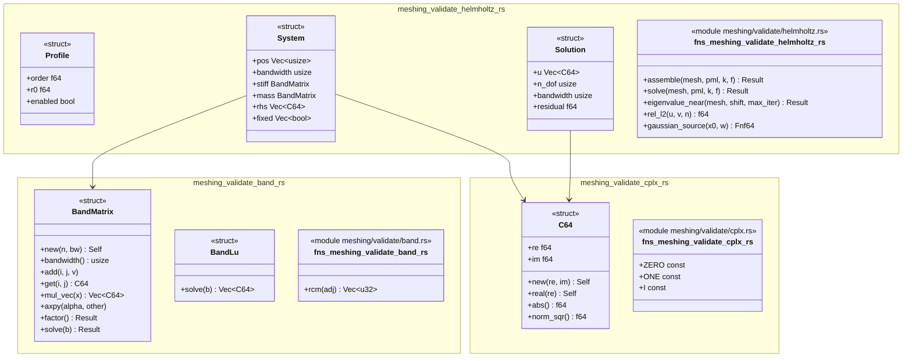

# Meshing validation harness: code

C4 level 4 (code) of the component **Meshing validation harness** (`femcore.meshcheck`) in the container **femcore** (crate `femcore`). [Component view of the container](../../3-components/femcore.md) · [All code pages](../README.md)

> A small independent scalar Helmholtz solver with PML used to validate meshes.

**Decisions:** [ADR 7](../../../adr/0007-metric-adaptation-and-structured-pml.md)  
**Size:** 4 files, 980 lines.

## Files

| File | Lines | What it says about itself |
|---|---:|---|
| `crates/femcore/src/meshing/validate/band.rs` | 270 | Reverse Cuthill-McKee ordering and a banded LU solver for the harness. |
| `crates/femcore/src/meshing/validate/cplx.rs` | 82 | Minimal complex number type (the harness needs nothing beyond the field operations). |
| `crates/femcore/src/meshing/validate/helmholtz.rs` | 617 | Scalar Helmholtz equation with PML on mixed meshes: P1 triangles, Q1 quadrilaterals (2D) and P1 tetrahedra, trilinear hexahedra, P1 x linear prisms (3D). |
| `crates/femcore/src/meshing/validate/mod.rs` | 11 | Validation harness: a small, independent scalar Helmholtz finite-element solver with PML. |

## What it uses

| Target | Modules | Items |
|---|---|---|
| [Mesh](./mesh.md) | mesh::cells | CellMesh, CellType |
| [Metric fields](./metric.md) | adapt::work | bbox_of |
| [Structured absorbing layers](./structpml.md) | meshing::pml_box | PmlMesh |

## Used by

Nothing else in the workspace names this component (entry points are reached by the program or by tests).

## Class diagram

Public types with their public fields (or variants) and methods, free functions per file as a `module` box; arrows are field types and `impl Trait`. Capped at 36 types and a few members each; the table below is complete.

## Public items

| Kind | Item | File:line | Signature or summary |
|---|---|---|---|
| fn | `rcm` | `meshing/validate/band.rs:10` | `pub fn rcm(adj: &[Vec<u32>]) -> Vec<u32>` —  Reverse Cuthill-McKee permutation: `perm[new] = old`. |
| struct | `BandMatrix` | `meshing/validate/band.rs:76` |  Square band matrix with half-bandwidth `bw`. |
| struct | `BandLu` | `meshing/validate/band.rs:170` |  Factorisation produced by [`BandMatrix::factor`]. |
| fn | `BandMatrix::new` | `meshing/validate/band.rs:84` | `pub fn new(n: usize, bw: usize) -> Self` |
| fn | `BandMatrix::bandwidth` | `meshing/validate/band.rs:88` | `pub fn bandwidth(&self) -> usize` |
| fn | `BandMatrix::add` | `meshing/validate/band.rs:97` | `pub fn add(&mut self, i: usize, j: usize, v: C64)` |
| fn | `BandMatrix::get` | `meshing/validate/band.rs:102` | `pub fn get(&self, i: usize, j: usize) -> C64` |
| fn | `BandMatrix::mul_vec` | `meshing/validate/band.rs:107` | `pub fn mul_vec(&self, x: &[C64]) -> Vec<C64>` —  `y = A x`. |
| fn | `BandMatrix::axpy` | `meshing/validate/band.rs:121` | `pub fn axpy(&mut self, alpha: C64, other: &BandMatrix)` —  `self += alpha * other` (same size and bandwidth). |
| fn | `BandMatrix::factor` | `meshing/validate/band.rs:129` | `pub fn factor(&self) -> Result<BandLu, String>` —  LU factorisation (no pivoting) that can be reused for several right-hand sides. |
| fn | `BandMatrix::solve` | `meshing/validate/band.rs:160` | `pub fn solve(&self, b: &[C64]) -> Result<(Vec<C64>, f64), String>` —  Solve `A x = b`; returns `(x, relative residual)`. |
| fn | `BandLu::solve` | `meshing/validate/band.rs:175` | `pub fn solve(&self, b: &[C64]) -> Vec<C64>` |
| struct | `C64` | `meshing/validate/cplx.rs:6` | fields: `re`, `im` |
| const | `ZERO` | `meshing/validate/cplx.rs:11` | `C64` |
| const | `ONE` | `meshing/validate/cplx.rs:12` | `C64` |
| const | `I` | `meshing/validate/cplx.rs:13` | `C64` |
| fn | `C64::new` | `meshing/validate/cplx.rs:16` | `pub fn new(re: f64, im: f64) -> Self` |
| fn | `C64::real` | `meshing/validate/cplx.rs:19` | `pub fn real(re: f64) -> Self` |
| fn | `C64::abs` | `meshing/validate/cplx.rs:22` | `pub fn abs(self) -> f64` |
| fn | `C64::norm_sqr` | `meshing/validate/cplx.rs:25` | `pub fn norm_sqr(self) -> f64` |
| struct | `Profile` | `meshing/validate/helmholtz.rs:28` | fields: `order`, `r0`, `enabled` —  PML profile parameters. |
| struct | `Solution` | `meshing/validate/helmholtz.rs:44` | fields: `u`, `n_dof`, `bandwidth`, `residual` —  Result of a solve. |
| struct | `System` | `meshing/validate/helmholtz.rs:192` | fields: `pos`, `bandwidth`, `stiff`, `mass`, `rhs`, `fixed` —  Assembled (banded, RCM-ordered) stiffness and mass matrices with Dirichlet rows applied. |
| fn | `assemble` | `meshing/validate/helmholtz.rs:207` | `pub fn assemble<const D: usize>( mesh: &CellMesh<D>, pml: Option<(&PmlMesh<D>, Profile)>, k: f64, f: &dyn Fn(&[f64; D]) -> f64, ) -> Result<System, String>` —  Assemble the system for wavenumber `k` (which sets the PML stretching) and source `f`. |
| fn | `solve` | `meshing/validate/helmholtz.rs:320` | `pub fn solve<const D: usize>( mesh: &CellMesh<D>, pml: Option<(&PmlMesh<D>, Profile)>, k: f64, f: &dyn Fn(&[f64; D]) -> f64, ) -> Result<Solution, String>` —  Solve `-Laplace u - k^2 u = f` with the PML described by `pml` (pass `None` for a plain |
| fn | `eigenvalue_near` | `meshing/validate/helmholtz.rs:337` | `pub fn eigenvalue_near<const D: usize>( mesh: &CellMesh<D>, shift: f64, max_iter: usize, ) -> Result<(f64, usize), String>` —  Eigenvalue of the (unstretched, real) Dirichlet problem `-Laplace u = lambda u` nearest to |
| fn | `rel_l2` | `meshing/validate/helmholtz.rs:376` | `pub fn rel_l2(u: &[C64], v: &[C64], n: usize) -> f64` —  Relative L2 difference `\|\|u - v\|\| / \|\|v\|\|` over the vertex ids `0..n`. |
| fn | `gaussian_source` | `meshing/validate/helmholtz.rs:383` | `pub fn gaussian_source<const D: usize>(x0: [f64; D], w: f64) -> impl Fn(&[f64` —  Gaussian source of width `w` centred at `x0`. |

Trait implementations in this component: `C64: Add`, `C64: Sub`, `C64: Mul`, `C64: Mul`, `C64: Div`, `C64: Neg`, `C64: AddAssign`, `C64: SubAssign`, `C64: MulAssign`, `Profile: Default`
