# Meshing facade: code

C4 level 4 (code) of the component **Meshing facade** (`femcore.meshing`) in the container **femcore** (crate `femcore`). [Component view of the container](../../3-components/femcore.md) · [All code pages](../README.md)

> MeshPlan and mesh_model (the one way to mesh a geom model), the serialisable request and report, sizing from the physics, and the 2D triangulation core.

**Decisions:** [ADR 6](../../../adr/0006-one-meshing-interface.md), [ADR 17](../../../adr/0017-physics-driven-mesh-sizing.md), [ADR 54](../../../adr/0054-mesh-request-and-report-as-data.md)  
**Size:** 6 files, 1772 lines.

## Files

| File | Lines | What it says about itself |
|---|---:|---|
| `crates/femcore/src/meshing/geomdrive.rs` | 301 | From a `geom` model to a mesh and to the integers the solvers take, in the wafer frame throughout: x lateral, y the direction of propagation, z the surface normal. A 2D model is the x-z cross-section and its mesh has the columns `(x, z)`... |
| `crates/femcore/src/meshing/mesher.rs` | 287 | The triangulation core shared by the geom path (`geomdrive`): chains of boundary points become a constrained Delaunay triangulation with Ruppert refinement (via the `spade` crate), cells labelled by a domain function; and the sweep of a ... |
| `crates/femcore/src/meshing/mod.rs` | 580 | The one way to mesh a `geom` model: a `MeshPlan` says how fine and with which mesher, `mesh_model` returns a `MeshedGeom` with the names, labels and exact geometry of the model, whichever mesher made the cells. |
| `crates/femcore/src/meshing/physics_size.rs` | 221 | Element sizes from the physics: how fine a mesh must be for the waves the study looks for, before any solution exists. The core takes the neutral `meshing::Sizing` a physics reports (`cell_sizes_for`, `vertex_sizes_for`, `metrics_for`, `... |
| `crates/femcore/src/meshing/request.rs` | 323 | A mesh asked for and reported in data (ADR 54): the serialisable request that the engine, the MCP tools and the window can build, run with [`mesh_request`], and the report that comes back, with JSON Schemas for both (draft 2020-12). Noth... |
| `crates/femcore/src/meshing/sizing.rs` | 60 | The neutral request a physics makes of the mesher: what to resolve, with no knowledge of any physics or of `ProblemSpec`. |

## What it uses

| Target | Modules | Items |
|---|---|---|
| [container `geom` (geom)](../../3-components/geom.md) | diff, eval, labels, model, query, select | ChangeKind, DiscretizeOpts, EntityKind, Evaluated, Evaluator, FeatureList, LabelMap, Model, RegionKind, Selector +2 |
| [Adaptation drivers](./adaptdrive.md) | adapt::drive, adapt::drive3, adapt::geom | AdaptOptions, AdaptReport, Geometry2, adapt2_with, adapt3 |
| [Adaptation operators](./adaptops.md) | adapt::ops3, adapt::topo, adapt::topo3 | AdaptOptions3, Sig, TopoOptions3, Work2 |
| [Finite-element basics](./fem.md) | props | Pml, PmlDir |
| [Material specification](./material.md) | material | M6 |
| [Mesh](./mesh.md) | mesh | SimplexMesh |
| [3D meshing](./meshing3d.md) | meshing::curve3, meshing::geomdrive3 | Sizes3, scaled_jacobian_min |
| [Metric fields](./metric.md) | adapt, adapt::field, adapt::field3, adapt::metric, adapt::work | BackgroundMetric2, BackgroundMetric3, MetricField, Sym, intersect, isotropic, simplex_from_adapt, simplex_to_adapt, sym_eig |
| [Structured absorbing layers](./structpml.md) | meshing::pml_geom | PmlMode, PmlReport, structured_pml |

## Used by

| Component | Modules | Items |
|---|---|---|
| [ems: Physics adapter](../ems/adapter.md) | meshing::physics_size | optical_wavelength, speed_of_light |
| [engine: Meshing seam](../engine/meshing.md) | meshing::geomdrive, meshing::mesher, meshing::request | Layer, MeshReport, MeshRequest, MesherRequest, WavesRequest, evaluate, extrude_y, mesh_request |
| [engine: Registry and facade](../engine/registry.md) | meshing::geomdrive |  |
| [Error estimators](./estimators.md) | meshing, meshing::geomdrive | Adaptive, GeomMeshOpts, MeshedGeom, adapt_to_field, adapt_to_metrics, evaluate, geometry_floor, mesh_geom_2d |
| [Fixtures and test kit](./fixtures.md) | meshing, meshing::geomdrive, meshing::mesher | GeomMeshOpts, Layer, MeshPlan, MeshedGeom, block, evaluate, extrude_y, mesh_evaluated +3 |
| [3D meshing](./meshing3d.md) | meshing, meshing::geomdrive | Adaptive, GeomMeshOpts, MeshedGeom, evaluate, periodic_labels |
| [Structured absorbing layers](./structpml.md) | meshing::geomdrive | MeshedGeom |
| [physics: Descriptors and schemas](../physics/descriptors.md) | meshing::sizing | Sizing |
| [sms: Physics adapter](../sms/adapter.md) | meshing::physics_size | elastic_wavelength |

## Class diagram

Public types with their public fields (or variants) and methods, free functions per file as a `module` box; arrows are field types and `impl Trait`. Capped at 36 types and a few members each; the table below is complete.

```mermaid
classDiagram
  namespace meshing_geomdrive_rs {
    class GeomMeshOpts {
        <<struct>>
        +h f64
        +max_dev Option~f64~
        +min_angle_deg f64
        +curved bool
        +new(h) Self
    }
    class MeshedGeom {
        <<struct>>
        +mesh SimplexMesh
        +labels LabelMap
        +eval Arc~Evaluated~
        +domain(region) Option~i32~
        +domains(pattern) Vec~i32~
        +boundary(name) Vec~i32~
        +select(selector) Result
        +pml_materials(strength) BTreeMap
    }
    class SizeMap {
        <<struct>>
        +region_h Vec~f64~
        +edge_rule Vec
    }
    class Plate {
        <<struct>>
        +mesh SimplexMesh
        +domain i32
        +xmin Vec~i32~
        +xmax Vec~i32~
        +zmin Vec~i32~
        +zmax Vec~i32~
    }
    class Block {
        <<struct>>
        +mesh SimplexMesh
        +domain i32
        +xmin Vec~i32~
        +xmax Vec~i32~
        +zmin Vec~i32~
        +zmax Vec~i32~
        +ymin Vec~i32~
        +ymax Vec~i32~
    }
    class fns_meshing_geomdrive_rs {
        <<module meshing/geomdrive.rs>>
        +evaluate(list) Result
        ~size_map(ev, h) SizeMap
        +mesh_geom_2d(ev, opts) Result
        +select_labels(ev, labels, selector) Result
        +plate(lx, lz, h) Result
        +block(lx, ly, lz, h, ny) Result
        +sort_nodes(m) SimplexMesh
    }
  }
  namespace meshing_mesher_rs {
    class Layer {
        <<struct>>
        +thickness f64
        +n usize
        +domain_offset i32
    }
    class Chain {
        <<struct>>
        +pts Vec
        +label i32
        +part usize
    }
    class Fill {
        <<struct>>
        +lo slice
        +hi slice
        +h f64
        +owner BoxdynFnf642bool
    }
    class MeshParams {
        <<struct>>
        +h f64
        +h_fine_min f64
        +h_reach f64
        +min_angle_deg f64
        +lo slice
        +hi slice
    }
    class fns_meshing_mesher_rs {
        <<module meshing/mesher.rs>>
        ~dist_point_segment(p, a, b) f64
        ~mesh_chains(chains, fills, mp, domain_at) Result
        +extrude_y(m2, layers, y0) Result
    }
  }
  namespace meshing_mod_rs {
    class Adaptive {
        <<struct>>
        +scale f64
        +grade f64
        +max_cells Option~usize~
    }
    class Mesher {
        <<enumeration>>
        Simple
        Adaptive
    }
    class MeshPlan {
        <<struct>>
        +opts GeomMeshOpts
        +mesher Mesher
        +pml PmlMode
        +simple(h) Self
        +adaptive(h, scale) Self
    }
    class GeomOracle2 {
        <<struct>>
        +from_work(ev, labels, w) Self
    }
    class Reuse {
        <<enumeration>>
        Hit
        Meshed
    }
    class CacheStats {
        <<struct>>
        +requests usize
        +hits usize
        +eval_seconds f64
        +mesh_seconds f64
    }
    class MeshCache {
        <<struct>>
        +stats CacheStats
        +new(capacity) Self
        +mesh(list, plan) Result
        +mesh_extruded(list, plan, layers) Result
    }
    class fns_meshing_mod_rs {
        <<module meshing/mod.rs>>
        +mesh_model(list, plan) Result
        +mesh_evaluated(ev, plan) Result
        +mesh_evaluated_report(ev, plan) Result
        +mesh_for_sizing(list, plan, sizing, sz) Result
        +wave_sizes_by_region(ev, labels, sizing, sz) Result
        +a_priori_metrics(g, opts, a) Result
        +geometry_floor(g, opts, a) Result
        +adapt_to_metrics(g, metrics, a) Result
        +adapt_to_field(g, field, a) Result
        ~periodic_labels(g) Vec~i32~
    }
  }
  namespace meshing_physics_size_rs {
    class PhysicsSizing {
        <<struct>>
        +points_per_wavelength Option~f64~
        +pml_relax f64
        +eigen_headroom f64
        +ppw(order) f64
    }
    class fns_meshing_physics_size_rs {
        <<module meshing/physics_size.rs>>
        +wave_speed_range(c, rho) tuple
        +cell_sizes_for(sizing, resolve, cell_labels, pml, sz) Result
        +vertex_sizes_for(sizing, resolve, mesh, pml, sz) Result
        +metrics_for(sizing, resolve, mesh, pml, sz, ceiling) Result
        +adapt_tets_for(mesh, sizing, resolve, pml, sz, ceiling, grade, opt) Result
        +optical_wavelength(eps, mu, lam0) f64
        +speed_of_light() f64
        +elastic_wavelength(c, rho, f) f64
    }
  }
  namespace meshing_request_rs {
    class MesherRequest {
        <<enumeration>>
        Simple
        Adaptive
    }
    class WavesRequest {
        <<struct>>
        +sizing Sizing
        +points_per_wavelength Option~f64~
        +pml_relax f64
        +eigen_headroom f64
    }
    class MeshRequest {
        <<struct>>
        +h f64
        +max_dev Option~f64~
        +mesher MesherRequest
        +structured_pml bool
        +waves Option~WavesRequest~
        +curved bool
        +plan() MeshPlan
    }
    class DomainReport {
        <<struct>>
        +id i32
        +name String
        +cells usize
        +wave_size Option~f64~
    }
    class AdaptSummary {
        <<struct>>
        +iterations usize
        +converged bool
        +capped bool
        +q_min f64
        +cells_start usize
        +cells_end usize
    }
    class MeshReport {
        <<struct>>
        +dim usize
        +vertices usize
        +cells usize
        +facets usize
        +domains Vec~DomainReport~
        +adaptation Option~AdaptSummary~
        +structured_layers Option
        +curved Option~CurvedSummary~
        +more_1_fields
    }
    class CurvedSummary {
        <<struct>>
        +edges usize
        +cells usize
        +min_scaled_jacobian f64
    }
    class fns_meshing_request_rs {
        <<module meshing/request.rs>>
        +mesh_request(list, req) Result
        +request_schema() Value
        +report_schema() Value
    }
  }
  namespace meshing_sizing_rs {
    class Sizing {
        <<struct>>
        +order u8
        +headroom f64
        +wavelengths BTreeMap
        +by_label(order, headroom, wavelengths) Sizing
        +resolve(domain) Result
    }
    class fns_meshing_sizing_rs {
        <<module meshing/sizing.rs>>
        +label_names(name) Option~i32~
    }
  }
  Mesher --> Adaptive
  MeshPlan --> GeomMeshOpts
  MeshPlan --> Mesher
  MeshCache --> CacheStats
  WavesRequest --> Sizing
  MeshRequest --> MesherRequest
  MeshRequest --> WavesRequest
  MeshReport --> DomainReport
  MeshReport --> AdaptSummary
  MeshReport --> CurvedSummary
```

## Public items

| Kind | Item | File:line | Signature or summary |
|---|---|---|---|
| struct | `GeomMeshOpts` | `meshing/geomdrive.rs:29` | fields: `h`, `max_dev`, `min_angle_deg`, `curved` —  Sizes of a mesh made from a model. |
| struct | `MeshedGeom` | `meshing/geomdrive.rs:47` | fields: `mesh`, `labels`, `eval` —  A meshed model: the mesh, the compiled names, and the evaluation they came from. |
| fn | `evaluate` | `meshing/geomdrive.rs:117` | `pub fn evaluate(list: &FeatureList) -> Result<Evaluated, String>` —  Evaluates a feature list to the tier the mesher needs. |
| struct | `SizeMap` | `meshing/geomdrive.rs:123` | fields: `region_h`, `edge_rule` —  The element sizes a model asks for: per region (the global size, the `Size` rules on regions, and thickness / layers in an absorbing |
| fn | `size_map` | `meshing/geomdrive.rs:128` | `pub(crate) fn size_map(ev: &Evaluated, h: f64) -> SizeMap` |
| fn | `mesh_geom_2d` | `meshing/geomdrive.rs:154` | `pub fn mesh_geom_2d(ev: Evaluated, opts: &GeomMeshOpts) -> Result<MeshedGeom, String>` —  Meshes a 2D model (the x-z cross-section) with triangles. |
| fn | `select_labels` | `meshing/geomdrive.rs:219` | `pub fn select_labels(ev: &Evaluated, labels: &LabelMap, selector: &str) -> Result<Vec<i32>, String>` —  Labels of whatever a selector text picks in an evaluated model: boundary labels for edges, domain labels for regions. |
| struct | `Plate` | `meshing/geomdrive.rs:236` | fields: `mesh`, `domain`, `xmin`, `xmax`, `zmin`, `zmax` —  A rectangle `[0, lx] x [0, lz]` of the x-z plane as one domain, meshed with element size `h`, with the boundary labels of its four sides |
| fn | `plate` | `meshing/geomdrive.rs:245` | `pub fn plate(lx: f64, lz: f64, h: f64) -> Result<Plate, String>` |
| struct | `Block` | `meshing/geomdrive.rs:258` | fields: `mesh`, `domain`, `xmin`, `xmax`, `zmin`, `zmax`, `ymin`, `ymax` —  A box `[0, lx] x [0, ly] x [0, lz]`: the plate swept along y through `ny` layers (`extrude_y`). The vertices of the section are put in coordinate order first (`sort_nodes`), so that opposite side walls can be paired by a Floquet condition. The side walls keep the labels of the |
| fn | `block` | `meshing/geomdrive.rs:269` | `pub fn block(lx: f64, ly: f64, lz: f64, h: f64, ny: usize) -> Result<Block, String>` |
| fn | `sort_nodes` | `meshing/geomdrive.rs:280` | `pub fn sort_nodes(m: &SimplexMesh) -> SimplexMesh` —  The mesh with its vertices renumbered in the order of their coordinates (x first, then the second axis, equal to a tolerance of |
| fn | `GeomMeshOpts::new` | `meshing/geomdrive.rs:40` | `pub fn new(h: f64) -> Self` |
| fn | `MeshedGeom::domain` | `meshing/geomdrive.rs:56` | `pub fn domain(&self, region: &str) -> Option<i32>` —  The domain label of a region. |
| fn | `MeshedGeom::domains` | `meshing/geomdrive.rs:62` | `pub fn domains(&self, pattern: &str) -> Vec<i32>` —  Domain labels of regions by name. A list is comma separated; `"sapphire*"` is `sapphire` and every region whose name starts with |
| fn | `MeshedGeom::boundary` | `meshing/geomdrive.rs:82` | `pub fn boundary(&self, name: &str) -> Vec<i32>` —  Boundary labels by name (`"rib.top"`, `"air\|rib"`; a face split into pieces has several) or tag/group. |
| fn | `MeshedGeom::select` | `meshing/geomdrive.rs:87` | `pub fn select(&self, selector: &str) -> Result<Vec<i32>, String>` —  Boundary labels of whatever a selector text picks (`"outer & plane(z = -3e-6)"`). |
| fn | `MeshedGeom::pml_materials` | `meshing/geomdrive.rs:93` | `pub fn pml_materials(&self, strength: f64) -> BTreeMap<i32, Pml>` —  The absorbing layers of the model as solver stretching, keyed by domain: `strength` is the imaginary stretch at the outer edge, the |
| struct | `Layer` | `meshing/mesher.rs:11` | fields: `thickness`, `n`, `domain_offset` |
| struct | `Chain` | `meshing/mesher.rs:19` | fields: `pts`, `label`, `part` —  One closed polyline edge chain: sample points and the boundary label of every segment. |
| fn | `dist_point_segment` | `meshing/mesher.rs:26` | `pub(crate) fn dist_point_segment(p: [f64; 2], a: [f64; 2], b: [f64; 2]) -> f64` |
| struct | `Fill` | `meshing/mesher.rs:35` | fields: `lo`, `hi`, `h`, `owner` —  One lattice fill: a region that wants elements of size `h` (finer than the global size) inside the box `lo..hi`; `owner` says whether a point is |
| struct | `MeshParams` | `meshing/mesher.rs:42` | fields: `h`, `h_fine_min`, `h_reach`, `min_angle_deg`, `lo`, `hi` |
| fn | `mesh_chains` | `meshing/mesher.rs:56` | `pub(crate) fn mesh_chains( chains: &[Chain], fills: &[Fill], mp: &MeshParams, domain_at: &dyn Fn([f64; 2]) -> Option<i32>, ) -> Result<SimplexMesh, String>` —  The shared tail of the meshers: constrained Delaunay triangulation of the chains (conforming, labelled), lattice points, Ruppert refinement, |
| fn | `extrude_y` | `meshing/mesher.rs:225` | `pub fn extrude_y(m2: &SimplexMesh, layers: &[Layer], y0: f64) -> Result<SimplexMesh, String>` —  Sweeps the x-z cross-section of the wafer frame (a 2D mesh with the columns `(x, z)`) along the propagation axis y through the given |
| struct | `Adaptive` | `meshing/mod.rs:51` | fields: `scale`, `grade`, `max_cells` —  Settings of the adaptive mesher. |
| enum | `Mesher` | `meshing/mod.rs:69` | variants: `Simple`, `Adaptive` —  Which mesher makes the cells. |
| struct | `MeshPlan` | `meshing/mod.rs:76` | fields: `opts`, `mesher`, `pml` —  How a model is meshed: the sizes (as for `mesh_geom_2d`) and the mesher. |
| fn | `mesh_model` | `meshing/mod.rs:102` | `pub fn mesh_model(list: &FeatureList, plan: &MeshPlan) -> Result<MeshedGeom, String>` —  Meshes a model. |
| fn | `mesh_evaluated` | `meshing/mod.rs:107` | `pub fn mesh_evaluated(ev: Evaluated, plan: &MeshPlan) -> Result<MeshedGeom, String>` —  Meshes an evaluated model. |
| fn | `mesh_evaluated_report` | `meshing/mod.rs:112` | `pub fn mesh_evaluated_report(ev: Evaluated, plan: &MeshPlan) -> Result<(MeshedGeom, Option<AdaptReport>), String>` —  Like `mesh_evaluated`, with the report of the adaptation when there was one. |
| fn | `mesh_for_sizing` | `meshing/mod.rs:136` | `pub fn mesh_for_sizing(list: &FeatureList, plan: &MeshPlan, sizing: &Sizing, sz: &PhysicsSizing) -> Result<(MeshedGeom, Option<AdaptReport>), String>` —  Meshes a model of either dimension for the neutral `Sizing` a physics reports (ADR 50): the sizes the model asks for, and in |
| fn | `wave_sizes_by_region` | `meshing/mod.rs:194` | `pub fn wave_sizes_by_region(ev: &Evaluated, labels: &LabelMap, sizing: &Sizing, sz: &PhysicsSizing) -> Result<Vec<f64>, String>` —  The element size the waves of `sizing` need in every region of a 3D model, by region index; `f64::INFINITY` where a region carries no |
| fn | `a_priori_metrics` | `meshing/mod.rs:270` | `pub fn a_priori_metrics(g: &MeshedGeom, opts: &GeomMeshOpts, a: &Adaptive) -> Result<Vec<Sym<2>>, String>` —  The isotropic metric at every vertex of a meshed model that the model itself asks for: the size of the region(s) the vertex belongs |
| fn | `geometry_floor` | `meshing/mod.rs:276` | `pub fn geometry_floor(g: &MeshedGeom, opts: &GeomMeshOpts, a: &Adaptive) -> Result<Vec<Sym<2>>, String>` —  The sizes the geometry insists on whatever the solution does: `Size` rules on regions and edges, the layers of an absorbing region, and |
| fn | `adapt_to_metrics` | `meshing/mod.rs:364` | `pub fn adapt_to_metrics(g: MeshedGeom, metrics: &[Sym<2>], a: &Adaptive) -> Result<(MeshedGeom, AdaptReport), String>` —  Adapts a meshed model to a metric given at every vertex of its mesh. The metrics are graded and interpolated on the old mesh; the |
| fn | `adapt_to_field` | `meshing/mod.rs:378` | `pub fn adapt_to_field(g: MeshedGeom, field: &dyn MetricField<2>, a: &Adaptive) -> Result<(MeshedGeom, AdaptReport), String>` —  Adapts a meshed model to a metric field defined anywhere in the plane, for example the final metric of an earlier, slightly different |
| fn | `periodic_labels` | `meshing/mod.rs:397` | `pub(crate) fn periodic_labels(g: &MeshedGeom) -> Vec<i32>` —  Boundary labels of the edges that take part in a periodic pair of the model. Their chains stay exactly as the start mesh has them, so |
| struct | `GeomOracle2` | `meshing/mod.rs:434` |  The exact geometry as the oracle of the adaptation: where a vertex of a boundary or interface chain may go is the closest point on |
| enum | `Reuse` | `meshing/mod.rs:496` | variants: `Hit`, `Meshed` —  How a cached request was answered. |
| struct | `CacheStats` | `meshing/mod.rs:506` | fields: `requests`, `hits`, `eval_seconds`, `mesh_seconds` —  Counters of a `MeshCache`. |
| struct | `MeshCache` | `meshing/mod.rs:521` | fields: `stats` —  Meshes a series of related models (a parameter sweep, a refinement study, the same model for several physics) without repeating work. |
| fn | `MeshPlan::simple` | `meshing/mod.rs:85` | `pub fn simple(h: f64) -> Self` —  The simple mesher at element size `h`. |
| fn | `MeshPlan::adaptive` | `meshing/mod.rs:90` | `pub fn adaptive(h: f64, scale: f64) -> Self` —  The adaptive mesher: start at element size `h`, adapt to `scale * h` (and to the curvature of the edges at that scale). |
| fn | `GeomOracle2::from_work` | `meshing/mod.rs:441` | `pub fn from_work(ev: &'a Evaluated, labels: &LabelMap, w: &Work2) -> Self` |
| fn | `MeshCache::new` | `meshing/mod.rs:537` | `pub fn new(capacity: usize) -> Self` —  A cache that keeps the `capacity` most recent distinct requests. |
| fn | `MeshCache::mesh` | `meshing/mod.rs:547` | `pub fn mesh(&mut self, list: &FeatureList, plan: &MeshPlan) -> Result<(MeshedGeom, Reuse), String>` —  The meshed model for `list` and `plan`, from the cache when it is there. |
| fn | `MeshCache::mesh_extruded` | `meshing/mod.rs:574` | `pub fn mesh_extruded(&mut self, list: &FeatureList, plan: &MeshPlan, layers: &[crate::meshing::mesher::Layer]) -> Result<(MeshedGeom, Reuse), String>` —  The section of `list` swept along y through `layers`. The section is the cached part: changing only the layers re-extrudes it. |
| struct | `PhysicsSizing` | `meshing/physics_size.rs:30` | fields: `points_per_wavelength`, `pml_relax`, `eigen_headroom` —  How finely the waves are resolved. |
| fn | `wave_speed_range` | `meshing/physics_size.rs:56` | `pub fn wave_speed_range(c: &M6, rho: f64) -> (f64, f64)` —  Slowest and fastest plane-wave speed of a medium with stiffness `c` (solver Voigt order xx, yy, zz, xy, yz, xz; engineering shear) and |
| fn | `cell_sizes_for` | `meshing/physics_size.rs:93` | `pub fn cell_sizes_for( sizing: &Sizing, resolve: &dyn Fn(&str) -> Option<i32>, cell_labels: &[i32], pml: &dyn Fn(i32) -> bool, sz: &PhysicsSizing, ) -> Result<Vec<f64>, String>` —  Target element size of every cell: the shortest wavelength of its domain, divided by the headroom and by the points per wavelength, and |
| fn | `vertex_sizes_for` | `meshing/physics_size.rs:116` | `pub fn vertex_sizes_for( sizing: &Sizing, resolve: &dyn Fn(&str) -> Option<i32>, mesh: &SimplexMesh, pml: &dyn Fn(i32) -> bool, sz: &PhysicsSizing, ) -> Result<Vec<f64>, String>` —  Target element size at every vertex: the smallest of the cells that meet there. A vertex of cells without a wave gets `f64::INFINITY`. |
| fn | `metrics_for` | `meshing/physics_size.rs:135` | `pub fn metrics_for<const D: usize>( sizing: &Sizing, resolve: &dyn Fn(&str) -> Option<i32>, mesh: &SimplexMesh, pml: &dyn Fn(i32) -> bool, sz: &PhysicsSizing, ceiling: f64, ) -> Result<Vec<Sym<D>>, String>` —  Isotropic metric of the physics size at every vertex of a mesh of any dimension (`D` = 2 or 3). Vertices without a wave get `ceiling` (a |
| fn | `adapt_tets_for` | `meshing/physics_size.rs:153` | `pub fn adapt_tets_for( mesh: &SimplexMesh, sizing: &Sizing, resolve: &dyn Fn(&str) -> Option<i32>, pml: &dyn Fn(i32) -> bool, sz: &PhysicsSizing, ceiling: f64, grade: f64, opt: &crate::adapt::ops3::AdaptOptions3, ) -> Result<(SimplexMesh, crate::adapt::drive::AdaptReport), String>` —  Adapts a tetrahedral mesh to a neutral `Sizing`: the sizes of `vertex_sizes_for` (capped at `ceiling`), graded with slope `grade`, |
| fn | `optical_wavelength` | `meshing/physics_size.rs:176` | `pub fn optical_wavelength(eps: &[[f64; 3]; 3], mu: f64, lam0: f64) -> f64` —  Free-space wavelength `lam0` shortened by the largest refractive index of a medium with the relative permittivity tensor `eps` and the |
| fn | `speed_of_light` | `meshing/physics_size.rs:182` | `pub fn speed_of_light() -> f64` —  Vacuum speed of light (m/s). |
| fn | `elastic_wavelength` | `meshing/physics_size.rs:188` | `pub fn elastic_wavelength(c: &M6, rho: f64, f: f64) -> f64` —  Shortest wavelength of the elastic waves of a medium with stiffness `c` (solver Voigt order) and density `rho` at frequency `f`: the |
| fn | `PhysicsSizing::ppw` | `meshing/physics_size.rs:48` | `pub fn ppw(&self, order: usize) -> f64` —  Points per wavelength for an element order. |
| enum | `MesherRequest` | `meshing/request.rs:18` | variants: `Simple`, `Adaptive` —  Which mesher makes the cells. |
| struct | `WavesRequest` | `meshing/request.rs:49` | fields: `sizing`, `points_per_wavelength`, `pml_relax`, `eigen_headroom` —  The waves of a study, as the physics reports them (`Sizing`) and how finely they are resolved. |
| struct | `MeshRequest` | `meshing/request.rs:64` | fields: `h`, `max_dev`, `mesher`, `structured_pml`, `waves`, `curved` —  A mesh asked for. |
| struct | `DomainReport` | `meshing/request.rs:102` | fields: `id`, `name`, `cells`, `wave_size` —  One domain of the meshed model. |
| struct | `AdaptSummary` | `meshing/request.rs:113` | fields: `iterations`, `converged`, `capped`, `q_min`, `cells_start`, `cells_end` —  What the adaptation did. |
| struct | `MeshReport` | `meshing/request.rs:125` | fields: `dim`, `vertices`, `cells`, `facets`, `domains`, `adaptation`, `structured_layers`, `curved`, `warnings` —  A mesh reported. |
| struct | `CurvedSummary` | `meshing/request.rs:147` | fields: `edges`, `cells`, `min_scaled_jacobian` —  The curved geometry of a 3D mesh (ADR 82). |
| fn | `mesh_request` | `meshing/request.rs:212` | `pub fn mesh_request(list: &FeatureList, req: &MeshRequest) -> Result<(MeshedGeom, MeshReport), String>` —  Meshes `list` as `req` asks (any dimension) and reports what came out. |
| fn | `request_schema` | `meshing/request.rs:236` | `pub fn request_schema() -> Value` —  JSON Schema of [`MeshRequest`]. |
| fn | `report_schema` | `meshing/request.rs:285` | `pub fn report_schema() -> Value` —  JSON Schema of [`MeshReport`]. |
| fn | `MeshRequest::plan` | `meshing/request.rs:85` | `pub fn plan(&self) -> MeshPlan` —  The plan this request names. |
| struct | `Sizing` | `meshing/sizing.rs:14` | fields: `order`, `headroom`, `wavelengths` —  What the mesher needs from a physics to size the elements before any solution exists. |
| fn | `label_names` | `meshing/sizing.rs:41` | `pub fn label_names(name: &str) -> Option<i32>` —  Resolver for meshes without names: the key of a region is its decimal domain label. |
| fn | `Sizing::by_label` | `meshing/sizing.rs:25` | `pub fn by_label(order: u8, headroom: f64, wavelengths: &BTreeMap<i32, f64>) -> Sizing` —  A request for a mesh that only has domain numbers: the keys are the decimal labels. |
| fn | `Sizing::resolve` | `meshing/sizing.rs:30` | `pub fn resolve(&self, domain: &dyn Fn(&str) -> Option<i32>) -> Result<BTreeMap<i32, f64>, String>` —  The wavelengths by domain label, the names resolved by `domain`. A region the model does not have is an error. |

Trait implementations in this component: `Adaptive: Default`, `MeshPlan: From`, `GeomOracle2: Geometry2`, `MeshCache: Default`, `PhysicsSizing: Default`
