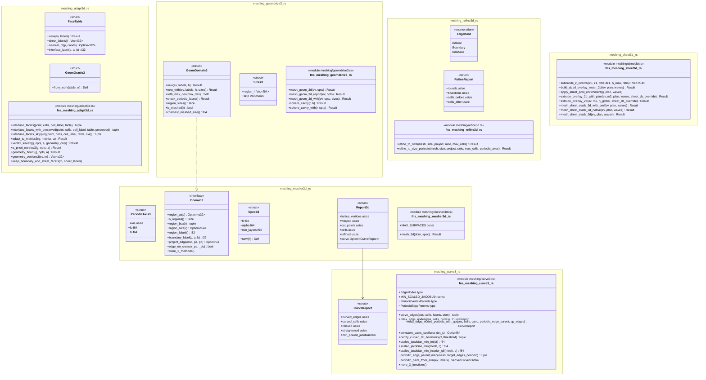

# 3D meshing: code

C4 level 4 (code) of the component **3D meshing** (`femcore.meshing3d`) in the container **femcore** (crate `femcore`). [Component view of the container](../../3-components/femcore.md) · [All code pages](../README.md)

> The lattice tetrahedral mesher on Domain3, Rivara refinement, the adapter from a 3D geom model (`R33` crease projection), adaptive meshing driven by exact faces, face sizes and max_dev, Bernstein/`q8` curved Jacobian certification & periodic mid-edge sync, and conformal 3D sheet-stack meshing.

**Decisions:** [ADR 40](../../../adr/0040-3d-geom-models-meshed-by-the-lattice-mesher.md), [ADR 50](../../../adr/0050-wavelength-sizing-in-3d.md), [ADR 51](../../../adr/0051-adaptive-meshing-of-3d-geom-models.md), [ADR 55](../../../adr/0055-lattice-mesher-welds-slivers-and-is-independent-of-the-thread-count.md), [ADR 82](../../../adr/0082-curved-order-2-geometry.md), [ADR 83](../../../adr/0083-face-size-rules-and-max-dev-in-the-lattice-mesher.md), [ADR 102](../../../adr/0102-conformal-interior-sheets-and-batch-polygons.md), [ADR 132](../../../adr/0132-vvuq-asme-six-pillar-code-verification.md)  
**Size:** 6 files, 7505 lines.

## Files

| File | Lines | What it says about itself |
|---|---:|---|
| `crates/femcore/src/meshing/adapt3d.rs` | 528 | Adaptive meshing of a 3D `geom` model (ADR 51): the metric adaptation of `adapt::drive3` driven by the exact faces of the model. |
| `crates/femcore/src/meshing/curve3.rs` | 999 | Curved edges for 3D meshes (ADR 82): the mid-edge geometry nodes that make the tetrahedra around a curved surface quadratic (isoparametric) instead of straight. |
| `crates/femcore/src/meshing/geomdrive3.rs` | 494 | From a 3D `geom` model to a tetrahedral mesh: the adapter between `geom::Evaluated` and the lattice mesher (`mesher3d`), which only knows the trait `Domain3`. |
| `crates/femcore/src/meshing/mesher3d.rs` | 1425 | Tetrahedral meshes of 3D models: a lattice fill that is fitted to the exact geometry of any model that can say which region a point is in. |
| `crates/femcore/src/meshing/refine3d.rs` | 491 | Local refinement of a tetrahedral mesh by longest-edge (Rivara) bisection. |
| `crates/femcore/src/meshing/sheet3d.rs` | 3568 |  |

## What it uses

| Target | Modules | Items |
|---|---|---|
| [container `geom` (geom)](../../3-components/geom.md) | complex, curve, eval, labels, math, model, query, select +1 | Aabb, Curve, DiscretizeOpts, EdgeGeom, EntityKind, Evaluated, FaceGeom, LabelMap, Model, PeriodicPair +7 |
| [Adaptation drivers](./adaptdrive.md) | adapt::drive, adapt::drive3, adapt::geom3 | AdaptReport, FacetGeometry, Geometry3, adapt3_with |
| [Adaptation operators](./adaptops.md) | adapt::ops3, adapt::topo, adapt::topo3 | AdaptOptions3, Sig, TopoOptions3, Work3 |
| [Finite-element basics](./fem.md) | fem | CurvedTet, quad_rule_collapsed |
| [Mesh](./mesh.md) | mesh, mesh::cells, mesh::exchange | CellMesh, CellType, Mesh, SimplexMesh |
| [Meshing facade](./meshing.md) | meshing, meshing::geomdrive, meshing::mesher, meshing::physics_size, meshing::sheet3d_curve, meshing::singularity, meshing::sizing | Adaptive, Chain, DEFAULT_QUARTER_POINT_XI, Fill, GeomMeshOpts, MeshParams, MeshPlan, MeshedGeom, Mesher, NativeRawTuple +15 |
| [Metric fields](./metric.md) | adapt::field3, adapt::metric, adapt::work | BackgroundMetric3, SimplexMesh, Sym, isotropic, simplex_to_adapt |
| [Runtime services](./runtime.md) | par, progress | check, lap, threads |
| [Structured absorbing layers](./structpml.md) | meshing::pml_geom, meshing::pml_geom3 | Native3, PmlReport, structured_pml_3d_native_with_curved, structured_pml_3d_with_curved |

## Used by

| Component | Modules | Items |
|---|---|---|
| [engine: Meshing seam](../engine/meshing.md) | meshing::geomdrive3, meshing::sheet3d | Sizes3, build_sized_overlay_mesh_2d, extrude_overlay_2d_with_plan |
| [Meshing facade](./meshing.md) | meshing::adapt3d, meshing::curve3, meshing::geomdrive3, meshing::mesher3d, meshing::sheet3d | CurveReport, Domain3, EdgeNodes, GeomDomain3, Sizes3, adapt_to_metrics3, apply_sheet_post_enrichment, build_sized_overlay_mesh_2d +9 |
| [Structured absorbing layers](./structpml.md) | meshing::adapt3d, meshing::curve3 | FaceTable, MIN_SCALED_JACOBIAN |

## Class diagram

Public types with their public fields (or variants) and methods, free functions per file as a `module` box; arrows are field types and `impl Trait`. Capped at 36 types and a few members each; the table below is complete.

## Public items

| Kind | Item | File:line | Signature or summary |
|---|---|---|---|
| struct | `FaceTable` | `meshing/adapt3d.rs:35` |  The faces of a model as the adaptation needs them: the domain numbers on their two sides, their boundary number and their box. |
| struct | `GeomOracle3` | `meshing/adapt3d.rs:139` |  The exact geometry as the oracle of the 3D adaptation. |
| fn | `interface_facets` | `meshing/adapt3d.rs:264` | `pub fn interface_facets(point: &dyn Fn(u32) -> [f64; 3], cells: &[u32], cell_label: &[i32], table: &FaceTable) -> (Vec<[u32` —  Faces between cells of different domains, labelled, oriented out of the lower-numbered domain. |
| fn | `interface_facets_with_preserved` | `meshing/adapt3d.rs:270` | `pub fn interface_facets_with_preserved( point: &dyn Fn(u32) -> [f64; 3], cells: &[u32], cell_label: &[i32], table: &FaceTable, preserved: &BTreeMap<[u32; 3], ([u32; 3], i32)>, ) -> (Vec<[u32` —  Like [`interface_facets`], while also emitting surviving physical interior facets recorded in `preserved` |
| fn | `interface_facets_skipping` | `meshing/adapt3d.rs:282` | `pub fn interface_facets_skipping( point: &dyn Fn(u32) -> [f64; 3], cells: &[u32], cell_label: &[i32], table: &FaceTable, skip: &HashSet<[u32; 3]>, ) -> (Vec<[u32` —  Like [`interface_facets`], skipping any sorted vertex triple already present in `skip` |
| fn | `adapt_to_metrics3` | `meshing/adapt3d.rs:344` | `pub fn adapt_to_metrics3(g: MeshedGeom, metrics: &[Sym<3>], a: &Adaptive) -> Result<(MeshedGeom, AdaptReport), String>` —  Adapts a meshed 3D model to a metric given at every vertex of its mesh: graded, the faces of the model as the oracle, the labels of |
| fn | `vertex_sizes3` | `meshing/adapt3d.rs:406` | `pub fn vertex_sizes3(g: &MeshedGeom, opts: &GeomMeshOpts, a: &Adaptive, geometry_only: bool) -> Result<Vec<f64>, String>` —  The element size every vertex of a meshed 3D model is asked for by the model itself: the size of the regions it belongs to (the |
| fn | `a_priori_metrics3` | `meshing/adapt3d.rs:457` | `pub fn a_priori_metrics3(g: &MeshedGeom, opts: &GeomMeshOpts, a: &Adaptive) -> Result<Vec<Sym<3>>, String>` —  The isotropic metric the model itself asks for at every vertex (see [`vertex_sizes3`]). |
| fn | `geometry_floor3` | `meshing/adapt3d.rs:462` | `pub fn geometry_floor3(g: &MeshedGeom, opts: &GeomMeshOpts, a: &Adaptive) -> Result<Vec<Sym<3>>, String>` —  The sizes the geometry insists on whatever the solution does, as metrics: the floor of an estimator metric. |
| fn | `geometry_vertices3` | `meshing/adapt3d.rs:467` | `pub fn geometry_vertices3(ev: &Evaluated, m: &WorkMesh<3>) -> Vec<u32>` —  Indices of the 3D working-mesh vertices that sit on an exact vertex of `ev`. |
| fn | `keep_boundary_and_sheet_facets` | `meshing/adapt3d.rs:498` | `pub fn keep_boundary_and_sheet_facets(m: &mut WorkMesh<3>, sheet_labels: &[i32])` —  Keeps outer boundary facets (`count == 1`) and two-sided interior sheet facets (`count == 2` with |
| fn | `FaceTable::new` | `meshing/adapt3d.rs:45` | `pub fn new(ev: &'a Evaluated, labels: &LabelMap) -> Result<Self, String>` |
| fn | `FaceTable::sheet_labels` | `meshing/adapt3d.rs:59` | `pub fn sheet_labels(&self) -> Vec<i32>` —  Sorted, deduplicated 1-based boundary labels of all 2D `Op::Sheet` faces in the model. |
| fn | `FaceTable::nearest_of` | `meshing/adapt3d.rs:89` | `pub fn nearest_of(&self, p: [f64; 3], cands: impl Iterator<Item = usize>) -> Option<i32>` —  The boundary number of the nearest of the faces `cands` to `p`. |
| fn | `FaceTable::interface_label` | `meshing/adapt3d.rs:114` | `pub fn interface_label(&self, p: [f64; 3], a: i32, b: i32) -> i32` —  The boundary number of the non-sheet face a facet with centroid `p` between the domains `a` and `b` lies on: |
| fn | `GeomOracle3::from_work` | `meshing/adapt3d.rs:149` | `pub fn from_work(table: &'a FaceTable<'a>, w: &Work3) -> Self` |
| type | `EdgeNodes` | `meshing/curve3.rs:21` |  The curved edges: sorted vertex pair and the position of the mid-edge node. |
| struct | `CurveReport` | `meshing/curve3.rs:25` | fields: `curved_edges`, `curved_cells`, `relaxed`, `straightened`, `min_scaled_jacobian` —  What `curve_boundary_edges` did. |
| const | `MIN_SCALED_JACOBIAN` | `meshing/curve3.rs:45` | `f64` —  A cell must keep this fraction of its straight Jacobian determinant everywhere. |
| fn | `curve_edges` | `meshing/curve3.rs:76` | `pub fn curve_edges( pos: &(dyn Fn(u32) -> [f64; 3] + Sync), cells: &[[u32; 4]], facets: &[[u32; 3]], dom: &dyn Domain3, ) -> (EdgeNodes, CurveReport)` —  The core: curved edges for the tetrahedra `cells` with vertex positions `pos`, from the edges of the facets `facets` (boundary |
| fn | `relax_edge_nodes` | `meshing/curve3.rs:195` | `pub fn relax_edge_nodes( pos: &(dyn Fn(u32) -> [f64; 3] + Sync), cells: &[[u32; 4]], nodes: &mut EdgeNodes, ) -> CurveReport` —  Validates and relaxes curved mid-edge nodes `nodes` over `cells` via exact 20-coefficient tetrahedral |
| fn | `relax_edge_nodes_periodic_with_qp` | `meshing/curve3.rs:210` | `pub(crate) fn relax_edge_nodes_periodic_with_qp( pos: &(dyn Fn(u32) -> [f64; 3] + Sync), cells: &[[u32; 4]], cand: &mut EdgeNodes, periodic_edge_parent: &HashMap<[u32; 2], ([u32; 2], [f64; 3])>, qp_edges: &[[u32; 2]], ) -> CurveReport` —  Periodic-aware curved edge relaxation excluding cells touching Barsoum quarter-point `qp_edges` from |
| fn | `bernstein_cubic_coeffs` | `meshing/curve3.rs:433` | `pub fn bernstein_cubic_coeffs(ct: &CurvedTet, det_s: f64) -> Option<[f64` —  Computes the exact 20-coefficient tetrahedral Bernstein expansion of cubic `det J(lam) / det_s` on the |
| fn | `certify_curved_tet_bernstein` | `meshing/curve3.rs:501` | `pub fn certify_curved_tet_bernstein(ct: &CurvedTet, threshold: f64) -> (bool, f64)` —  Certifies via the 20-coefficient tetrahedral Bernstein expansion (subdividing 1-&gt;8 only on borderline |
| fn | `scaled_jacobian_min_tet` | `meshing/curve3.rs:512` | `pub fn scaled_jacobian_min_tet(ct: &CurvedTet) -> f64` —  Certified Bernstein lower bound of `det J(lam) / det_straight` over a non-QP [`CurvedTet`] (returning |
| fn | `scaled_jacobian_min` | `meshing/curve3.rs:536` | `pub fn scaled_jacobian_min(mesh: &SimplexMesh, c: usize) -> f64` —  The smallest certified ratio of the Jacobian determinant to the straight cell's over cell `c` of a solver |
| fn | `scaled_jacobian_min_interior_q8` | `meshing/curve3.rs:543` | `pub fn scaled_jacobian_min_interior_q8(mesh: &SimplexMesh, c: usize) -> f64` —  The smallest ratio of the Jacobian determinant to the straight cell's over all 216 interior Gauss points of |
| type | `PeriodicVertexParents` | `meshing/curve3.rs:558` |  |
| type | `PeriodicEdgeParents` | `meshing/curve3.rs:559` |  |
| fn | `periodic_edge_parent_map` | `meshing/curve3.rs:564` | `pub(crate) fn periodic_edge_parent_map( mesh: &SimplexMesh, target_edges: &[[u32; 2]], periodic: &[(Vec<i32>, Vec<i32>, [f64; 3])], ) -> (PeriodicVertexParents, PeriodicEdgeParents)` —  Maps periodic boundary vertices and candidate edges `(child_edge -> (root_parent_edge, shift))` |
| fn | `periodic_pairs_from_eval` | `meshing/curve3.rs:714` | `pub(crate) fn periodic_pairs_from_eval( ev: &geom::eval::Evaluated, labels: &geom::labels::LabelMap, ) -> Vec<(Vec<i32>, Vec<i32>, [f64` —  Resolves evaluated `PeriodicPair`s to boundary-label tuples `(src_labels, dst_labels, translation)` for 3D meshes. |
| fn | `curve_boundary_edges` | `meshing/curve3.rs:740` | `pub fn curve_boundary_edges(mesh: &mut CellMesh<3>, dom: &dyn Domain3) -> CurveReport` —  Curves the edges of the boundary and interface facets of a tetrahedral `CellMesh` (replacing its list of curved edges). Meshes with |
| fn | `curve_solver_mesh` | `meshing/curve3.rs:754` | `pub fn curve_solver_mesh(mesh: &mut SimplexMesh, dom: &dyn Domain3) -> CurveReport` —  The same for a solver mesh (after an adaptation, say): curves edges of active `dom` regions while |
| fn | `apply_edge_nodes_validated` | `meshing/curve3.rs:840` | `pub fn apply_edge_nodes_validated(mesh: &mut SimplexMesh, raw_cand: EdgeNodes) -> CurveReport` —  Validates and relaxes pre-projected candidate mid-edge nodes against all incident 3D tetrahedra of `mesh` |
| struct | `GeomDomain3` | `meshing/geomdrive3.rs:27` |  A `geom` model as the geometry of the lattice mesher. |
| struct | `Sizes3` | `meshing/geomdrive3.rs:425` | fields: `region_h`, `skip` —  What a caller asks of the 3D mesh beyond the model's own sizes. |
| fn | `mesh_geom_3d` | `meshing/geomdrive3.rs:436` | `pub fn mesh_geom_3d(ev: Evaluated, opts: &GeomMeshOpts) -> Result<MeshedGeom, String>` —  Meshes a 3D model with tetrahedra at element size `opts.h`: cells labelled by region (domain numbers), boundary facets by geom face. |
| fn | `mesh_geom_3d_report` | `meshing/geomdrive3.rs:441` | `pub fn mesh_geom_3d_report(ev: Evaluated, opts: &GeomMeshOpts) -> Result<(MeshedGeom, Report3d, CellMesh<3>), String>` —  Like `mesh_geom_3d`, with the report of the mesher and the native mesh (all tetrahedra) the solver mesh was made from. |
| fn | `mesh_geom_3d_with` | `meshing/geomdrive3.rs:446` | `pub fn mesh_geom_3d_with(ev: Evaluated, opts: &GeomMeshOpts, sizes: &Sizes3) -> Result<(MeshedGeom, Report3d, CellMesh<3>), String>` —  Like `mesh_geom_3d_report`, with the extra requests of `sizes` (ADR 50, 52). |
| fn | `sphere_cavity` | `meshing/geomdrive3.rs:482` | `pub fn sphere_cavity(r: f64, h: f64) -> Result<MeshedGeom, String>` —  A spherical cavity of radius `r` centred at the origin, meshed at element size `h`: one domain (`cavity`) and one boundary, the surface of |
| fn | `sphere_cavity_with` | `meshing/geomdrive3.rs:487` | `pub fn sphere_cavity_with(r: f64, opts: &GeomMeshOpts) -> Result<MeshedGeom, String>` —  `sphere_cavity` with the mesh options of the caller (`curved`, `max_dev`). |
| fn | `GeomDomain3::new` | `meshing/geomdrive3.rs:44` | `pub fn new(ev: &'a Evaluated, labels: &'a LabelMap, h: f64) -> Result<Self, String>` |
| fn | `GeomDomain3::new_with` | `meshing/geomdrive3.rs:50` | `pub fn new_with(ev: &'a Evaluated, labels: &'a LabelMap, h: f64, sizes: &Sizes3) -> Result<Self, String>` —  Like `new`, with the extra requests of `sizes`: a finer element size per region (the wavelength of a study, ADR 50) and regions that |
| fn | `GeomDomain3::with_max_dev` | `meshing/geomdrive3.rs:154` | `pub fn with_max_dev(mut self, max_dev: Option<f64>) -> Self` —  Adds the chord limit `max_dev` (metres) of the request to every curved face: the element size at which a chord stays within it |
| fn | `GeomDomain3::check_periodic_faces` | `meshing/geomdrive3.rs:167` | `pub fn check_periodic_faces(&self) -> Result<(), String>` —  A face with a size request that a non-axis-aligned periodic face is within reach of: refused when not handled by axis-aligned |
| fn | `GeomDomain3::region_sizes` | `meshing/geomdrive3.rs:196` | `pub fn region_sizes(&self) -> &[f64]` —  The element size of each geom region (global size lowered by `Size` rules, absorbing layers and requested sizes). |
| fn | `GeomDomain3::is_meshed` | `meshing/geomdrive3.rs:201` | `pub fn is_meshed(&self, r: u32) -> bool` —  Whether a region contributes cells. |
| fn | `GeomDomain3::coarsest_meshed_size` | `meshing/geomdrive3.rs:206` | `pub fn coarsest_meshed_size(&self) -> f64` —  The largest element size any meshed region asks for. |
| struct | `PeriodicAxis3` | `meshing/mesher3d.rs:32` | fields: `axis`, `lo`, `hi` —  One axis-aligned periodic face pair of a 3D domain (`lo` is the parent plane, `hi` the child plane along `axis` in `0..3`). |
| trait | `Domain3` | `meshing/mesher3d.rs:39` | methods: `region_at`, `n_regions`, `region_box`, `region_size`, `region_label`, `boundary_label`, `project_edge`, `edge_on_crease`, `size_at`, `asks_size_at`, `periodic_axes` —  The geometry the mesher fits to. Regions are numbered `0..n_regions()`; a point outside every region is in the void. |
| struct | `Spec3d` | `meshing/mesher3d.rs:76` | fields: `h`, `alpha`, `min_layers` —  Settings of the 3D mesher. |
| struct | `Report3d` | `meshing/mesher3d.rs:95` | fields: `lattice_vertices`, `warped`, `cut_points`, `cells`, `refined`, `curve` —  A report of how the mesh was made. |
| const | `MAX_SURFACES` | `meshing/mesher3d.rs:109` | `usize` —  Largest number of cutting surfaces: the solid and the regions. |
| fn | `mesh_3d` | `meshing/mesher3d.rs:395` | `pub fn mesh_3d(dom: &dyn Domain3, spec: &Spec3d) -> Result<(CellMesh<3>, Report3d), String>` —  Meshes the model with tetrahedra. Cells carry `region_label`, boundary facets (outer faces and faces between regions) carry |
| fn | `Spec3d::new` | `meshing/mesher3d.rs:88` | `pub fn new(h: f64) -> Self` |
| enum | `EdgeKind` | `meshing/refine3d.rs:19` | variants: `Interior`, `Boundary`, `Interface` —  Where an edge that is being split lies. |
| struct | `RefineReport` | `meshing/refine3d.rs:28` | fields: `rounds`, `bisections`, `cells_before`, `cells_after` |
| fn | `refine_to_size` | `meshing/refine3d.rs:107` | `pub fn refine_to_size( mesh: &CellMesh<3>, size: &(dyn Fn(P3) -> f64 + Sync), project: &(dyn Fn(P3, P3, P3, EdgeKind) -> P3 + Sync), ratio: f64, max_cells: usize, ) -> Result<(CellMesh<3>, RefineReport), String>` —  Refines `mesh` until no cell has an edge longer than `ratio` times `size(centroid)`. |
| fn | `refine_to_size_periodic` | `meshing/refine3d.rs:119` | `pub fn refine_to_size_periodic( mesh: &CellMesh<3>, size: &(dyn Fn(P3) -> f64 + Sync), project: &(dyn Fn(P3, P3, P3, EdgeKind) -> P3 + Sync), ratio: f64, max_cells: usize, periodic_axes: &[PeriodicAxis3], ) -> Result<(CellMesh<3>, RefineReport), String>` —  Like [`refine_to_size`], keeping opposite periodic faces listed in `periodic_axes` congruent vertex for vertex, |
| fn | `subdivide_z_interval` | `meshing/sheet3d.rs:410` | `pub fn subdivide_z_interval(z0: f64, z1: f64, dz0: f64, dz1: f64, h_max: f64, ratio: f64) -> Vec<f64>` —  Subdivides `[z0, z1]` into graded z-levels starting at step `dz0` near `z0` and `dz1` near `z1`, |
| fn | `build_sized_overlay_mesh_2d` | `meshing/sheet3d.rs:1743` | `pub fn build_sized_overlay_mesh_2d( ev: &Evaluated, plan: &MeshPlan, waves: Option<(&Sizing, &PhysicsSizing)>, ) -> Result<SimplexMesh, String>` —  Builds the sized 2D conformal overlay triangulation `m2` (`cell_labels = ov_cell + 1`, boundary |
| fn | `apply_sheet_post_enrichment` | `meshing/sheet3d.rs:1820` | `pub fn apply_sheet_post_enrichment( g: &mut MeshedGeom, plan: &MeshPlan, waves: Option<(&Sizing, &PhysicsSizing)>, )` —  Applies post-adaptation `AF-5` (`curved`) and `AF-2` (`singular_edges = "quarter_point"`) `EdgeNodes` |
| fn | `extrude_overlay_2d_with_plan` | `meshing/sheet3d.rs:3095` | `pub fn extrude_overlay_2d_with_plan( ev: Evaluated, m2: &SimplexMesh, plan: &MeshPlan, waves: Option<(&Sizing, &PhysicsSizing)>, sheet_dz_override: Option<f64>, ) -> Result<MeshedGeom, String>` —  Extrudes a conformal 2D overlay triangulation `m2` across the 3D layers of `ev` using the full |
| fn | `extrude_overlay_2d` | `meshing/sheet3d.rs:3113` | `pub fn extrude_overlay_2d( ev: Evaluated, m2: &SimplexMesh, h_global: f64, sheet_dz_override: Option<f64>, ) -> Result<MeshedGeom, String>` —  Extrudes a conformal 2D overlay triangulation `m2` across the 3D layers of `ev` at global |
| fn | `mesh_sheet_stack_3d_with_pml` | `meshing/sheet3d.rs:3124` | `pub fn mesh_sheet_stack_3d_with_pml( ev: Evaluated, plan: &MeshPlan, waves: Option<(&Sizing, &PhysicsSizing)>, ) -> Result<(MeshedGeom, Option<AdaptReport>, Option<crate::meshing::PmlReport>), String>` —  Meshes a 3D layer-stack model containing 2D sheets (`Op::Sheet`) into a [`MeshedGeom`], with |
| fn | `mesh_sheet_stack_3d_native` | `meshing/sheet3d.rs:3145` | `pub fn mesh_sheet_stack_3d_native( ev: Evaluated, plan: &MeshPlan, waves: Option<(&Sizing, &PhysicsSizing)>, ) -> Result<crate::meshing::NativeRawTuple, String>` —  Meshes a 3D layer-stack model containing 2D sheets (`Op::Sheet`) directly into an uncut |
| fn | `mesh_sheet_stack_3d` | `meshing/sheet3d.rs:3172` | `pub fn mesh_sheet_stack_3d( ev: Evaluated, plan: &MeshPlan, waves: Option<(&Sizing, &PhysicsSizing)>, ) -> Result<(MeshedGeom, Option<AdaptReport>), String>` —  Meshes a 3D layer-stack model containing 2D sheets (`Op::Sheet`) into a conformal tetrahedral `MeshedGeom`. |

Trait implementations in this component: `GeomOracle3: Geometry3`, `CurveReport: Default`, `GeomDomain3: Domain3`
