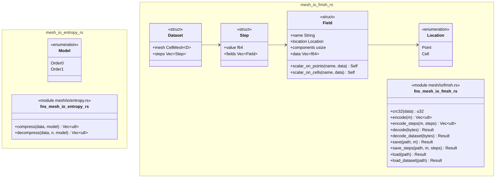

# Mesh files: code

C4 level 4 (code) of the component **Mesh files** (`femcore.meshio`) in the container **femcore** (crate `femcore`). [Component view of the container](../../3-components/femcore.md) · [All code pages](../README.md)

> The compact lossless .fmsh format for meshes and results and its entropy coder.

**Decisions:** [ADR 16](../../../adr/0016-fmsh-lossless-mesh-and-result-format.md)  
**Size:** 3 files, 878 lines.

## Files

| File | Lines | What it says about itself |
|---|---:|---|
| `crates/femcore/src/mesh/io/entropy.rs` | 206 | Small lossless byte-stream compressor: an adaptive binary range coder (the carry-propagating scheme used by LZMA) driven by an order-0 or order-1 byte model. Pure Rust, no dependencies. |
| `crates/femcore/src/mesh/io/fmsh.rs` | 667 | `.fmsh`: a compact, lossless, self-checking binary format for mixed-cell meshes and results. |
| `crates/femcore/src/mesh/io/mod.rs` | 5 | Mesh and result storage: the compact lossless `.fmsh` format (see [`fmsh`]). |

## What it uses

| Target | Modules | Items |
|---|---|---|
| [Mesh](./mesh.md) | mesh::cells | CellMesh, CellType |

## Used by

Nothing else in the workspace names this component (entry points are reached by the program or by tests).

## Class diagram

Public types with their public fields (or variants) and methods, free functions per file as a `module` box; arrows are field types and `impl Trait`. Capped at 36 types and a few members each; the table below is complete.

## Public items

| Kind | Item | File:line | Signature or summary |
|---|---|---|---|
| enum | `Model` | `mesh/io/entropy.rs:111` | variants: `Order0`, `Order1` —  Context model of the byte coder. |
| fn | `compress` | `mesh/io/entropy.rs:128` | `pub fn compress(data: &[u8], model: Model) -> Vec<u8>` —  Compress `data` with the given model (the length is not stored). |
| fn | `decompress` | `mesh/io/entropy.rs:146` | `pub fn decompress(data: &[u8], n: usize, model: Model) -> Vec<u8>` —  Inverse of [`compress`]; `n` is the number of bytes to produce. |
| fn | `crc32` | `mesh/io/fmsh.rs:58` | `pub fn crc32(data: &[u8]) -> u32` —  CRC-32 (IEEE, reflected, polynomial 0xEDB88320), bitwise implementation. |
| enum | `Location` | `mesh/io/fmsh.rs:103` | variants: `Point`, `Cell` —  Where a field lives. |
| struct | `Field` | `mesh/io/fmsh.rs:111` | fields: `name`, `location`, `components`, `data` —  A named array of `components` values per point or per cell (component-major per entity: |
| struct | `Step` | `mesh/io/fmsh.rs:129` | fields: `value`, `fields` —  Fields at one time / frequency / iteration value. |
| struct | `Dataset` | `mesh/io/fmsh.rs:136` | fields: `mesh`, `steps` —  A mesh with optional result steps. |
| fn | `encode` | `mesh/io/fmsh.rs:375` | `pub fn encode<const D: usize>(m: &CellMesh<D>) -> Vec<u8>` —  Encode a mesh without results. |
| fn | `encode_steps` | `mesh/io/fmsh.rs:380` | `pub fn encode_steps<const D: usize>(m: &CellMesh<D>, steps: &[Step]) -> Vec<u8>` —  Encode a mesh with result steps. Panics if a field's length does not match its location. |
| fn | `decode` | `mesh/io/fmsh.rs:419` | `pub fn decode<const D: usize>(bytes: &[u8]) -> Result<CellMesh<D>, String>` —  Decode a mesh (results, if any, are ignored), verifying the checksum. |
| fn | `decode_dataset` | `mesh/io/fmsh.rs:424` | `pub fn decode_dataset<const D: usize>(bytes: &[u8]) -> Result<Dataset<D>, String>` —  Decode a mesh and its result steps, verifying the checksum. |
| fn | `save` | `mesh/io/fmsh.rs:485` | `pub fn save<const D: usize>(path: &std::path::Path, m: &CellMesh<D>) -> std::io::Result<()>` —  Write a mesh to a file. |
| fn | `save_steps` | `mesh/io/fmsh.rs:490` | `pub fn save_steps<const D: usize>(path: &std::path::Path, m: &CellMesh<D>, steps: &[Step]) -> std::io::Result<()>` —  Write a mesh with result steps to a file. |
| fn | `load` | `mesh/io/fmsh.rs:495` | `pub fn load<const D: usize>(path: &std::path::Path) -> Result<CellMesh<D>, String>` —  Read a mesh from a file. |
| fn | `load_dataset` | `mesh/io/fmsh.rs:500` | `pub fn load_dataset<const D: usize>(path: &std::path::Path) -> Result<Dataset<D>, String>` —  Read a mesh and its result steps from a file. |
| fn | `Field::scalar_on_points` | `mesh/io/fmsh.rs:119` | `pub fn scalar_on_points(name: &str, data: Vec<f64>) -> Self` |
| fn | `Field::scalar_on_cells` | `mesh/io/fmsh.rs:122` | `pub fn scalar_on_cells(name: &str, data: Vec<f64>) -> Self` |
